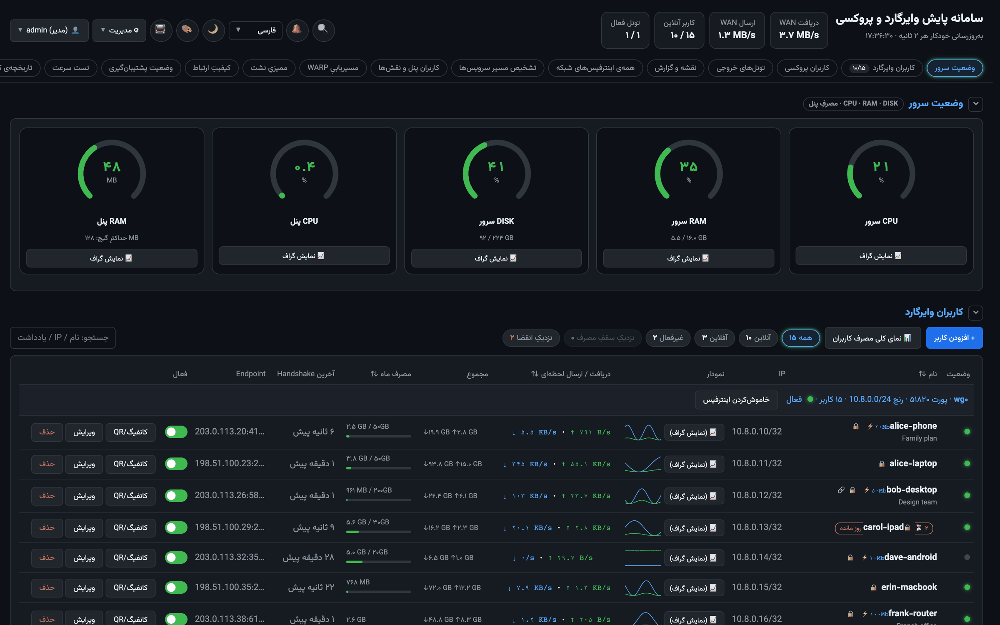
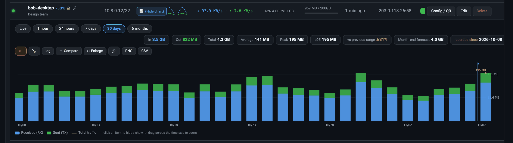
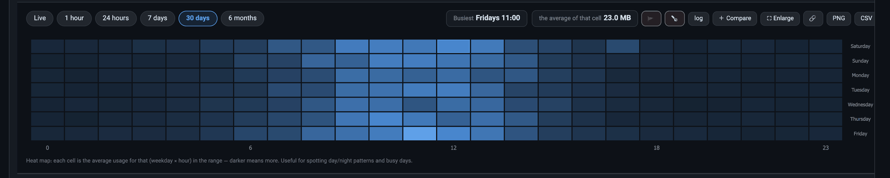
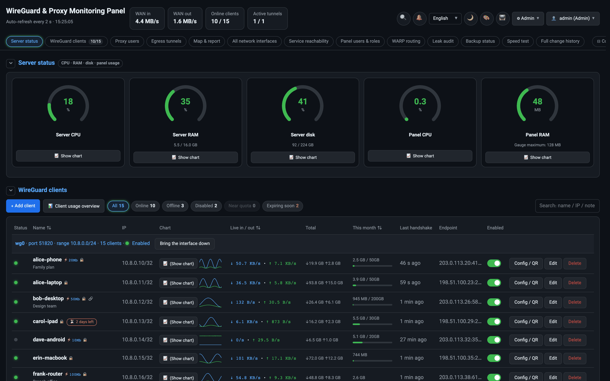
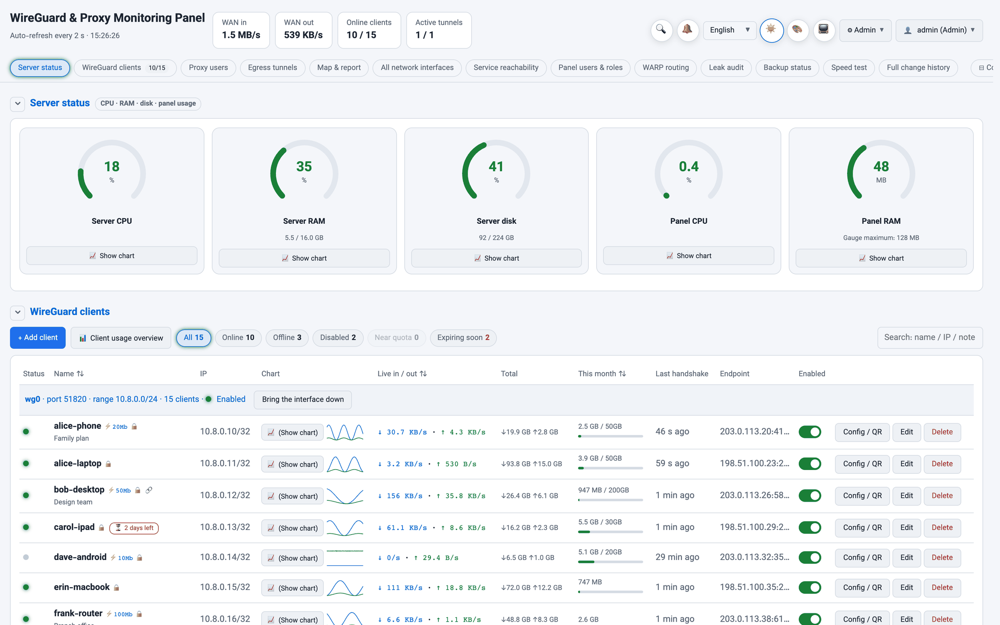
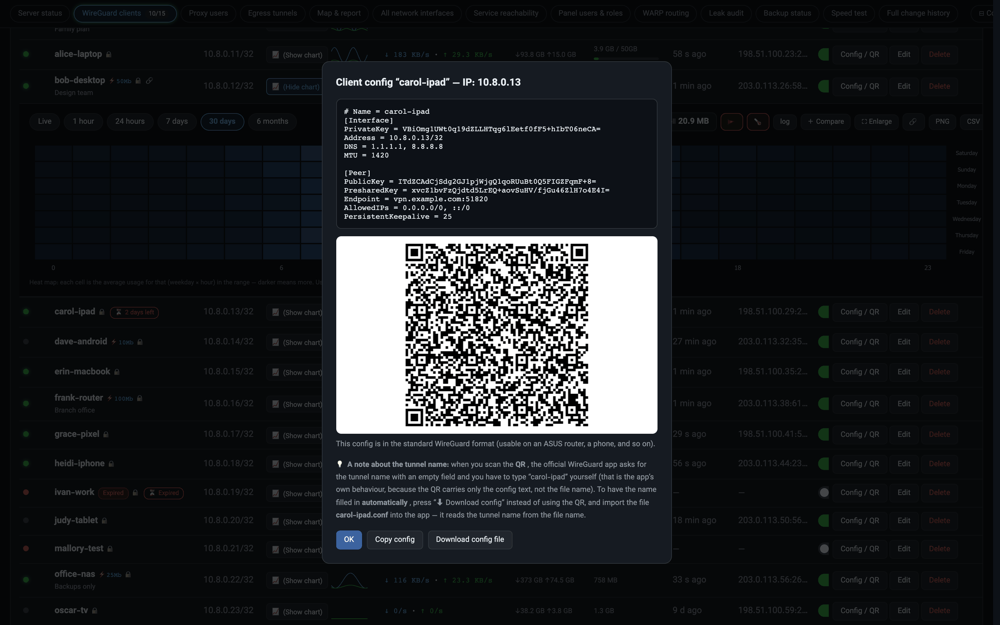
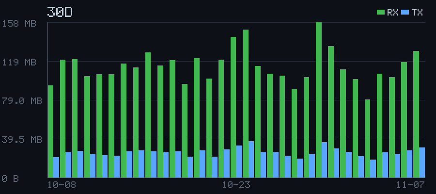
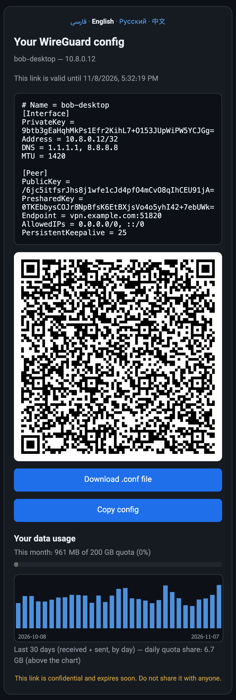
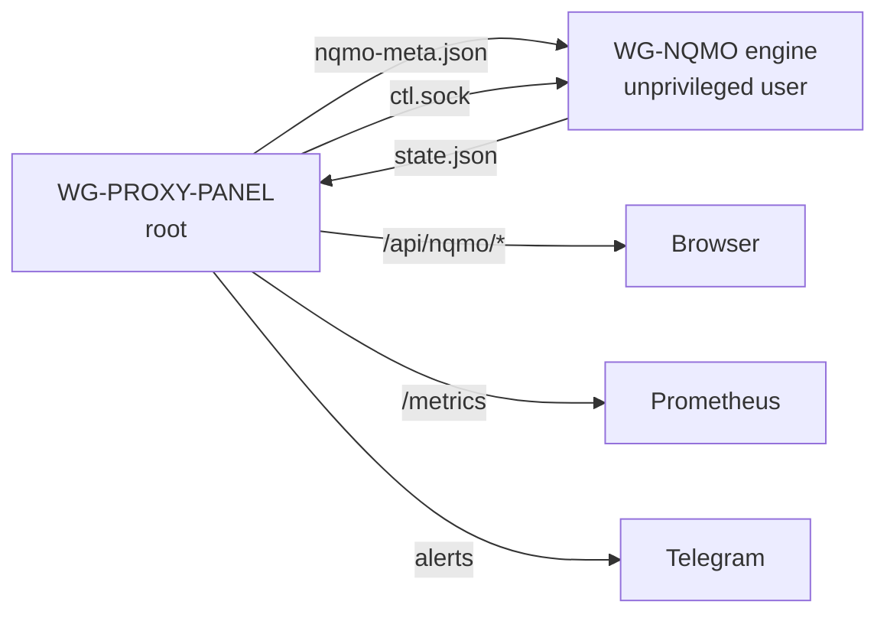

<div align="center">

# WG-PROXY-PANEL

**پنلِ تحتِ وب برای پایش و مدیریتِ WireGuard و پروکسیِ Squid، با استقرارِ تک‌فایلی.**<br>
فقط کتابخانه‌ی استانداردِ پایتون — بدونِ بسته‌ی pip، بدونِ مرحله‌ی build، با چهار زبان.

[](https://github.com/alibakhtiari-ux/WG-PROXY-PANEL/actions/workflows/verify.yml)
[](LICENSE)


[English](README.md) · **فارسی** · [Русский](README.ru.md) · [中文](README.zh-CN.md)

</div>

---

کلِ برنامه به‌صورتِ یک فایل مستقر می‌شود، `wg_panel.pyz`، و **جز کتابخانه‌ی استانداردِ پایتون**
به هیچ چیزی نیاز ندارد. آن را به‌صورتِ سرویسِ systemd (یا در کانتینرِ Docker ِ
همراهِ پروژه) اجرا کنید تا یک پنلِ وب برای اینترفیس‌های WireGuard ِ همان سرور
داشته باشید: ترافیکِ زنده‌ی هر کاربر، افزودن و غیرفعال‌کردنِ کاربر، کدِ QR و
لینکِ اشتراک، محدودیتِ سرعت و حجم، نمودارهای حرفه‌ای، بکاپ، تاریخچه‌ی
تغییرات، رباتِ تلگرامِ پیشرفته و متریک‌های Prometheus.

این پنل برای سروری ساخته شده که نه Docker دارد نه pip؛ پس نصبِ آن یعنی
کپی‌کردنِ یک فایل.

<p align="center">
  
</p>
<p align="center"><sub>همه‌ی تصاویرِ این صفحه داده‌ی ساختگیِ نمایشی دارند — بخشِ <a href="#screenshots">تصاویر</a> را ببینید.</sub></p>

## فهرست

- [تصاویر](#screenshots)
- [امکانات](#features)
- [موتورِ نمودار](#chart-engine)
- [کیفیتِ ارتباط (WG-NQMO)](#wg-nqmo)
- [زبان‌ها](#languages)
- [پیش‌نیازها](#requirements)
- [شروعِ سریع با Docker](#quick-start-with-docker)
- [نصب با systemd](#install-with-systemd)
- [به‌روزرسانی](#upgrading)
- [پیکربندی](#configuration)
- [راه‌اندازیِ رباتِ تلگرام](#telegram-bot-setup)
- [پروکسیِ Squid](#squid-proxy)
- [بکاپ](#backups)
- [TLS و reverse proxy](#tls-and-reverse-proxies)
- [Prometheus](#prometheus)
- [امنیت](#security)
- [اتصال‌های خروجی](#outbound-connections)
- [محدودیت‌ها](#limitations)
- [رفعِ اشکال](#troubleshooting)
- [حذفِ نصب](#uninstalling)
- [توسعه](#development)
- [ساختارِ مخزن](#repository-layout)
- [مشارکت](#contributing)
- [حمایت از پروژه](#support)
- [مجوز](#license)

<a id="screenshots"></a>

## تصاویر

<table>
  <tr>
    <td width="50%" valign="top">
      <a href="docs/screenshots/client-chart.png"></a>
      <p align="center"><b>نمودارِ ترافیکِ هر کاربر</b><br><sub>مصرفِ روزانه‌ی ۳۰ روز با میانگین، اوج، p95، مقایسه با بازه‌ی قبل و پیش‌بینیِ آخرِ ماه</sub></p>
    </td>
    <td width="50%" valign="top">
      <a href="docs/screenshots/heatmap.png"></a>
      <p align="center"><b>نقشه‌ی حرارتیِ روزِ هفته × ساعت</b><br><sub>کاربر چه زمانی از اتصال استفاده می‌کند، و پرترافیک‌ترین ساعتش</sub></p>
    </td>
  </tr>
  <tr>
    <td width="50%" valign="top">
      <a href="docs/screenshots/overview.png"></a>
      <p align="center"><b>انگلیسی، چپ‌به‌راست</b><br><sub>همان پنل به انگلیسی — یکی از چهار زبانِ رابط</sub></p>
    </td>
    <td width="50%" valign="top">
      <a href="docs/screenshots/light.png"></a>
      <p align="center"><b>تمِ روشن</b><br><sub>تمِ تیره و روشن، با یک دکمه در نوارِ بالا</sub></p>
    </td>
  </tr>
  <tr>
    <td width="50%" valign="top">
      <a href="docs/screenshots/config-qr.png"></a>
      <p align="center"><b>کانفیگ و کدِ QR ِ کاربر</b><br><sub>کپی کنید، فایلِ <code>.conf</code> را دانلود کنید یا QR را اسکن کنید</sub></p>
    </td>
    <td width="50%" valign="top">
      <a href="docs/screenshots/telegram-chart.png"></a>
      <p align="center"><b>نمودار از رباتِ تلگرام</b><br><sub>ربات خودش PNG را می‌کشد، با پایتونِ خالص</sub></p>
    </td>
  </tr>
</table>

<p align="center">
  <a href="docs/screenshots/share-mobile.png"></a><br>
  <b>صفحه‌ی اشتراک روی گوشی</b><br><sub>آنچه گیرنده‌ی لینکِ اشتراک می‌بیند: کانفیگ، کدِ QR، دکمه‌ی دانلود و مصرفِ خودش</sub>
</p>

> [!NOTE]
> این تصاویر از یک پنلِ واقعیِ در حالِ اجرا گرفته شده‌اند که با **داده‌ی
> ساختگی** پر شده است: نام‌های ساختگی برای کاربران، کلیدهای تولیدشده، دامنه‌ی
> نمونه‌ی `vpn.example.com` و آدرس‌های IP از بازه‌های مستندسازیِ RFC 5737. هیچ
> سرور، کاربر یا کلیدِ واقعی‌ای در آن‌ها نیست. همه‌شان با
> `python3 demo/screenshots.py` از نو ساخته می‌شوند.

<a id="features"></a>

## امکانات

### محدودیتِ سرعت و حجم برای هر کاربرِ WireGuard

- **محدودیتِ سرعت برای هر کاربر** بر حسبِ مگابیت‌برثانیه، که در خودِ کرنلِ
  لینوکس با `tc htb` اعمال می‌شود — دانلود روی خودِ اینترفیسِ WireGuard و آپلود
  از طریقِ یک دستگاهِ `ifb` محدود می‌شود. کاملاً اختیاری است: تا وقتی کسی را
  محدود نکرده‌اید، پنل اصلاً به `tc` دست نمی‌زند و کاربرانِ بدونِ محدودیت هیچ
  اثری نمی‌بینند.
- **سهمیه‌ی حجمِ ماهانه**، **سقفِ حجمِ کل** و **تاریخِ انقضا** برای هر کاربر.
- وقتی کاربر به یکی از این سقف‌ها برسد، پنل خودش اقدام می‌کند: کاربر را
  **غیرفعال** (پیش‌فرض) یا **حذف** می‌کند، رویداد را در تاریخچه ثبت می‌کند و
  هشدارِ تلگرام می‌فرستد. حساب‌هایی که به انقضا نزدیک‌اند (به‌طورِ پیش‌فرض ۳
  روز مانده) هم گزارش می‌شوند.
- کاربرانِ پروکسیِ Squid هم همین امکانات را دارند: سهمیه، محدودیتِ سرعت و
  تاریخِ انقضا.

### نمودارهای حرفه‌ای

- موتورِ نمودارِ اختصاصی روی canvas، بدونِ هیچ کتابخانه‌ی نمودار: نمودارِ خطی
  و میله‌ای روی محورِ زمانِ واقعی، **زوم**، **مقیاسِ لگاریتمی**، نمایشِ وقفه در
  جاهایی که داده نیست، نمایشِ مقدار با نگه‌داشتنِ ماوس، روشن و خاموش‌کردنِ هر
  سری، و نمای تمام‌صفحه
- بازه‌های زمانی: **زنده، ۱ ساعت، ۲۴ ساعت، ۷ روز، ۳۰ روز و ۶ ماه**
- نمودارِ ترافیک برای هر کاربر، هر اینترفیس و هر تونلِ خروجی
- **نقشه‌ی حرارتیِ «روزِ هفته × ساعت»** که نشان می‌دهد هر کاربر چه زمانی از
  اتصال استفاده می‌کند
- گیج‌های زنده‌ی CPU، حافظه و دیسک؛ نمودارِ تأخیر و مسیریابیِ WARP
- نمودارِ مصرف در هر صفحه‌ی اشتراک، تا خودِ کاربر مصرفش را ببیند

چطور کار می‌کند و چه کارهایی می‌کند: [موتورِ نمودار](#chart-engine).

### رباتِ تلگرامِ پیشرفته

ربات داخلِ همان پروسه‌ی پنل اجرا می‌شود و سرویسِ جداگانه‌ای لازم ندارد. یک راهِ
دومِ کامل برای مدیریتِ سرور است — بدونِ SSH و بدونِ مرورگر:

- **۱۸ دستور** (یکی از آن‌ها، `/botwatch`، فقط برای مالک) و منوی دکمه‌ای: ساختن، نمایش، تغییرِ نام، فعال/غیرفعال‌کردن و
  حذفِ کاربرانِ WireGuard و پروکسی؛ تعیینِ **سهمیه** و **محدودیتِ سرعت**؛
  فرستادنِ **فایلِ کانفیگ** و **کدِ QR**
- **نمودار به‌صورتِ تصویر** — ربات خودش فایلِ PNG را می‌کشد (پایتونِ خالص، بدونِ
  کتابخانه‌ی تصویر): ترافیکِ هر کاربر (۲۴ ساعت / ۷ روز / ۳۰ روز / ۶ ماه)،
  ترافیکِ پروکسی و تستِ سرعت، همراه با مجموع، میانگین و بیشینه در توضیحِ تصویر
- کاربرانِ آنلاین، جست‌وجو، گزارش بر اساسِ انقضا و بر اساسِ مصرف، وضعیتِ بکاپ،
  تستِ سرعت، و خلاصه‌ی روزانه یا هفتگی
- **۱۱ نوع هشدار**: قطع و وصلِ تونل‌های خروجی، رسیدن به سهمیه، نزدیک‌شدنِ
  انقضا، بالا بودنِ CPU/RAM/دیسک، مصرفِ swap، تلاش‌های ناموفقِ مکررِ ورود،
  شکستِ آپلودِ بکاپ، افتِ سرعت، ری‌استارتِ پنل و موارد دیگر
- **تأییدِ ورود به پنل** با یک لمس در تلگرام (اختیاری)
- نقش برای کاربرانِ ربات (`owner`، `admin`، `viewer`) و زبانِ جداگانه برای هر
  کاربر (`/lang`)

### امکاناتِ دیگر

**کاربران**

- وضعیتِ آنلاین/آفلاین از روی زمانِ آخرین هندشیک، و ترافیکِ زنده‌ی دریافت و
  ارسالِ هر کاربر (نمونه‌برداری هر ۲ ثانیه)
- افزودنِ کاربر (ساختِ جفت‌کلید و انتخابِ یک آدرسِ آزاد از بازه) و حذفِ کاربر
- فعال یا غیرفعال‌کردنِ کاربر هم روی اینترفیسِ زنده **و** هم در فایلِ کانفیگ،
  تا تغییر پس از ری‌استارت هم بماند
- کانفیگِ آماده‌ی کاربر با دکمه‌ی کپی، دانلود و کدِ QR
- **لینکِ اشتراک** — صفحه‌ای مستقل با کدِ QR، دکمه‌ی دانلود و نمودارِ مصرف،
  برای فرستادنِ کانفیگ به دیگران. اعتبارِ لینک از ۱ دقیقه تا ۲۴ ساعت است،
  می‌تواند یک‌بارمصرف باشد و قابلِ لغو است. زبانِ صفحه از مرورگرِ گیرنده
  انتخاب می‌شود.

**سرور**

- وضعیتِ تونل‌های خروجی: endpoint، سرعتِ زنده و وضعیتِ یونیتِ systemd
- پشتیبانی از اینترفیس‌های WireGuard و AmneziaWG
- مدیریتِ کاربرانِ پروکسیِ Squid — نگاه کنید به [پروکسیِ Squid](#squid-proxy)
- وضعیتِ Cloudflare WARP، و یک سرویسِ اختیاریِ تفکیکِ SNI که اتصال‌ها را بر
  اساسِ نامِ میزبانِ مقصد مسیردهی می‌کند (این دو به اسکریپت‌هایی نیاز دارند که
  در این مخزن نیستند — نگاه کنید به [محدودیت‌ها](#limitations))
- کیفیتِ ارتباطِ هر کاربر (رفت‌وبرگشت، گم‌شدنِ بسته، MTU) با تشخیص و هشدار، از طریقِ
  موتورِ جدای WG-NQMO که هنوز منتشر نشده است؛ پیش‌فرض خاموش — نگاه کنید به
  [کیفیتِ ارتباط (WG-NQMO)](#wg-nqmo)
- ممیزیِ نشتِ فقط‌خواندنی (مسیریابی؛ و DNS و IPv6 از طریقِ رباتِ تلگرام)
- بکاپ و بازیابی؛ هر فایلِ کانفیگ پیش از نوشتن خودکار بکاپ گرفته می‌شود و
  نوشتن اتمیک است
- تاریخچه‌ی همه‌ی کارها: چه کسی، چه کاری، با چه نتیجه‌ای
- نمای تلویزیون/کیوسک که صفحه‌های وضعیت را به‌نوبت نشان می‌دهد، همراه با یک
  نمای سه‌بعدیِ شبکه

**دسترسی**

- چند کاربر؛ نقش‌های داخلیِ `admin` و `viewer` به‌علاوه‌ی نقش‌های سفارشی که از
  فهرستی از مجوزهای جزئی ساخته می‌شوند
- ورودِ دومرحله‌ایِ اختیاری با TOTP، و تأییدِ اختیاریِ هر ورود به پنل از
  طریقِ تلگرام
- کوکیِ نشستِ امضاشده، محدودیتِ تعدادِ تلاشِ ورود، فهرستِ مجازِ IP (اختیاری)
- متریک‌های Prometheus در `/metrics`، محافظت‌شده با توکنِ Bearer

<a id="chart-engine"></a>

## موتورِ نمودار

همه‌ی نمودارهای پنل را یک موتورِ رسمِ کوچک می‌کشد که برای همین پروژه از صفر
نوشته شده است: Canvas 2D ِ خالص، در حدودِ دو هزار خط JavaScript داخلِ
`wgpanel/app.py`. هیچ کتابخانه‌ی نمودار و هیچ CDN‌ای در کار نیست، پس روی سرورِ
بدونِ اینترنت هم کار می‌کند. موتور داده‌ای را که می‌کشد می‌شناسد: می‌داند
سهمیه چیست، کاربر کِی غیرفعال شده و یک تونل در ده ثانیه‌ی گذشته چند بایت
جابه‌جا کرده است.

### چه چیزهایی می‌کشد

| نمودار | کجا | چه نشان می‌دهد |
|---|---|---|
| ترافیک | هر کاربر، هر اینترفیس و هر تونلِ خروجی | دریافت و ارسال به‌علاوه‌ی یک خطِ خط‌چینِ مجموع؛ برای «زنده» و «۱ ساعت» خطی، از ۲۴ ساعت به بالا میله‌ای |
| نقشه‌ی حرارتی | هر نمودارِ ترافیک، بازه‌ی ۷ یا ۳۰ روز | میانگینِ مصرف در هر ساعت از هر روزِ هفته، و پرترافیک‌ترین ساعت |
| تفکیکِ کاربران | هر اینترفیسِ WireGuard | سهمِ هر کاربر از ترافیکِ اینترفیس: ۷ کاربرِ اول، و بقیه با هم زیرِ «سایر» |
| مقایسه | هر مجموعه‌ای از نمودارها که انتخاب کنید | چند کاربر، تونل یا اینترفیس به‌صورتِ خط روی یک محورِ مشترک |
| نمای کلی مصرف | بخشِ کاربرانِ وایرگارد | مصرفِ انباشته‌ی همه‌ی کاربرانِ یک اینترفیس در طولِ زمان |
| گیج‌های سرور | CPU، RAM، دیسک، CPU و RAM ِ پنل | تاریخچه‌ی پشتِ هر گیج |
| تستِ سرعت | بخشِ تستِ سرعت | دانلود و آپلود به Mbit/s، و پینگ روی محورِ دوم |
| WARP | بخشِ WARP | زمانِ پاسخ در مسیرِ مستقیم در برابرِ WARP، و سهمِ ترافیکی که به سرویس‌های هوشِ مصنوعی می‌رود |
| کیفیتِ مسیر | تشخیصِ مسیرِ سرویس‌ها | کیفیتِ تماس (MOS) و زمانِ رفت‌وبرگشت برای هر مسیرِ سنجیده‌شده |
| صفحه‌ی اشتراک | صفحه‌ای که لینکِ اشتراک باز می‌کند | مصرفِ ۳۰ روزِ اخیرِ خودِ گیرنده، و اگر سهمیه دارد، سهمِ روزانه‌اش |

### عددها از کجا می‌آیند

| بازه | هر نقطه یعنی | نگهداری |
|---|---|---|
| زنده | یک نمونه‌ی ۲ ثانیه‌ای | ۳ دقیقه‌ی اخیر، در حافظه |
| ۱ ساعت | میانگینِ ۱۰ ثانیه | یک ساعتِ اخیر، در حافظه (با ری‌استارت از نو شروع می‌شود) |
| ۲۴ ساعت | یک ساعت | حدودِ ۲۱ روز، در SQLite |
| ۷ روز · ۳۰ روز · ۶ ماه | یک روز | حدودِ ۴۰۰ روز، در SQLite؛ نمای ۶ ماه می‌تواند روزها را هفتگی جمع کند |

مصرفِ کاربرانِ پروکسی از لاگِ دسترسیِ Squid حساب می‌شود و از نمای ۲۴ ساعت
شروع می‌شود. نقشه‌ی حرارتی از ردیف‌های ساعتی ساخته می‌شود، پس تا حدودِ ۲۱ روز
به عقب را می‌بیند.

### عددهای بالای هر نمودار

- **دریافت، ارسال، مجموع**: در «زنده» و «۱ ساعت» سرعتِ همین لحظه؛ در
  بازه‌های بلندتر جمعِ کلِ بازه.
- **میانگین** و **اوج**، و **p95**: مقداری که ۹۵٪ ِ ساعت‌ها یا روزهای بازه
  زیرِ آن می‌مانند. به همین دلیل یک جهشِ تکی بر آن غالب نمی‌شود.
- **نسبت به بازه قبل**: تغییر نسبت به دوره‌ی هم‌طولِ درست قبل از آن. ▲ ِ
  کهربایی یعنی بیشتر، ▼ ِ سبز یعنی کمتر.
- **پیش‌بینی پایان ماه**، برای کاربرانِ دارای سهمیه‌ی ماهانه. مصرفِ ماه تا
  امروز را روی کلِ ماه پخش می‌کند، و اگر آهنگِ مصرف زیاد باشد هشدارِ «~N روز
  تا اتمام سهمیه» می‌دهد.
- **ثبت‌شده از**: اولین روزی که داده دارد، تا تاریخچه‌ی کوتاه با مصرفِ کم
  اشتباه گرفته نشود.

روی خودِ نمودار، یک نقطه‌ی طلایی اوج را نشان می‌دهد، و برای کاربرانِ دارای
سهمیه یک خطِ خط‌چین در ارتفاعِ سهمِ روزانه‌ی آن کشیده می‌شود.

### کار با نمودار

- **نگه‌داشتنِ نشانگر** روی نمودار همه‌ی سری‌ها را در همان لحظه نشان می‌دهد.
  اگر چند نمودار باز باشد، همه همان لحظه را دنبال می‌کنند.
- **زوم**: روی نمودار بکشید تا یک بازه‌ی زمانی انتخاب شود، یا از چرخِ ماوس
  استفاده کنید. روی گوشی، با دو انگشت باز و بسته کنید. وقتی زوم شده است،
  کشیدن نمودار را روی محورِ زمان جابه‌جا می‌کند. دوبار کلیک یا **↺ کل بازه**
  زوم را برمی‌دارد. محورِ عمودی خودش را با بخشِ دیده‌شده تنظیم می‌کند.
- **کلیک روی هر آیتمِ راهنما** آن سری را پنهان یا آشکار می‌کند.
- **log** مقیاس را لگاریتمی می‌کند تا یک کاربرِ کم‌مصرف و یک کاربرِ پرمصرف
  روی یک نمودار خوانا باشند.
- **🚩** تغییراتِ ثبت‌شده در تاریخچه را روی محورِ زمان علامت می‌زند: قرمز
  وقتی کاربری غیرفعال یا تونلی قطع می‌شود، سبز وقتی چیزی برمی‌گردد، آبی برای
  بقیه‌ی تغییرات. روی نمودارِ تونل، مدتِ قطعی هم با سایه‌ی قرمز مشخص می‌شود.
  با بردنِ نشانگر نزدیکِ پرچم می‌بینید چه شد، چه کسی انجامش داد و چرا.
  نمودارِ اینترفیسِ WARP رویدادهای خودِ WARP را هم نشان می‌دهد، مثلِ سوییچ
  به کلیدِ استندبای.
- **⛶ بزرگ‌نمایی** نمودار را تمام‌صفحه باز می‌کند و **＋ مقایسه** آن را به
  مقایسه اضافه می‌کند.
- **🔗** لینکِ دقیقاً همین نما را کپی می‌کند: همین نمودار، بازه، زوم، و حالتِ
  لگاریتمی، حرارتی یا تفکیکِ کاربران.
- **PNG** نمودار را با وضوحِ کاملِ صفحه و عنوانش ذخیره می‌کند. **CSV**
  ردیف‌های خام را با UTF-8 ذخیره می‌کند، آماده برای صفحه‌گسترده.

بازه، مقیاس و سری‌های پنهانِ هر نمودارِ باز در مرورگر به خاطر سپرده می‌شوند.

### صادق، از پایه

- از نمای ۱ ساعت به بالا، محورِ زمان زمانِ واقعی است: ساعتی که داده ندارد
  خالی می‌ماند، و جایی که داده نیست خط قطع می‌شود، نه اینکه از رویِ جای خالی
  رد شود.
- در نمای ۱ ساعت، کاربرِ ساکت یک خطِ صفرِ واقعی است، نه جای خالی: پنل سکوت را
  هم ثبت می‌کند.
- محورها با گام‌های گرد (۱، ۲، ۲٫۵ یا ۵ × ۱۰ⁿ) درجه‌بندی می‌شوند و بایت‌ها
  با توان‌های ۱۰۲۴. سرعت‌ها بایت بر ثانیه‌اند؛ تستِ سرعت به Mbit/s است.
- نمودارها با تراکمِ پیکسلِ واقعیِ صفحه کشیده می‌شوند، پس روی نمایشگرهای
  پرتراکم هم تیز می‌مانند، و با تغییرِ اندازه‌ی پنجره از نو کشیده می‌شوند.
- داده هر ۲ ثانیه تازه می‌شود، ولی وقتی نشانگر روی نمودار است مکث می‌کند تا
  نمودار زیرِ دستتان جابه‌جا نشود.

### رنگ‌ها و زبان‌ها

نمودارها رنگشان را از تمِ صفحه می‌گیرند، پس با تمِ تیره و روشن هماهنگ‌اند.
دکمه‌ی **🎨** یک پالتِ مناسبِ کوررنگی (Okabe–Ito) را روشن می‌کند، که در آن
خطِ ارسال خط‌چین هم می‌شود تا سری‌ها علاوه بر رنگ، در شکل هم فرق داشته
باشند. در زبانِ فارسی نمودارها ارقامِ فارسی دارند، و نمودارهای تستِ سرعت،
کیفیتِ مسیر و WARP تاریخ را به تقویمِ شمسی نشان می‌دهند.

### نمودار در تلگرام

رباتِ تلگرام مرورگر ندارد، پس پنل نمودار را روی خودِ سرور هم می‌کشد، با
پایتونِ خالص. یک بافرِ پیکسلی را پر می‌کند، خط‌ها و میله‌ها را در آن می‌کشد،
برچسب‌ها را با یک فونتِ بیت‌مپیِ داخلی می‌نویسد، و نتیجه را با `zlib` در یک
PNG بسته‌بندی می‌کند. تصویر ۹۰۰ × ۴۰۰ است، میله‌ای یا خطی. همین تصاویر در
نمودارهای کاربر و پروکسیِ ربات و در گزارشِ دوره‌ای فرستاده می‌شوند.

<a id="wg-nqmo"></a>

<div dir="rtl">

## کیفیتِ ارتباط (WG-NQMO)

کاربری می‌گوید ارتباطش کند است یا مدام قطع می‌شود. علت شبکه‌ی خودِ اوست، سرور،
یک تونلِ خروجی، MTU، یا فقط محدودیتِ سرعتی که خودتان برایش گذاشته‌اید؟ این موتور
همین را از سمتِ سرور و برای هر کاربر جداگانه پاسخ می‌دهد، با شواهد و با سطحِ
اطمینانِ صریح. روی دستگاهِ کاربر چیزی نصب نمی‌شود.

این موتور برنامه‌ای جداست. زمانِ رفت‌وبرگشتِ هندشیکِ WireGuard، گم‌شدنِ بسته در
مسیرِ بالارو (کاربر به سرور) و مقدارِ MTU کاربر را می‌پاید، خرابی را تشخیص می‌دهد و
می‌تواند MTU مناسب را پیشنهاد کند. تشخیص‌ها و پیشنهادها فقط گزارش‌اند: موتور هیچ
تنظیمی را خودکار عوض نمی‌کند.

> [!NOTE]
> **موتور بخشی از این مخزن نیست و هنوز منتشر نشده است.** نسخه‌ی 1.3.0 فقط سمتِ پنل
> را می‌آورد: قلاب‌هایی که گزارشِ موتور را نشان می‌دهند و داده‌ی خودِ پنل و فرمان‌های
> مدیر را به آن می‌رسانند. بدونِ موتور، این قلاب‌ها چیزی برای نشان‌دادن ندارند. پیش‌فرضشان
> خاموش است؛ پس پنلِ بدونِ موتور طوری کار می‌کند که انگار این قلاب‌ها وجود ندارند.



### چه چیزی می‌بینید

- **در پنل.** بخشِ **کیفیتِ ارتباط** حالتِ موتور و سنِ داده‌اش، جمع‌آورها (سالم، خطا
  یا خاموش)، پوشش، اندازه‌ی پایگاهِ داده، تشخیص‌های سراسری و یافته‌های پیکربندی را نشان
  می‌دهد؛ به‌علاوه‌ی جدولِ کاربران با کیفیت، میانه‌ی رفت‌وبرگشت، گم‌شدنِ بسته‌ی بالارو،
  وضعیتِ MTU و تشخیص‌های باز، و ۵۰ رویدادِ آخر.
- **برای هر کاربر.** با کلیک روی هر کاربر، ۱۵ دقیقه‌ی اخیرش، تشخیص‌ها با شواهدشان و
  توصیه‌ها با دلیل و محدودیتشان باز می‌شود. پنجره‌ی ویرایشِ کاربر هم همین محتوا را در
  بخشِ **کیفیت و MTU (WG-NQMO)** دارد.
- **در تلگرام.** تشخیصِ تازه، تشدیدشده یا برطرف‌شده هشدار می‌شود.
- **در Prometheus.** همین عددها به‌صورتِ سری‌های <span dir="ltr">`wg_nqmo_*`</span>، با نمونه‌ی پرس‌وجو در
  [مرجع](#wg-nqmo-reference).

بخش هر ۳۰ ثانیه تازه می‌شود، فقط وقتی زبانه‌ی مرورگر دیده می‌شود. عددی که موتور
گزارش نکرده «—» نشان داده می‌شود، هرگز ۰.

سه دکمه روی موتور اثر می‌گذارند: **دیدم** روی هر تشخیص، آزمونِ MTU و تغییرِ حالت.
هرکدام پیش از اجرا تأیید می‌خواهد و، پذیرفته یا ردشده، در تاریخچه ثبت می‌شود.

### روشن و خاموش‌کردن

قلاب‌ها فقط وقتی روشن‌اند که در فایلِ `config.json` زیرِ `nqmo.enabled` مقدارِ
`true` به‌صورتِ مقدارِ JSON باشد؛ <span dir="ltr">`"true"`</span>، `1` یا نبودنِ کلید همه یعنی خاموش. تا
وقتی خاموش‌اند:

- پنل برای موتور هیچ چیزی نمی‌خوانَد و نمی‌نویسد؛
- مسیرهای <span dir="ltr">`/api/stats`</span> و <span dir="ltr">`/metrics`</span> دقیقاً همان پاسخی را می‌دهند که بدونِ این قلاب‌ها
  می‌دادند؛
- شش مسیرِ <span dir="ltr">`/api/nqmo/*`</span> فقط خطای «موتور خاموش است» (<span dir="ltr">`"disabled": true`</span>) برمی‌گردانند؛
- صفحه هیچ درخواستی برای این موتور نمی‌فرستد و هیچ بخشی از آن را نشان نمی‌دهد، و گروهِ
  مجوز و نوعِ هشدارش پنهان‌اند. ذخیره‌ی یک نقش یا تنظیماتِ هشدار مقدارهای ذخیره‌شده‌ی
  آن را نگه می‌دارد.

برای روشن‌کردن، وقتی موتور نصب است، این را به `config.json` اضافه کنید:

```json
"nqmo": {"enabled": true, "user_iface": "wg0"}
```

1. مقدارِ `user_iface` را اینترفیسِ WireGuard ای بگذارید که کاربران به آن وصل می‌شوند؛
   پنل MTU و نشانِ فایروالِ آن را به موتور گزارش می‌دهد. پیش‌فرض `wg1udp` است. اگر
   اینترفیسی با این نام نباشد، پنل برای موتور چیزی نمی‌نویسد؛ پس نامِ اینترفیسِ خودتان
   را بگذارید.
2. پنل را ری‌استارت کنید.
3. به کسانی که لازم دارند مجوزِ `nqmo.view` بدهید. نقشِ داخلیِ `admin` همه‌ی مجوزهای
   این بخش را دارد و نقشِ داخلیِ `viewer` هیچ‌کدام را.
4. ببینید <span dir="ltr">`/metrics`</span> مقدارِ `wg_nqmo_up 1` را گزارش می‌دهد. اگر ۰ بود، سریِ
   <span dir="ltr">`wg_nqmo_unavailable{why}`</span> دلیلش را می‌گوید؛ [رفعِ اشکال](#wg-nqmo-troubleshooting) را
   ببینید.

روشن‌کردنِ قلاب‌ها بدونِ موتور آسیبی نمی‌زند: بخش می‌گوید موتور هنوز خروجی‌ای ننوشته
است.

برای خاموش‌کردن، `enabled` را `false` کنید یا کلید را بردارید و پنل را ری‌استارت کنید.
پنل دیگر فایلش را برای موتور تازه نمی‌کند. موتور را متوقف نمی‌کند، فایل‌هایش را پاک
نمی‌کند، و مقدارهای ذخیره‌شده‌ی نقش‌ها و هشدارها همان‌طور می‌مانند.

### حالت‌های موتور

موتور با **فقط مشاهده** شروع می‌کند و بالا رفتنش دستی است، تا پیش از آنکه چیزی بگوید
ببینید چه می‌سنجد. حالت فقط یک پله جابه‌جا می‌شود؛ پنل و موتور هر دو پرش را رد می‌کنند.

| حالت | در پنل | تلگرام | توصیه و آزمونِ MTU |
|---|---|---|---|
| **فقط مشاهده** (`OBSERVATION_ONLY`) | رفت‌وبرگشت و گم‌شدنِ بسته. تشخیص‌ها محاسبه و ذخیره می‌شوند ولی نشان داده نمی‌شوند | نه | نه |
| **تشخیص فعال** (`DIAGNOSTICS_ENABLED`) | به‌علاوه‌ی تشخیص‌ها و ستونِ کیفیت | تشخیصِ تازه با اطمینانِ متوسط یا بالا | نه |
| **توصیه فعال** (`RECOMMENDATIONS_ENABLED`) | به‌علاوه‌ی توصیه‌ها | مثلِ بالا | بله؛ آزمون باید در تنظیماتِ موتور هم مجاز باشد |

### خواندنِ نتیجه

**کیفیت** بدترین سطحِ اطمینان در میانِ تشخیص‌های بازِ یک کاربر است. نمره‌ی خودِ ارتباط
نیست: «سالم» یعنی هیچ قاعده‌ای مشکلی پیدا نکرده است.

| `wg_nqmo_peer_quality_state` | نمایش |
|---|---|
| ‎−۱ | داده‌ی ناکافی |
| ۰ | سالم، بدونِ تشخیص |
| ۱ | تشخیص با اطمینانِ کم |
| ۲ | تشخیص با اطمینانِ متوسط |
| ۳ | تشخیص با اطمینانِ بالا |

**تشخیص‌ها.** هر تشخیص دامنه، اطمینان، کیفیتِ داده و شواهدش را می‌گوید و، با مجوزِ
`nqmo.detail`، اینکه چه چیزی خلافش را نشان می‌دهد و چه توضیحِ دیگری ممکن است. تشخیص
ظنِ مستدل است، نه اثبات.

| کد | نمایش | دامنه | معنا |
|---|---|---|---|
| `SERVER_RESOURCE_BOTTLENECK` | گلوگاهِ منابعِ سرور | سراسری | خودِ سرور بسته حذف می‌کند: صف‌های کرنل، کارتِ شبکه، بافرهای UDP، جدولِ پیگیریِ اتصال یا حافظه‌ی بازسرهم‌کردن |
| `HANDSHAKE_FLOOD` | سیلِ هندشیک | سراسری | هندشیک بیش از توانِ هم‌زمانِ WireGuard می‌رسد |
| `EGRESS_TUNNEL_DEGRADATION` | افتِ کیفیتِ تونلِ خروجی | خروجی | یک تونلِ خروجی ناسالم است و کاربرانِ پشتش بی‌تقصیر آسیب می‌بینند |
| `TRAFFIC_SHAPING_EFFECT` | اثرِ محدودیتِ سرعت | دستگاه | کاربر به سقفِ سرعتی رسیده که در پنل گذاشته‌اید؛ این کارِ درستِ محدودیت است، نه خرابی |
| `HANDSHAKE_FAILURE` | شکستِ هندشیک | دستگاه | کاربر هندشیک می‌فرستد و سرور پاسخ نمی‌دهد؛ کلید یا پیکربندیِ نادرست را بررسی کنید |
| `NAT_OR_FIREWALL_ISSUE` | مشکلِ NAT یا فایروال | دستگاه | سرور می‌فرستد و چیزی برنمی‌گردد. نشانه‌ی رایجِ نگاشتِ منقضی‌شده‌ی NAT در سمتِ کاربر؛ علتِ دقیق از سمتِ سرور تفکیک‌پذیر نیست |
| `ROUTING_ANOMALY` | ناهنجاریِ مسیریابی | دستگاه | مسیرِ برگشت به کاربر از اینترفیسِ موردِ انتظار نمی‌رود، یا مسیرها هم‌زمان با افتِ کیفیت عوض شده‌اند |
| `UDP_INSTABILITY` | ناپایداریِ UDP | دستگاه | نشانیِ کاربر مدام عوض می‌شود، یا بسته‌ها نامرتب یا تکراری می‌رسند |
| `PACKET_LOSS` | گم‌شدنِ بسته | دستگاه | گم‌شدنِ بالارو که از نظرِ آماری روشن است، نه یک خوانشِ تصادفی |
| `NETWORK_CONGESTION` | ازدحامِ شبکه | دستگاه | رفت‌وبرگشتِ هندشیک به‌وضوح بالاتر از سطحِ عادیِ خودِ این کاربر است |
| `SUSPECTED_MTU_PROBLEM` | احتمالِ مشکلِ MTU | دستگاه | مقدارِ MTU کاربر از ظرفیتِ مسیر بزرگ‌تر است و بسته‌هایش تکه‌تکه می‌رسند |
| `SUSPECTED_PMTU_BLACKHOLE` | احتمالِ سیاه‌چاله‌ی PMTU | دستگاه | بسته‌های بزرگ در راه گم می‌شوند و بسته‌های کوچک می‌رسند |
| `UNKNOWN_DEGRADATION` | افتِ کیفیتِ بی‌علتِ مشخص | دستگاه | بدتر از سطحِ عادیِ این کاربر، بدونِ قاعده‌ای که علتش را بگوید |

**وضعیتِ MTU** می‌گوید موتور درباره‌ی MTU کاربر چه می‌تواند بگوید. اعمالِ هر مقدارِ
پیشنهادی با خودِ شماست؛ چیزی به‌جای شما عوض نمی‌شود.

| `wg_nqmo_peer_mtu_status` | نمایش | معنا |
|---|---|---|
| ۰ | تعیین‌نشده | شواهد برای نتیجه‌گیری کافی نیست |
| ۱ | نامزدِ آزمون | مقدارِ پیشنهادی هست ولی آزمون می‌خواهد |
| ۲ | برآوردشده | مقداری که از سنجش‌های پایدار یا آزمون به دست آمده است |
| ۳ | تأییدشده | بسته‌های هم‌اندازه‌ی کامل در مسیرِ بالارو بی‌تکه رسیده‌اند؛ مسیرِ پایین‌رو تأیید نشده است |

**یافته‌های پیکربندی** از روی پیکربندی محاسبه می‌شوند نه از سنجش؛ پس فقط در پنل
می‌آیند و هرگز هشدار نمی‌شوند.

### آزمونِ MTU

این آزمون چند بسته‌ی آزمایشی به یک کاربر می‌فرستد تا بزرگ‌ترین اندازه‌ای را که می‌گذرد
پیدا کند؛ به‌دردِ وقتی می‌خورد که مشاهده‌ی منفعل به نتیجه نمی‌رسد. همه‌ی این‌ها لازم است:

- حالت **توصیه فعال** باشد و آزمون در تنظیماتِ موتور مجاز باشد؛
- کاربرِ پنل مجوزِ `nqmo.probe` داشته باشد؛
- آخرین هندشیکِ کاربر کمتر از ۲ دقیقه پیش باشد، یعنی آنلاین باشد؛
- آزمونِ دیگری در حالِ اجرا نباشد و این کاربر در یک ساعتِ گذشته آزمون نشده باشد؛
- نامِ کاربر روی اینترفیسِ دیگری تکرار نشده باشد.

کاربری که به ping پاسخ نمی‌دهد آزمون‌پذیر نیست.

<a id="wg-nqmo-troubleshooting"></a>

### رفعِ اشکال

**بخشِ پنل یا <span dir="ltr">`wg_nqmo_unavailable{why}`</span> می‌گوید داده قابلِ استفاده نیست:**

| `why` | معنا | چه باید کرد |
|---|---|---|
| `disabled` | قلاب‌ها خاموش‌اند | کاری لازم نیست، مگر قصدِ روشن‌کردن داشته باشید. در این حالت <span dir="ltr">`/metrics`</span> هیچ سری‌ای از این موتور ندارد |
| `missing` | موتور هنوز خروجی‌ای ننوشته است | نصب نیست یا تازه راه افتاده است؛ سرویسش را ببینید |
| `unreadable` | فایل خواندنی نیست | مجوزهایش را ببینید. پیوندِ نمادین یا هر چیزی جز فایلِ معمولی عمداً رد می‌شود |
| `too_large` | فایل از سقفِ اندازه بزرگ‌تر است | موتور را بررسی کنید؛ فایل باید خیلی کوچک‌تر باشد |
| `corrupt` | فایل سندِ معتبری نیست | لاگِ موتور را ببینید |
| `schema` | نسخه‌ی سند با پنل نمی‌خوانَد | پنل و موتور را به نسخه‌های هم‌خوان برسانید |
| `stale` | عمرِ فایل از ۳ دقیقه گذشته است | موتور متوقف شده یا گیر کرده است |
| `clock` | تاریخِ فایل در آینده است | ساعتِ سامانه را درست کنید |
| `error` | خطای درونی هنگامِ خواندنِ فایل | لاگِ پنل را ببینید |

**فرمانی رد شد** (کد در فیلدِ `refused` و در تاریخچه می‌آید):

| کد | معنا | چه باید کرد |
|---|---|---|
| `UNREACHABLE` | پنل به موتور وصل نشد | موتور را راه بیندازید |
| `NO_REPLY` | موتور اتصال را بی‌پاسخ بست | احتمالاً پنل با root اجرا نمی‌شود |
| `TIMEOUT` | پاسخِ موتور به‌موقع نرسید | دوباره امتحان کنید؛ اگر تکرار شد موتور را بررسی کنید |
| `MODE_GATE` | آزمون فقط در **توصیه فعال** مجاز است | حالت را پله‌پله بالا ببرید |
| `FLAG_GATE` | آزمون در تنظیماتِ موتور خاموش است | اگر می‌خواهید، همان‌جا مجازش کنید |
| `META_STALE` | داده‌ی پنل نزدِ موتور کهنه است | مقدارِ `user_iface` و وجودِ گروهِ `wg-nqmo` را ببینید |
| `NO_SUCH_PEER` | موتور این کاربر را نمی‌شناسد | منتظرِ به‌روزرسانیِ بعدیِ پنل بمانید |
| `PEER_NOT_PROBEABLE` | کاربر غیرفعال است یا آدرسِ تونل ندارد | چیزی برای آزمون نیست |
| `STALE_HS` | کاربر آنلاین نیست | وقتی وصل است امتحان کنید |
| `RATE` | این کاربر در یک ساعتِ گذشته آزمون شده است | بعداً امتحان کنید |
| `BUSY` | موتور مشغول است یا آزمونِ دیگری در حالِ اجراست | کمی بعد دوباره امتحان کنید |
| `AMBIGUOUS_PEER` | این نام روی چند اینترفیس هست | نامِ یکی از کاربران را عوض کنید |
| `NOT_ADJACENT` | حالت فقط یک پله جابه‌جا می‌شود | از حالتِ میانی بگذرید |
| `NO_SUCH_OPEN_DIAGNOSIS` | این تشخیص دیگر باز نیست | کاری لازم نیست |

<a id="wg-nqmo-reference"></a>

### مرجع

<details>
<summary><b>مجوزها</b></summary>

<br>

| مجوز | اجازه | شاملِ |
|---|---|---|
| `nqmo.view` | دیدنِ کیفیت و تشخیص‌ها | — |
| `nqmo.detail` | prefix، ASN، همبستگی‌ها و شواهدِ کامل | `nqmo.view` |
| `nqmo.ack` | تأییدِ دیده‌شدنِ تشخیص | `nqmo.view` |
| `nqmo.probe` | اجرای آزمونِ دستیِ MTU | `nqmo.view` |
| `nqmo.manage` | تغییرِ حالتِ موتور | `nqmo.view` |

</details>

<details>
<summary><b>پنل و موتور چطور با هم حرف می‌زنند و به چه چیزی اعتماد می‌شود</b></summary>

<br>

فقط از راهِ همین فایل‌ها؛ پنل هرگز موتور را import، اجرا یا متوقف نمی‌کند و قلاب‌ها هیچ
اتصالِ خروجی نمی‌سازند.

| مسیر | جهت | محتوا |
|---|---|---|
| <span dir="ltr">`/run/wg-panel/nqmo-meta.json`</span> | پنل ← موتور، هر ۶۰ ثانیه | کاربرانِ همه‌ی اینترفیس‌های کاربری (نام، کلیدِ عمومی، آدرسِ تونل، endpoint، آخرین هندشیک، شمارنده‌های ترافیک، MTU و محدودیتِ سرعتِ هر کاربر)، تونل‌های خروجیِ روشن و سلامتشان، و `client_mtu`. مود `0640`، گروهِ `wg-nqmo`، پوشه `0750`. فقط وقتی نوشته می‌شود که گروهِ `wg-nqmo` وجود داشته باشد، یعنی موتور نصب باشد |
| <span dir="ltr">`/var/lib/wg-nqmo/state.json`</span> | موتور ← پنل، هر ۶۰ ثانیه | حالتِ موتور، جمع‌آورها، تشخیص‌های باز، خلاصه‌ی هر کاربر و صندوقِ هشدار. پنل آن را ۱۰ ثانیه کش می‌کند؛ فایلِ قدیمی‌تر از ۱۸۰ ثانیه کهنه حساب می‌شود |
| <span dir="ltr">`/run/wg-nqmo/ctl.sock`</span> | پنل ← موتور، هنگامِ نیاز | سه فرمان: تأییدِ دیده‌شدنِ یک تشخیص، اجرای آزمونِ MTU، تغییرِ حالت. هر اتصال یک درخواست، با مهلتِ ۷ ثانیه. موتور روی این سوکت فقط root را می‌پذیرد |
| <span dir="ltr">`/opt/wg-panel/nqmo-notified.last`</span> | فقط پنل | شناسه‌ی آخرین هشدارِ موتور که پنل فرستاده است |

فایلِ meta نام، کلیدِ عمومی و endpoint کاربران (آدرسِ عمومیِ آن‌ها) را دارد؛ پس عضویت
در گروهِ `wg-nqmo` یعنی دسترسی به همین‌ها.

فایلِ موتور نامطمئن است. موتور با کاربرِ بی‌امتیازِ خودش اجرا می‌شود و پنل با root. پس
پنل `state.json` را فقط به‌شکلِ فایلِ معمولی می‌خوانَد، هرگز از راهِ پیوندِ نمادین، و
حداکثر تا ۸ مگابایت. schema سند را می‌سنجد، از هر رشته نویسه‌های کنترلی و جهت‌دار را حذف
و کوتاهش می‌کند، فقط عددِ متناهی را نگه می‌دارد، و تشخیص‌ها و سری‌ها را فقط برای کاربرانی
نشان می‌دهد که خودش می‌شناسد؛ پس فایلِ جعلی نمی‌تواند کاربر یا برچسبِ تازه بسازد.

</details>

<details>
<summary><b>هشدارِ تلگرام</b></summary>

<br>

با قلاب‌های روشن، نوعِ هشدارِ دوازدهمی به نامِ `nqmo` («تشخیص‌های موتورِ کیفیتِ شبکه
(WG-NQMO)») زیرِ `alerts.events` می‌آید. پنل صندوقِ هشدارِ موتور را می‌فرستد: بازشدن،
تشدید یا برطرف‌شدنِ یک تشخیص، با متن‌های خودِ پنل به هر چهار زبان.

- حذفِ تکرار، فاصله‌ی بی‌صدایی و سقفِ ساعتی کارِ موتور است؛ پنل در هر بررسیِ ۳۰ ثانیه‌ای
  حداکثر ۶ پیام می‌فرستد.
- در نخستین اجرا، و پس از بازسازیِ پایگاهِ داده‌ی موتور، فقط رویدادهای کمتر از ۱۸۰ ثانیه
  فرستاده می‌شوند، تا روشن‌کردن تاریخچه را یک‌جا به گفت‌وگو نریزد.
- تشخیصی که به‌خاطرِ تمام‌شدنِ داده بسته شده پیامِ ⚪ جدا می‌گیرد و «برطرف‌شده» گزارش
  نمی‌شود.
- ردیف‌های کم‌اهمیت و خلاصه‌ای هرگز فرستاده نمی‌شوند.

</details>

<details>
<summary><b>API</b></summary>

<br>

هر شش مسیر `POST` با بدنه‌ی JSON اند، مثلِ بقیه‌ی پنل.

| مسیر | مجوز | ورودی | پاسخ |
|---|---|---|---|
| <span dir="ltr">`/api/nqmo/status`</span> | `nqmo.view` | — | حالت، جمع‌آورها، پوشش، پایگاهِ داده، تشخیص‌های سراسری، یافته‌های پیکربندی، و خلاصه‌ی هر کاربری که پنل می‌شناسد |
| <span dir="ltr">`/api/nqmo/peer`</span> | `nqmo.view` | `name`، و `iface` (اختیاری) | یک کاربر: خلاصه، تشخیص‌ها و توصیه‌ها |
| <span dir="ltr">`/api/nqmo/events`</span> | `nqmo.view` | `since` (۰ یا بیشتر)، `limit` (۱ تا ۲۰۰) | رویدادهای صندوق پس از `since`، قدیمی‌ترین اول |
| <span dir="ltr">`/api/nqmo/ack`</span> | `nqmo.ack` | `id` | تأییدِ دیده‌شدنِ یک تشخیص؛ تشخیص باز می‌ماند |
| <span dir="ltr">`/api/nqmo/probe`</span> | `nqmo.probe` | `name`، و `iface` (اختیاری) | درخواستِ آزمونِ MTU از موتور |
| <span dir="ltr">`/api/nqmo/mode`</span> | `nqmo.manage` | `to` (اختیاری) | بدونِ `to` حالتِ کنونی؛ با `to` جابه‌جاییِ یک پله |

</details>

<details>
<summary><b>Prometheus</b></summary>

<br>

با قلاب‌های روشن، مسیرِ <span dir="ltr">`/metrics`</span> سری‌های زیر را اضافه می‌کند. مقداری که موتور اندازه
نگرفته حذف می‌شود و هرگز ۰ گزارش نمی‌شود.

| سری | معنا |
|---|---|
| `wg_nqmo_up` | ۱ وقتی فایلِ موتور تازه و معتبر است |
| <span dir="ltr">`wg_nqmo_unavailable{why}`</span> | دلیلِ نبودنش؛ وقتی فایل نیست، خواندنی نیست یا کهنه است، فقط همین و `wg_nqmo_up 0` می‌آیند |
| `wg_nqmo_state_age_seconds` | سنِ فایلِ موتور |
| <span dir="ltr">`wg_nqmo_mode{mode}`</span> | ۱ برای حالتِ کنونی |
| <span dir="ltr">`wg_nqmo_collector_ok{collector}`</span> | ۱ سالم، ۰ خطا، و غایب وقتی خاموش است: `C1_meta` (فایلِ پنل)، `C2_kernel` (شمارنده‌های کرنل)، `C3_capture` (سرآیندِ بسته‌ها) |
| <span dir="ltr">`wg_nqmo_diagnoses_open{class}`</span> | تشخیص‌های بازِ هر نوع |
| `wg_nqmo_peers`، `wg_nqmo_active_peers` | کاربرانی که موتور می‌شناسد، و آن‌هایی که در ۱۸۰ ثانیه‌ی گذشته هندشیک داشته‌اند |
| `wg_nqmo_recent_errors` | خطاهای موتور که در فایلش نگه داشته شده‌اند |
| `wg_nqmo_store_bytes`، `wg_nqmo_store_read_only` | اندازه‌ی پایگاهِ داده‌ی موتور، و اینکه فقط‌خواندنی است یا نه |

هر کاربر این‌ها را هم دارد، با همان برچسب‌های `iface` و `name` که سری‌های <span dir="ltr">`wg_peer_*`</span> دارند:

| سری | معنا |
|---|---|
| `wg_nqmo_peer_quality_state` | همان کیفیتِ بالا؛ در **فقط مشاهده** غایب است |
| `wg_nqmo_peer_rtt_seconds`، `wg_nqmo_peer_rtt_min_seconds`، `wg_nqmo_peer_rtt_samples` | میانه و کمینه‌ی رفت‌وبرگشتِ هندشیک، پنجره‌ی ۱۵ دقیقه‌ای، دست‌کم ۵ نمونه |
| `wg_nqmo_peer_upstream_loss_ratio`، `wg_nqmo_peer_upstream_loss_lower_ratio`، `wg_nqmo_peer_upstream_loss_upper_ratio`، `wg_nqmo_peer_upstream_loss_judged_packets` | گم‌شدنِ بالارو با کران‌های Wilson در سطحِ ۹۵٪، پنجره‌ی ۵ دقیقه‌ای، دست‌کم ۱۰۰۰ بسته‌ی داوری‌شده |
| `wg_nqmo_peer_mtu_status` | همان وضعیتِ MTU بالا |

نمونه‌ی پرس‌وجو:

```promql
wg_nqmo_up == 0
sum by (class) (wg_nqmo_diagnoses_open) > 0
wg_nqmo_peer_quality_state >= 2
wg_nqmo_peer_upstream_loss_lower_ratio > 0.01
```

</details>

**آنچه همراه نیست:** خودِ موتور، و فرمانِ رباتِ تلگرام برای آن.

</div>

<a id="languages"></a>

## زبان‌ها

پنل، تاریخچه‌ی تغییرات، پیام‌های خطای API، رباتِ تلگرام و هشدارهای تلگرام
همگی به **انگلیسی، فارسی، روسی و چینی** در دسترس‌اند. ترجمه‌ها داخلِ خودِ
`wgpanel/app.py` هستند (حدودِ دو هزار کلید)، تا پنل همچنان یک فایل بماند.

| کجا | زبان چگونه انتخاب می‌شود |
|---|---|
| پنل، صفحه‌ی ورود، صفحه‌ی اشتراک | `?lang=` ← کوکیِ `wgl` ← `Accept-Language` ِ مرورگر ← فارسی |
| رباتِ تلگرام | جدا برای هر کاربر — هر کاربر با `/lang` انتخاب می‌کند |
| هشدارهای تلگرام | زبانِ مالکِ ربات |

صفحه‌های فارسی راست‌به‌چپ و بقیه چپ‌به‌راست‌اند؛ استایل‌ها با ویژگی‌های
منطقیِ CSS نوشته شده‌اند، پس چیدمان خودش آینه می‌شود. ارقامِ فارسی فقط در زبانِ
فارسی به کار می‌روند. شناسه‌ها — نامِ کاربر، کلید، endpoint، آدرسِ IP — در همه‌ی
زبان‌ها لاتین می‌مانند تا قابلِ جست‌وجو و کپی باشند.

فونتِ جاسازی‌شده‌ی وزیرمتن فارسی و لاتین را پوشش می‌دهد؛ روسی و چینی از فونتِ
سیستم استفاده می‌کنند. هیچ چیزی از CDN بارگذاری نمی‌شود، پس پنل روی سرورِ
بدونِ اینترنت هم کار می‌کند.

<a id="requirements"></a>

## پیش‌نیازها

- اوبونتو 22.04 یا 24.04 ‏(x86_64 یا arm64) با دسترسیِ root
- پایتونِ 3.10 یا جدیدتر از خودِ توزیع — بدونِ بسته‌ی pip و بدونِ virtualenv
- systemd و بسته‌های `wireguard-tools` و `iproute2`

بقیه‌ی برنامه‌ها اختیاری‌اند. نبودنِ هر برنامه فقط قابلیتی را خاموش می‌کند که به
آن نیاز دارد:

| برنامه | لازم برای |
|---|---|
| `squid`، `openssl` | کاربرانِ پروکسی — نگاه کنید به [پروکسیِ Squid](#squid-proxy) |
| `tc` (از `iproute2`) و ماژولِ کرنلِ `ifb` | محدودیتِ سرعتِ هر کاربر |
| `qrencode` | کدِ QR ای که رباتِ تلگرام می‌فرستد (بدونِ آن، ربات فایلِ `.conf` را می‌فرستد) |
| `speedtest` (CLI ِ Ookla، در مخزنِ اوبونتو نیست) | تستِ سرعت |
| `curl`، `dig`، `ping`، `traceroute` | تشخیصِ مسیرِ سرویس‌ها و بررسی‌های WARP |
| `iptables`، `ipset` | مسیریابیِ WARP |
| `awg`، `awg-quick` | تونل‌های AmneziaWG |
| `rclone` | آپلودِ بکاپ به MEGA S4 (`deploy/`) |

ایمیجِ Docker همه‌ی این‌ها را به‌جز `speedtest` دارد.

پورت‌هایی که باید در فایروال باز شوند:

| پورت | استفاده‌کننده |
|---|---|
| `8787/tcp` (`port`) | پنل و لینک‌های اشتراک |
| `ListenPort` ِ هر اینترفیسِ کاربران (در Docker، `51820/udp`) | کاربرانِ WireGuard |
| `18080/tcp` | پروکسیِ Squid، فقط اگر کاربرِ پروکسی بسازید |

> [!NOTE]
> این پنل اینترفیس‌های WireGuard را مدیریت می‌کند؛ توپولوژیِ شبکه‌ی شما را
> طراحی نمی‌کند. نصب با Docker یک اینترفیس برایتان می‌سازد. در نصب با systemd،
> پنل همان اینترفیس‌هایی را مدیریت می‌کند که از قبل روی سرور هستند.

<a id="quick-start-with-docker"></a>

## شروعِ سریع با Docker

پنل و WireGuard در یک کانتینر اجرا می‌شوند. اولین اجرا `config.json`، کلیدهای
سرور و یک گواهیِ TLS ِ خودامضا را می‌سازد؛ اجراهای بعدی فقط کدِ پنل را به‌روز
می‌کنند و به داده‌های شما دست نمی‌زنند.

```bash
git clone https://github.com/alibakhtiari-ux/WG-PROXY-PANEL.git
cd WG-PROXY-PANEL/docker
sudo bash host-setup.sh
(umask 077 && cp .env.example .env)
```

فایلِ `.env` را باز کنید و دست‌کم `WG_SERVER_HOST` را تنظیم کنید — آدرسِ IP ِ
عمومی یا دامنه‌ای که کاربران به آن وصل می‌شوند. اگر خالی بماند، اولین اجرا آدرسِ
سرور را از `https://ifconfig.me` می‌پرسد. در همین فایل می‌توانید رباتِ تلگرام
(`WG_BOT_TOKEN`، `WG_BOT_OWNER_ID`، `WG_BOT_CHAT_ID`) و فهرستِ مجازِ IP
(`WG_PANEL_ALLOW_IPS`) را هم تنظیم کنید. سپس:

```bash
docker compose up -d --build
```

پنل روی `https://SERVER:8787` با گواهیِ خودامضا بالا می‌آید (هشدارِ مرورگر را
یک بار بپذیرید). نامِ کاربری `admin` است.

> [!WARNING]
> **اولین رمزی که وارد کنید، رمزِ مدیر می‌شود.** بلافاصله بعد از نصب وارد
> شوید، پیش از آنکه کسِ دیگری به پورتِ 8787 دسترسی پیدا کند.

برای سرورهای بدونِ اینترنت، می‌توانید یک بسته‌ی آفلاین روی ماشینی که اینترنت
دارد بسازید و به سرور ببرید. از ریشه‌ی مخزن:

```bash
cd docker/airgap && bash build-offline-bundle.sh --arch amd64
```

جزئیات: [docker/README.md](docker/README.md) ·
[docker/airgap/README.md](docker/airgap/README.md) (به فارسی)

<a id="install-with-systemd"></a>

## نصب با systemd

پنل و یونیتش را از [آخرین release](https://github.com/alibakhtiari-ux/WG-PROXY-PANEL/releases/latest) دانلود کنید و با checksumهای
منتشرشده بسنجید (کلون‌کردنِ مخزن هم کار می‌کند):

```bash
base=https://github.com/alibakhtiari-ux/WG-PROXY-PANEL/releases/latest/download
curl -fLO "$base/wg_panel.pyz" -O "$base/wg_panel.py" -O "$base/wg-panel.service" \
     -O "$base/qr.js" -O "$base/three.module.min.js.gz" -O "$base/three.core.min.js.gz" \
     -O "$base/three.LICENSE.txt" -O "$base/SHA256SUMS"
sha256sum -c SHA256SUMS
```

پنل پیکربندیِ خودش را **نمی‌سازد**: فایلِ `config.json` را از همان پوشه‌ای که
`wg_panel.py` در آن است می‌خوانَد و بدونِ آن اجرا نمی‌شود. دو فایلِ پنل را
کنارِ هم نصب کنید — `wg_panel.pyz` کلِ پنل است و `wg_panel.py` لانچرِ ۲۰ خطی‌ای
است که یونیتِ systemd همیشه از همین مسیر اجرا کرده — و بعد یونیت را:

```bash
sudo install -d -m700 /opt/wg-panel
sudo install -m600 -o root -g root -t /opt/wg-panel wg_panel.pyz wg_panel.py
sudo python3 /opt/wg-panel/wg_panel.py --check
sudo install -m644 -t /opt/wg-panel qr.js three.module.min.js.gz three.core.min.js.gz \
     three.LICENSE.txt
sudo install -m644 wg-panel.service /etc/systemd/system/
```

سپس فایلِ `/opt/wg-panel/config.json` را بسازید (مالک root، مجوزِ `600`). یک
نمونه‌ی حداقلی — با `salt` و `hash` ِ خالی، اولین ورود رمز را ثبت می‌کند؛ بدونِ
`tls_cert` و `tls_key` پنل روی HTTP ِ ساده اجرا می‌شود:

```json
{
  "port": 8787,
  "users": [{"username": "admin", "salt": "", "hash": "", "role": "admin"}],
  "server_host": "vpn.example.com",
  "client_dns": "1.1.1.1, 8.8.8.8",
  "client_mtu": 1420
}
```

```bash
sudo systemctl enable --now wg-panel
```

در اولین اجرا، پنل آنچه را که نمونه ندارد اضافه می‌کند: کلیدِ نشست (`secret`)،
یک `metrics_token` ِ تصادفی، و بخش‌های خالیِ `allow_ips`، `roles` و `bot`.
بلافاصله وارد شوید — مثلِ نصب با Docker، اولین رمزی که وارد کنید رمزِ مدیر
می‌شود.

پنل اینترفیس‌های کاربران را از `/etc/wireguard` پیدا می‌کند: کانفیگی که
`ListenPort` دارد و هیچ peer اش `Endpoint` ندارد اینترفیسِ کاربران است، و هر
کانفیگِ `wg*` ِ دیگر تونلِ خروجی. کاربرانِ تازه از زیرشبکه‌ی `Address` ِ
اینترفیس آدرس می‌گیرند. برای انتخابِ صریحِ این‌ها، `server_ifaces` و
`user_subnets` را در `config.json` تنظیم کنید.

یونیت‌های اختیاری برای بکاپ، چرخشِ لاگ، محافظت در برابرِ OOM و قاعده‌ی fail2ban
در پوشه‌ی [deploy/](deploy/) هستند — نگاه کنید به [بکاپ](#backups).

<a id="upgrading"></a>

## به‌روزرسانی

پنل یک فایل (`wg_panel.pyz`) به‌علاوه‌ی لانچرِ ۲۰ خطیِ آن است، پس به‌روزرسانی یعنی جایگزین‌کردنِ همین دو فایل. تنظیماتِ
`config.json` و داده‌های `traffic.db` حفظ می‌شوند؛ پیکربندی‌های قدیمی‌تر هنگامِ
شروعِ پنل خودکار به‌روز می‌شوند.

**با systemd:** هر دو فایلِ release ِ جدید را دانلود کنید، همراه با بررسیِ
`sha256sum -c`:

```bash
base=https://github.com/alibakhtiari-ux/WG-PROXY-PANEL/releases/latest/download
curl -fLO "$base/wg_panel.pyz" -O "$base/wg_panel.py" -O "$base/wg-panel.service" \
     -O "$base/qr.js" -O "$base/three.module.min.js.gz" -O "$base/three.core.min.js.gz" \
     -O "$base/three.LICENSE.txt" -O "$base/SHA256SUMS"
sha256sum -c SHA256SUMS
```

سپس اول `wg_panel.pyz` و بعد لانچر را نصب کنید (ترتیبِ آرگومان‌ها در دستورِ زیر
همین را تضمین می‌کند)، `--check` را اجرا کنید و دوباره راه بیندازید. اگر از 1.2.x
یا قدیمی‌تر می‌آیید همین تنها تغییر است: یونیت همان می‌ماند و داده‌ها
(`config.json`، `traffic.db`، `clients/`) سرِ جایشان می‌مانند.

```bash
sudo install -m600 -o root -g root -t /opt/wg-panel wg_panel.pyz wg_panel.py
sudo install -m644 -t /opt/wg-panel qr.js three.module.min.js.gz three.core.min.js.gz
sudo install -m644 wg-panel.service /etc/systemd/system/
sudo python3 /opt/wg-panel/wg_panel.py --check
sudo systemctl daemon-reload
sudo systemctl restart wg-panel
```

برای دیدنِ build ای که روی سرور اجرا می‌شود، خروجیِ
`sha256sum /opt/wg-panel/wg_panel.pyz | cut -c1-12` را با build id ِ یادداشتِ
release مقایسه کنید؛ همان مقدارِ `python3 tools/build_pyz.py --id` روی سورس و
نسخه‌ای است که نصبِ Docker چاپ می‌کند. تغییراتِ هر نسخه در [CHANGELOG.md](CHANGELOG.md) آمده است.

**با Docker:** کدِ جدید را روی سرور بیاورید (`git pull`)، سپس در پوشه‌ی
`docker/`:

```bash
docker compose up -d --build
```

> [!TIP]
> پیش از به‌روزرسانی بکاپ بگیرید: یک کپی از `/opt/wg-panel/` (در Docker،
> `docker/data/`). دکمه‌ی **بکاپ/بازیابی** ِ پنل به‌تنهایی کافی نیست، چون
> آرشیوش `config.json` را ندارد — نگاه کنید به [بکاپ](#backups).

<a id="configuration"></a>

## پیکربندی

همه‌ی تنظیمات در `/opt/wg-panel/config.json` است و بیشترشان از داخلِ پنل هم
قابلِ تغییرند. کلیدهای مهم:

| کلید | کاربرد |
|---|---|
| `port` | پورتِ شنود (پیش‌فرض `8787`) |
| `tls_cert` · `tls_key` | مسیرِ گواهی و کلیدِ TLS؛ اگر نباشند HTTP ِ ساده |
| `users` | حساب‌های پنل (هشِ رمز با PBKDF2) و نقشِ هرکدام |
| `roles` | نقش‌های سفارشی و مجوزهایشان |
| `server_host` · `server_endpoint` | آدرسی که در کانفیگِ کاربران نوشته می‌شود |
| `server_label` | نامِ کوتاهِ سرور در ربات و هشدارها (پیش‌فرض: `server_host`، بعد hostname) |
| `server_ifaces` · `user_subnets` | اینترفیس‌های کاربران و بازه‌ی آدرسشان، مثلاً `{"wg0": "10.66.66.0/24"}` (پیش‌فرض: تشخیص از کانفیگ‌های WireGuard) |
| `client_dns` · `client_mtu` · `client_allowed` | مقادیرِ پیش‌فرضِ کانفیگِ کاربران (`1.1.1.1, 8.8.8.8` · `1420` · `0.0.0.0/0, ::/0`) |
| `allow_ips` | فهرستِ مجازِ IP، اختیاری (`127.0.0.1` همیشه مجاز است) |
| `metrics_token` | توکن Bearer برای `/metrics` و `/api/health` |
| `trusted_proxies` | IP/CIDR ِ reverse proxy ِ جلوی پنل؛ فقط در این حالت IP کلاینت از `X-Forwarded-For` / `X-Real-IP` خوانده و `X-Forwarded-Proto: https` پذیرفته می‌شود (لینکِ اشتراکِ https و کوکیِ `Secure`) |
| `session_idle_min` | خروجِ خودکار پس از این‌قدر دقیقه بی‌کاری (`0`/نبود = فقط سقفِ مطلقِ ۱۲ ساعت) |
| `secret` | کلیدی که کوکیِ نشست را امضا می‌کند؛ در اولین اجرا ساخته می‌شود. تغییرش همه را از پنل بیرون می‌کند |
| `bot` | روشن یا خاموش بودنِ رباتِ تلگرام، کاربرانِ مجاز و نقش‌هایشان |
| `alerts` | توکنِ ربات، چتِ هشدار، هشدارهایی که فرستاده می‌شوند و آستانه‌هایشان |
| `login_2fa` | تأییدِ هر ورود به پنل از طریقِ تلگرام |
| `report` | گزارشِ تصویریِ دوره‌ای در تلگرام: `mode` ‏`off`/`daily`/`weekly`، `time`، `dow` |
| `svc_enabled` · `svc_interval` | روشن/خاموش‌بودنِ تشخیصِ مسیرِ سرویس‌ها (پیش‌فرض روشن) و فاصله‌ی اجرا به ثانیه (پیش‌فرض `300`) |
| `speedtest_server` · `speedtest_ifaces` | شناسه‌ی سرورِ Ookla و اینترفیس‌هایی که تستِ سرعت روی آن‌ها اجرا می‌شود |
| `nqmo` | قلاب‌های موتورِ جدای WG-NQMO؛ خاموش، مگر `enabled` برابرِ `true` باشد — [کیفیتِ ارتباط (WG-NQMO)](#wg-nqmo) را ببینید |

آستانه‌های هشدار در `alerts` و پیش‌فرض‌هایشان: `cpu_pct`، `ram_pct` و `disk_pct`
برابرِ `90` که `sustain_min` یعنی `5` دقیقه ادامه پیدا کند، `quota_pct` برابرِ `90`،
`expiry_days` برابرِ `3`، و `login_fails` یعنی `10` ورودِ ناموفق در ۱۰ دقیقه. هر
کدام از ۱۱ نوعِ هشدار را می‌توان زیرِ `alerts.events` خاموش کرد.

### نقش‌ها و مجوزها

جدا از نقش‌های داخلیِ `admin` و `viewer` (`wg.view`، `tun.view`، `net.view`،
`sys.view`)، می‌توان در پنل از این مجوزها نقشِ سفارشی ساخت:

| بخش | مجوزها |
|---|---|
| کاربرانِ WireGuard | `wg.view`، `wg.add`، `wg.edit`، `wg.del`، `wg.conf` (کانفیگ، QR، لینکِ اشتراک) |
| کاربرانِ پروکسی | `proxy.view`، `proxy.add`، `proxy.edit`، `proxy.del`، `proxy.conf` |
| تونل‌ها و سرور | `tun.view`، `tun.toggle`، `net.view`، `sys.view` |
| تشخیصِ مسیرِ سرویس‌ها | `svc.view`، `svc.edit` |
| تاریخچه | `audit.view` |
| مدیریت | `users.manage`، `alerts.manage`، `bot.manage`، `ecmp.manage`، `warp.manage`، `settings.ips`، `backup.get`، `backup.restore` |
| کیفیتِ ارتباط (WG-NQMO) | `nqmo.view`، `nqmo.detail`، `nqmo.ack`، `nqmo.probe`، `nqmo.manage` (فقط وقتی `nqmo.enabled` روشن است دیده می‌شوند) |

`users.manage` هم‌ارزِ یک ادمینِ کامل است، چون می‌تواند هر مجوزی را بدهد. یک
نقش می‌تواند ورودِ دومرحله‌ای را هم الزامی کند.

<a id="telegram-bot-setup"></a>

## راه‌اندازیِ رباتِ تلگرام

1. با [@BotFather](https://t.me/BotFather) یک ربات بسازید و توکنش را کپی کنید.
2. در پنل، تنظیماتِ هشدارِ تلگرام را باز کنید، توکن را وارد کنید و چتی را که
   هشدارها به آن می‌رود تعیین کنید. ربات و هشدارها همین یک توکن را به کار
   می‌برند (`alerts.bot_token`).
3. در چتِ خصوصی یک پیام به ربات بفرستید. چون هنوز مجاز نیستید، ربات شناسه‌ی
   عددیِ تلگرامِ شما را جواب می‌دهد.
4. خودتان را مالک کنید. مالک را نمی‌شود از پنل اضافه یا عوض کرد؛ پس پنل را
   متوقف کنید، `config.json` را ویرایش کنید و دوباره اجرا کنید:

   ```json
   "bot": {"enabled": true, "users": [{"id": "123456789", "role": "owner", "name": ""}]}
   ```

   در Docker، متغیرهای `WG_BOT_TOKEN`، `WG_BOT_OWNER_ID` و `WG_BOT_CHAT_ID` در
   `.env` همه‌ی این کارها را در اولین اجرا انجام می‌دهند.
5. `/start` را بفرستید. کاربرانِ دیگرِ ربات (`admin`، `viewer`) را بعد از این
   می‌توان از پنل اضافه کرد.

ربات کانفیگ، کلیدِ preshared و رمزِ پروکسی را فقط در چتِ خصوصی می‌فرستد.
هشدارها به زبانِ مالک‌اند. اگر سرور مستقیم به `api.telegram.org` نرسد، ربات
تونل‌های خروجی را یکی‌یکی امتحان می‌کند.

<a id="squid-proxy"></a>

## پروکسیِ Squid

کاربرانِ پروکسی را Squid روی پورتِ **18080** (ثابت) سرویس می‌دهد، با احرازِ
هویتِ HTTP basic یا، برای کاربرانِ بدونِ رمز، با IP ِ مبدأ. هر کاربر را می‌توان
به فقط HTTP یا فقط HTTPS محدود کرد، و همان سهمیه، محدودیتِ سرعت و تاریخِ انقضای
کاربرِ WireGuard را می‌گیرد.

> [!CAUTION]
> پنل **صاحبِ** `/etc/squid/squid.conf` و `/etc/squid/passwd` است و آن‌ها را
> کامل بازنویسی می‌کند. روی سروری که Squid در آن کارِ دیگری انجام می‌دهد از آن
> استفاده نکنید.

- Squid با ساختنِ اولین کاربرِ پروکسی روشن و با حذفِ آخرین کاربر خاموش می‌شود.
- کانفیگِ ساخته‌شده پرس‌وجوهای DNS را به `127.0.0.1` می‌فرستد، پس سرور باید آنجا
  یک resolver ِ محلی داشته باشد (مثلاً `systemd-resolved` یا `unbound`).
- ترافیکِ پروکسی از لاگِ دسترسیِ Squid اندازه‌گیری می‌شود.

<a id="backups"></a>

## بکاپ

دو نوع بکاپ وجود دارد و محتوایشان یکی نیست:

| | دکمه‌ی پنل (**بکاپ/بازیابی**) | `deploy/wg-panel-backup.sh` (تایمرِ شبانه) |
|---|---|---|
| کانفیگ‌های WireGuard | ✅ | ✅ |
| کانفیگِ کاربران (`clients/`) | ✅ | ✅ |
| تاریخچه‌ی ترافیک (`traffic.db`) | ✅ | ✅ |
| `config.json` (کاربرانِ پنل، نقش‌ها، رازها، توکنِ ربات) | ❌ | ✅ |
| پیکربندیِ Squid | ❌ | ✅ |

بازیابی از پنل اول پیش‌نمایش نشان می‌دهد (آرشیو کدام کاربران را اضافه، حذف یا
عوض می‌کند)، دوباره رمز را می‌پرسد، فقط برای اولین حسابِ ادمین مجاز است، و پیش
از نوشتنِ هر چیزی وضعیتِ فعلی را در `/opt/wg-panel/restore-backups/` ذخیره
می‌کند. پنل هر بار که یک کانفیگِ WireGuard را می‌نویسد، نسخه‌ی قبلی را هم در
`/etc/wireguard/backups/` نگه می‌دارد (۵۰ نسخه‌ی آخرِ هر فایل).

فایل‌های [deploy/](deploy/) به این جاها می‌روند:

| فایل | محلِ نصب | کارش |
|---|---|---|
| `wg-panel-backup.sh` · `.service` · `.timer` | `/usr/local/sbin/` · `/etc/systemd/system/` | آرشیوِ شبانه ساعتِ 04:30 در `/var/backups/wg-panel/`، ۱۴ نسخه نگه داشته می‌شود |
| `wg-panel-s4-upload.sh` · `.service` · `.timer` | همان | ساعتِ 04:55 آرشیو را با `rclone` به MEGA S4 آپلود می‌کند و **سپس نسخه‌ی محلی را پاک می‌کند**. به `/etc/wg-panel-s4.env` (`REMOTE`، `BUCKET` و `PREFIX` ِ اختیاری) و `/etc/wg-panel-rclone.conf` نیاز دارد |
| `wg-panel-verify-backup.sh` · `.service` · `.timer` | همان | بررسیِ هفتگیِ بکاپ‌های آپلودشده: تازگی، checksum، محتوای آرشیو و سلامتِ دیتابیس. زنجیره‌ی بکاپِ کاملِ میزبان (که در این مخزن نیست) هم از وقتی که دست‌کم یک بار آپلود کرده باشد سنجیده می‌شود |
| `wg-panel-oom.conf` | `/etc/systemd/system/wg-panel.service.d/` | پنل را از OOM killer در امان نگه می‌دارد |
| `wg-quick-oom.conf` | `/etc/systemd/system/wg-quick@.service.d/` | همین کار برای اینترفیس‌های WireGuard |
| `wg-panel.logrotate` | `/etc/logrotate.d/wg-panel` | چرخشِ ماهانه‌ی `actions.log`، ۱۲ نسخه |
| `fail2ban-wg-panel.filter.conf` · `.jail.conf` | `/etc/fail2ban/filter.d/wg-panel.conf` · `/etc/fail2ban/jail.d/wg-panel.conf` | یک IP را پس از ۵ ورودِ ناموفق در ۱۰ دقیقه مسدود می‌کند. در jail ‏`port = 8787` نوشته شده؛ اگر `port` را عوض کرده‌اید این را هم عوض کنید |

فایل‌های یونیت اسکریپت‌ها را از `/usr/local/sbin/` صدا می‌زنند، پس آن‌ها را همان‌جا
نصب کنید. پس از کپیِ یونیت‌ها `sudo systemctl daemon-reload` را اجرا کنید و
تایمرهای دلخواه را فعال کنید، مثلاً
`sudo systemctl enable --now wg-panel-backup.timer`.

<a id="tls-and-reverse-proxies"></a>

## TLS و reverse proxy

**گواهیِ واقعی.** `tls_cert` و `tls_key` را به زنجیره‌ی گواهی و کلید (مثلاً از
Let's Encrypt) اشاره دهید و پنل را ری‌استارت کنید. پنل TLS 1.2 و جدیدتر را
می‌پذیرد. فایل‌ها را فقط هنگامِ شروع می‌خوانَد، پس بعد از هر تمدید ری‌استارتش
کنید (مثلاً با یک deploy hook ِ certbot).

**پشتِ nginx یا Caddy.** پنل می‌تواند با HTTP ِ ساده پشتِ یک reverse proxy که
TLS را تمام می‌کند هم اجرا شود. در این حالت:

- آدرسِ پروکسی را در `trusted_proxies` بگذارید تا فهرستِ مجاز، محدودیتِ نرخ و
  تاریخچه IP ِ واقعیِ کاربر را از `X-Forwarded-For` ببینند؛
- هدرِ `Host` ِ اصلی را عبور دهید — پنل `POST` ای را که `Origin` اش با `Host`
  نخواند رد می‌کند؛
- دسترسیِ مستقیم به پورتِ پنل را به خودِ پروکسی محدود کنید (پنل روی همه‌ی
  آدرس‌های IPv4 گوش می‌دهد).

بدونِ `tls_cert`، پنل خودش را HTTP ِ ساده می‌داند: کوکی‌های نشست پرچمِ `Secure`
را ندارند و لینک‌های اشتراک با `http://` شروع می‌شوند.

<a id="prometheus"></a>

## Prometheus

```yaml
scrape_configs:
  - job_name: wg-panel
    scheme: https
    metrics_path: /metrics
    authorization:
      type: Bearer
      credentials: <metrics_token from config.json>
    static_configs:
      - targets: ['your-server:8787']
```

اگر گواهی خودامضاست، `tls_config: {insecure_skip_verify: true}` را اضافه کنید
یا گواهی را به Prometheus بدهید.

`GET /api/health` (با همان توکنِ Bearer، یا کاربرِ واردشده با `sys.view`) ضربانِ هر نخِ پس‌زمینه را گزارش می‌دهد و اگر یکی متوقف شده باشد `503` برمی‌گرداند — برای پایشِ بیرونی یا healthcheck ِ Docker.

هر دو مسیر از `allow_ips` هم پیروی می‌کنند؛ اگر فهرستِ مجاز دارید، آدرسِ سرورِ
Prometheus را به آن اضافه کنید.

<a id="security"></a>

## امنیت

- سرویس با کاربرِ root اجرا می‌شود، چون اینترفیس‌های شبکه و قواعدِ فایروال را
  تغییر می‌دهد. فایل‌هایش مالکِ root و با مجوزِ `600` هستند.
- کلیدِ خصوصیِ کاربرانی که **خودِ پنل** ساخته در `/opt/wg-panel/clients/` (فقط
  root) نگه داشته می‌شود تا کانفیگ و QR بعداً هم قابلِ نمایش باشند.
- **لینکِ اشتراک کلیدِ خصوصیِ کاربر را در خود دارد.** عمرِ کوتاهی دارد، می‌تواند
  یک‌بارمصرف باشد و قابلِ لغو است، و با `Referrer-Policy: no-referrer` و
  `X-Robots-Tag: noindex` ارائه می‌شود — با این حال هر لینک را مثلِ یک رمز نگه
  دارید.
- ورودِ ناموفق به ۵ بار در دقیقه برای هر IP و ۱۰ بار در ۵ دقیقه برای هر حساب
  محدود است (قفل خودش باز می‌شود)، و خطاهای پیاپی می‌توانند هشدارِ تلگرام
  بفرستند. فیلتر و قاعده‌ی fail2ban در `deploy/` هست.
- رباتِ تلگرام یک راهِ کاملِ مدیریت است: هر کسی که در فهرستِ کاربرانِ مجازِ
  آن باشد، بدونِ SSH و بدونِ ورود به پنل می‌تواند سرور را تغییر دهد.
- پنل را پشتِ `allow_ips` یا فایروال قرار دهید. در نصب با Docker توجه کنید که
  `ufw` پورت‌هایی را که Docker منتشر می‌کند فیلتر نمی‌کند — نگاه کنید به
  [docker/README.md](docker/README.md).
- لینک‌های اشتراک روی پورتِ پنل سرویس می‌شوند و عمداً از `allow_ips` عبور
  می‌کنند تا گیرنده بتواند بازشان کند.
- کوکی‌های نشست `SameSite=Strict` هستند، و `POST` ای که هدرِ `Origin` اش با
  `Host` نخواند رد می‌شود.

برای گزارشِ آسیب‌پذیری، [SECURITY.md](SECURITY.md) را ببینید.

<a id="outbound-connections"></a>

## اتصال‌های خروجی

پنل به جایی «گزارش» نمی‌فرستد، ولی بعضی قابلیت‌ها خودشان درخواست می‌زنند. اگر
این برای سرورتان مهم است، این جدول می‌گوید چه چیزی بیرون می‌رود و چطور جلویش را
بگیرید:

| چه چیزی | کِی | چطور خاموش شود |
|---|---|---|
| تشخیصِ مسیرِ سرویس‌ها: درخواستِ HTTPS به YouTube، YouTube Music، x.com، Telegram و Tidal، و یک `traceroute` | هر ۵ دقیقه؛ traceroute هر ساعت | `"svc_enabled": false`، یا حذفِ سرویس‌ها در همان صفحه |
| تستِ سرعتِ Ookla روی همه‌ی اینترفیس‌ها | هر ۱۲ ساعت (نه بینِ 03:00 تا 06:00)، اگر `speedtest` نصب باشد | `speedtest` را نصب نکنید، یا با `speedtest_ifaces` محدودش کنید |
| API ِ رباتِ تلگرام (`api.telegram.org`) | تا وقتی ربات یا هشدارها روشن‌اند | خاموش‌کردنِ ربات و هشدارها |
| `https://ifconfig.me` | هنگامِ تستِ یک مقصدِ WARP؛ در Docker، در اولین اجرا اگر `WG_SERVER_HOST` خالی باشد | تنظیمِ `WG_SERVER_HOST` |

<a id="limitations"></a>

## محدودیت‌ها

- **فقط IPv4 برای کاربران.** کاربرانِ تازه آدرسِ IPv4 می‌گیرند. `AllowedIPs` ِ
  پیش‌فرض شاملِ `::/0` است، پس ترافیکِ IPv6 ِ کاربر واردِ تونل می‌شود و همان‌جا
  دور ریخته می‌شود، و کاربر به IPv4 برمی‌گردد. خودِ پنل هم فقط روی IPv4 گوش
  می‌دهد.
- **WARP، گاردِ ECMP و تفکیک‌کننده‌ی SNI** برای توپولوژیِ خودِ نگه‌دارنده‌ی پروژه
  ساخته شده‌اند. به اسکریپت‌ها و اینترفیس‌هایی نیاز دارند که در این مخزن نیستند
  (`/usr/local/sbin/warp-gemini-sync.sh`،
  `/usr/local/sbin/awg-ecmp-from-file.sh`، اینترفیسِ `wgwarp`) و بدونِ آن‌ها
  غیرفعال می‌مانند. `deploy/cleanup-dead-iface-rules.sh` هم نامِ اینترفیس‌های
  همان توپولوژی را دارد؛ پیش از اجرا بخوانیدش.
- **فارسی زبانِ پیش‌فرض است.** مرورگری که هیچ‌کدام از چهار زبان را نخواهد فارسی
  می‌گیرد؛ یک بار `?lang=en` را اضافه کنید تا انتخاب در کوکی بماند. هشدارها تا
  وقتی مالکِ ربات تعیین نشده فارسی‌اند.
- **پیش‌فرض‌های منطقه‌ای.** `.env.example` ِ Docker مقدارِ `TZ=Asia/Tehran` را
  دارد، `deploy/setup-deps.sh` از یک mirror ِ ایرانیِ اوبونتو نصب می‌کند (فقط
  24.04 و amd64)، و تشخیصِ مسیرِ سرویس‌ها سرویس‌هایی را می‌سنجد که در ایران
  مسدودند. این‌ها را متناسب با سرورتان تغییر دهید.
- **یک سرور برای هر پنل.** پنل ماشینی را مدیریت می‌کند که روی آن اجرا می‌شود؛
  حالتِ چندسروری ندارد.

<a id="troubleshooting"></a>

## رفعِ اشکال

<details>
<summary><b>رمزِ ادمین را فراموش کرده‌ام یا دستگاهِ ورودِ دومرحله‌ای را گم کرده‌ام</b></summary>

<br>

پنل را متوقف کنید و `config.json` را باز کنید (`/opt/wg-panel/config.json`، یا
در Docker `docker/data/panel/config.json`). حساب را در `users` پیدا کنید و
`salt` و `hash` آن را رشته‌ی خالی بگذارید — برای خاموش‌کردنِ ورودِ دومرحله‌ای ِ
آن حساب، `totp` را هم `""` کنید. پنل را دوباره اجرا کنید: اولین رمزی که برای
آن حساب در صفحه‌ی ورود وارد شود رمزِ جدیدش می‌شود؛ پس این کار را وقتی انجام
دهید که کسِ دیگری به پنل دسترسی ندارد.

</details>

<details>
<summary><b>سرویس اجرا نمی‌شود</b></summary>

<br>

لاگ را با `journalctl -u wg-panel -n 50` بخوانید. رایج‌ترین علت نبودن یا
نامعتبربودنِ `config.json` است: پنل هرگز این فایل را خودش نمی‌سازد (بخشِ
[نصب با systemd](#install-with-systemd) را ببینید) و باید JSON ِ معتبر باشد.

</details>

<details>
<summary><b>لینکِ اشتراک می‌گوید نامعتبر یا منقضی است</b></summary>

<br>

لینکِ اشتراک وقتی منقضی شود، اگر یک‌بارمصرف باشد پس از اولین استفاده، یا
وقتی لغو شود از کار می‌افتد. صفحه عمداً نمی‌گوید کدام‌یک رخ داده است. از ردیفِ
همان کاربر یک لینکِ تازه بسازید.

</details>

<details>
<summary><b>پشتِ reverse proxy هیچ تغییری در پنل ذخیره نمی‌شود</b></summary>

<br>

پنل `POST` ای را که هدرِ `Origin` اش با `Host` نخواند رد می‌کند. کاری کنید که
پروکسی `Host` ِ اصلی را عبور دهد (در nginx: `proxy_set_header Host $host;`) و
پروکسی را به `trusted_proxies` اضافه کنید — نگاه کنید به
[TLS و reverse proxy](#tls-and-reverse-proxies).

</details>

<details>
<summary><b>محدودیتِ سرعت روی آپلود اثری ندارد</b></summary>

<br>

آپلود از طریقِ یک دستگاهِ `ifb` شکل‌دهی می‌شود. یونیتِ systemd ماژولِ `ifb` را
پیش از شروعِ پنل بارگذاری می‌کند، و در Docker ‏`host-setup.sh` آن را روی میزبان
بارگذاری می‌کند. اگر نسخه‌ی قدیمی‌ترِ `wg-panel.service` را دارید، نسخه‌ی فعلی را
نصب کنید، یا ماژول را خودتان هنگامِ بوت بارگذاری کنید:

```bash
echo ifb | sudo tee /etc/modules-load.d/ifb.conf
sudo modprobe ifb
```

اگر `modprobe ifb` شکست بخورد، کرنل ماژولِ `ifb` ندارد و محدودیتِ آپلود اعمال
نمی‌شود؛ پنل این را در `actions.log` می‌نویسد.

</details>

<details>
<summary><b>بعد از تغییرِ کد صفحه سفید است</b></summary>

<br>

تقریباً همیشه یعنی یک خطای JavaScript داخلِ رشته‌های پایتون — یادداشتِ بخشِ
[توسعه](#development) را ببینید و کنسولِ مرورگر را بررسی کنید.

</details>

<a id="uninstalling"></a>

## حذفِ نصب

با systemd:

```bash
sudo systemctl disable --now wg-panel
sudo rm /etc/systemd/system/wg-panel.service
sudo systemctl daemon-reload
sudo rm -rf /opt/wg-panel      # config, traffic history and client keys — back up first
```

کانفیگ‌های WireGuard در `/etc/wireguard/` می‌مانند. اگر کاربرِ پروکسی داشتید،
Squid را متوقف کنید و `/etc/squid/squid.conf` را که پنل نوشته جایگزین کنید. اگر
از محدودیتِ سرعت استفاده کردید، `sudo tc qdisc del dev <interface> root` و
`sudo tc qdisc del dev <interface> ingress` شکل‌دهی را از اینترفیس برمی‌دارند
(ری‌استارتِ سرور هم همین کار را می‌کند). یونیت‌های `deploy/` ای را که نصب کرده
بودید به همان روشِ یونیتِ پنل حذف کنید.

در Docker، در پوشه‌ی `docker/` دستورِ `docker compose down` را اجرا کنید؛ داده‌ها
در `docker/data/` هستند.

<a id="development"></a>

## توسعه

فایلِ `wgpanel/app.py` بیش از ۳۰٬۰۰۰ خط دارد، و کلِ رابطِ وب (HTML، CSS و
JavaScript) داخلِ رشته‌های پایتون است. اجرای تست‌ها:

```bash
python3 -m unittest discover -s tests -v
python3 tools/build_pyz.py && python3 dist/wg_panel.pyz --check
python3 tests/check_js.py      # JavaScript syntax, needs Node.js
```

کاربران فقط فایلِ ساخته‌شده را دانلود می‌کنند؛ مشارکت‌کنندگان آن را از سورس می‌سازند (سورسِ یکسان همیشه بایت‌های یکسان می‌دهد) یا پنل را مستقیم از یک checkout اجرا می‌کنند:

```bash
python3 tools/build_pyz.py      # dist/wg_panel.pyz — same source, same bytes
python3 -m wgpanel             # run the panel straight from a checkout
```

تست‌ها از جمله این‌ها را می‌سنجند: هر کلیدِ ترجمه در هر چهار زبان با
جای‌نگهدارهای یکسان وجود داشته باشد؛ متنِ ترجمه‌شده هرگز «داده» نشود (برچسبِ
متریک، ردیفِ ذخیره‌شده‌ی تاریخچه، کلیدِ مقایسه)؛ هیچ چیزِ خصوصی واردِ context ِ
بیلدِ Docker نشود؛ و داده‌های آزمایشی از آدرس‌های مستندسازیِ RFC 5737 استفاده
کنند. برخی تست‌ها در این مخزن رد (skip) می‌شوند، چون ابزارهای استقراری را
می‌سنجند که اینجا منتشر نشده‌اند.

> [!IMPORTANT]
> پایتون خطاهای داخلِ رشته‌های JavaScript را نمی‌بیند — `py_compile` روی
> JavaScript ِ خراب هم موفق می‌شود و نتیجه‌اش یک صفحه‌ی سفید در مرورگر است.
> `tests/check_js.py` (که CI هم اجرایش می‌کند) خطاهای نحوی را می‌گیرد؛ با این
> حال بعد از تغییرِ رابط، پنل را باز کنید و کنسولِ مرورگر را ببینید.

**حالتِ دمو.** `python3 demo/run.py` پنل را روی `http://127.0.0.1:8787` (کاربر
`admin`، رمز `demo`) با کاربرانِ ساختگی، شش ماه تاریخچه‌ی ترافیک و ابزارهای
سیستمیِ ساختگی بالا می‌آورد. نه WireGuard لازم دارد نه root، و بیرون از یک پوشه‌ی
موقت چیزی نمی‌نویسد. `python3 demo/screenshots.py` همه‌ی تصاویرِ
`docs/screenshots/` را از نو می‌سازد؛ Node.js و Playwright لازم دارد و اگر
Pillow نصب باشد تصاویر را فشرده می‌کند.

<a id="repository-layout"></a>

## ساختارِ مخزن

| مسیر | محتوا |
|---|---|
| `wgpanel/app.py` | پنل (سورس؛ بخشِ عمده‌ی آن در `app.py` است) |
| `wgpanel/__main__.py` | نقطه‌ی ورود (`python3 -m wgpanel`) |
| `wgpanel/_check.py` | خودآزماییِ آرشیو (`wg_panel.pyz --check`) |
| `tools/build_pyz.py` | ساختِ بازتولیدپذیرِ `dist/wg_panel.pyz` |
| `wg_panel.py` | لانچرِ ۲۰ خطیِ که یونیتِ systemd اجرا می‌کند |
| `wg-panel.service` | یونیتِ systemd |
| `docker/` | نصب با Docker Compose و سازنده‌ی بسته‌ی آفلاین |
| `deploy/` | یونیت‌های اختیاریِ systemd، قاعده‌ی fail2ban، اسکریپت‌های بکاپ، تفکیک‌کننده‌ی SNI |
| `tests/` | مجموعه‌ی تست‌ها |
| `docs/screenshots/` | تصاویرِ استفاده‌شده در READMEها |
| `demo/` | حالتِ دمو و سازنده‌ی اسکرین‌شات‌ها |
| `CHANGELOG.md` | تغییراتِ هر نسخه |
| `fonts/` | منبعِ زیرمجموعه‌ی فونتِ وزیرمتن (خودِ فونت داخلِ `wgpanel/app.py` جاسازی شده) |
| `qr.js` · `three.*.min.js.gz` | کتابخانه‌های همراهِ کدِ QR و three.js |
| `.github/` | CI، گردش‌کارِ release، و قالب‌های issue و pull request |
| `SECURITY.md` · `CONTRIBUTING.md` | گزارشِ آسیب‌پذیری و راهنمای مشارکت |
| `README.*.md` | همین README به فارسی، روسی و چینی |
| `three.LICENSE.txt` · `LICENSE` | مجوزِ three.js و مجوزِ پروژه |

<a id="contributing"></a>

## مشارکت

گزارشِ باگ و pull request خوشایند است — [CONTRIBUTING.md](CONTRIBUTING.md) را
ببینید. لطفاً دو قاعده‌ی پروژه را رعایت کنید: **فقط کتابخانه‌ی استاندارد** و
**یک فایل**.

<a id="support"></a>

## حمایت از پروژه

اگر این پنل برایتان مفید است، می‌توانید با کمکِ مالی از ادامه‌ی توسعه‌اش حمایت کنید:

**تتر** — USDT · TRON (TRC20)

```text
TV4R2i7yQxzEVSzZEXwBJqfhDavifaGwMt
```

**تتر یا USDC** — USDT / USDC · BNB Smart Chain (BEP20)

```text
0x5631398273a7283d543A62336eD090101FF3D449
```

**بیت‌کوین** — Bitcoin (BTC)

```text
bc1qjnmmqs5c57shld3ka90vcle4scxhszevehj4y3
```

> [!WARNING]
> هر ارز را **فقط روی همان شبکه‌ای بفرستید که کنارش نوشته شده**. ارزی که روی
> شبکه‌ی دیگری فرستاده شود قابلِ بازگشت نیست.

<a id="license"></a>

## مجوز

[MIT](LICENSE) © 2026 Ali Bakhtiari

اجزای شخصِ ثالثِ همراهِ پروژه مجوزِ خودشان را دارند:

- [three.js](https://threejs.org) — MIT ‏([three.LICENSE.txt](three.LICENSE.txt))
- [Vazirmatn](https://github.com/rastikerdar/vazirmatn) — SIL Open Font License 1.1
