<div align="center">

# WG-PROXY-PANEL

**A web panel for monitoring and managing WireGuard and a Squid proxy, deployed as a single file.**<br>
Pure Python standard library — no pip packages, no build step, four languages.<br>
Ships with the [WG-NQMO](#wg-nqmo) engine: server-side diagnosis of each client's connection quality (optional, off by default).

[](https://github.com/alibakhtiari-ux/WG-PROXY-PANEL/actions/workflows/verify.yml)
[](LICENSE)


**English** · [فارسی](README.fa.md) · [Русский](README.ru.md) · [中文](README.zh-CN.md)

</div>

---

The whole application deploys as one file, `wg_panel.pyz`, that uses **nothing but the
Python standard library**. Run it as a systemd service (or in the provided
Docker container) and you get a web panel for the WireGuard interfaces on that
machine: live per-client traffic, adding and disabling clients, QR codes and
share links, speed limits and data quotas, rich charts, backups, an audit log,
an advanced Telegram bot, and Prometheus metrics.

It was built for a server with no Docker and no pip, so deploying the panel
means copying one file.

Some questions a table can't answer, so the panel draws them instead. Under
**Map & report** you get a live map of where traffic leaves the server, a
step-by-step answer to *why is this user disconnected?*, and a timeline of what
happened to the tunnels over the last day. The same facts can be downloaded as
an Excel workbook. See [Map & report](#map-and-report).

The panel is also ready for **WG-NQMO**, a separate engine that tells you where a
client's slowness or dropouts come from: their own network, the server, an outbound
tunnel, the MTU, or the speed limit you set. It answers from the server side, with the
evidence and a stated confidence, and nothing is installed on the client. The engine is
in this repository as its own service and is optional: this support is off by default
and the panel works fully without it. See [Connection quality (WG-NQMO)](#wg-nqmo).

<p align="center">
  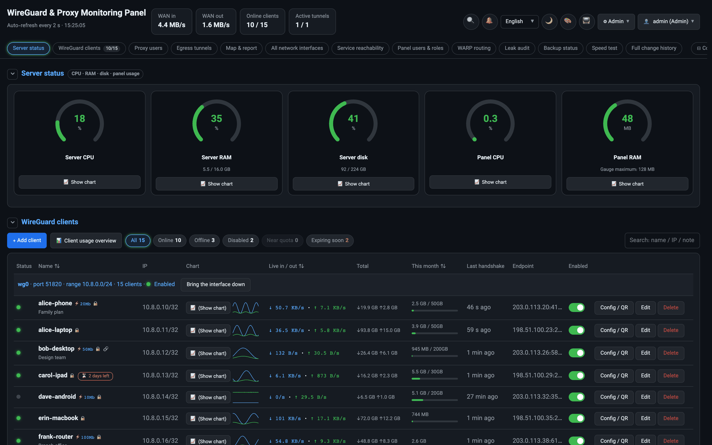
</p>
<p align="center"><sub>Every screenshot in this README shows synthetic demo data — see <a href="#screenshots">Screenshots</a>.</sub></p>

## Contents

- [Screenshots](#screenshots)
- [Features](#features)
- [The chart engine](#chart-engine)
- [Connection quality (WG-NQMO)](#wg-nqmo)
- [Map & report (SvgStudio and Excel)](#map-and-report)
- [Languages](#languages)
- [Requirements](#requirements)
- [Quick start with Docker](#quick-start-with-docker)
- [Install with systemd](#install-with-systemd)
- [Upgrading](#upgrading)
- [Configuration](#configuration)
- [Telegram bot setup](#telegram-bot-setup)
- [Squid proxy](#squid-proxy)
- [Backups](#backups)
- [TLS and reverse proxies](#tls-and-reverse-proxies)
- [Prometheus](#prometheus)
- [Security](#security)
- [Outbound connections](#outbound-connections)
- [Limitations](#limitations)
- [Troubleshooting](#troubleshooting)
- [Uninstalling](#uninstalling)
- [Development](#development)
- [Repository layout](#repository-layout)
- [Contributing](#contributing)
- [Support the project](#support-the-project)
- [License](#license)

## Screenshots

<table>
  <tr>
    <th colspan="2"><a href="#map-and-report">Map &amp; report</a><br><sub>SvgStudio diagrams drawn from the server's live state, and the same facts as an Excel workbook</sub></th>
  </tr>
  <tr>
    <td colspan="2" valign="top">
      <a href="docs/screenshots/egress-map.png">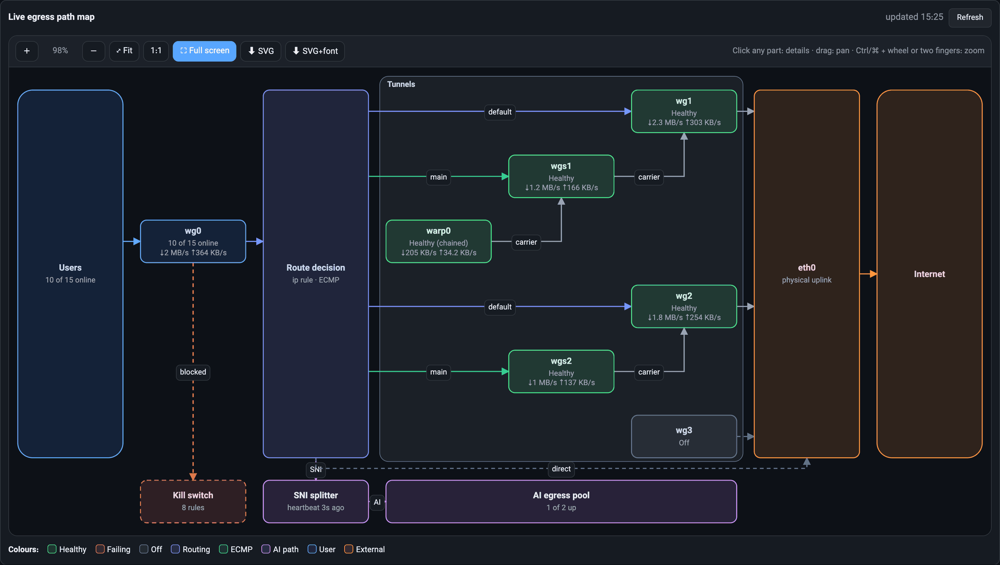</a>
      <p align="center"><b>Live egress map</b><br><sub>Every way a packet can leave the server, coloured by live health; click any box or arrow for the facts behind it</sub></p>
    </td>
  </tr>
  <tr>
    <td width="50%" valign="top">
      <a href="docs/screenshots/user-trace.png">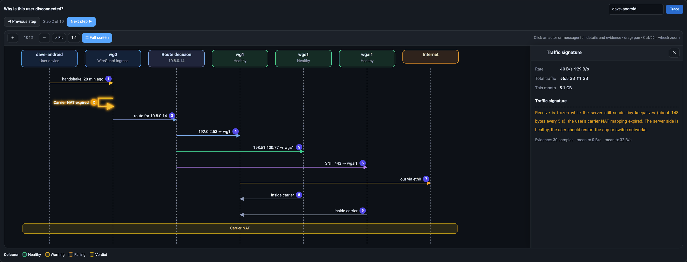</a>
      <p align="center"><b>Why is this user disconnected?</b><br><sub>One client's path step by step, ending in a verdict, here Carrier NAT, with the traffic signature beside it</sub></p>
    </td>
    <td width="50%" valign="top">
      <a href="docs/screenshots/event-timeline.png">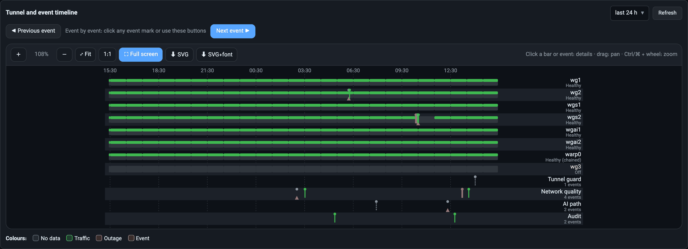</a>
      <p align="center"><b>Tunnel and event timeline</b><br><sub>The last 24 hours of every tunnel, with outages and the events of tunnel-guard, connection quality, the AI path and the audit log</sub></p>
    </td>
  </tr>
  <tr>
    <td width="50%" valign="top">
      <a href="docs/screenshots/excel-dashboard.png">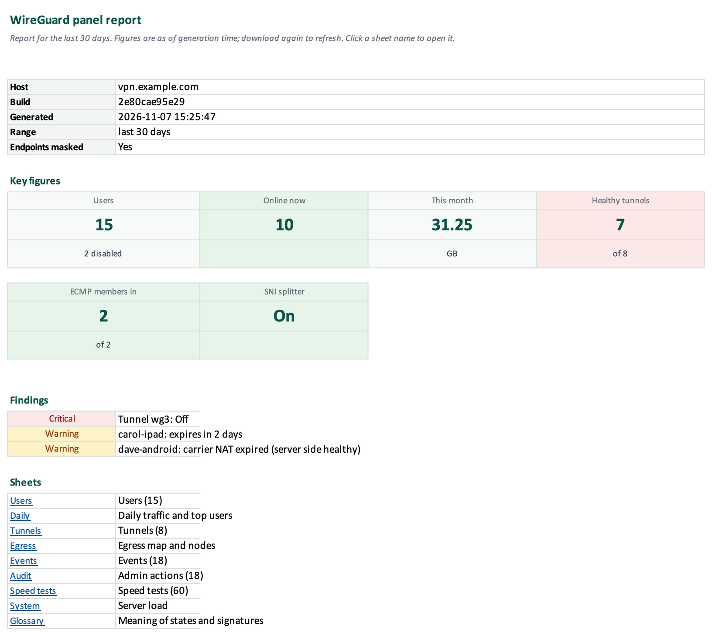</a>
      <p align="center"><b>Excel report: Dashboard</b><br><sub>Key figures, findings and a link to every sheet</sub></p>
    </td>
    <td width="50%" valign="top">
      <a href="docs/screenshots/excel-egress.png">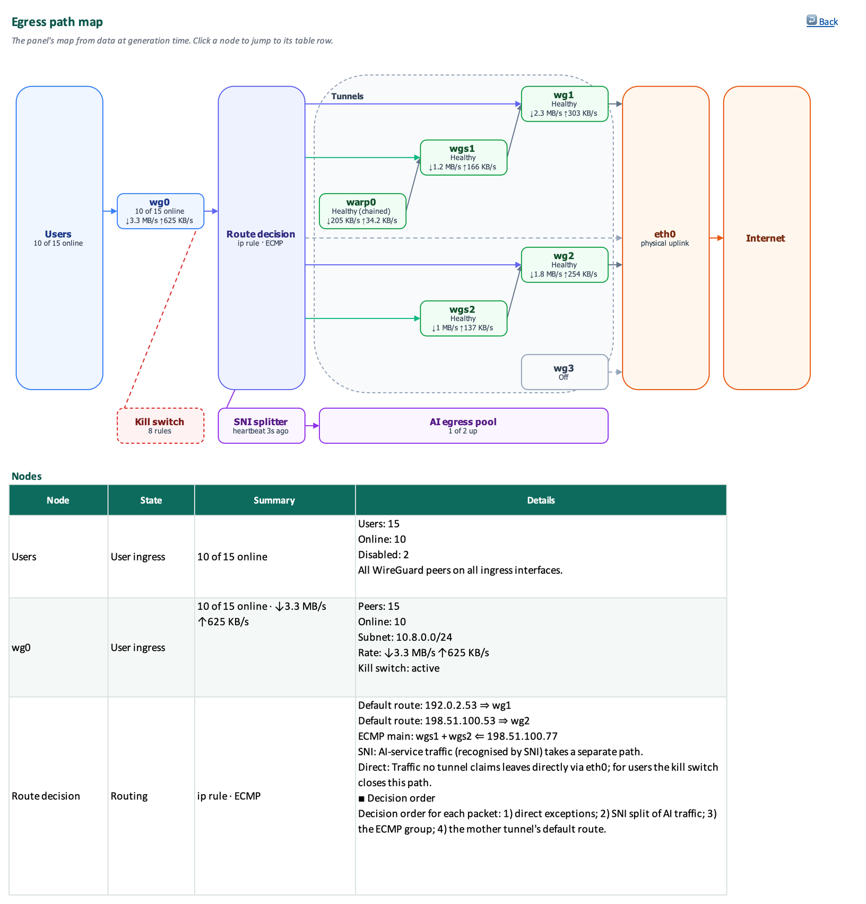</a>
      <p align="center"><b>Excel report: Egress</b><br><sub>The same map as native Excel shapes you can move and edit</sub></p>
    </td>
  </tr>
</table>

<table>
  <tr>
    <th colspan="2"><a href="#wg-nqmo">Connection quality (WG-NQMO)</a><br><sub>Per-device diagnoses with their evidence and a stated confidence, worked out on the server</sub></th>
  </tr>
  <tr>
    <td width="68%" valign="top">
      <a href="docs/screenshots/nqmo-quality.png">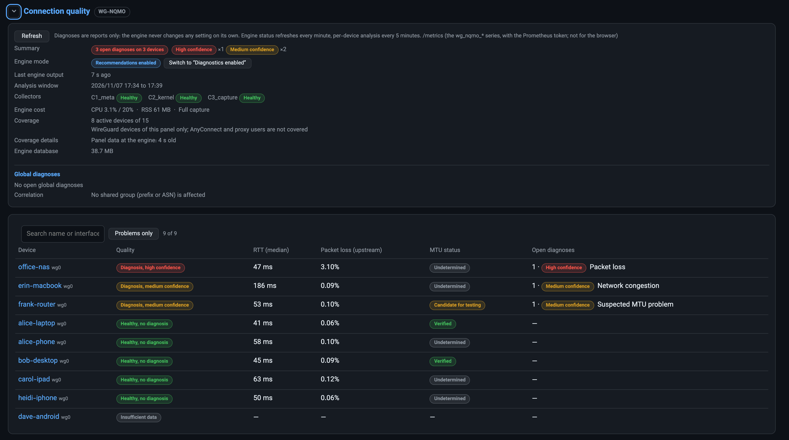</a>
      <p align="center"><b>Every device at a glance</b><br><sub>Engine state, collectors and cost, then each device sorted by severity: quality, RTT, upstream loss, MTU status and open diagnoses</sub></p>
    </td>
    <td width="32%" valign="top">
      <a href="docs/screenshots/nqmo-peer.png">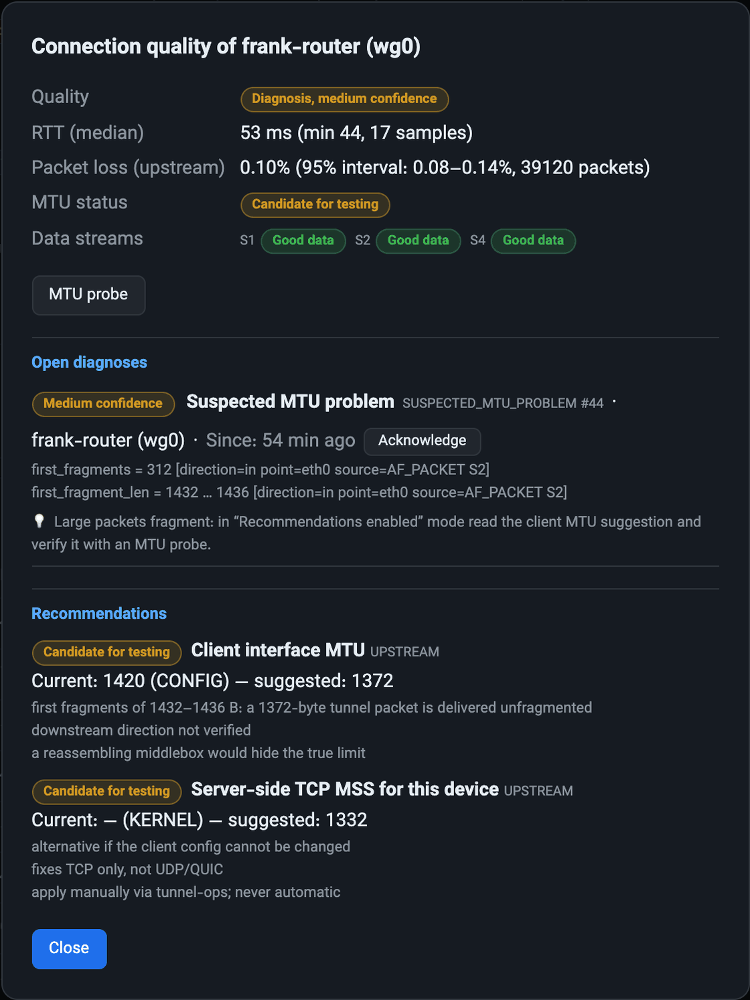</a>
      <p align="center"><b>One device in detail</b><br><sub>A suspected MTU problem with its evidence, and two MTU recommendations to test</sub></p>
    </td>
  </tr>
</table>

<table>
  <tr>
    <th colspan="2">Traffic charts</th>
  </tr>
  <tr>
    <td width="50%" valign="top">
      <a href="docs/screenshots/client-chart.png">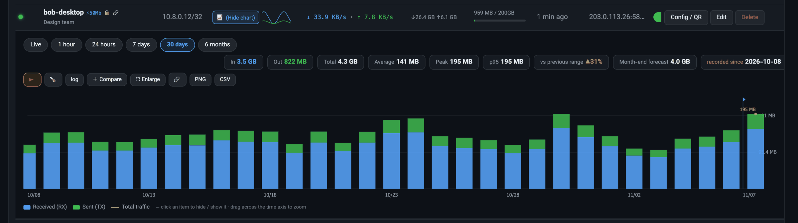</a>
      <p align="center"><b>Per-client traffic chart</b><br><sub>30 days of daily usage with average, peak, p95, change against the previous range and a month-end forecast</sub></p>
    </td>
    <td width="50%" valign="top">
      <a href="docs/screenshots/heatmap.png">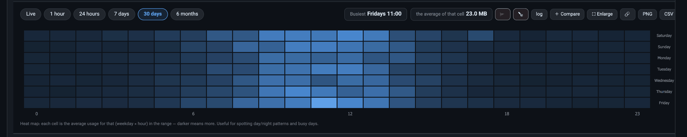</a>
      <p align="center"><b>Weekday × hour heat map</b><br><sub>When a client uses the connection, and its busiest hour</sub></p>
    </td>
  </tr>
</table>

<table>
  <tr>
    <th colspan="2">Everyday use</th>
  </tr>
  <tr>
    <td width="50%" valign="top">
      <a href="docs/screenshots/event-center.png">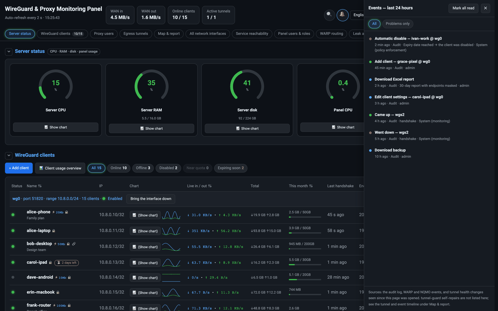</a>
      <p align="center"><b>Event center</b><br><sub>The last 24 hours in one list: admin actions, WARP, connection quality and tunnel health, with repeats merged</sub></p>
    </td>
    <td width="50%" valign="top">
      <a href="docs/screenshots/command-palette.png">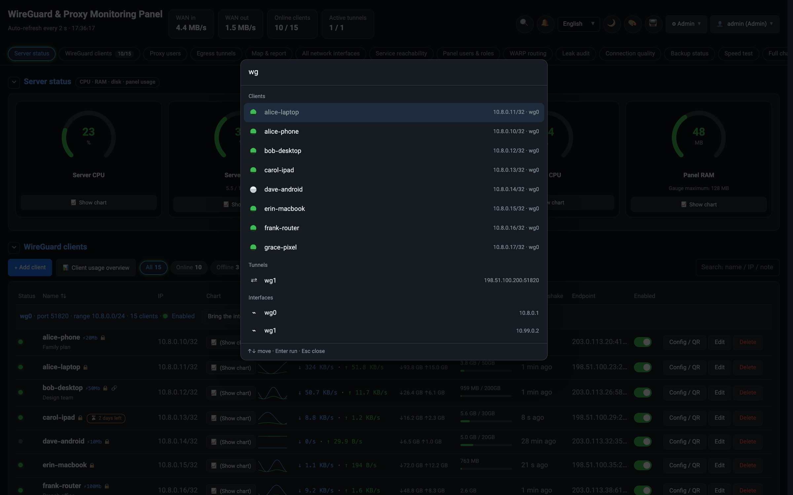</a>
      <p align="center"><b>Search and commands</b><br><sub><kbd>Ctrl</kbd>/<kbd>⌘</kbd> + <kbd>K</kbd> finds a client, tunnel, interface, section or command</sub></p>
    </td>
  </tr>
  <tr>
    <td width="50%" valign="top">
      <a href="docs/screenshots/rtl-fa.png">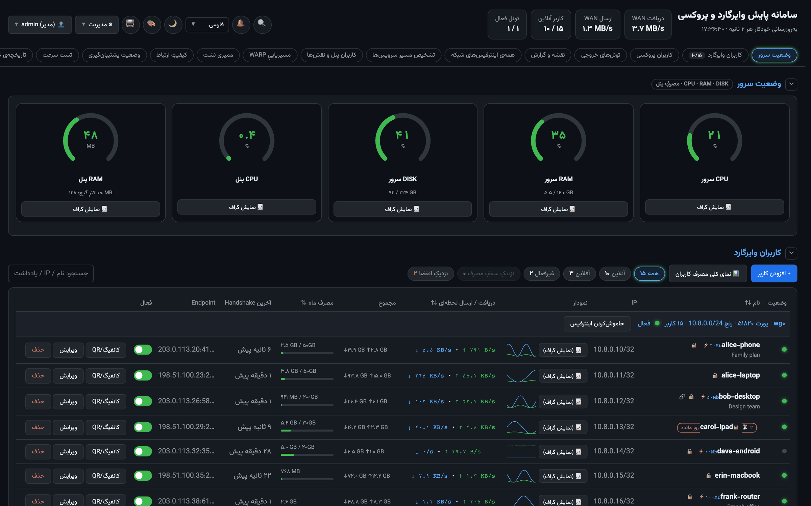</a>
      <p align="center"><b>Persian, right to left</b><br><sub>The same panel in Persian — one of four interface languages</sub></p>
    </td>
    <td width="50%" valign="top">
      <a href="docs/screenshots/light.png">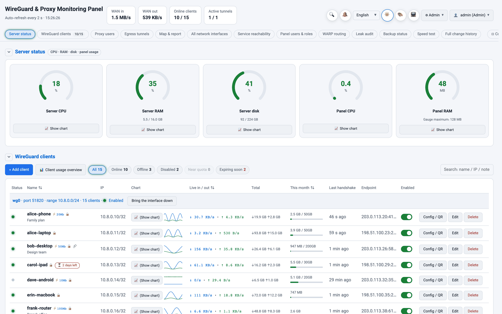</a>
      <p align="center"><b>Light theme</b><br><sub>Dark and light themes, switched from the toolbar</sub></p>
    </td>
  </tr>
</table>

<table>
  <tr>
    <th colspan="2">Clients, Telegram and phones</th>
  </tr>
  <tr>
    <td width="50%" valign="top">
      <a href="docs/screenshots/config-qr.png">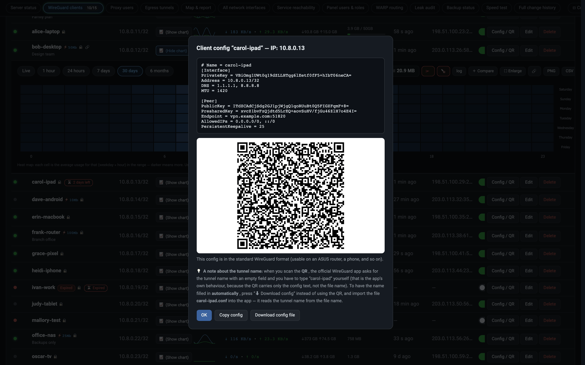</a>
      <p align="center"><b>Client config and QR code</b><br><sub>Copy it, download the <code>.conf</code> file, or scan the QR code</sub></p>
    </td>
    <td width="50%" valign="top">
      <a href="docs/screenshots/telegram-chart.png">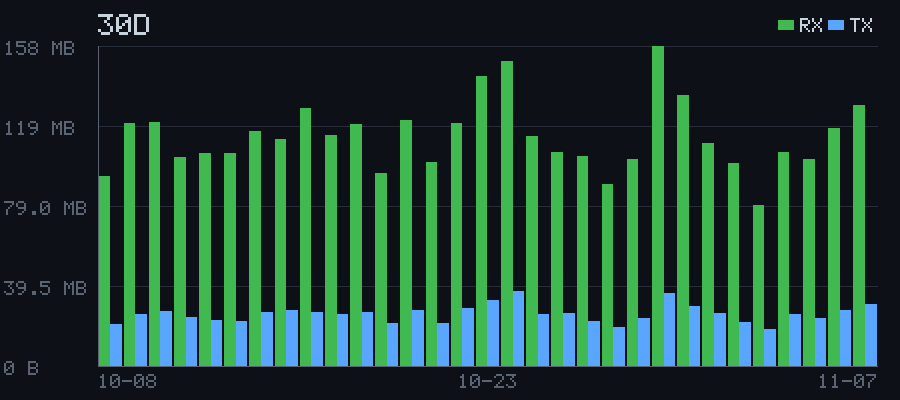</a>
      <p align="center"><b>Chart from the Telegram bot</b><br><sub>The bot draws the PNG itself, in pure Python</sub></p>
    </td>
  </tr>
  <tr>
    <td width="50%" valign="top" align="center">
      <a href="docs/screenshots/mobile-cards.png">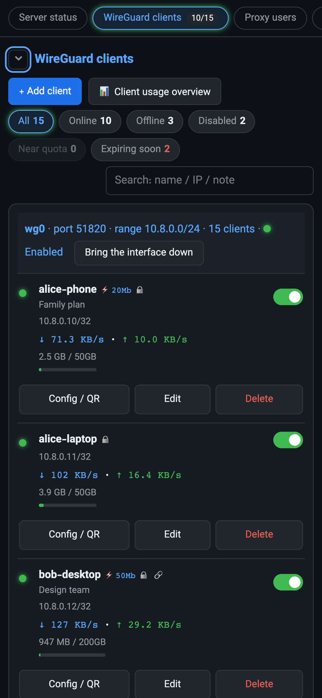</a>
      <p align="center"><b>The panel on a phone</b><br><sub>On a narrow screen the client table becomes cards, with the status filters above them</sub></p>
    </td>
    <td width="50%" valign="top" align="center">
      <a href="docs/screenshots/share-mobile.png">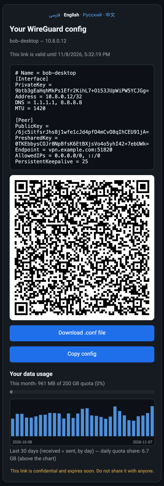</a>
      <p align="center"><b>Share page on a phone</b><br><sub>What the recipient of a share link sees: config, QR code, download button and their own usage</sub></p>
    </td>
  </tr>
</table>

> [!NOTE]
> The screenshots were taken from a real running panel filled with **synthetic
> data**: made-up client names, generated keys, the example domain
> `vpn.example.com`, and IP addresses from the RFC 5737 documentation ranges.
> The connection quality figures are made up as well: the demo writes them in
> the WG-NQMO engine's own state format. No real server, user or key appears in
> them. `python3 demo/screenshots.py`
> regenerates all of them except the two Excel images, which are taken from
> Microsoft Excel itself.

## Features

### Speed limits and data quotas for every WireGuard client

- **Speed limit per client**, in Mbit/s, enforced in the Linux kernel with
  `tc htb` — download is shaped on the WireGuard interface, upload through an
  `ifb` device. It is opt-in: until you limit someone, the panel does not
  touch `tc` at all, and clients without a limit are not affected.
- **Monthly data quota**, a **lifetime data cap** and an **expiry date** for
  each client.
- When a client reaches a limit, the panel acts on its own: it **disables**
  the client (the default) or **deletes** it, writes the event to the audit
  log and sends a Telegram alert. Accounts that are about to expire (3 days
  ahead by default) are reported too.
- Squid proxy users get the same treatment: quota, speed limit and expiry.

### Professional charts

- A canvas chart engine written from scratch — no chart library: line and bar
  charts on a real time axis, **zoom**, **logarithmic scale**, gaps shown
  where data is missing, hover values, series you can switch on and off, and
  a full-screen view
- Time ranges: **live, 1 hour, 24 hours, 7 days, 30 days and 6 months**
- Traffic charts for every client, every interface and every egress tunnel
- A **heat map of weekday × hour** that shows when each client uses the
  connection
- Live gauges for CPU, memory and disk; latency and routing charts for WARP
- A usage chart on every share page, so the client can see their own usage

How it works, and everything it can do: [The chart engine](#chart-engine).

### Map & report: where traffic goes, and why a user is down

- **Live egress map**: every path out of the server, from the users through
  the WireGuard ingress, the route decision (`ip rule`, ECMP) and the tunnels
  to the physical uplink, along with the SNI splitter, the AI egress pool, a
  WARP chain and the kill switch. The colours show live health, and clicking
  any part shows its facts and evidence
- **Why is this user disconnected?**: one client's path drawn step by step,
  ending in a verdict such as carrier NAT expired, never connected, offline or
  egress failing
- **Tunnel and event timeline**: a Gantt chart of the last 6, 24 or 72 hours
  with each tunnel's traffic and outages, tunnel-guard repairs, and WARP,
  WG-NQMO and admin events
- **Excel report**: one `.xlsx` file for 7, 30 or 90 days, with up to ten
  sheets and the egress map drawn as native Excel shapes. Client addresses are
  masked by default

See [Map & report](#map-and-report) for the details.

### Advanced Telegram bot

The bot runs inside the panel process, so it needs no extra service. It is a
complete second way to manage the server — no SSH, no browser. Each bot user
sees only the buttons their role allows.

- **19 commands** (one of them, `/botwatch`, only for the owner) and a button
  menu. Each user gets the command list in their own language, chosen with
  `/lang`
- **Excel export** (`/excel`): one `.xlsx` file for the last 1, 3, 7 or 30 days
  or any range you type, in Gregorian or Solar Hijri dates. Three kinds: all
  WireGuard clients, the whole server (every sheet the user's role may see), or
  one WireGuard or proxy user with daily and hourly traffic, their path through
  the server as native Excel shapes, connection quality, share links, proxy
  sources and destinations, and the admin actions on that user. Passwords never
  reach the file
- **WireGuard clients**: create one step by step (an optional preshared key, a
  monthly quota, a lifetime cap, a speed limit and an expiry date), then renew
  it, change its quota or speed limit, enable or disable it, rotate its key or
  delete it. The bot sends the **config file**, the **QR code** and the config
  as text that copies with one tap
- **Proxy users**: create one with a password, or without one and limited to
  allowed source addresses, for HTTP, HTTPS or both; see the sites each user
  reaches; set a new password; get the full proxy link with its QR code
- Every change asks for confirmation first and is written to the audit log
- **Charts as images** — the bot draws the PNG itself (pure Python, no image
  library) for client traffic (24 hours / 7 days / 30 days / 6 months), proxy
  traffic and speed tests, with totals, averages and peaks in the caption
- **Server and network**: egress tunnels with their real health, server load,
  a DNS and IPv6 leak audit, the ECMP guard, and WARP routing with path
  quality, events, endpoint ranking, AI traffic per client and what automatic
  discovery has added
- Online users, search, lists sorted by expiry and by usage, the last speed
  test of each interface, and backup status with SHA-256 checksums
- A daily or weekly text digest and, separately, a daily or weekly report of
  three charts: WAN traffic over 7 days, the top 5 clients and the speed test
  trend
- **11 kinds of alerts**: egress tunnel down or back up, a dead tunnel taken
  out of ECMP or restored, WARP problems, quota reached, accounts about to
  expire, sustained high CPU, RAM or disk, swap use, repeated failed logins,
  failed backup upload, speed drop and panel restart. With the
  [WG-NQMO](#wg-nqmo) engine on, there is a twelfth: its diagnoses. DNS and
  IPv6 leaks are reported as well
- **Approve panel logins** with one tap in Telegram (optional)
- **Bot users and roles**: `owner`, `admin`, `viewer` or any custom panel role.
  Bot users are managed from the bot itself, and nobody can grant a role with
  more rights than their own. Only the owner can switch the ECMP guard, add a
  WARP target and open `/botwatch`, which shows what every user did, in the bot
  and in the web panel, for up to six months
- Configs, keys, proxy links and passwords are sent only in a private chat; in
  a group the bot refuses

### More features

**Clients**

- Online/offline state from the handshake age, live RX/TX per client sampled
  every 2 seconds
- Add a client (key pair generated, a free address picked from the pool) and
  remove one
- Enable or disable a client on the live interface **and** in the config file,
  so the change survives a restart
- Ready-to-use client config with copy, download and QR code
- **Share links** — a standalone page with the QR code, a download button and
  a usage chart, for sending a config to someone. Links are valid for 1 minute
  to 24 hours, can be single-use, and can be revoked. The page picks its
  language from the recipient's browser.

**Server**

- Status of egress tunnels: endpoint, live throughput, systemd unit state
- WireGuard and AmneziaWG interfaces
- Squid proxy user management — see [Squid proxy](#squid-proxy)
- Cloudflare WARP status, and an optional SNI-splitting daemon that routes
  connections by destination hostname (these need helper scripts that are not
  in this repository — see [Limitations](#limitations))
- Per-client connection quality (round trip, packet loss, MTU) with diagnoses and
  alerts, through the separate WG-NQMO engine in this repository; off by
  default — see [Connection quality (WG-NQMO)](#wg-nqmo)
- Read-only leak audits (routing; DNS and IPv6 from the Telegram bot)
- Backup and restore; every config file is backed up automatically before it
  is written, and writes are atomic
- An audit log of every action, with who, what and the result
- A TV / kiosk view that rotates through status pages, including the egress
  map and a 3D network scene

**Interface**

- A section bar at the top with live counts; fold any section, or all of them
  at once
- **Search and commands** with <kbd>Ctrl</kbd>/<kbd>⌘</kbd> + <kbd>K</kbd>: jump
  to a client, tunnel, interface or section, or run a command. <kbd>/</kbd>
  jumps to the section's filter box and <kbd>?</kbd> lists the shortcuts
- An **event center** behind the bell: the last 24 hours of admin actions,
  WARP and WG-NQMO events and tunnel health changes, with repeats merged and a
  *Problems only* filter
- Status filters above the client table (online, offline, disabled, near
  quota, expiring soon), and a quota bar and a days-left badge on each row
- Every confirmation uses the same dialog. Irreversible actions (deleting a
  client, bringing a tunnel down, restoring a backup from the cloud) ask you
  to type the name first, and a form with unsaved changes asks before it
  closes
- An **Undo** button in the notification after you enable or disable a
  client, for ten seconds
- On a phone the client table becomes cards
- Loading, empty and error states with a *Retry* button; a visible focus ring
  for keyboard users, screen-reader announcements, and less motion when the
  system asks for it

**Access**

- Multiple users; built-in `admin` and `viewer` roles plus custom roles built
  from a catalog of fine-grained permissions
- Optional TOTP two-factor authentication, and optional approval of every
  panel login from Telegram
- Signed session cookies, login rate limiting, optional IP allowlist
- Prometheus metrics at `/metrics`, protected by a bearer token

<a id="chart-engine"></a>

## The chart engine

Every chart in the panel comes from a small drawing engine written from
scratch for this project: plain Canvas 2D in about two thousand lines of
JavaScript in `wgpanel/web/page.html`. It uses no chart library and no CDN, so it
works on a server with no internet access, and it knows the data it draws.
It knows what a quota is, when a client was disabled, and how many bytes a
tunnel moved in the last ten seconds.

### What it draws

| Chart | Where | What it shows |
|---|---|---|
| Traffic | Every client, interface and egress tunnel | Received and sent traffic plus a dashed total line; lines for Live and 1 hour, bars from 24 hours up |
| Heat map | Any traffic chart, 7 or 30 days | Average use for each weekday × hour, and the busiest hour |
| Per-client split | Every WireGuard interface | How the interface's traffic divides between its clients: the top 7, with the rest grouped as "Others" |
| Compare | Any set of charts you pick | Several clients, tunnels or interfaces as lines on one shared axis |
| Usage overview | The WireGuard clients section | Stacked usage of all clients of an interface over time |
| Server gauges | CPU, RAM, disk, panel CPU and panel RAM | The history behind each gauge |
| Speed test | The speed test section | Download and upload in Mbit/s, with ping on a second axis |
| WARP | The WARP section | Response time direct vs. through WARP, and the share of traffic routed to AI services |
| Route quality | Service reachability | Call quality (MOS) and round-trip time for each measured route |
| Share page | The page behind a share link | The recipient's own last 30 days, with their daily budget if they have a quota |

### Where the numbers come from

| Range | One point is | Kept |
|---|---|---|
| Live | a 2-second sample | the last 3 minutes, in memory |
| 1 hour | a 10-second average | the last hour, in memory (starts again after a restart) |
| 24 hours | one hour | about 21 days, in SQLite |
| 7 days · 30 days · 6 months | one day | about 400 days, in SQLite; the 6-month view can group days into weeks |

Proxy users are measured from Squid's access log and start at the 24-hour
view. The heat map is built from the hourly rows, so it can look back about
21 days.

### The figures above each chart

- **In, Out, Total**: the current rate on Live and 1 hour; the total for the
  range on the longer views.
- **Average** and **Peak**, and **p95**: the value that 95% of the hours or
  days in the range stay under. A single spike therefore does not dominate it.
- **vs previous range**: the change against the equally long period just
  before it. ▲ amber is more, ▼ green is less.
- **Month-end forecast**, for clients with a monthly quota. It takes this
  month's use so far, spreads it over the whole month, and warns
  "~N days until the quota runs out" when the pace is too high.
- **Recorded since**: the first day with data, so a short history is not
  mistaken for low use.

On the chart itself, a gold dot marks the peak, and clients with a quota get
a dashed line at their daily share of it.

### Working with a chart

- **Hover** shows every series at that moment. With several charts open,
  they all follow the same point in time.
- **Zoom**: drag across the chart to select a time span, or use the mouse
  wheel. On a phone, pinch with two fingers. Once zoomed in, drag to move
  along the time axis. Double-click or **↺ Whole range** zooms back out.
  The vertical scale fits whatever is visible.
- **Click a legend item** to hide or show that series.
- **log** switches to a logarithmic scale, so a quiet client and a heavy one
  can be read on the same chart.
- **🚩** marks changes from the audit log on the time axis: red when a
  client is disabled or a tunnel goes down, green when something comes back,
  blue for other changes. On a tunnel's chart, the time it was down is also
  shaded red. Hover near a flag to see what happened, who did it and why.
  The WARP interface's chart also shows WARP's own events, such as a switch
  to the standby key.
- **⛶ Enlarge** opens the chart full screen, and **＋ Compare** adds it to
  the comparison.
- **🔗** copies a link to exactly this view: the chart, the range, the zoom,
  and log, heat-map or per-client mode.
- **PNG** saves the chart at full screen resolution with its title. **CSV**
  saves the raw rows in UTF-8, ready for a spreadsheet.

Each open chart's range, scale and hidden series are remembered in the
browser.

### Honest by design

- From the 1-hour view up, the time axis is real time: a missing hour is
  left empty, and a line breaks where data is missing instead of drawing
  across the gap.
- In the 1-hour view, a silent client is a real zero line, not a gap: the
  panel records the silence too.
- The axes use round steps (1, 2, 2.5 or 5 × 10ⁿ) and scale bytes in powers
  of 1024. Rates are bytes per second; speed tests are in Mbit/s.
- Charts are drawn at the screen's real pixel density, so they stay sharp on
  high-resolution screens, and are redrawn when the window changes size.
- Updates arrive every 2 seconds but pause while you hover, so the chart does
  not move under the cursor.

### Colours and languages

The charts take their colours from the page theme, so they follow the dark
and light themes. The **🎨** button switches to a colour-blind-safe palette
(Okabe–Ito), which also draws the sent line dashed so the series differ in
shape as well as colour. In Persian the charts use Persian digits, and the
speed test, route and WARP charts give dates in the Solar Hijri calendar.

### Charts in Telegram

The Telegram bot cannot run a browser, so the panel also draws charts on the
server, in pure Python. It fills a pixel buffer, draws lines and bars into
it, writes the labels with a built-in bitmap font, and packs the result into
a PNG with `zlib`. The PNG is 900 × 400, bars or lines. These images go into
the client and proxy graphs in the bot and into the periodic report.

<a id="wg-nqmo"></a>

## Connection quality (WG-NQMO)

A client says the connection is slow or keeps dropping. Is the cause their own
network, the server, an outbound tunnel, the MTU, or simply the speed limit you
set for them? WG-NQMO answers that from the server side, for each client, with
the evidence and a stated confidence. Nothing is installed on the client.

It is a separate engine. It watches the round trip of the WireGuard handshake,
upstream packet loss (client to server) and the client MTU, diagnoses what goes
wrong and can recommend an MTU. Diagnoses and recommendations are reports only:
the engine never changes a setting on its own.

> [!NOTE]
> **The engine is a separate service in this repository, and it is optional.** Release
> 1.3.0 added the panel's side of it: hooks that show what the engine reports and pass
> it the panel's own data and the administrator's commands. Release 1.4.0 adds the
> engine itself, `wg_nqmo.pyz`, built from `nqmo/`. The hooks are off by default, so a
> panel without the engine behaves as if they were not there.

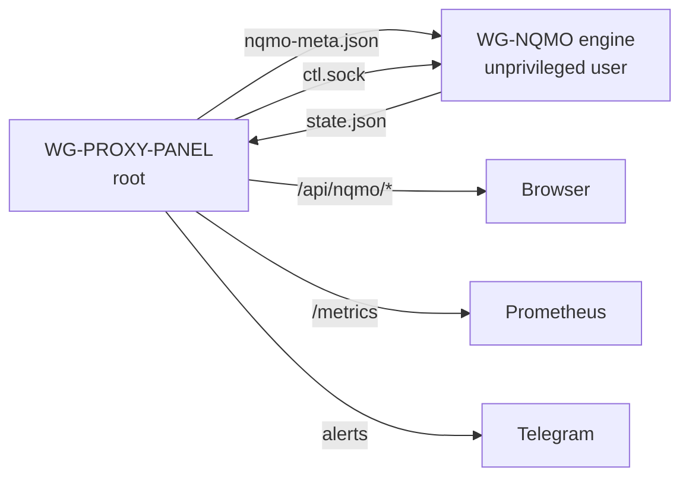

### What you see

- **In the panel.** A **Connection quality** section shows the engine mode and the
  age of its data, the collectors (healthy, failing or off), coverage, database
  size, global diagnoses and configuration findings; a table of clients with
  quality, median round trip, upstream packet loss, MTU status and open diagnoses;
  and the last 50 events.
- **For each client.** Clicking a client opens the last 15 minutes, the diagnoses
  with their evidence, and the recommendations with their reason and limits. The
  client edit dialog has the same content in a **Quality and MTU (WG-NQMO)** block.
- **In Telegram.** A new, escalated or cleared diagnosis becomes an alert. Bot users
  whose role can see quality get `/quality` (and a menu button): the same summary,
  worst clients first, and each client's numbers, diagnoses and recommendations.
  It is read-only, never shows prefixes, ASNs or raw evidence, and appears only
  while the engine is turned on.
- **In Prometheus.** The same numbers as `wg_nqmo_*` series, with example queries
  under [Reference](#wg-nqmo-reference).

The section refreshes every 30 seconds, only while the browser tab is visible. A
number the engine did not report is shown as “—”, never as 0.

Three buttons act on the engine: **Acknowledge** on a diagnosis, the MTU probe, and
the mode change. Each one asks for confirmation and, accepted or refused, is
written to the history.

### Installing the engine

The engine is its own service: a second single file, `wg_nqmo.pyz`, built from the
`nqmo/` package in this repository, that runs as the unprivileged system user `wg-nqmo`.
It needs Python 3.10 or newer and nothing else, and it goes on the server that runs the
panel; the Docker image does not include it. Build it, install it and run its self-test:

```bash
python3 tools/build_nqmo_pyz.py --out dist/wg_nqmo.pyz
sudo useradd --system --user-group --no-create-home --home-dir /nonexistent --shell /usr/sbin/nologin wg-nqmo
sudo install -d -m750 -o root -g wg-nqmo /opt/wg-nqmo
sudo install -m640 -o root -g wg-nqmo dist/wg_nqmo.pyz /opt/wg-nqmo/wg_nqmo.pyz
sudo install -d -m755 -o root -g root /etc/wg-nqmo
sudo install -m640 -o root -g wg-nqmo deploy/wg-nqmo.config.json /etc/wg-nqmo/config.json
sudo install -m644 -o root -g root deploy/wg-nqmo.service /etc/systemd/system/wg-nqmo.service
sudo systemctl daemon-reload
sudo -u wg-nqmo python3 -I /opt/wg-nqmo/wg_nqmo.pyz --check
sudo systemctl enable --now wg-nqmo
```

The self-test prints `NQMO_CHECK_OK`; do not start the service without it. Then turn the
panel's hooks on, as described in the next section, and check that `/metrics` reports
`wg_nqmo_up 1`.

**Observation only, with no active diagnosis, by default.** The shipped
`deploy/wg-nqmo.config.json` starts the engine in **Observation only** with
`active_probes` off and header capture off. In this state the engine reads the panel's
file and the kernel counters and writes its state file. It sends no packet, probes no
client, changes no setting and raises no alert; diagnoses are worked out and stored but
not shown. Move the mode up from the panel, one step at a time, once you have seen what
it measures.

**Header capture** (optional). Round trip, packet loss and MTU evidence come from the
WireGuard headers on the wire, so they need the capture to be on. Install the drop-in
`deploy/wg-nqmo-capture.conf`, which gives the service only `CAP_NET_RAW`, and the
configuration `deploy/wg-nqmo.capture.config.json`, which turns capture on. The engine
reads only the headers of WireGuard packets on the port in `listen_port`; the payload is
encrypted and is never stored. The filters are compiled for port `53953`: for another
port, change `PORT` in `tools/gen_nqmo_bpf.py` and regenerate (needs `tcpdump`), or the
capture refuses to start. Never give the service `CAP_NET_ADMIN`: with it, `wg show`
would expose private keys.

```bash
sudo install -d -m755 -o root -g root /etc/systemd/system/wg-nqmo.service.d
sudo install -m644 -o root -g root deploy/wg-nqmo-capture.conf /etc/systemd/system/wg-nqmo.service.d/capture.conf
sudo install -m640 -o root -g wg-nqmo deploy/wg-nqmo.capture.config.json /etc/wg-nqmo/config.json
sudo systemctl daemon-reload
sudo systemctl restart wg-nqmo
```

**Resource quota.** The unit caps the engine at `CPUQuota=20%`, `MemoryHigh=128M` and
`MemoryMax=160M`, with `Nice=10`, so it never competes with the data path. With capture on
a busy server that cap is too tight: the watchdog kills the engine while it closes an
analysis window. `deploy/wg-nqmo-resources.conf` raises the three values to `200%`,
`256M` and `320M`; install it as `resources.conf` next to `capture.conf`. The engine is a
watcher: if it stops, nothing else stops, and `systemctl disable --now wg-nqmo` takes it
out of the picture with no network state to undo.

**Metrics.** The engine has no endpoint of its own. Everything it measures reaches
Prometheus through the panel's `/metrics` as the `wg_nqmo_*` series, listed under
[Reference](#wg-nqmo-reference).

**Hourly review archive** (optional). `deploy/wg-nqmo-review.sh` with its service and
timer keeps, every hour, a compressed copy of the state file and a one-line summary in
`/var/lib/wg-nqmo/review`: counts only, no names, keys or addresses, for 14 days.

### Turning it on and off

The hooks are on only when `config.json` has the JSON value `true` under
`nqmo.enabled`; `"true"`, `1` or a missing key all mean off. While they are off:

- the panel reads and writes nothing for the engine;
- `/api/stats` and `/metrics` answer exactly as they would without the hooks;
- the six `/api/nqmo/*` routes return only a “disabled” error (`"disabled": true`);
- the page sends no WG-NQMO request and shows no WG-NQMO section, and the WG-NQMO
  permission group and alert kind are hidden. Saving a role or the alert settings
  keeps their stored WG-NQMO values.

To turn them on once the engine is installed, add this to `config.json`:

```json
"nqmo": {"enabled": true, "user_iface": "wg0"}
```

1. Set `user_iface` to the WireGuard interface your clients connect to; the panel
   reports its MTU and firewall mark to the engine. The default is `wg1udp`. If no
   interface has that name, the panel writes nothing for the engine, so use your own.
2. Restart the panel.
3. Give the people who need it `nqmo.view`. The built-in `admin` role has every
   WG-NQMO permission and the built-in `viewer` role has none.
4. Check that `/metrics` reports `wg_nqmo_up 1`. If it reports 0, the
   `wg_nqmo_unavailable{why}` series says why; see [Troubleshooting](#wg-nqmo-troubleshooting).

Turning the hooks on without the engine does no harm: the section says the engine
has written no output yet.

To turn them off, set `enabled` to `false` or remove the key, and restart the panel.
The panel stops updating its file for the engine. It does not stop the engine and
does not delete its files, and stored role and alert values stay as they are.

### Engine modes

The engine starts in **Observation only** and moves up by hand, so you can see what
it measures before it says anything. The mode moves only one step at a time; the
panel and the engine both refuse a jump.

| Mode | In the panel | Telegram | Recommendations and MTU probe |
|---|---|---|---|
| **Observation only** (`OBSERVATION_ONLY`) | Round trip and packet loss. Diagnoses are worked out and stored, but not shown | No | No |
| **Diagnostics enabled** (`DIAGNOSTICS_ENABLED`) | Also diagnoses and the quality column | New diagnoses with medium or high confidence | No |
| **Recommendations enabled** (`RECOMMENDATIONS_ENABLED`) | Also recommendations | Same as above | Yes; the probe must also be allowed in the engine settings |

### Reading the results

**Quality** is the worst confidence among a client's open diagnoses. It is not a
score of the connection itself: “healthy” means that no rule found a problem.

| `wg_nqmo_peer_quality_state` | Shown as |
|---|---|
| −1 | Insufficient data |
| 0 | Healthy, no diagnosis |
| 1 | Diagnosis, low confidence |
| 2 | Diagnosis, medium confidence |
| 3 | Diagnosis, high confidence |

**Diagnoses.** Each one names its scope, confidence, data quality, evidence and,
with `nqmo.detail`, what speaks against it and what else could explain it. A
diagnosis is a reasoned suspicion, not proof.

| Code | Shown as | Scope | What it means |
|---|---|---|---|
| `SERVER_RESOURCE_BOTTLENECK` | Server resource bottleneck | Global | The server itself is dropping packets: kernel queues, the network card, UDP buffers, connection tracking or reassembly memory |
| `HANDSHAKE_FLOOD` | Handshake flood | Global | More handshakes arrive than WireGuard can process at once |
| `EGRESS_TUNNEL_DEGRADATION` | Egress tunnel degradation | Egress | An outbound tunnel is unhealthy; clients behind it suffer through no fault of their own |
| `TRAFFIC_SHAPING_EFFECT` | Traffic shaping effect | Device | The client is reaching the speed limit set in the panel; this is the limit working, not a fault |
| `HANDSHAKE_FAILURE` | Handshake failure | Device | The client sends handshakes and the server does not answer them; suspect a wrong key or configuration |
| `NAT_OR_FIREWALL_ISSUE` | NAT or firewall issue | Device | The server sends and nothing comes back. Typical of an expired NAT mapping on the client's side; the exact cause cannot be told from the server |
| `ROUTING_ANOMALY` | Routing anomaly | Device | The route back to the client does not leave by the expected interface, or routes changed just as quality fell |
| `UDP_INSTABILITY` | UDP instability | Device | The client's address keeps changing, or packets arrive reordered or duplicated |
| `PACKET_LOSS` | Packet loss | Device | Upstream loss that is statistically clear, not a chance reading |
| `NETWORK_CONGESTION` | Network congestion | Device | The handshake round trip is well above this client's own normal level |
| `SUSPECTED_MTU_PROBLEM` | Suspected MTU problem | Device | The client's MTU is larger than the path can carry, so its packets arrive in fragments |
| `SUSPECTED_PMTU_BLACKHOLE` | Suspected PMTU black hole | Device | Large packets are being lost on the way while small ones get through |
| `UNKNOWN_DEGRADATION` | Unexplained degradation | Device | Worse than this client's normal level, and no rule explains why |

**MTU status** is what the engine can say about a client's MTU. Any suggested value
is yours to apply; nothing is changed for you.

| `wg_nqmo_peer_mtu_status` | Shown as | Meaning |
|---|---|---|
| 0 | Undetermined | Not enough evidence for a conclusion |
| 1 | Candidate for testing | There is a suggested value, but it needs a test |
| 2 | Estimated | A value worked out from stable measurements or a probe |
| 3 | Verified | Full-size packets arrived unfragmented on the way up; the way down is not confirmed |

**Configuration findings** are calculated from the configuration rather than
measured, so they appear only in the panel and never as an alert.

### MTU probe

The probe sends a few test packets to one client to find the largest size that
gets through, which helps when passive observation cannot decide. It needs all of
these:

- the mode is **Recommendations enabled**, and probes are allowed in the engine settings;
- the user has `nqmo.probe`;
- the client's last handshake is under 2 minutes old, so it is online;
- no other probe is running, and this client had none in the last hour;
- the client's name is not repeated on another interface.

A client that does not answer ping cannot be tested.

<a id="wg-nqmo-troubleshooting"></a>

### Troubleshooting

**The section or `wg_nqmo_unavailable{why}` says the data is not usable:**

| `why` | Meaning | What to do |
|---|---|---|
| `disabled` | The hooks are off | Nothing, unless you meant to turn them on. `/metrics` has no WG-NQMO series in this state |
| `missing` | The engine has written no output yet | It is not installed, or has just started; check its service |
| `unreadable` | The file cannot be read | Check its permissions. A symlink or anything that is not a regular file is refused on purpose |
| `too_large` | The file is over the size limit | Look at the engine; the file should be far smaller |
| `corrupt` | The file is not a valid document | Look at the engine's log |
| `schema` | The document version does not match the panel | Bring the panel and the engine to matching versions |
| `stale` | The file is over 3 minutes old | The engine has stopped or hung |
| `clock` | The file is dated in the future | Fix the system clock |
| `error` | Internal error while reading the file | Look at the panel's log |

**A command was refused** (the code is in the `refused` field and in the history):

| Code | Meaning | What to do |
|---|---|---|
| `UNREACHABLE` | The panel could not connect to the engine | Start the engine |
| `NO_REPLY` | The engine closed the connection without replying | The panel is probably not running as root |
| `TIMEOUT` | The engine did not answer in time | Try again; if it repeats, look at the engine |
| `MODE_GATE` | Probes need **Recommendations enabled** | Move the mode up one step at a time |
| `FLAG_GATE` | Probes are disabled in the engine settings | Allow them there, if you want them |
| `META_STALE` | The engine's copy of the panel data is stale | Check `user_iface` and that the group `wg-nqmo` exists |
| `NO_SUCH_PEER` | The engine does not know this client | Wait for the next panel update |
| `PEER_NOT_PROBEABLE` | The client is disabled or has no tunnel address | Nothing to test |
| `STALE_HS` | The client is not online | Try while it is connected |
| `RATE` | This client had a probe in the last hour | Try later |
| `BUSY` | The engine is busy or another probe is running | Try again shortly |
| `AMBIGUOUS_PEER` | The name exists on several interfaces | Rename one of the clients |
| `NOT_ADJACENT` | The mode moves one step at a time | Go through the middle mode |
| `NO_SUCH_OPEN_DIAGNOSIS` | The diagnosis is no longer open | Nothing to do |

<a id="wg-nqmo-reference"></a>

### Reference

<details>
<summary><b>Permissions</b></summary>

<br>

| Permission | Allows | Includes |
|---|---|---|
| `nqmo.view` | Seeing quality and diagnoses | — |
| `nqmo.detail` | Prefix, ASN, correlations and full evidence | `nqmo.view` |
| `nqmo.ack` | Acknowledging a diagnosis | `nqmo.view` |
| `nqmo.probe` | Running a manual MTU probe | `nqmo.view` |
| `nqmo.manage` | Changing the engine mode | `nqmo.view` |

</details>

<details>
<summary><b>How the panel and the engine talk, and what is trusted</b></summary>

<br>

Only through these files; the panel never imports, starts or stops the engine, and
the hooks make no outbound connection.

| Path | Direction | Contents |
|---|---|---|
| `/run/wg-panel/nqmo-meta.json` | panel → engine, every 60 seconds | The clients of every client interface (name, public key, tunnel address, endpoint, last handshake, traffic counters, per-client MTU and speed limit), the outbound tunnels that are on and their health, and `client_mtu`. Mode `0640`, group `wg-nqmo`, directory `0750`. Written only while the group `wg-nqmo` exists, that is, while the engine is installed |
| `/var/lib/wg-nqmo/state.json` | engine → panel, every 60 seconds | The engine mode, collectors, open diagnoses, a summary of each client and the alert outbox. The panel caches it for 10 seconds; a file older than 180 seconds counts as stale |
| `/run/wg-nqmo/ctl.sock` | panel → engine, on demand | Three commands: acknowledge a diagnosis, run an MTU probe, change the mode. One request per connection, with a 7-second time-out. The engine accepts only root on this socket |
| `/opt/wg-panel/nqmo-notified.last` | panel only | The id of the last engine alert the panel sent |

The meta file holds the clients' names, public keys and endpoints (their public
addresses), so membership of the group `wg-nqmo` means access to those.

The engine's file is untrusted. The engine runs as its own unprivileged user and
the panel as root, so the panel reads `state.json` only as a regular file, never
through a symbolic link, and only up to 8 MB. It checks the document's schema,
strips control and bidirectional characters from every string and shortens it,
keeps only finite numbers, and shows diagnoses and series only for clients it
knows itself, so a forged file cannot create a client or a label.

</details>

<details>
<summary><b>Telegram alert</b></summary>

<br>

With the hooks on, a twelfth alert kind named `nqmo` (“Network quality engine
diagnoses (WG-NQMO)”) appears under `alerts.events`. The panel forwards the
engine's alert outbox: a diagnosis opening, escalating or clearing, in the panel's
own wording in all four languages.

- Removing duplicates, the quiet interval and the hourly cap are the engine's job;
  the panel sends at most 6 messages per 30-second check.
- On the first run, and after the engine's database is rebuilt, only events younger
  than 180 seconds are sent, so switching on does not pour the history into the chat.
- A diagnosis closed because data ran out gets a separate ⚪ message and is not
  reported as cleared.
- Low-importance and digest rows are never sent.

</details>

<details>
<summary><b>API</b></summary>

<br>

All six routes are `POST` with a JSON body, like the rest of the panel.

| Route | Permission | Input | Answer |
|---|---|---|---|
| `/api/nqmo/status` | `nqmo.view` | — | Mode, collectors, coverage, database, global diagnoses, configuration findings, and a summary of each client the panel knows |
| `/api/nqmo/peer` | `nqmo.view` | `name`, and `iface` (optional) | One client: summary, diagnoses and recommendations |
| `/api/nqmo/events` | `nqmo.view` | `since` (0 or more), `limit` (1 to 200) | Outbox events after `since`, oldest first |
| `/api/nqmo/ack` | `nqmo.ack` | `id` | Acknowledges a diagnosis; it stays open |
| `/api/nqmo/probe` | `nqmo.probe` | `name`, and `iface` (optional) | Asks the engine for an MTU probe |
| `/api/nqmo/mode` | `nqmo.manage` | `to` (optional) | Without `to`, the current mode; with `to`, a move of one step |

</details>

<details>
<summary><b>Prometheus</b></summary>

<br>

With the hooks on, `/metrics` adds the series below. A value the engine did not
measure is left out and never reported as 0.

| Series | Meaning |
|---|---|
| `wg_nqmo_up` | 1 when the engine's file is fresh and valid |
| `wg_nqmo_unavailable{why}` | Why not; when the file is missing, unreadable or stale, only this and `wg_nqmo_up 0` appear |
| `wg_nqmo_state_age_seconds` | Age of the engine's file |
| `wg_nqmo_mode{mode}` | 1 for the current mode |
| `wg_nqmo_collector_ok{collector}` | 1 healthy, 0 failing, absent when off: `C1_meta` (the panel's file), `C2_kernel` (kernel counters), `C3_capture` (packet headers) |
| `wg_nqmo_diagnoses_open{class}` | Open diagnoses of each class |
| `wg_nqmo_peers`, `wg_nqmo_active_peers` | Clients the engine knows, and those with a handshake in the last 180 seconds |
| `wg_nqmo_recent_errors` | Engine errors kept in its file |
| `wg_nqmo_store_bytes`, `wg_nqmo_store_read_only` | Size of the engine's database, and whether it is read-only |

Each client also gets these, with the same `iface` and `name` labels as the
`wg_peer_*` series:

| Series | Meaning |
|---|---|
| `wg_nqmo_peer_quality_state` | The quality above; absent in **Observation only** |
| `wg_nqmo_peer_rtt_seconds`, `wg_nqmo_peer_rtt_min_seconds`, `wg_nqmo_peer_rtt_samples` | Median and minimum handshake round trip, 15-minute window, at least 5 samples |
| `wg_nqmo_peer_upstream_loss_ratio`, `wg_nqmo_peer_upstream_loss_lower_ratio`, `wg_nqmo_peer_upstream_loss_upper_ratio`, `wg_nqmo_peer_upstream_loss_judged_packets` | Upstream loss with its 95% Wilson bounds, 5-minute window, at least 1000 judged packets |
| `wg_nqmo_peer_mtu_status` | The MTU status above |

Example queries:

```promql
wg_nqmo_up == 0
sum by (class) (wg_nqmo_diagnoses_open) > 0
wg_nqmo_peer_quality_state >= 2
wg_nqmo_peer_upstream_loss_lower_ratio > 0.01
```

</details>

**Not included:** the engine itself, and a Telegram bot command for it.

<a id="map-and-report"></a>

## Map & report (SvgStudio and Excel)

The **Map & report** section draws three pictures from the server's live state:

1. **Live egress map**: where traffic leaves this server right now
2. **Why is this user disconnected?**: one client's path, step by step, ending in a verdict
3. **Tunnel and event timeline**: what happened to the tunnels over the last day

The same facts can also be downloaded as an Excel workbook.

<p align="center">
  <a href="docs/screenshots/egress-map.png"></a>
</p>

The server does the thinking. `wgpanel/viz.py` gathers live facts (the routes
the kernel reports for `ip route get`, ECMP membership, handshake ages, rx/tx
sampled every two seconds) and turns them into a diagram model. The browser
only draws that model, using `wgpanel/web/svgstudio.js`, which knows nothing
about WireGuard: it has no interface names and no translations in it. Every
name on the map comes from your own server, so the map fits your topology
without any setup.

### Live egress map

The map shows every way a client's packet can leave the server: users, the
WireGuard ingress, the route decision (`ip rule` and ECMP), the tunnels, the
physical uplink and the internet. Where they exist, it also shows the SNI
splitter, the AI egress pool, a WARP chain and the kill switch.

- A tunnel's role is worked out from routing, not from its name. If its
  endpoint is reached through the physical uplink, it is a *mother* tunnel; if
  the endpoint is reached through another tunnel, it is *nested* and is drawn
  next to its carrier. A nested tunnel over a working carrier is a chain, not
  a routing loop.
- The colours show live health: healthy, failing, off, routing, ECMP, AI path,
  user and external. An ECMP member that the guard has taken out of rotation
  is marked as such.
- Click any box or arrow to open a side drawer with the facts behind it: the
  endpoint, the device the endpoint is routed through, the last handshake,
  rates and totals, the ECMP state, and the traffic signature along with the
  samples it was computed from.
- You can zoom, pan, fit, return to 1:1 or go full screen, and download the
  diagram as SVG, with or without the font embedded. The map refreshes every
  minute, but it holds still for five minutes after you touch it, and for as
  long as a drawer or full screen is open.
- The map is also one of the TV / kiosk slides, shown just before the 3D scene.

<p align="center">
  <a href="docs/screenshots/egress-map-fa.png">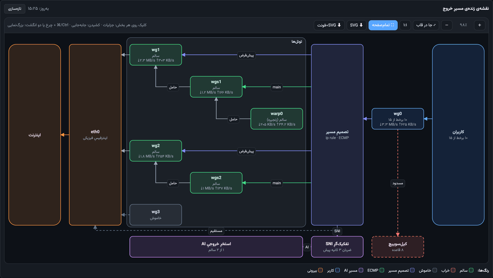</a><br>
  <sub>In Persian the whole map is mirrored and reads from right to left.</sub>
</p>

### Why is this user disconnected?

Type a client's name, or pick one from the list, and the panel draws a
sequence diagram from the device to the internet: the handshake, the ingress,
each route decision that applies to that client's own address (default route,
ECMP group, AI path), the tunnels on the way, and the exit. Every step shows
its evidence. The first step that fails becomes the **verdict**, and the
checks run in the order a person would follow:

| Verdict | Meaning |
|---|---|
| Auto-disabled · Disabled | The client is switched off, by a quota, an expiry date or an admin |
| Never connected | No handshake has ever been recorded: the config never reached the device, the key is wrong, or the endpoint is unreachable |
| Carrier NAT | Nothing is being received, yet the server still sends small keepalives: the mapping in the user's carrier NAT has expired. The server is fine; the user should restart the app or switch networks |
| Offline | The handshake is old and there is no traffic: the device is off or the app is closed. Nothing is wrong |
| Egress failing | The device reaches the server, but a tunnel on its path is failing. Roles without tunnel access see the verdict without the tunnel details |
| No route | No route decision applies to this client's address |
| Healthy | Every step works |

<p align="center">
  <a href="docs/screenshots/user-trace.png"></a>
</p>

The **traffic signature** comes from the two-second samples. Each signature has
one fixed meaning, so two failures that look alike are not mixed up:

| Signature | What the numbers show |
|---|---|
| Carrier NAT expired | rx frozen, tx a steady trickle (about 148 bytes every 5 seconds), old handshake |
| Heavy tx, no rx | A lot is sent and nothing comes back: the pattern of a routing loop |
| Dead endpoint | The handshake is old while the server keeps trying (tunnels) |
| Handshake only | Recent handshake, but the only bytes received are the handshake reply |
| Never connected · Offline · Connected, idle · Two-way traffic · Disabled · Tunnel down | What the name says |

Walk through the diagram with *Previous step* and *Next step*, or click any
message. There is no download button on this card, on purpose: the trace shows
one person's data unmasked.

### Tunnel and event timeline

A Gantt chart of the last 6, 24 or 72 hours. Each tunnel has its own lane,
with an hourly bar wherever it carried traffic, grey where it carried none,
and red where it was down. An event sits on the lane of the tunnel it is
about; everything else gets a lane of its own:

- tunnel and interface changes noticed by the panel's own monitor (down, up,
  a loop found and fixed)
- **tunnel-guard** actions, read from the systemd journal
  (`journalctl -t tunnel-guard`): state changes, repairs, verified repairs,
  failed repairs and route pins. Only actions are kept, not the routine output
  of every check. Without the guard script this lane stays empty
- WARP events (endpoint rotated, egress switched)
- WG-NQMO incidents, for roles with `nqmo.view`
- other admin actions from the audit log, for roles with `audit.view`

The panel's monitor and the guard watch the same tunnels separately, and both
feed the red outage spans. Step from one event to the next with *Previous
event* and *Next event*, or click an event to see its details.

<p align="center">
  <a href="docs/screenshots/event-timeline.png"></a>
</p>

### Excel report

The **Download Excel** button builds one `.xlsx` file for the last 7, 30 or 90
days. The file is written with the standard library alone (`wgpanel/xlsx.py`),
and it holds only the sheets that the person downloading it is allowed to see:

| Sheet | Contents | Needs |
|---|---|---|
| Dashboard | Key figures (clients, online now, this month, healthy tunnels, ECMP members in rotation, SNI splitter), findings, and a link to every sheet | — |
| Users | Every client: state, last handshake, endpoint, traffic this month, in the range and in total, quota and how much of it is used, expiry, speed limit, note and traffic signature | `wg.view` |
| Daily | Traffic per day with the number of active clients, and the top users with their share | `wg.view` |
| Tunnels | Every tunnel: role, carrier, the device its endpoint is routed through, ECMP state, health, signature, rates and totals | `tun.view` |
| Egress | The egress map drawn as **native Excel shapes**, plus a table of its nodes | `tun.view` |
| Events | The same events as the timeline | `tun.view` |
| Audit | Admin actions: who, what and the result | `audit.view` |
| Speed tests | Every speed test in the range | `sys.view` |
| System | Server load: CPU, memory and disk | `sys.view` |
| Glossary | What each state, signature and verdict means | — |

- In Persian the sheets run right to left. Numbers are stored as numbers, so
  you can sort, filter and add them up.
- **Client endpoint addresses are masked by default.** Untick *Mask user IPs*
  to get them in full. Every download is recorded in the audit log, together
  with the range and whether it was masked.
- Text always goes in as text, never as a formula, so a client called
  `=HYPERLINK(…)` stays just a name. Dates are real Excel dates, and a missing
  value is left blank rather than turned into zero.
- Tested in Microsoft Excel for Mac, which opens the file without asking to
  repair it.

<table>
  <tr>
    <td width="50%" valign="top">
      <a href="docs/screenshots/excel-dashboard.png"></a>
      <p align="center"><b>Dashboard sheet</b><br><sub>Key figures, findings and a link to every sheet</sub></p>
    </td>
    <td width="50%" valign="top">
      <a href="docs/screenshots/excel-egress.png"></a>
      <p align="center"><b>Egress sheet</b><br><sub>The same map as native Excel shapes you can move and edit</sub></p>
    </td>
  </tr>
</table>

### Permissions and API

| Endpoint | Permission | Returns |
|---|---|---|
| `GET /api/viz/egress` | `tun.view` | The egress map model |
| `GET /api/viz/trace?iface=…&name=…` | `wg.view` | The trace of one client (`404` if there is no such client) |
| `GET /api/viz/timeline?hours=1…168` | `tun.view` | The timeline model |
| `GET /api/report.xlsx?days=1…183&mask=0\|1` | `wg.view` | The workbook; `mask` defaults to `1` |

The section appears for any role with `tun.view` or `wg.view`, and each card
appears only with the permission it needs. The models are plain JSON, so the
same `svgstudio.js` can draw them anywhere.

## Languages

The panel, the audit log, API errors, the Telegram bot and the Telegram alerts
are all available in **English, Persian, Russian and Chinese**. The
translations live in `wgpanel/i18n/catalog.json` (about three thousand keys),
which is built into `wg_panel.pyz`, so the panel still deploys as a single file.

| Where | How the language is chosen |
|---|---|
| Panel, login page, share page | `?lang=` → `wgl` cookie → browser `Accept-Language` → Persian |
| Telegram bot | Per user — each user chooses with `/lang` |
| Telegram alerts | The bot owner's language |

Persian pages are right-to-left, the others left-to-right; the stylesheet uses
logical CSS properties, so the layout mirrors itself. Persian digits are used
only in Persian. Identifiers — client names, keys, endpoints, IP addresses —
stay in Latin script in every language, so they can be searched and copied.

The embedded Vazirmatn font covers Persian and Latin; Russian and Chinese use
the system font. Nothing is loaded from a CDN, so the panel also works on
servers without internet access.

## Requirements

- Ubuntu 22.04 or 24.04 (x86_64 or arm64) with root access
- Python 3.10 or newer from the distribution — no pip packages, no virtualenv
- systemd, `wireguard-tools` and `iproute2`

Everything else is optional. A missing program switches off only the feature
that needs it:

| Program | Needed for |
|---|---|
| `squid`, `openssl` | Proxy users — see [Squid proxy](#squid-proxy) |
| `tc` (from `iproute2`) and the `ifb` kernel module | Per-client speed limits |
| `qrencode` | QR codes sent by the Telegram bot (without it, the bot sends the `.conf` file) |
| `speedtest` (Ookla CLI, not in the Ubuntu repository) | Speed tests |
| `curl`, `dig`, `ping`, `traceroute` | Service diagnostics and the WARP checks |
| `iptables`, `ipset` | WARP routing |
| `awg`, `awg-quick` | AmneziaWG tunnels |
| `rclone` | Uploading backups to MEGA S4 (`deploy/`) |

The Docker image includes all of them except `speedtest`.

Ports to open in the firewall:

| Port | Used by |
|---|---|
| `8787/tcp` (`port`) | The panel and share links |
| the `ListenPort` of each client interface (`51820/udp` with Docker) | WireGuard clients |
| `18080/tcp` | The Squid proxy, only if you create proxy users |

> [!NOTE]
> The panel manages WireGuard interfaces; it does not design your network
> topology. The Docker install creates one interface for you. With systemd,
> the panel manages the interfaces that already exist on the server.

## Quick start with Docker

The panel and WireGuard run in one container. The first start creates
`config.json`, the server keys and a self-signed TLS certificate; later starts
only update the panel code and never touch your data.

```bash
git clone https://github.com/alibakhtiari-ux/WG-PROXY-PANEL.git
cd WG-PROXY-PANEL/docker
sudo bash host-setup.sh
(umask 077 && cp .env.example .env)
```

Open `.env` and set at least `WG_SERVER_HOST` — the public IP address or
domain that clients will connect to. If it is left empty, the first start asks
`https://ifconfig.me` for the server's address. The same file can set up the
Telegram bot (`WG_BOT_TOKEN`, `WG_BOT_OWNER_ID`, `WG_BOT_CHAT_ID`) and an IP
allowlist (`WG_PANEL_ALLOW_IPS`). Then:

```bash
docker compose up -d --build
```

The panel starts at `https://SERVER:8787` with a self-signed certificate
(accept the browser warning once). The username is `admin`.

> [!WARNING]
> **The first password you type becomes the admin password.** Sign in right
> after installing, before anyone else can reach port 8787.

For servers without internet access, an offline bundle can be built on a
connected machine and carried over. From the repository root:

```bash
cd docker/airgap && bash build-offline-bundle.sh --arch amd64
```

Details: [docker/README.md](docker/README.md) ·
[docker/airgap/README.md](docker/airgap/README.md) (in Persian)

## Install with systemd

Download the panel and its unit from the [latest release](https://github.com/alibakhtiari-ux/WG-PROXY-PANEL/releases/latest) and
check them against the published checksums (a clone of the repository works
too):

```bash
base=https://github.com/alibakhtiari-ux/WG-PROXY-PANEL/releases/latest/download
curl -fLO "$base/wg_panel.pyz" -O "$base/wg_panel.py" -O "$base/wg-panel.service" \
     -O "$base/qr.js" -O "$base/three.module.min.js.gz" -O "$base/three.core.min.js.gz" \
     -O "$base/three.LICENSE.txt" -O "$base/SHA256SUMS"
sha256sum -c SHA256SUMS
```

The panel does **not** create its own configuration: it reads `config.json`
from the same directory as `wg_panel.py` and will not start without it.
Install the two panel files side by side — `wg_panel.pyz` is the whole panel and
`wg_panel.py` is a 20-line launcher at the path the systemd unit has always
used — and the unit:

```bash
sudo install -d -m700 /opt/wg-panel
sudo install -m600 -o root -g root -t /opt/wg-panel wg_panel.pyz wg_panel.py
sudo python3 /opt/wg-panel/wg_panel.py --check
sudo install -m644 -t /opt/wg-panel qr.js three.module.min.js.gz three.core.min.js.gz \
     three.LICENSE.txt
sudo install -m644 wg-panel.service /etc/systemd/system/
```

Then create `/opt/wg-panel/config.json` (owner root, mode `600`). A minimal
example — with empty `salt` and `hash`, the first login sets the password;
without `tls_cert`/`tls_key` the panel serves plain HTTP:

```json
{
  "port": 8787,
  "users": [{"username": "admin", "salt": "", "hash": "", "role": "admin"}],
  "server_host": "vpn.example.com",
  "client_dns": "1.1.1.1, 8.8.8.8",
  "client_mtu": 1420
}
```

```bash
sudo systemctl enable --now wg-panel
```

On the first start the panel adds what the example leaves out: the session
key (`secret`), a random `metrics_token`, and empty `allow_ips`, `roles` and
`bot` sections. Sign in right away — as with Docker, the first password you
type becomes the admin password.

The panel manages the client interfaces it finds in `/etc/wireguard`: a
config with a `ListenPort` and no peer `Endpoint` counts as a client
interface, every other `wg*` config as an egress tunnel. New clients get an
address from the interface's `Address` subnet. Set `server_ifaces` and
`user_subnets` in `config.json` to choose them explicitly.

Optional units for backups, log rotation, OOM protection and a fail2ban jail
are in [deploy/](deploy/) — see [Backups](#backups).

## Upgrading

The panel is one file (`wg_panel.pyz`) plus its 20-line launcher, so upgrading means replacing those two files. The settings in
`config.json` and the data in `traffic.db` are kept; older configurations are
brought up to date automatically when the panel starts.

**With systemd:** download both files of the new release, including the
`sha256sum -c` check:

```bash
base=https://github.com/alibakhtiari-ux/WG-PROXY-PANEL/releases/latest/download
curl -fLO "$base/wg_panel.pyz" -O "$base/wg_panel.py" -O "$base/wg-panel.service" \
     -O "$base/qr.js" -O "$base/three.module.min.js.gz" -O "$base/three.core.min.js.gz" \
     -O "$base/three.LICENSE.txt" -O "$base/SHA256SUMS"
sha256sum -c SHA256SUMS
```

Then install `wg_panel.pyz` first and the launcher second (the argument order
below does that), run `--check`, and restart. Coming from 1.2.x or earlier this
is the only change: the unit stays as it is and the data (`config.json`,
`traffic.db`, `clients/`) stays where it is.

```bash
sudo install -m600 -o root -g root -t /opt/wg-panel wg_panel.pyz wg_panel.py
sudo install -m644 -t /opt/wg-panel qr.js three.module.min.js.gz three.core.min.js.gz
sudo install -m644 wg-panel.service /etc/systemd/system/
sudo python3 /opt/wg-panel/wg_panel.py --check
sudo systemctl daemon-reload
sudo systemctl restart wg-panel
```

To see which build a server runs, compare
`sha256sum /opt/wg-panel/wg_panel.pyz | cut -c1-12` with the build id in the
release notes. It is the same value as `python3 tools/build_pyz.py --id` on the
source and as the version a Docker install prints. Changes between versions are listed in
[CHANGELOG.md](CHANGELOG.md).

**With Docker:** bring the new code onto the server (`git pull`), then, in
`docker/`:

```bash
docker compose up -d --build
```

> [!TIP]
> Take a backup before upgrading: a copy of `/opt/wg-panel/` (`docker/data/`
> with Docker). The panel's **Backup / restore** button alone is not enough,
> because its archive leaves out `config.json` — see [Backups](#backups).

## Configuration

All settings are in `/opt/wg-panel/config.json`. Most of them can also be
changed from the panel. The most important keys:

| Key | Purpose |
|---|---|
| `port` | Listening port (default `8787`) |
| `tls_cert` · `tls_key` | Paths to the TLS certificate and key; plain HTTP if absent |
| `users` | Panel accounts (PBKDF2 password hashes) and their roles |
| `roles` | Custom roles and their permissions |
| `server_host` · `server_endpoint` | The address written into generated client configs |
| `server_label` | Short server name in the bot and alerts (default: `server_host`, then the hostname) |
| `server_ifaces` · `user_subnets` | Client interfaces and their address pools, e.g. `{"wg0": "10.66.66.0/24"}` (default: detected from the WireGuard configs) |
| `client_dns` · `client_mtu` · `client_allowed` | Defaults for generated client configs (`1.1.1.1, 8.8.8.8` · `1420` · `0.0.0.0/0, ::/0`) |
| `allow_ips` | Optional IP allowlist (`127.0.0.1` is always allowed) |
| `metrics_token` | Bearer token for `/metrics` and `/api/health` |
| `trusted_proxies` | IPs/CIDRs of a reverse proxy in front of the panel; only then is the client IP read from `X-Forwarded-For` / `X-Real-IP` and `X-Forwarded-Proto: https` honoured (https share links, `Secure` cookie) |
| `session_idle_min` | Sign out a session after this many idle minutes (`0`/absent = only the 12-hour absolute limit) |
| `secret` | Key that signs session cookies; created on the first start. Changing it signs everyone out |
| `bot` | Whether the Telegram bot is on, its authorized users and their roles |
| `alerts` | The bot token, the alert chat, which alerts are sent, and their thresholds |
| `login_2fa` | Approval of every panel login from Telegram |
| `report` | Periodic picture report in Telegram: `mode` `off`/`daily`/`weekly`, `time`, `dow` |
| `svc_enabled` · `svc_interval` | Service diagnostics on/off (default on) and its interval in seconds (default `300`) |
| `speedtest_server` · `speedtest_ifaces` | Ookla server id and the interfaces the speed test runs on |
| `nqmo` | Hooks for the separate WG-NQMO engine; off unless `enabled` is `true` — see [Connection quality (WG-NQMO)](#wg-nqmo) |

The alert thresholds in `alerts` and their defaults: `cpu_pct`, `ram_pct` and
`disk_pct` `90` sustained for `sustain_min` `5` minutes, `quota_pct` `90`,
`expiry_days` `3`, and `login_fails` `10` failed logins in 10 minutes. Each of
the 11 alert kinds can be switched off under `alerts.events`.

### Roles and permissions

Besides the built-in `admin` and `viewer` (`wg.view`, `tun.view`,
`net.view`, `sys.view`), custom roles can be built in the panel from these
permissions:

| Area | Permissions |
|---|---|
| WireGuard clients | `wg.view`, `wg.add`, `wg.edit`, `wg.del`, `wg.conf` (config, QR, share link) |
| Proxy users | `proxy.view`, `proxy.add`, `proxy.edit`, `proxy.del`, `proxy.conf` |
| Tunnels and server | `tun.view`, `tun.toggle`, `net.view`, `sys.view` |
| Service diagnostics | `svc.view`, `svc.edit` |
| Audit log | `audit.view` |
| Administration | `users.manage`, `alerts.manage`, `bot.manage`, `ecmp.manage`, `warp.manage`, `settings.ips`, `backup.get`, `backup.restore` |
| Connection quality (WG-NQMO) | `nqmo.view`, `nqmo.detail`, `nqmo.ack`, `nqmo.probe`, `nqmo.manage` (shown only while `nqmo.enabled` is on) |

`users.manage` is as powerful as a full admin, because it can grant any
permission. A role can also require two-factor authentication.

## Telegram bot setup

1. Create a bot with [@BotFather](https://t.me/BotFather) and copy its token.
2. In the panel, open the Telegram alerts settings, paste the token, and set
   the chat that receives alerts. The bot and the alerts share this token
   (`alerts.bot_token`).
3. Send any message to the bot in a private chat. Because you are not
   authorized yet, it answers with your numeric Telegram id.
4. Make yourself the owner. The owner cannot be added or changed from the
   panel, so stop the panel, edit `config.json`, and start it again:

   ```json
   "bot": {"enabled": true, "users": [{"id": "123456789", "role": "owner", "name": ""}]}
   ```

   With Docker, `WG_BOT_TOKEN`, `WG_BOT_OWNER_ID` and `WG_BOT_CHAT_ID` in
   `.env` do all of this on the first start.
5. Send `/start`. Other bot users (`admin`, `viewer`) can then be added from
   the panel.

The bot sends configs, preshared keys and proxy passwords only in a private
chat. Alerts use the owner's language. If the server cannot reach
`api.telegram.org` directly, the bot tries each egress tunnel in turn.

## Squid proxy

Proxy users are served by Squid on port **18080** (fixed), with HTTP basic
authentication or, for password-less users, by source IP. A user can be
limited to HTTP or HTTPS only, and gets the same quota, speed limit and expiry
as a WireGuard client.

> [!CAUTION]
> The panel **owns** `/etc/squid/squid.conf` and `/etc/squid/passwd` and
> rewrites them completely. Do not use it on a server where Squid already
> serves something else.

- Squid is started when the first proxy user is created and stopped when the
  last one is removed.
- The generated config sends DNS queries to `127.0.0.1`, so the server needs a
  local resolver there (for example `systemd-resolved` or `unbound`).
- Proxy traffic is measured from Squid's access log.

## Backups

There are two kinds of backup, and they contain different things:

| | Panel button (**Backup / restore**) | `deploy/wg-panel-backup.sh` (nightly timer) |
|---|---|---|
| WireGuard configs | ✅ | ✅ |
| Client configs (`clients/`) | ✅ | ✅ |
| Traffic history (`traffic.db`) | ✅ | ✅ |
| `config.json` (panel users, roles, secrets, bot token) | ❌ | ✅ |
| Squid configuration | ❌ | ✅ |

Restoring from the panel shows a preview first (which clients the archive
would add, remove or change), asks for the password again, is allowed only
for the first admin account, and saves the current state to
`/opt/wg-panel/restore-backups/` before writing anything. Every time the panel
writes a WireGuard config, it also keeps the previous version in
`/etc/wireguard/backups/` (the last 50 of each file).

The files in [deploy/](deploy/) go to these places:

| File | Install to | What it does |
|---|---|---|
| `wg-panel-backup.sh` · `.service` · `.timer` | `/usr/local/sbin/` · `/etc/systemd/system/` | Nightly archive at 04:30 in `/var/backups/wg-panel/`, 14 kept |
| `wg-panel-s4-upload.sh` · `.service` · `.timer` | same | Uploads the archive to MEGA S4 with `rclone` at 04:55, **then deletes the local copy**. Needs `/etc/wg-panel-s4.env` (`REMOTE`, `BUCKET`, optional `PREFIX`) and `/etc/wg-panel-rclone.conf` |
| `wg-panel-verify-backup.sh` · `.service` · `.timer` | same | Weekly check of the uploaded backups: freshness, checksum, archive contents and the database's integrity. A full-host backup chain (not in this repository) is checked too once it has uploaded |
| `wg-panel-oom.conf` | `/etc/systemd/system/wg-panel.service.d/` | Makes the OOM killer spare the panel |
| `wg-quick-oom.conf` | `/etc/systemd/system/wg-quick@.service.d/` | The same for the WireGuard interfaces |
| `wg-panel.logrotate` | `/etc/logrotate.d/wg-panel` | Monthly rotation of `actions.log`, 12 kept |
| `fail2ban-wg-panel.filter.conf` · `.jail.conf` | `/etc/fail2ban/filter.d/wg-panel.conf` · `/etc/fail2ban/jail.d/wg-panel.conf` | Bans an IP after 5 failed logins in 10 minutes. The jail has `port = 8787`; change it if you changed `port` |

The unit files call the scripts in `/usr/local/sbin/`, so install them there.
Run `sudo systemctl daemon-reload` after copying units, then enable the
timers you want, for example `sudo systemctl enable --now wg-panel-backup.timer`.

## TLS and reverse proxies

**A real certificate.** Point `tls_cert` and `tls_key` at the certificate
chain and key, for example from Let's Encrypt, and restart the panel. The
panel accepts TLS 1.2 and newer. It only reads the files at start-up, so
restart it after each renewal (for example from a certbot deploy hook).

**Behind nginx or Caddy.** The panel can also run as plain HTTP behind a
reverse proxy that terminates TLS. Then:

- put the proxy's address in `trusted_proxies`, so that the allowlist, rate
  limit and audit log see the real client IP from `X-Forwarded-For`;
- pass the original `Host` header on — the panel refuses a `POST` whose
  `Origin` does not match `Host`;
- limit direct access to the panel port to the proxy (the panel listens on
  every IPv4 address).

Without `tls_cert`, the panel treats itself as plain HTTP: session cookies
lose the `Secure` flag and share links start with `http://`.

## Prometheus

```yaml
scrape_configs:
  - job_name: wg-panel
    scheme: https
    metrics_path: /metrics
    authorization:
      type: Bearer
      credentials: <metrics_token from config.json>
    static_configs:
      - targets: ['your-server:8787']
```

With a self-signed certificate, add `tls_config: {insecure_skip_verify: true}`
or give Prometheus the certificate.

`GET /api/health` (same Bearer token, or a signed-in user with `sys.view`)
reports the heartbeat of every background thread and answers `503` when one
has stopped — suitable for an external uptime check or a Docker healthcheck.

Both endpoints also obey `allow_ips`, so add the Prometheus server's address
there if you use an allowlist.

## Security

- The service runs as root, because it changes network interfaces and
  firewall rules. Its files are owned by root with mode `600`.
- Private keys of clients created **by the panel** are stored in
  `/opt/wg-panel/clients/` (root only), so the config and QR can be shown
  again later.
- **Share links contain the client's private key.** They are short-lived,
  can be single-use and revoked, and are served with
  `Referrer-Policy: no-referrer` and `X-Robots-Tag: noindex` — still, treat
  every link as a secret.
- Failed logins are limited to 5 per minute per IP and 10 per 5 minutes per
  account (the lock lifts by itself), and repeated failures can trigger a
  Telegram alert. A fail2ban filter and jail are in `deploy/`.
- The Telegram bot is a full management path: anyone on its authorized-user
  list can change the server without SSH or a panel login.
- Put the panel behind `allow_ips` or a firewall. With Docker, note that `ufw`
  does not filter ports published by Docker — see
  [docker/README.md](docker/README.md).
- Share links are served on the panel port and bypass `allow_ips` by design,
  so the recipient can open them.
- Session cookies are `SameSite=Strict`, and a `POST` whose `Origin` header
  does not match `Host` is refused.

To report a vulnerability, see [SECURITY.md](SECURITY.md).

## Outbound connections

The panel does not phone home, but some features make requests of their own.
If that matters on your server, here is what goes out and how to stop it:

| What | When | How to turn it off |
|---|---|---|
| Service diagnostics: HTTPS requests to YouTube, YouTube Music, x.com, Telegram and Tidal, and a `traceroute` | every 5 minutes; traces every hour | `"svc_enabled": false`, or remove services on the page |
| Ookla speed test on every interface | every 12 hours (not between 03:00 and 06:00), if `speedtest` is installed | do not install `speedtest`, or limit it with `speedtest_ifaces` |
| Telegram Bot API (`api.telegram.org`) | while the bot or alerts are on | switch off the bot and alerts |
| `https://ifconfig.me` | when you test a WARP destination; with Docker, on the first start if `WG_SERVER_HOST` is empty | set `WG_SERVER_HOST` |

## Limitations

- **IPv4 only for clients.** New clients get IPv4 addresses. The default
  `AllowedIPs` includes `::/0`, so a client's IPv6 traffic enters the tunnel
  and is dropped there, and the client falls back to IPv4. The panel itself
  listens on IPv4 only.
- **WARP, the ECMP guard and the SNI splitter** are built for the maintainer's
  own topology. They need helper scripts and interfaces that are not in this
  repository (`/usr/local/sbin/warp-gemini-sync.sh`,
  `/usr/local/sbin/awg-ecmp-from-file.sh`, the `wgwarp` interface), and stay
  inactive without them. `deploy/cleanup-dead-iface-rules.sh` also names that
  topology's interfaces; read it before running it.
- **Parts of Map & report need those helpers too.** The ECMP group, the SNI
  splitter, the AI egress pool and the WARP chain appear on the egress map only
  where they exist, and the *tunnel-guard* lane of the timeline reads a guard
  script that is not in this repository; without it that lane is simply empty.
- **Persian is the fallback language.** A browser that asks for none of the
  four languages gets Persian; add `?lang=en` once and the choice is kept in a
  cookie. Alerts are in Persian until a bot owner is set.
- **Regional defaults.** The Docker `.env.example` sets `TZ=Asia/Tehran`,
  `deploy/setup-deps.sh` installs from an Iranian Ubuntu mirror (24.04, amd64
  only), and service diagnostics probe services that are blocked in Iran.
  Change these to suit your server.
- **One server per panel.** The panel manages the machine it runs on; it has no
  multi-node mode.

## Troubleshooting

<details>
<summary><b>I forgot the admin password, or lost the two-factor device</b></summary>

<br>

Stop the panel and open `config.json` (`/opt/wg-panel/config.json`, or
`docker/data/panel/config.json` with Docker). Find the account in `users` and
set its `salt` and `hash` to empty strings — to switch off two-factor
authentication for it as well, also set `totp` to `""`. Start the panel again:
the next password you type for that account on the login page becomes its new
password, so do this while no one else can reach the panel.

</details>

<details>
<summary><b>The service does not start</b></summary>

<br>

Read the log with `journalctl -u wg-panel -n 50`. The most common cause is a
missing or invalid `config.json`: the panel never creates this file itself
(see [Install with systemd](#install-with-systemd)), and it must be valid JSON.

</details>

<details>
<summary><b>A share link says it is invalid or expired</b></summary>

<br>

Share links stop working when they expire, after their first use if they are
single-use, or when they are revoked. The page deliberately does not say which
of these happened. Create a new link from the client's row.

</details>

<details>
<summary><b>Every change in the panel fails behind a reverse proxy</b></summary>

<br>

The panel refuses a `POST` whose `Origin` header does not match `Host`. Make
the proxy pass the original `Host` (nginx: `proxy_set_header Host $host;`),
and add the proxy to `trusted_proxies` — see
[TLS and reverse proxies](#tls-and-reverse-proxies).

</details>

<details>
<summary><b>Speed limits have no effect on upload</b></summary>

<br>

Upload is shaped through an `ifb` device. The systemd unit loads the `ifb`
module before the panel starts, and with Docker `host-setup.sh` loads it on
the host. If you use an older copy of `wg-panel.service`, install the current
one, or load the module at boot yourself:

```bash
echo ifb | sudo tee /etc/modules-load.d/ifb.conf
sudo modprobe ifb
```

If `modprobe ifb` fails, the kernel has no `ifb` module and upload limits
cannot be enforced; the panel writes this to `actions.log`.

</details>

<details>
<summary><b>The page is blank after I changed the code</b></summary>

<br>

This almost always means a JavaScript error inside the Python strings — see
the note under [Development](#development) and check the browser console.

</details>

## Uninstalling

With systemd:

```bash
sudo systemctl disable --now wg-panel
sudo rm /etc/systemd/system/wg-panel.service
sudo systemctl daemon-reload
sudo rm -rf /opt/wg-panel      # config, traffic history and client keys — back up first
```

Your WireGuard configs in `/etc/wireguard/` stay. If you used proxy users,
stop Squid and replace `/etc/squid/squid.conf`, which the panel wrote. If you
used speed limits, `sudo tc qdisc del dev <interface> root` and
`sudo tc qdisc del dev <interface> ingress` remove the shaping from an
interface (a reboot does too). Remove any `deploy/` units you
installed the same way as the panel's unit.

With Docker, run `docker compose down` in `docker/`; the data is in
`docker/data/`.

## Development

The panel is the `wgpanel/` package: the server in `wgpanel/app.py` (about
19,000 lines), the web interface as real files in `wgpanel/web/`, and the
translations in `wgpanel/i18n/catalog.json`. `tools/build_pyz.py` packs them
into the one file you deploy. Run the tests with:

```bash
python3 -m unittest discover -s tests -v
python3 tools/build_pyz.py && python3 dist/wg_panel.pyz --check
python3 tests/check_js.py      # JavaScript syntax, needs Node.js
```

Users only download the built file; contributors build it from the source (the same source always gives the same bytes) or run the panel straight from a checkout:

```bash
python3 tools/build_pyz.py      # dist/wg_panel.pyz — same source, same bytes
python3 -m wgpanel             # run the panel straight from a checkout
```

The tests check, among other things, that every translation key exists in all
four languages with matching placeholders, that translated text never becomes
data (metric labels, stored audit rows, comparison keys), that nothing private
enters the Docker build context, and that test fixtures use RFC 5737
documentation addresses. Some tests are skipped in this repository because
they check deployment tooling that is not published here.

> [!IMPORTANT]
> Python cannot see errors in the JavaScript of `wgpanel/web/` — the Python
> tests pass on broken JavaScript, and the result is a blank page in the browser.
> `tests/check_js.py` (also run by CI) catches syntax errors; after changing
> the interface, still open the panel and check the browser console.

**Demo mode.** `python3 demo/run.py` starts the panel at
`http://127.0.0.1:8787` (user `admin`, password `demo`) with made-up clients,
six months of traffic history and fake system tools. It needs no WireGuard and
no root, and it writes nothing outside a temporary folder.
`python3 demo/screenshots.py` rebuilds every image in `docs/screenshots/`; it
needs Node.js and Playwright (it uses Playwright's Chromium, or Google Chrome
if that is missing), and compresses the images if Pillow is installed.
`--reports DIR` also saves the English and Persian Excel workbooks of the demo;
`excel-dashboard.png` and `excel-egress.png` were taken from those files in
Microsoft Excel (*Copy as Picture*).

## Repository layout

| Path | Contents |
|---|---|
| `wgpanel/app.py` | The panel's server: API, permissions, background threads |
| `wgpanel/web/` | The web interface: `page.html`, `share.html`, the SvgStudio engine (`svgstudio.js`), the 3D scene, fonts, and the vendored `svg-pan-zoom` |
| `wgpanel/viz.py` | The models behind Map & report: egress map, user trace, timeline |
| `wgpanel/report.py` · `wgpanel/xlsx.py` | The Excel report and a standard-library `.xlsx` writer |
| `wgpanel/i18n/catalog.json` | Every translation, in four languages |
| `wgpanel/__main__.py` | The entry point (`python3 -m wgpanel`) |
| `wgpanel/_check.py` | The archive self-test (`wg_panel.pyz --check`) |
| `tools/build_pyz.py` | Reproducible build of `dist/wg_panel.pyz` |
| `wg_panel.py` | The 20-line launcher the systemd unit starts |
| `wg-panel.service` | systemd unit |
| `docker/` | Docker Compose install and the offline bundle builder |
| `deploy/` | Optional systemd units, fail2ban jail, backup scripts, SNI splitter |
| `tests/` | Test suite |
| `docs/screenshots/` | The screenshots used in the READMEs |
| `demo/` | Demo mode and the screenshot generator |
| `CHANGELOG.md` | Changes in each version |
| `fonts/` | Source of the Vazirmatn font subset (the subset itself is in `wgpanel/web/fonts/`) |
| `qr.js` · `three.*.min.js.gz` | Bundled QR code and three.js libraries |
| `.github/` | CI, release workflow, issue and pull request templates |
| `SECURITY.md` · `CONTRIBUTING.md` | Vulnerability reporting and contribution guide |
| `README.*.md` | This README in Persian, Russian and Chinese |
| `three.LICENSE.txt` · `LICENSE` | The three.js license and the project's license |

## Contributing

Bug reports and pull requests are welcome — see
[CONTRIBUTING.md](CONTRIBUTING.md). Please keep the project's two rules:
**standard library only** and **one file**.

## Support the project

If this panel is useful to you, you can support its development with a donation:

**USDT** — USDT · TRON (TRC20)

```text
TV4R2i7yQxzEVSzZEXwBJqfhDavifaGwMt
```

**USDT or USDC** — USDT / USDC · BNB Smart Chain (BEP20)

```text
0x5631398273a7283d543A62336eD090101FF3D449
```

**BTC** — Bitcoin (BTC)

```text
bc1qjnmmqs5c57shld3ka90vcle4scxhszevehj4y3
```

> [!WARNING]
> Send each coin **only on the network shown next to it**. Coins sent on a
> different network cannot be recovered.

## License

[MIT](LICENSE) © 2026 Ali Bakhtiari

Bundled third-party components keep their own licenses:

- [three.js](https://threejs.org) — MIT ([three.LICENSE.txt](three.LICENSE.txt))
- [Vazirmatn](https://github.com/rastikerdar/vazirmatn) — SIL Open Font License 1.1
- [svg-pan-zoom](https://github.com/ariutta/svg-pan-zoom) 3.6.1 — BSD 2-Clause ([svg-pan-zoom.LICENSE.txt](wgpanel/web/vendor/svg-pan-zoom.LICENSE.txt))
