<div align="center">

# WG-PROXY-PANEL

**Веб-панель для мониторинга и управления WireGuard и прокси Squid, которая разворачивается одним файлом.**<br>
Только стандартная библиотека Python — без пакетов pip, без сборки, на четырёх языках.<br>
Поставляется с движком [WG-NQMO](#wg-nqmo): диагностика качества соединения каждого клиента со стороны сервера (необязательна, по умолчанию выключена).

[](https://github.com/alibakhtiari-ux/WG-PROXY-PANEL/actions/workflows/verify.yml)
[](LICENSE)


[English](README.md) · [فارسی](README.fa.md) · **Русский** · [中文](README.zh-CN.md)

</div>

---

Всё приложение разворачивается одним файлом, `wg_panel.pyz`, которому **не нужно ничего,
кроме стандартной библиотеки Python**. Запустите его как службу systemd (или в
прилагаемом контейнере Docker) — и получите веб-панель для интерфейсов
WireGuard на этом сервере: трафик каждого клиента в реальном времени,
добавление и отключение клиентов, QR-коды и ссылки для передачи, ограничения
скорости и трафика, подробные графики, резервные копии, журнал действий,
продвинутый Telegram-бот и метрики Prometheus.

Панель создавалась для сервера без Docker и без pip, поэтому её установка — это
копирование одного файла.

На некоторые вопросы таблицей не ответишь, поэтому панель отвечает картинкой. В
разделе **Карта и отчёт** есть живая карта того, где трафик покидает сервер, пошаговый
ответ на вопрос *почему пользователь не подключён?* и хронология того, что происходило
с туннелями за последние сутки. Те же данные можно скачать в виде книги Excel.
Подробнее — в разделе [Карта и отчёт](#map-and-report).

Панель также готова к **WG-NQMO** — отдельному движку, который показывает, откуда
берутся медленная работа или обрывы у клиента: из его собственной сети, сервера,
выходного туннеля, MTU или ограничения скорости, которое вы задали. Ответ приходит со
стороны сервера, с доказательствами и явным уровнем уверенности, а на устройство клиента
ничего не устанавливается. Движок — отдельная служба в этом репозитории, и он
необязателен: эта поддержка по умолчанию выключена, а панель полностью работает без него.
Подробнее:
[Качество соединения (WG-NQMO)](#wg-nqmo).

<p align="center">
  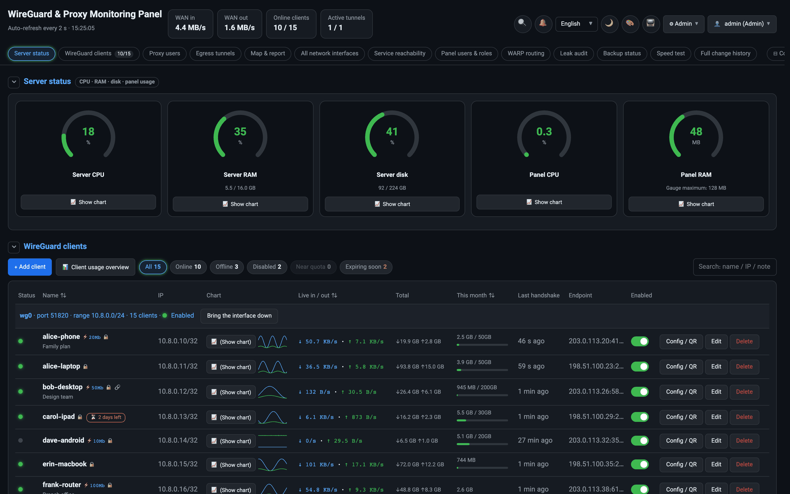
</p>
<p align="center"><sub>На всех снимках экрана в этом README — вымышленные демонстрационные данные; см. <a href="#screenshots">Снимки экрана</a>.</sub></p>

## Содержание

- [Снимки экрана](#screenshots)
- [Возможности](#features)
- [Графический движок](#chart-engine)
- [Качество соединения (WG-NQMO)](#wg-nqmo)
- [Карта и отчёт (SvgStudio и Excel)](#map-and-report)
- [Языки](#languages)
- [Требования](#requirements)
- [Быстрый старт с Docker](#quick-start-with-docker)
- [Установка через systemd](#install-with-systemd)
- [Обновление](#upgrading)
- [Настройка](#configuration)
- [Настройка Telegram-бота](#telegram-bot-setup)
- [Прокси Squid](#squid-proxy)
- [Резервное копирование](#backups)
- [TLS и обратные прокси](#tls-and-reverse-proxies)
- [Prometheus](#prometheus)
- [Безопасность](#security)
- [Исходящие соединения](#outbound-connections)
- [Ограничения](#limitations)
- [Решение проблем](#troubleshooting)
- [Удаление](#uninstalling)
- [Разработка](#development)
- [Структура репозитория](#repository-layout)
- [Участие в проекте](#contributing)
- [Поддержать проект](#support)
- [Лицензия](#license)

<a id="screenshots"></a>

## Снимки экрана

<table>
  <tr>
    <td width="50%" valign="top">
      <a href="docs/screenshots/client-chart.png">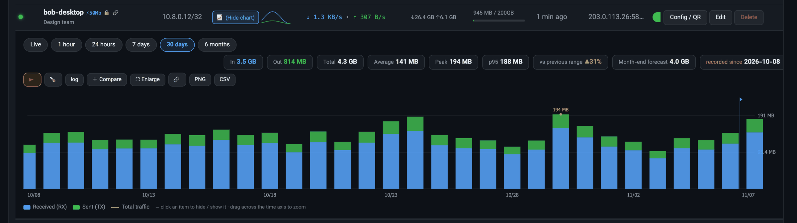</a>
      <p align="center"><b>График трафика клиента</b><br><sub>Суточное потребление за 30 дней: среднее, пик, p95, сравнение с прошлым периодом и прогноз на конец месяца</sub></p>
    </td>
    <td width="50%" valign="top">
      <a href="docs/screenshots/heatmap.png">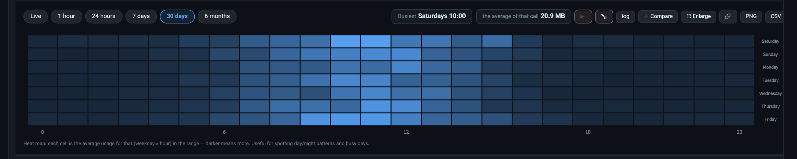</a>
      <p align="center"><b>Тепловая карта «день недели × час»</b><br><sub>Когда клиент пользуется подключением и в какой час нагрузка максимальна</sub></p>
    </td>
  </tr>
  <tr>
    <td width="50%" valign="top">
      <a href="docs/screenshots/rtl-fa.png">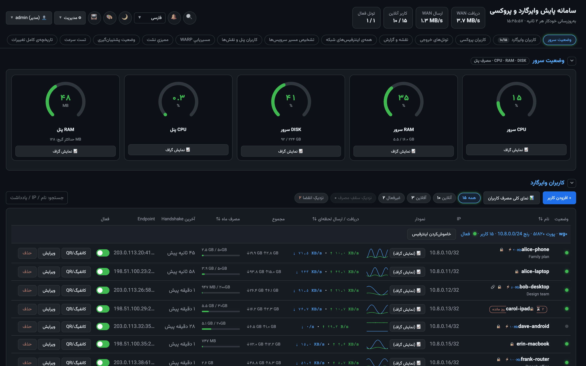</a>
      <p align="center"><b>Персидский, справа налево</b><br><sub>Та же панель на персидском — один из четырёх языков интерфейса</sub></p>
    </td>
    <td width="50%" valign="top">
      <a href="docs/screenshots/light.png">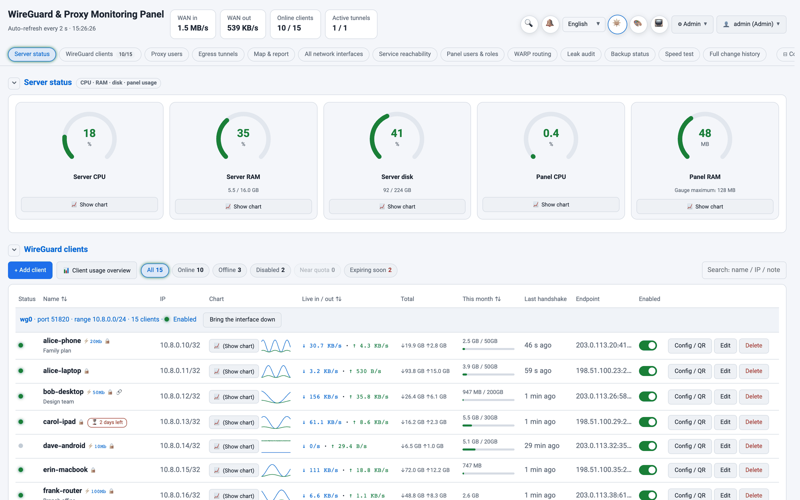</a>
      <p align="center"><b>Светлая тема</b><br><sub>Тёмная и светлая темы переключаются кнопкой на панели инструментов</sub></p>
    </td>
  </tr>
  <tr>
    <td width="50%" valign="top">
      <a href="docs/screenshots/config-qr.png">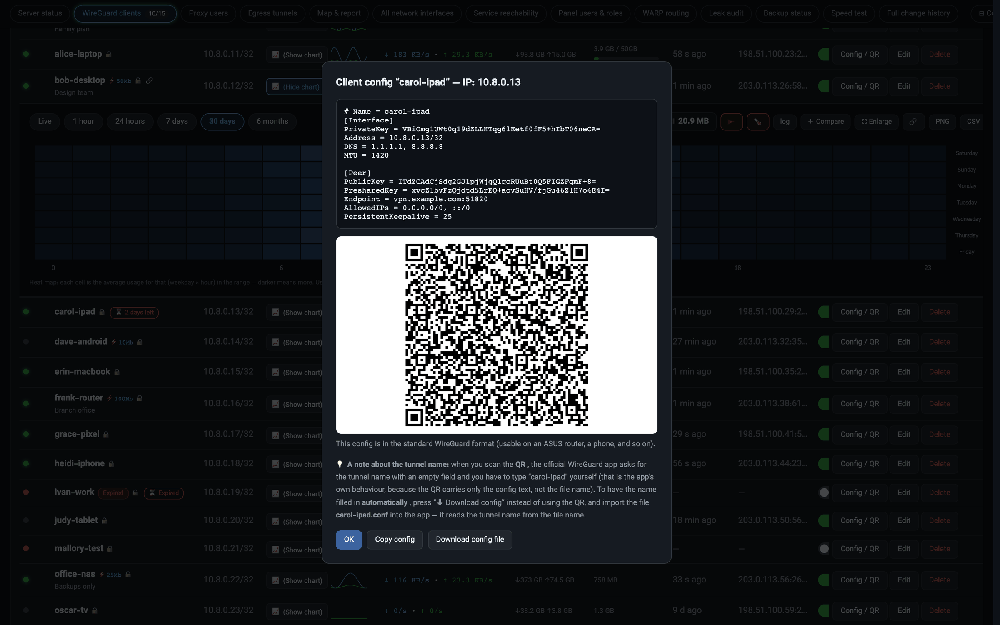</a>
      <p align="center"><b>Конфигурация и QR-код клиента</b><br><sub>Скопируйте её, скачайте файл <code>.conf</code> или отсканируйте QR-код</sub></p>
    </td>
    <td width="50%" valign="top">
      <a href="docs/screenshots/telegram-chart.png">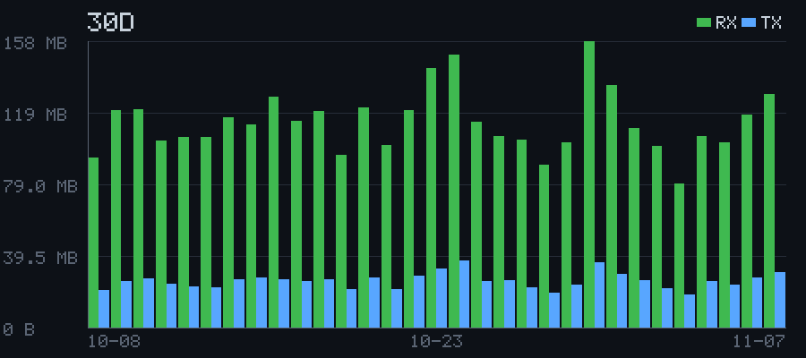</a>
      <p align="center"><b>График из Telegram-бота</b><br><sub>Бот сам рисует PNG на чистом Python</sub></p>
    </td>
  </tr>
  <tr>
    <td width="50%" valign="top">
      <a href="docs/screenshots/event-center.png">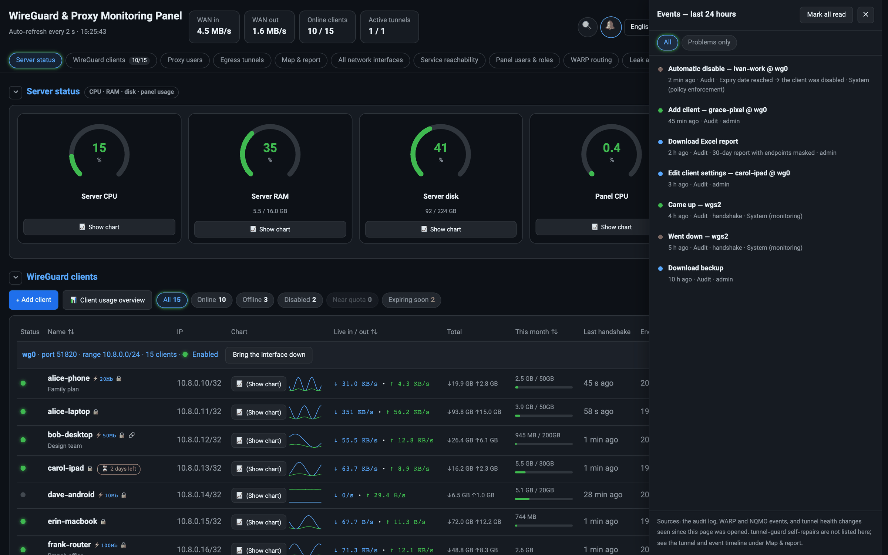</a>
      <p align="center"><b>Центр событий</b><br><sub>Последние 24 часа в одном списке: действия администраторов, WARP, качество соединения и состояние туннелей, повторы объединены</sub></p>
    </td>
    <td width="50%" valign="top">
      <a href="docs/screenshots/command-palette.png">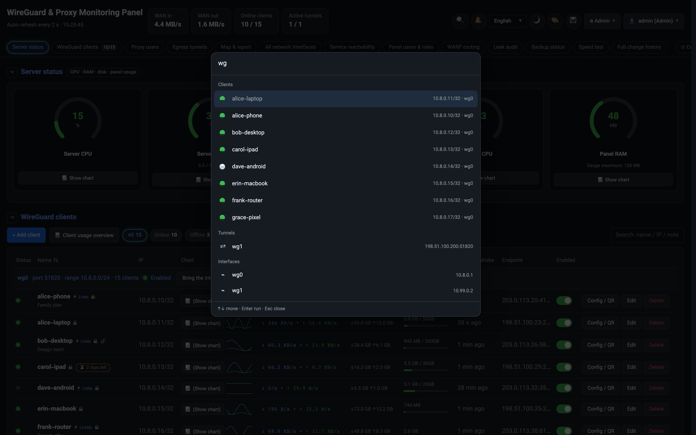</a>
      <p align="center"><b>Поиск и команды</b><br><sub><kbd>Ctrl</kbd>/<kbd>⌘</kbd> + <kbd>K</kbd> находит клиента, туннель, интерфейс, раздел или команду</sub></p>
    </td>
  </tr>
  <tr>
    <td width="50%" valign="top" align="center">
      <a href="docs/screenshots/mobile-cards.png">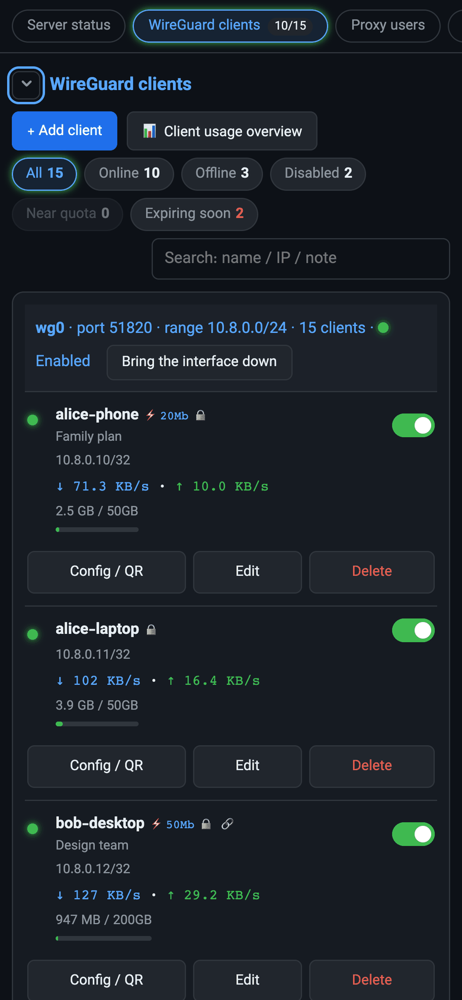</a>
      <p align="center"><b>Панель на телефоне</b><br><sub>На узком экране таблица клиентов превращается в карточки, а фильтры состояния стоят над ними</sub></p>
    </td>
    <td width="50%" valign="top" align="center">
      <a href="docs/screenshots/share-mobile.png">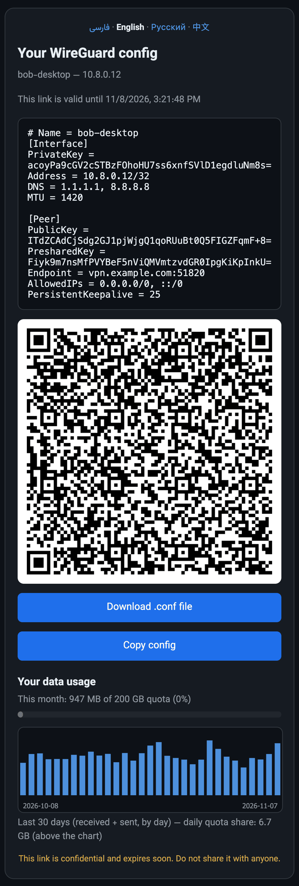</a>
      <p align="center"><b>Страница передачи на телефоне</b><br><sub>Что видит получатель ссылки: конфигурацию, QR-код, кнопку скачивания и своё потребление</sub></p>
    </td>
  </tr>
</table>

<p align="center"><sub>Карта выхода, трассировка пользователя, хронология и отчёт Excel показаны в разделе <a href="#map-and-report">Карта и отчёт</a>.</sub></p>

> [!NOTE]
> Снимки сделаны с настоящей работающей панели, заполненной **вымышленными
> данными**: придуманные имена клиентов, сгенерированные ключи, домен-пример
> `vpn.example.com` и IP-адреса из документационных диапазонов RFC 5737.
> Реальных серверов, пользователей и ключей на них нет. Все они, кроме двух
> снимков Excel, заново создаются командой `python3 demo/screenshots.py`; те два
> сняты в самом Microsoft Excel.

<a id="features"></a>

## Возможности

### Ограничение скорости и трафика для каждого клиента WireGuard

- **Ограничение скорости для каждого клиента** в Мбит/с, применяемое в ядре
  Linux через `tc htb`: загрузка ограничивается на самом интерфейсе WireGuard,
  отдача — через устройство `ifb`. Функция необязательна: пока вы никого не
  ограничили, панель вообще не трогает `tc`, и клиенты без ограничений ничего
  не замечают.
- **Месячная квота трафика**, **общий лимит трафика** и **срок действия** для
  каждого клиента.
- Когда клиент достигает лимита, панель действует сама: **отключает** клиента
  (по умолчанию) или **удаляет** его, записывает событие в журнал и отправляет
  оповещение в Telegram. Об учётных записях, срок которых скоро истекает (по
  умолчанию за 3 дня), тоже приходит уведомление.
- Для пользователей прокси Squid доступно то же самое: квота, ограничение
  скорости и срок действия.

### Профессиональные графики

- Собственный движок графиков на canvas, без сторонних библиотек: линейные и
  столбчатые графики на реальной оси времени, **масштабирование**,
  **логарифмическая шкала**, разрывы там, где нет данных, значения при
  наведении, включение и отключение отдельных серий и полноэкранный режим
- Периоды: **в реальном времени, 1 час, 24 часа, 7 дней, 30 дней и 6 месяцев**
- Графики трафика для каждого клиента, каждого интерфейса и каждого исходящего
  туннеля
- **Тепловая карта «день недели × час»**, показывающая, когда каждый клиент
  пользуется подключением
- Индикаторы загрузки CPU, памяти и диска в реальном времени; графики задержки
  и маршрутизации WARP
- График расхода на каждой странице ссылки, чтобы клиент видел свой расход

Как он устроен и что умеет: [Графический движок](#chart-engine).

### Карта и отчёт: куда уходит трафик и почему пользователь отключён

- **Живая карта выхода трафика**: все пути с сервера, от пользователей через вход
  WireGuard, выбор маршрута (`ip rule`, ECMP) и туннели до физического аплинка,
  вместе с SNI-сплиттером, пулом выхода AI, цепочкой WARP и kill switch. Цвета
  показывают состояние в реальном времени, а щелчок по любой части открывает её
  факты и данные
- **Почему пользователь не подключён?**: путь одного клиента, нарисованный шаг за
  шагом, с выводом в конце: истёк NAT оператора, ни разу не подключался, не в сети,
  сбой выхода и другие
- **Хронология туннелей и событий**: диаграмма Ганта за последние 6, 24 или 72 часа
  с трафиком и простоями каждого туннеля, ремонтами tunnel-guard и событиями WARP,
  WG-NQMO и администраторов
- **Отчёт Excel**: один файл `.xlsx` за 7, 30 или 90 дней, до десяти листов, а
  карта выхода нарисована собственными фигурами Excel. Адреса клиентов по умолчанию
  скрыты

Подробнее — в разделе [Карта и отчёт](#map-and-report).

### Продвинутый Telegram-бот

Бот работает внутри процесса панели и не требует отдельной службы. Это
полноценный второй способ управления сервером — без SSH и без браузера:

- **18 команд** (одна из них, `/botwatch`, — только для владельца) и меню с
  кнопками: создание, просмотр, переименование,
  включение/отключение и удаление клиентов WireGuard и пользователей прокси;
  настройка **квот** и **ограничений скорости**; отправка **файла
  конфигурации** и **QR-кода**
- **Графики в виде изображений** — бот сам рисует PNG (чистый Python, без
  графических библиотек): трафик клиента (24 часа / 7 дней / 30 дней /
  6 месяцев), трафик прокси и тесты скорости, с суммой, средним и пиком в
  подписи
- Пользователи онлайн, поиск, отчёты по сроку действия и по расходу, состояние
  резервных копий, тест скорости и ежедневная или еженедельная сводка
- **11 видов оповещений**: падение и восстановление исходящих туннелей,
  исчерпание квоты, скорое истечение учётных записей, высокая загрузка
  CPU/RAM/диска, использование swap, повторные неудачные входы, сбой загрузки
  резервной копии, падение скорости, перезапуск панели и другие
- **Подтверждение входа в панель** одним нажатием в Telegram (необязательно)
- Роли для пользователей бота (`owner`, `admin`, `viewer`) и свой язык для
  каждого пользователя (`/lang`)

### Другие возможности

**Клиенты**

- Статус онлайн/офлайн по времени последнего рукопожатия, приём и передача
  каждого клиента в реальном времени (замер каждые 2 секунды)
- Добавление клиента (генерация пары ключей, выбор свободного адреса из пула)
  и удаление
- Включение и отключение клиента на работающем интерфейсе **и** в файле
  конфигурации, чтобы изменение сохранялось после перезапуска
- Готовая конфигурация клиента с кнопками копирования и скачивания и QR-кодом
- **Ссылки для передачи** — отдельная страница с QR-кодом, кнопкой скачивания и
  графиком расхода, чтобы отправить конфигурацию другому человеку. Ссылка
  действует от 1 минуты до 24 часов, может быть одноразовой и может быть
  отозвана. Язык страницы выбирается по браузеру получателя.

**Сервер**

- Состояние исходящих туннелей: endpoint, скорость в реальном времени,
  состояние юнита systemd
- Интерфейсы WireGuard и AmneziaWG
- Управление пользователями прокси Squid — см. [Прокси Squid](#squid-proxy)
- Состояние Cloudflare WARP и необязательная служба разделения по SNI, которая
  маршрутизирует соединения по имени хоста назначения (для них нужны
  вспомогательные скрипты, которых нет в этом репозитории, — см.
  [Ограничения](#limitations))
- Качество соединения каждого клиента (время приёма-передачи, потери, MTU) с
  диагнозами и оповещениями, через отдельный движок WG-NQMO из этого
  репозитория; по умолчанию выключено — см.
  [Качество соединения (WG-NQMO)](#wg-nqmo)
- Аудит утечек только на чтение (маршрутизация; DNS и IPv6 — через Telegram-бота)
- Резервное копирование и восстановление; перед каждой записью файл
  конфигурации автоматически копируется, а запись атомарна
- Журнал всех действий: кто, что и с каким результатом
- Режим ТВ/киоска, поочерёдно показывающий страницы состояния, включая карту
  выхода и трёхмерную схему сети

**Интерфейс**

- Полоса разделов вверху страницы с живыми счётчиками; любой раздел можно свернуть,
  а можно свернуть все сразу
- **Поиск и команды** по <kbd>Ctrl</kbd>/<kbd>⌘</kbd> + <kbd>K</kbd>: перейти к клиенту,
  туннелю, интерфейсу или разделу либо выполнить команду. <kbd>/</kbd> ведёт к полю
  фильтра текущего раздела, а <kbd>?</kbd> показывает список сочетаний клавиш
- **Центр событий** под значком колокольчика: последние 24 часа действий
  администраторов, событий WARP и WG-NQMO и изменений состояния туннелей, с
  объединением повторов и фильтром *Только проблемы*
- Фильтры состояния над таблицей клиентов (в сети, не в сети, отключены, близки к
  квоте, скоро истекают), а в каждой строке полоса квоты и значок «осталось дней»
- Все подтверждения идут через одно и то же окно. Необратимые действия (удаление
  клиента, остановка туннеля, восстановление резервной копии из облака) просят
  сначала ввести имя, а форма с несохранёнными изменениями спрашивает, прежде чем
  закрыться
- Кнопка **Отменить** в уведомлении после включения или отключения клиента, в
  течение десяти секунд
- На телефоне таблица клиентов превращается в карточки
- Состояния «загрузка», «пусто» и «ошибка» с кнопкой *Повторить*; заметная рамка
  фокуса при работе с клавиатуры, объявления для экранных дикторов и меньше анимации,
  если этого просит система

**Доступ**

- Несколько пользователей; встроенные роли `admin` и `viewer`, а также
  собственные роли из каталога детальных разрешений
- Необязательная двухфакторная аутентификация TOTP и необязательное
  подтверждение каждого входа в панель через Telegram
- Подписанные cookie сеанса, ограничение попыток входа, необязательный список
  разрешённых IP
- Метрики Prometheus по адресу `/metrics`, защищённые токеном Bearer

<a id="chart-engine"></a>

## Графический движок

Все графики панели рисует небольшой движок, написанный для этого проекта с
нуля: чистый Canvas 2D, около двух тысяч строк JavaScript в
`wgpanel/web/page.html`. Никаких библиотек графиков и никаких CDN, поэтому он работает и
на сервере без доступа в интернет. Движок понимает данные, которые рисует: он
знает, что такое квота, когда клиента отключили и сколько байт туннель передал
за последние десять секунд.

### Что он рисует

| График | Где | Что показывает |
|---|---|---|
| Трафик | Каждый клиент, интерфейс и исходящий туннель | Приём и передачу плюс пунктирную линию общего трафика; линии для «Живой» и «1 час», столбцы начиная с 24 часов |
| Тепловая карта | Любой график трафика, 7 или 30 дней | Средний расход в каждый час каждого дня недели и самый загруженный час |
| Разбивка по клиентам | Каждый интерфейс WireGuard | Как трафик интерфейса делится между клиентами: первые 7, остальные вместе как «Прочие» |
| Сравнение | Любой набор выбранных графиков | Несколько клиентов, туннелей или интерфейсов линиями на одной общей оси |
| Обзор трафика | Раздел клиентов WireGuard | Накопительный расход всех клиентов интерфейса во времени |
| Индикаторы сервера | CPU, RAM, диск, CPU и RAM панели | История за каждым индикатором |
| Тест скорости | Раздел теста скорости | Загрузку и отдачу в Мбит/с и пинг на второй оси |
| WARP | Раздел WARP | Время ответа напрямую и через WARP, а также долю трафика, идущую к AI-сервисам |
| Качество маршрута | Диагностика доступа к сервисам | Качество связи (MOS) и время отклика для каждого измеренного маршрута |
| Страница передачи | Страница, которую открывает ссылка | Расход самого получателя за последние 30 дней и его дневную долю, если у него есть квота |

### Откуда берутся данные

| Диапазон | Одна точка — это | Хранится |
|---|---|---|
| Живой | замер за 2 секунды | последние 3 минуты, в памяти |
| 1 час | среднее за 10 секунд | последний час, в памяти (после перезапуска начинается заново) |
| 24 часа | один час | около 21 дня, в SQLite |
| 7 дней · 30 дней · 6 месяцев | один день | около 400 дней, в SQLite; вид за 6 месяцев может группировать дни по неделям |

Трафик пользователей прокси считается по журналу доступа Squid, и для них
графики начинаются с вида за 24 часа. Тепловая карта строится из почасовых
записей, поэтому заглядывает назад примерно на 21 день.

### Цифры над каждым графиком

- **Приём, Передача, Всего**: текущая скорость в режимах «Живой» и «1 час»;
  сумма за диапазон на более длинных видах.
- **Среднее** и **Пик**, а также **p95**: значение, ниже которого остаются 95%
  часов или дней диапазона. Поэтому один всплеск его не искажает.
- **к предыдущему диапазону**: изменение относительно такого же по длине
  периода непосредственно перед ним. Янтарный ▲ — больше, зелёный ▼ — меньше.
- **Прогноз на конец месяца** для клиентов с месячной квотой. Расход с начала
  месяца растягивается на весь месяц, и при слишком высоком темпе появляется
  предупреждение «~N дней до исчерпания квоты».
- **записано с**: первый день с данными, чтобы короткую историю не приняли за
  малый расход.

На самом графике золотая точка отмечает пик, а у клиентов с квотой
пунктиром показана их дневная доля квоты.

### Работа с графиком

- **Наведение курсора** показывает значения всех рядов в этот момент. Если
  открыто несколько графиков, все они следуют за тем же моментом времени.
- **Масштаб**: протяните по графику, чтобы выделить промежуток, или крутите
  колесо мыши. На телефоне разведите два пальца. После увеличения
  перетаскивание двигает график по оси времени. Двойной щелчок или
  **↺ Весь диапазон** возвращает исходный вид. Вертикальная шкала
  подстраивается под видимую часть.
- **Щелчок по элементу легенды** скрывает или показывает этот ряд.
- **log** включает логарифмическую шкалу, чтобы тихий и активный клиент
  читались на одном графике.
- **🚩** отмечает на оси времени изменения из журнала: красным, когда клиента
  отключили или туннель упал; зелёным, когда что-то вернулось; синим — прочие
  изменения. На графике туннеля время простоя дополнительно закрашено красным.
  Наведите курсор рядом с флажком, чтобы увидеть, что произошло, кто это
  сделал и почему. График интерфейса WARP показывает и собственные события
  WARP, например переход на резервный ключ.
- **⛶ Увеличить** открывает график на весь экран, а **＋ Сравнить** добавляет
  его к сравнению.
- **🔗** копирует ссылку именно на этот вид: график, диапазон, масштаб и режим
  (логарифмический, тепловая карта или разбивка по клиентам).
- **PNG** сохраняет график в полном экранном разрешении вместе с заголовком.
  **CSV** сохраняет исходные записи в UTF-8, готовые для таблицы.

Диапазон, шкала и скрытые ряды каждого открытого графика запоминаются в
браузере.

### Честность по умолчанию

- Начиная с вида за 1 час ось времени — это реальное время: час без данных
  остаётся пустым, а линия прерывается там, где данных нет, а не тянется через
  пробел.
- В виде за 1 час молчащий клиент — это настоящая нулевая линия, а не пробел:
  панель записывает и тишину.
- Шкалы размечены круглыми шагами (1, 2, 2,5 или 5 × 10ⁿ), байты считаются
  степенями 1024. Скорости — в байтах в секунду; тест скорости — в Мбит/с.
- Графики рисуются с реальной плотностью пикселей экрана, поэтому остаются
  чёткими на экранах высокого разрешения, и перерисовываются при изменении
  размера окна.
- Данные обновляются каждые 2 секунды, но пока курсор над графиком,
  обновление ждёт, чтобы график не сдвигался под рукой.

### Цвета и языки

Графики берут цвета из темы страницы и поэтому следуют тёмной и светлой
темам. Кнопка **🎨** включает палитру, различимую при дальтонизме
(Okabe–Ito); в ней линия передачи ещё и пунктирная, чтобы ряды отличались
не только цветом, но и формой. На персидском графики используют персидские
цифры, а графики теста скорости, качества маршрута и WARP показывают даты по
солнечному календарю хиджры.

### Графики в Telegram

Telegram-бот не может запустить браузер, поэтому панель рисует графики и на
сервере, на чистом Python. Она заполняет буфер пикселей, рисует в нём линии и
столбцы, подписывает их встроенным растровым шрифтом и упаковывает результат в
PNG с помощью `zlib`. Изображение размером 900 × 400, столбцы или линии.
Эти картинки бот присылает в графиках клиентов и прокси и в периодическом
отчёте.

<a id="wg-nqmo"></a>

## Качество соединения (WG-NQMO)

Клиент жалуется, что соединение медленное или постоянно обрывается. В чём причина:
в его собственной сети, в сервере, в выходном туннеле, в MTU или просто в
ограничении скорости, которое вы ему задали? WG-NQMO отвечает на этот вопрос со
стороны сервера, отдельно по каждому клиенту, с доказательствами и явным уровнем
уверенности. На устройство клиента ничего не устанавливается.

Это отдельный движок. Он следит за временем приёма-передачи рукопожатия WireGuard,
потерями пакетов на пути от клиента к серверу и MTU клиента, диагностирует неполадки
и может порекомендовать MTU. Диагнозы и рекомендации — только отчёты: движок никогда
не меняет настройки сам.

> [!NOTE]
> **Движок — отдельная служба в этом репозитории, и он необязателен.** Версия 1.3.0
> добавила сторону панели: хуки, которые показывают то, что сообщает движок, и передают
> ему данные самой панели и команды администратора. Версия 1.4.0 добавляет сам движок,
> `wg_nqmo.pyz`, собранный из `nqmo/`. По умолчанию хуки выключены, поэтому панель без
> движка работает так, будто их нет.

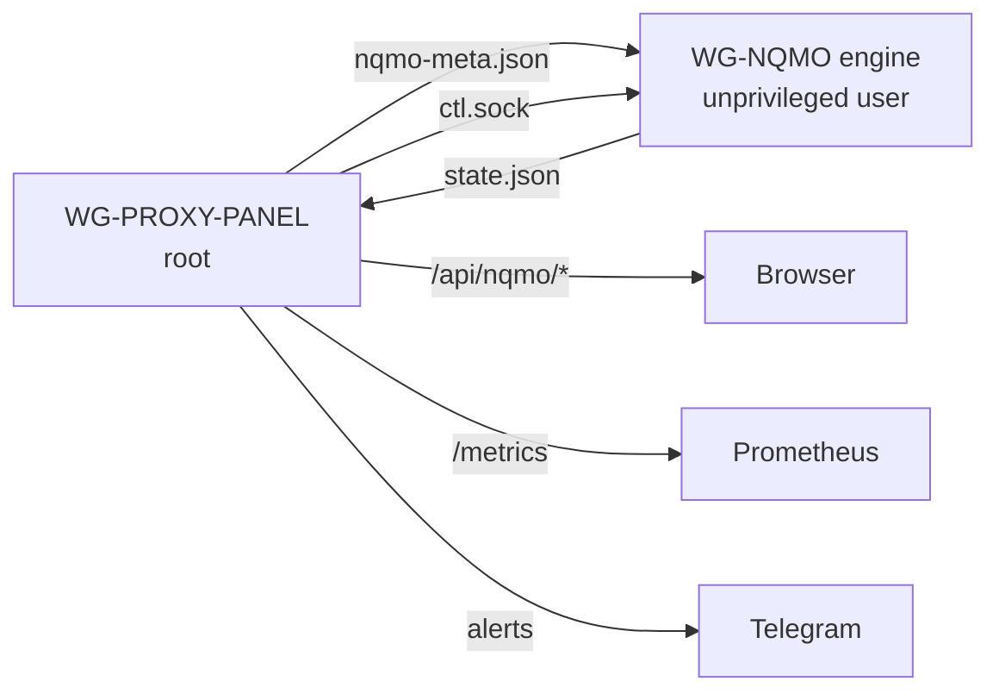

### Что вы увидите

- **В панели.** Раздел **Качество соединения** показывает режим движка и возраст его
  данных, сборщики (исправен, сбой или выключен), охват, размер базы данных, общие
  диагнозы и находки в конфигурации; таблицу клиентов с качеством, медианой времени
  приёма-передачи, потерями на пути к серверу, статусом MTU и открытыми диагнозами; и
  последние 50 событий.
- **По каждому клиенту.** Щелчок по клиенту открывает последние 15 минут, диагнозы с
  доказательствами и рекомендации с причиной и ограничениями. В окне редактирования
  клиента то же самое есть в блоке **Качество и MTU (WG-NQMO)**.
- **В Telegram.** Новый, усилившийся или устранённый диагноз становится оповещением.
- **В Prometheus.** Те же числа в виде рядов `wg_nqmo_*`, с примерами запросов в
  разделе [Справочник](#wg-nqmo-reference).

Раздел обновляется каждые 30 секунд и только пока вкладка браузера видна. Число,
которое движок не сообщил, показывается как «—», а не как 0.

На движок действуют три кнопки: **Подтвердить** у диагноза, проверка MTU и смена
режима. Каждая просит подтверждения и, принята команда или отклонена, записывается
в историю.

### Установка движка

Движок — отдельная служба: второй единственный файл, `wg_nqmo.pyz`, собранный из пакета
`nqmo/` в этом репозитории и работающий от непривилегированного системного пользователя
`wg-nqmo`. Ему нужен Python 3.10 или новее и больше ничего; он ставится на тот же
сервер, где работает панель, а в образ Docker не входит. Соберите, установите и
выполните самопроверку:

```bash
python3 tools/build_nqmo_pyz.py --out dist/wg_nqmo.pyz
sudo useradd --system --user-group --no-create-home --home-dir /nonexistent --shell /usr/sbin/nologin wg-nqmo
sudo install -d -m750 -o root -g wg-nqmo /opt/wg-nqmo
sudo install -m640 -o root -g wg-nqmo dist/wg_nqmo.pyz /opt/wg-nqmo/wg_nqmo.pyz
sudo install -d -m755 -o root -g root /etc/wg-nqmo
sudo install -m640 -o root -g wg-nqmo deploy/wg-nqmo.config.json /etc/wg-nqmo/config.json
sudo install -m644 -o root -g root deploy/wg-nqmo.service /etc/systemd/system/wg-nqmo.service
sudo systemctl daemon-reload
sudo -u wg-nqmo python3 -I /opt/wg-nqmo/wg_nqmo.pyz --check
sudo systemctl enable --now wg-nqmo
```

Самопроверка печатает `NQMO_CHECK_OK`; без него службу не запускайте. Затем включите
хуки панели, как описано в следующем разделе, и убедитесь, что `/metrics` сообщает
`wg_nqmo_up 1`.

**Только наблюдение и никакой активной диагностики по умолчанию.** Поставляемая
`deploy/wg-nqmo.config.json` запускает движок в режиме **Только наблюдение** с
выключенным `active_probes` и выключенным захватом заголовков. В этом состоянии движок
читает файл панели и счётчики ядра и пишет свой файл состояния. Он не отправляет ни
одного пакета, не проверяет клиентов, не меняет настроек и не поднимает оповещений;
диагнозы вычисляются и сохраняются, но не показываются. Поднимайте режим из панели, по
одному шагу, когда увидите, что он измеряет.

**Захват заголовков** (необязательно). Время приёма-передачи, потери и свидетельства по
MTU берутся из заголовков WireGuard на проводе, поэтому для них захват должен быть
включён. Установите drop-in `deploy/wg-nqmo-capture.conf`, который даёт службе только
`CAP_NET_RAW`, и конфигурацию `deploy/wg-nqmo.capture.config.json`, которая включает
захват. Движок читает только заголовки пакетов WireGuard на порту из `listen_port`;
полезная нагрузка зашифрована и никогда не сохраняется. Фильтры скомпилированы для порта
`53953`: для другого порта измените `PORT` в `tools/gen_nqmo_bpf.py` и пересоберите
(нужен `tcpdump`), иначе захват откажется стартовать. Никогда не давайте службе
`CAP_NET_ADMIN`: с ним `wg show` раскрыл бы закрытые ключи.

```bash
sudo install -d -m755 -o root -g root /etc/systemd/system/wg-nqmo.service.d
sudo install -m644 -o root -g root deploy/wg-nqmo-capture.conf /etc/systemd/system/wg-nqmo.service.d/capture.conf
sudo install -m640 -o root -g wg-nqmo deploy/wg-nqmo.capture.config.json /etc/wg-nqmo/config.json
sudo systemctl daemon-reload
sudo systemctl restart wg-nqmo
```

**Квота ресурсов.** Юнит ограничивает движок значениями `CPUQuota=20%`, `MemoryHigh=128M`
и `MemoryMax=160M` при `Nice=10`, чтобы он никогда не конкурировал с путём данных. С
захватом на загруженном сервере этот предел слишком тесен: watchdog убивает движок,
пока тот закрывает окно анализа. `deploy/wg-nqmo-resources.conf` поднимает три значения до
`200%`, `256M` и `320M`; установите его как `resources.conf` рядом с `capture.conf`.
Движок — наблюдатель: если он остановится, ничто другое не остановится, а
`systemctl disable --now wg-nqmo` убирает его без какого-либо сетевого состояния,
которое нужно было бы откатывать.

**Метрики.** У движка нет собственной конечной точки. Всё, что он измеряет, попадает в
Prometheus через `/metrics` панели в виде серий `wg_nqmo_*`, перечисленных в
[Справочнике](#wg-nqmo-reference).

**Почасовой архив для просмотра** (необязательно). `deploy/wg-nqmo-review.sh` со своими
службой и таймером каждый час сохраняет сжатую копию файла состояния и одну строку
сводки в `/var/lib/wg-nqmo/review`: только счётчики, без имён, ключей и адресов, на 14
дней.

### Включение и выключение

Хуки включены, только если в `config.json` под `nqmo.enabled` стоит JSON-значение
`true`; `"true"`, `1` или отсутствие ключа означают «выключено». Пока они выключены:

- панель ничего не читает и не пишет для движка;
- `/api/stats` и `/metrics` отвечают ровно так же, как без хуков;
- шесть маршрутов `/api/nqmo/*` отвечают только ошибкой «движок отключён»
  (`"disabled": true`);
- страница не отправляет запросов WG-NQMO и не показывает раздел WG-NQMO, а группа
  разрешений и тип оповещения WG-NQMO скрыты. При сохранении роли или настроек
  оповещений сохранённые значения WG-NQMO остаются прежними.

Чтобы включить их, когда движок установлен, добавьте это в `config.json`:

```json
"nqmo": {"enabled": true, "user_iface": "wg0"}
```

1. Укажите в `user_iface` интерфейс WireGuard, к которому подключаются клиенты; панель
   сообщает движку его MTU и метку брандмауэра. По умолчанию — `wg1udp`. Если
   интерфейса с таким именем нет, панель ничего не пишет для движка, поэтому укажите
   свой интерфейс.
2. Перезапустите панель.
3. Выдайте `nqmo.view` тем, кому это нужно. У встроенной роли `admin` есть все
   разрешения WG-NQMO, у встроенной роли `viewer` — ни одного.
4. Проверьте, что `/metrics` сообщает `wg_nqmo_up 1`. Если там 0, причину называет ряд
   `wg_nqmo_unavailable{why}`; см. [Устранение неполадок](#wg-nqmo-troubleshooting).

Включение хуков без движка ничему не вредит: раздел сообщит, что движок ещё ничего не
записал.

Чтобы выключить их, задайте `enabled` равным `false` или удалите ключ и перезапустите
панель. Панель перестанет обновлять свой файл для движка. Она не останавливает движок
и не удаляет его файлы, а сохранённые значения ролей и оповещений остаются прежними.

### Режимы движка

Движок начинает с режима **Только наблюдение**, а повышается вручную, чтобы вы видели,
что он измеряет, прежде чем он начнёт делать выводы. Режим меняется только на один шаг;
и панель, и движок отклоняют перескок.

| Режим | В панели | Telegram | Рекомендации и проверка MTU |
|---|---|---|---|
| **Только наблюдение** (`OBSERVATION_ONLY`) | Время приёма-передачи и потери. Диагнозы вычисляются и сохраняются, но не показываются | Нет | Нет |
| **Диагностика включена** (`DIAGNOSTICS_ENABLED`) | Плюс диагнозы и столбец качества | Новые диагнозы со средней или высокой уверенностью | Нет |
| **Рекомендации включены** (`RECOMMENDATIONS_ENABLED`) | Плюс рекомендации | Как выше | Да; проверка должна быть разрешена и в настройках движка |

### Как читать результаты

**Качество** — наихудшая уверенность среди открытых диагнозов клиента. Это не оценка
самого соединения: «в норме» означает, что ни одно правило не нашло проблемы.

| `wg_nqmo_peer_quality_state` | Показывается как |
|---|---|
| −1 | Недостаточно данных |
| 0 | В норме, диагнозов нет |
| 1 | Диагноз, низкая уверенность |
| 2 | Диагноз, средняя уверенность |
| 3 | Диагноз, высокая уверенность |

**Диагнозы.** Каждый называет свою область, уверенность, качество данных, доказательства
и, с разрешением `nqmo.detail`, что говорит против него и чем ещё это можно объяснить.
Диагноз — это обоснованное подозрение, а не доказательство.

| Код | Показывается как | Область | Что это значит |
|---|---|---|---|
| `SERVER_RESOURCE_BOTTLENECK` | Нехватка ресурсов сервера | Общий | Сам сервер отбрасывает пакеты: очереди ядра, сетевая карта, буферы UDP, отслеживание соединений или память сборки фрагментов |
| `HANDSHAKE_FLOOD` | Лавина рукопожатий | Общий | Рукопожатий приходит больше, чем WireGuard может обработать одновременно |
| `EGRESS_TUNNEL_DEGRADATION` | Деградация выходного туннеля | Выход | Выходной туннель неисправен; клиенты за ним страдают не по своей вине |
| `TRAFFIC_SHAPING_EFFECT` | Влияние ограничения скорости | Устройство | Клиент упирается в ограничение скорости, заданное в панели; ограничение работает, это не сбой |
| `HANDSHAKE_FAILURE` | Сбой рукопожатия | Устройство | Клиент отправляет рукопожатия, а сервер на них не отвечает; проверьте ключ и конфигурацию |
| `NAT_OR_FIREWALL_ISSUE` | Проблема NAT или межсетевого экрана | Устройство | Сервер отправляет, а в ответ ничего не приходит. Типично для истёкшего отображения NAT на стороне клиента; точную причину с сервера не определить |
| `ROUTING_ANOMALY` | Аномалия маршрутизации | Устройство | Обратный маршрут к клиенту идёт не через ожидаемый интерфейс, или маршруты изменились одновременно с падением качества |
| `UDP_INSTABILITY` | Нестабильность UDP | Устройство | Адрес клиента постоянно меняется, или пакеты приходят не по порядку либо с повторами |
| `PACKET_LOSS` | Потеря пакетов | Устройство | Статистически явные потери на пути к серверу, а не случайный замер |
| `NETWORK_CONGESTION` | Перегрузка сети | Устройство | Время приёма-передачи рукопожатия заметно выше обычного уровня этого клиента |
| `SUSPECTED_MTU_PROBLEM` | Подозрение на проблему MTU | Устройство | MTU клиента больше, чем способен пропустить путь, и его пакеты приходят фрагментами |
| `SUSPECTED_PMTU_BLACKHOLE` | Подозрение на «чёрную дыру» PMTU | Устройство | Большие пакеты теряются в пути, а маленькие проходят |
| `UNKNOWN_DEGRADATION` | Деградация без явной причины | Устройство | Хуже обычного уровня этого клиента, и ни одно правило не объясняет почему |

**Статус MTU** — то, что движок может сказать об MTU клиента. Применять предложенное
значение или нет, решаете вы; за вас ничего не меняется.

| `wg_nqmo_peer_mtu_status` | Показывается как | Значение |
|---|---|---|
| 0 | Не определено | Недостаточно доказательств для вывода |
| 1 | Кандидат для проверки | Есть предложенное значение, но его нужно проверить |
| 2 | Оценено | Значение получено из устойчивых измерений или проверки |
| 3 | Подтверждено | Пакеты полного размера дошли до сервера без фрагментации; обратный путь не подтверждён |

**Находки в конфигурации** вычисляются из конфигурации, а не измеряются, поэтому они
появляются только в панели и никогда не становятся оповещениями.

### Проверка MTU

Проверка отправляет одному клиенту несколько тестовых пакетов, чтобы найти наибольший
размер, который проходит; это помогает, когда пассивное наблюдение не даёт ответа.
Нужно всё из этого списка:

- режим **Рекомендации включены**, и проверка разрешена в настройках движка;
- у пользователя есть `nqmo.probe`;
- последнее рукопожатие клиента было менее 2 минут назад, то есть он в сети;
- другая проверка не выполняется, и этого клиента не проверяли в последний час;
- имя клиента не повторяется на другом интерфейсе.

Клиента, который не отвечает на ping, проверить нельзя.

<a id="wg-nqmo-troubleshooting"></a>

### Устранение неполадок

**Раздел или `wg_nqmo_unavailable{why}` сообщает, что данные непригодны:**

| `why` | Значение | Что делать |
|---|---|---|
| `disabled` | Хуки выключены | Ничего, если только вы не собирались их включить. В этом состоянии в `/metrics` нет рядов WG-NQMO |
| `missing` | Движок ещё ничего не записал | Он не установлен или только что запущен; проверьте его службу |
| `unreadable` | Файл нельзя прочитать | Проверьте права. Символическая ссылка и всё, что не является обычным файлом, отклоняется намеренно |
| `too_large` | Файл превышает предельный размер | Проверьте движок; файл должен быть намного меньше |
| `corrupt` | Файл не является корректным документом | Посмотрите журнал движка |
| `schema` | Версия документа не совпадает с панелью | Приведите панель и движок к совместимым версиям |
| `stale` | Файлу больше 3 минут | Движок остановился или завис |
| `clock` | Файл датирован будущим | Исправьте системные часы |
| `error` | Внутренняя ошибка при чтении файла | Посмотрите журнал панели |

**Команда отклонена** (код есть в поле `refused` и в истории):

| Код | Значение | Что делать |
|---|---|---|
| `UNREACHABLE` | Панель не смогла подключиться к движку | Запустите движок |
| `NO_REPLY` | Движок закрыл соединение без ответа | Вероятно, панель запущена не от root |
| `TIMEOUT` | Движок не ответил вовремя | Повторите; если это повторяется, проверьте движок |
| `MODE_GATE` | Проверке нужен режим **Рекомендации включены** | Повышайте режим по одному шагу |
| `FLAG_GATE` | Проверка выключена в настройках движка | Разрешите её там, если она вам нужна |
| `META_STALE` | Копия данных панели у движка устарела | Проверьте `user_iface` и наличие группы `wg-nqmo` |
| `NO_SUCH_PEER` | Движок не знает этого клиента | Дождитесь следующего обновления панели |
| `PEER_NOT_PROBEABLE` | Клиент отключён или не имеет адреса в туннеле | Проверять нечего |
| `STALE_HS` | Клиент не в сети | Повторите, когда он подключён |
| `RATE` | Этого клиента уже проверяли в последний час | Повторите позже |
| `BUSY` | Движок занят или выполняется другая проверка | Повторите чуть позже |
| `AMBIGUOUS_PEER` | Это имя есть на нескольких интерфейсах | Переименуйте одного из клиентов |
| `NOT_ADJACENT` | Режим меняется на один шаг | Пройдите через средний режим |
| `NO_SUCH_OPEN_DIAGNOSIS` | Этот диагноз уже не открыт | Ничего делать не нужно |

<a id="wg-nqmo-reference"></a>

### Справочник

<details>
<summary><b>Разрешения</b></summary>

<br>

| Разрешение | Что даёт | Включает |
|---|---|---|
| `nqmo.view` | Просмотр качества и диагнозов | — |
| `nqmo.detail` | Префикс, ASN, корреляции и полные доказательства | `nqmo.view` |
| `nqmo.ack` | Подтверждение диагноза | `nqmo.view` |
| `nqmo.probe` | Запуск ручной проверки MTU | `nqmo.view` |
| `nqmo.manage` | Смена режима движка | `nqmo.view` |

</details>

<details>
<summary><b>Как панель и движок обмениваются данными и чему панель доверяет</b></summary>

<br>

Только через эти файлы; панель никогда не импортирует, не запускает и не останавливает
движок, а хуки не создают исходящих соединений.

| Путь | Направление | Содержимое |
|---|---|---|
| `/run/wg-panel/nqmo-meta.json` | панель → движок, каждые 60 секунд | Клиенты всех клиентских интерфейсов (имя, публичный ключ, адрес в туннеле, endpoint, последнее рукопожатие, счётчики трафика, MTU и ограничение скорости клиента), включённые выходные туннели и их состояние, а также `client_mtu`. Режим `0640`, группа `wg-nqmo`, каталог `0750`. Записывается, только пока существует группа `wg-nqmo`, то есть пока движок установлен |
| `/var/lib/wg-nqmo/state.json` | движок → панель, каждые 60 секунд | Режим движка, сборщики, открытые диагнозы, сводка по каждому клиенту и очередь оповещений. Панель кэширует его на 10 секунд; файл старше 180 секунд считается устаревшим |
| `/run/wg-nqmo/ctl.sock` | панель → движок, по необходимости | Три команды: подтвердить диагноз, запустить проверку MTU, сменить режим. Один запрос на соединение, тайм-аут 7 секунд. На этом сокете движок принимает только root |
| `/opt/wg-panel/nqmo-notified.last` | только панель | Идентификатор последнего оповещения движка, отправленного панелью |

Файл meta содержит имена, публичные ключи и endpoint клиентов (их публичные адреса),
поэтому членство в группе `wg-nqmo` означает доступ к этим данным.

Файлу движка панель не доверяет. Движок работает под своим непривилегированным
пользователем, а панель — под root, поэтому панель читает `state.json` только как
обычный файл, никогда через символическую ссылку, и только до 8 МБ. Она проверяет схему
документа, удаляет из каждой строки управляющие и двунаправленные символы и укорачивает
её, оставляет только конечные числа и показывает диагнозы и ряды только для клиентов,
которых знает сама, так что поддельный файл не может создать клиента или метку.

</details>

<details>
<summary><b>Оповещение в Telegram</b></summary>

<br>

При включённых хуках под `alerts.events` появляется двенадцатый тип оповещения `nqmo`
(«Диагнозы движка качества сети (WG-NQMO)»). Панель пересылает очередь оповещений
движка: диагноз открыт, усилился или устранён, текстами самой панели на всех четырёх
языках.

- Удаление повторов, интервал тишины и почасовой предел — работа движка; панель
  отправляет не более 6 сообщений за 30-секундную проверку.
- При первом запуске и после пересоздания базы данных движка отправляются только
  события моложе 180 секунд, чтобы включение не вылило всю историю в чат.
- Диагноз, закрытый из-за нехватки данных, получает отдельное сообщение ⚪ и не считается
  устранённым.
- Малозначимые и сводные записи не отправляются никогда.

</details>

<details>
<summary><b>API</b></summary>

<br>

Все шесть маршрутов — `POST` с телом JSON, как и в остальной панели.

| Маршрут | Разрешение | Ввод | Ответ |
|---|---|---|---|
| `/api/nqmo/status` | `nqmo.view` | — | Режим, сборщики, охват, база данных, общие диагнозы, находки в конфигурации и сводка по каждому клиенту, известному панели |
| `/api/nqmo/peer` | `nqmo.view` | `name` и `iface` (необязательно) | Один клиент: сводка, диагнозы и рекомендации |
| `/api/nqmo/events` | `nqmo.view` | `since` (0 или больше), `limit` (от 1 до 200) | События очереди после `since`, сначала старые |
| `/api/nqmo/ack` | `nqmo.ack` | `id` | Подтверждает диагноз; он остаётся открытым |
| `/api/nqmo/probe` | `nqmo.probe` | `name` и `iface` (необязательно) | Запрашивает у движка проверку MTU |
| `/api/nqmo/mode` | `nqmo.manage` | `to` (необязательно) | Без `to` — текущий режим; с `to` — переход на один шаг |

</details>

<details>
<summary><b>Prometheus</b></summary>

<br>

При включённых хуках `/metrics` добавляет ряды ниже. Значение, которое движок не
измерил, опускается и никогда не сообщается как 0.

| Ряд | Значение |
|---|---|
| `wg_nqmo_up` | 1, когда файл движка свежий и корректный |
| `wg_nqmo_unavailable{why}` | Причина, если нет; когда файла нет, он нечитаем или устарел, есть только этот ряд и `wg_nqmo_up 0` |
| `wg_nqmo_state_age_seconds` | Возраст файла движка |
| `wg_nqmo_mode{mode}` | 1 для текущего режима |
| `wg_nqmo_collector_ok{collector}` | 1 исправен, 0 сбой, отсутствует, если выключен: `C1_meta` (файл панели), `C2_kernel` (счётчики ядра), `C3_capture` (заголовки пакетов) |
| `wg_nqmo_diagnoses_open{class}` | Открытые диагнозы каждого вида |
| `wg_nqmo_peers`, `wg_nqmo_active_peers` | Клиенты, известные движку, и те, у кого было рукопожатие за последние 180 секунд |
| `wg_nqmo_recent_errors` | Ошибки движка, сохранённые в его файле |
| `wg_nqmo_store_bytes`, `wg_nqmo_store_read_only` | Размер базы данных движка и то, доступна ли она только для чтения |

У каждого клиента есть также эти ряды, с теми же метками `iface` и `name`, что у рядов
`wg_peer_*`:

| Ряд | Значение |
|---|---|
| `wg_nqmo_peer_quality_state` | Качество, описанное выше; отсутствует в режиме **Только наблюдение** |
| `wg_nqmo_peer_rtt_seconds`, `wg_nqmo_peer_rtt_min_seconds`, `wg_nqmo_peer_rtt_samples` | Медиана и минимум времени приёма-передачи рукопожатия, окно 15 минут, не менее 5 замеров |
| `wg_nqmo_peer_upstream_loss_ratio`, `wg_nqmo_peer_upstream_loss_lower_ratio`, `wg_nqmo_peer_upstream_loss_upper_ratio`, `wg_nqmo_peer_upstream_loss_judged_packets` | Потери на пути к серверу с 95-процентными границами Уилсона, окно 5 минут, не менее 1000 оценённых пакетов |
| `wg_nqmo_peer_mtu_status` | Статус MTU, описанный выше |

Примеры запросов:

```promql
wg_nqmo_up == 0
sum by (class) (wg_nqmo_diagnoses_open) > 0
wg_nqmo_peer_quality_state >= 2
wg_nqmo_peer_upstream_loss_lower_ratio > 0.01
```

</details>

**Не входит в поставку:** сам движок и команда Telegram-бота для него.

<a id="map-and-report"></a>

## Карта и отчёт (SvgStudio и Excel)

Раздел **Карта и отчёт** рисует по живому состоянию сервера три картинки:

1. **Живая карта выхода трафика**: где трафик покидает сервер прямо сейчас
2. **Почему пользователь не подключён?**: путь одного клиента шаг за шагом, с выводом в конце
3. **Хронология туннелей и событий**: что происходило с туннелями за последние сутки

Те же данные можно скачать в виде книги Excel.

<p align="center">
  <a href="docs/screenshots/egress-map.png">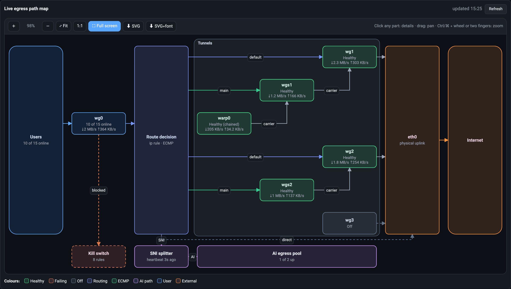</a>
</p>

Думает сервер. `wgpanel/viz.py` собирает живые факты (маршруты, которые ядро
сообщает в ответ на `ip route get`, членство в ECMP, возраст рукопожатий, приём и
отдачу с замерами каждые две секунды) и строит из них модель схемы. Браузер только
рисует эту модель с помощью `wgpanel/web/svgstudio.js`, а тот ничего не знает о
WireGuard: в нём нет ни имён интерфейсов, ни переводов. Все имена на карте берутся
с вашего сервера, поэтому карта подходит к вашей топологии без всякой настройки.

### Живая карта выхода трафика

Карта показывает все пути, которыми пакет клиента может уйти с сервера:
пользователи, вход WireGuard, выбор маршрута (`ip rule` и ECMP), туннели,
физический аплинк и интернет. Если на сервере есть SNI-сплиттер, пул выхода AI,
цепочка WARP и kill switch, они тоже появляются на карте.

- Роль туннеля определяется по маршрутизации, а не по имени. Если его endpoint
  доступен через физический аплинк, это *основной* туннель; если через другой
  туннель, он *вложенный* и рисуется рядом со своим несущим. Вложенный туннель
  поверх работающего несущего — это цепочка, а не петля маршрутизации.
- Цвета показывают состояние в реальном времени: исправно, сбой, выключено,
  маршрутизация, ECMP, маршрут AI, пользователь и внешнее. Участник ECMP, которого
  страж вывел из ротации, так и помечен.
- Щёлкните по любому блоку или стрелке, и откроется боковая панель с фактами: endpoint,
  устройство, через которое к нему идёт маршрут, последнее рукопожатие, скорость и
  объёмы, состояние ECMP и сигнатура трафика вместе с замерами, по которым она
  посчитана.
- Схему можно масштабировать, двигать, вписать в окно, вернуть к 1:1 или открыть
  на весь экран, а также скачать как SVG, со встроенным шрифтом или без него. Карта
  обновляется раз в минуту, но замирает на пять минут после того, как вы с ней
  поработали, и пока открыта боковая панель или полноэкранный режим.
- Карта также входит в слайды режима ТВ/киоска и идёт прямо перед трёхмерной схемой.

<p align="center">
  <a href="docs/screenshots/egress-map-fa.png">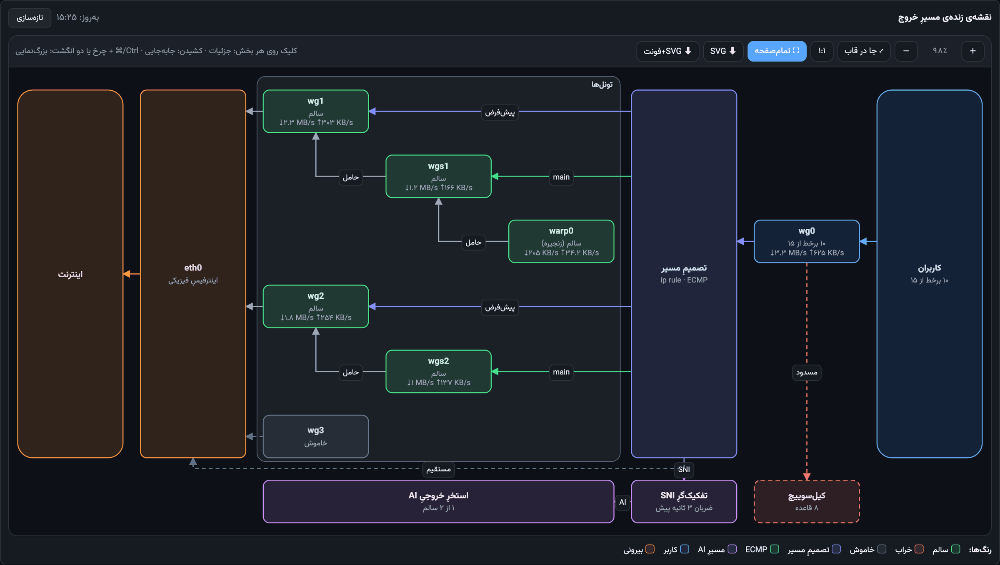</a><br>
  <sub>На персидском вся карта отражается зеркально и читается справа налево.</sub>
</p>

### Почему пользователь не подключён?

Введите имя клиента или выберите его из списка, и панель нарисует диаграмму
последовательности от устройства до интернета: рукопожатие, вход, каждое решение о
маршруте, которое касается адреса именно этого клиента (маршрут по умолчанию, группа
ECMP, маршрут AI), туннели по пути и выход. У каждого шага есть свои данные. Первый
шаг, который не работает, становится **выводом**, а проверки идут в том порядке, в
каком их проходил бы человек:

| Вывод | Что это значит |
|---|---|
| Отключён автоматически · Отключён | Клиент выключен: из-за квоты, срока действия или решением администратора |
| Ни разу не подключался | Рукопожатий не было ни разу: конфигурация не дошла до устройства, ключ неверен или endpoint недоступен |
| NAT оператора | Приёма нет, а сервер всё ещё шлёт мелкие keepalive: у оператора клиента истекло NAT-сопоставление. С сервером всё в порядке; пользователю нужно перезапустить приложение или сменить сеть |
| Не в сети | Рукопожатие давнее и трафика нет: устройство выключено или приложение закрыто. Ничего страшного |
| Сбой выхода | Устройство доходит до сервера, но туннель на его пути неисправен. Роли без доступа к туннелям видят вывод без подробностей о туннеле |
| Нет маршрута | К адресу этого клиента не относится ни одно решение о маршруте |
| Исправно | Все шаги работают |

<p align="center">
  <a href="docs/screenshots/user-trace.png">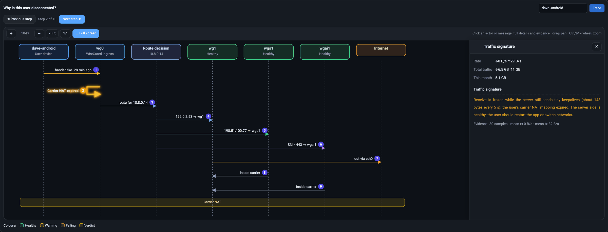</a>
</p>

**Сигнатура трафика** считается по тем же двухсекундным замерам. У каждой сигнатуры
одно постоянное значение, чтобы две похожие поломки не путались между собой:

| Сигнатура | Что показывают цифры |
|---|---|
| NAT оператора истёк | Приём замер, отдача идёт ровной струйкой (около 148 байт каждые 5 секунд), рукопожатие давнее |
| Много отдачи, нет приёма | Отправляется много, обратно ничего: так выглядит петля маршрутизации |
| Endpoint недоступен | Рукопожатие давнее, а сервер продолжает попытки (для туннелей) |
| Только рукопожатие | Рукопожатие свежее, но принят только ответ на него |
| Ни разу не подключался · Не в сети · Подключён, без трафика · Двусторонний трафик · Отключён · Туннель не поднят | Ровно то, что сказано в названии |

Проходите по схеме кнопками *Предыдущий шаг* и *Следующий шаг* или щёлкайте по любому
сообщению. Кнопки скачивания у этой карточки нет, и это сделано нарочно: трассировка
показывает данные одного человека без маскировки.

### Хронология туннелей и событий

Диаграмма Ганта за последние 6, 24 или 72 часа. У каждого туннеля своя дорожка:
почасовой столбик там, где шёл трафик, серый цвет там, где его не было, и красный там,
где туннель лежал. Событие ставится на дорожку того туннеля, к которому оно относится;
у остальных событий свои дорожки:

- изменения туннелей и интерфейсов, замеченные собственным мониторингом панели
  (падение, восстановление, найденная и устранённая петля)
- действия **tunnel-guard** из журнала systemd (`journalctl -t tunnel-guard`):
  смена состояния, ремонт, подтверждённый ремонт, неудачный ремонт и закрепление
  маршрута. Остаются только действия, а не обычный вывод каждой проверки. Без
  скрипта стража эта дорожка пустая
- события WARP (смена endpoint, переключение выхода)
- инциденты WG-NQMO, для ролей с `nqmo.view`
- прочие действия администраторов из журнала, для ролей с `audit.view`

Мониторинг панели и страж следят за одними и теми же туннелями независимо, и оба
дают красные интервалы простоя. Переходите от события к событию кнопками
*Предыдущее событие* и *Следующее событие* или щёлкните по событию, чтобы увидеть
подробности.

<p align="center">
  <a href="docs/screenshots/event-timeline.png">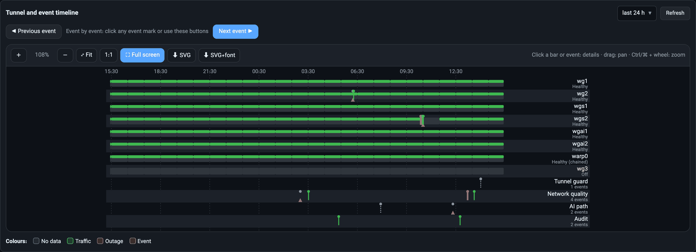</a>
</p>

### Отчёт Excel

Кнопка **Скачать Excel** собирает один файл `.xlsx` за последние 7, 30 или 90 дней.
Файл пишется только стандартной библиотекой (`wgpanel/xlsx.py`), и в нём есть
только те листы, которые разрешено видеть тому, кто его скачивает:

| Лист | Содержимое | Нужно право |
|---|---|---|
| Сводка | Главные цифры (клиенты, сейчас в сети, за этот месяц, исправные туннели, участники ECMP в ротации, SNI-сплиттер), выводы и ссылки на все листы | — |
| Пользователи | Все клиенты: состояние, последнее рукопожатие, endpoint, трафик за месяц, за период и всего, квота и её расход, срок действия, ограничение скорости, заметка и сигнатура трафика | `wg.view` |
| По дням | Трафик по дням с числом активных клиентов и самые активные пользователи с их долей | `wg.view` |
| Туннели | Все туннели: роль, несущий, устройство, через которое идёт маршрут к endpoint, состояние ECMP, исправность, сигнатура, скорость и объёмы | `tun.view` |
| Выход | Карта выхода, нарисованная **собственными фигурами Excel**, и таблица её узлов | `tun.view` |
| События | Те же события, что и в хронологии | `tun.view` |
| Аудит | Действия администраторов: кто, что и с каким результатом | `audit.view` |
| Скорость | Все замеры скорости за период | `sys.view` |
| Система | Нагрузка на сервер: процессор, память и диск | `sys.view` |
| Глоссарий | Что означает каждое состояние, сигнатура и вывод | — |

- На персидском листы идут справа налево. Числа хранятся как числа, так что их можно
  сортировать, фильтровать и суммировать.
- **Адреса endpoint клиентов по умолчанию скрыты.** Снимите флажок *Скрыть IP
  пользователей*, чтобы получить их полностью. Каждое скачивание записывается в журнал
  вместе с периодом и тем, были ли адреса скрыты.
- Любой текст всегда записывается как текст, а не как формула, поэтому клиент с
  именем `=HYPERLINK(…)` так и остаётся просто именем. Даты — настоящие даты Excel, а
  отсутствующее значение остаётся пустым и не превращается в ноль.
- Проверено в Microsoft Excel для Mac: файл открывается без предложения его
  восстановить.

<table>
  <tr>
    <td width="50%" valign="top">
      <a href="docs/screenshots/excel-dashboard.png">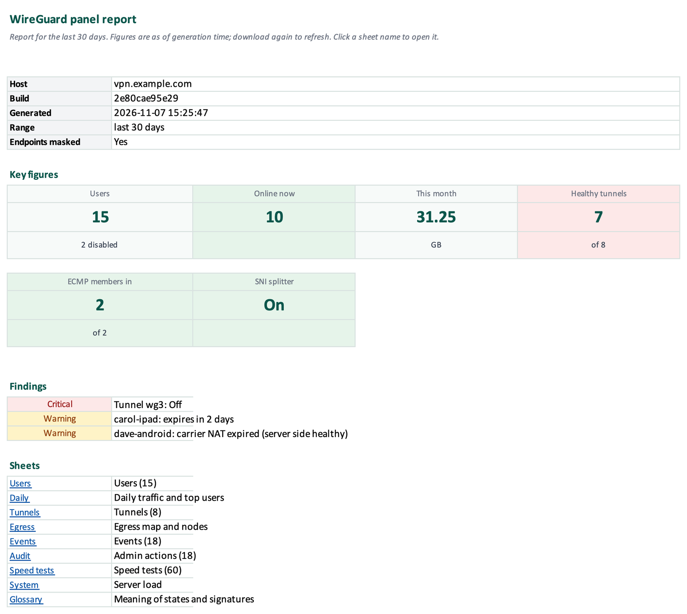</a>
      <p align="center"><b>Лист «Сводка»</b><br><sub>Главные цифры, выводы и ссылки на все листы</sub></p>
    </td>
    <td width="50%" valign="top">
      <a href="docs/screenshots/excel-egress.png">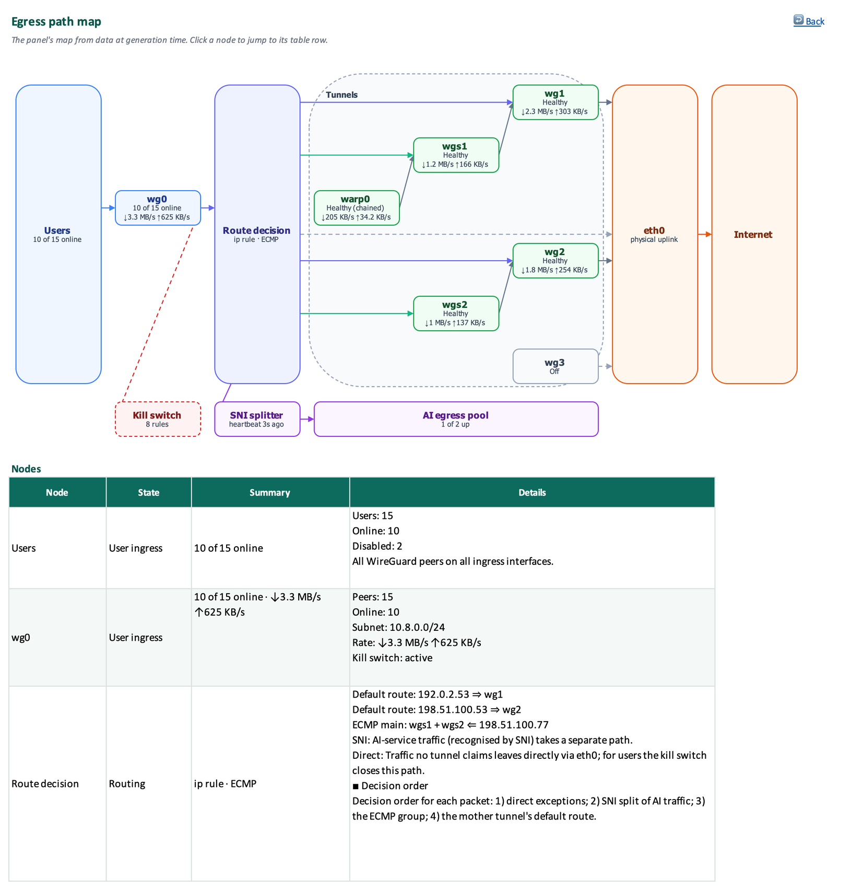</a>
      <p align="center"><b>Лист «Выход»</b><br><sub>Та же карта из фигур Excel, которые можно двигать и править</sub></p>
    </td>
  </tr>
</table>

### Права и API

| Адрес | Право | Что возвращает |
|---|---|---|
| `GET /api/viz/egress` | `tun.view` | Модель карты выхода |
| `GET /api/viz/trace?iface=…&name=…` | `wg.view` | Трассировку одного клиента (`404`, если такого клиента нет) |
| `GET /api/viz/timeline?hours=1…168` | `tun.view` | Модель хронологии |
| `GET /api/report.xlsx?days=1…183&mask=0\|1` | `wg.view` | Книгу Excel; `mask` по умолчанию равен `1` |

Раздел виден любой роли с `tun.view` или `wg.view`, а каждая карточка — только при
своём праве. Модели — это обычный JSON, поэтому тот же `svgstudio.js` может
нарисовать их где угодно.

<a id="languages"></a>

## Языки

Панель, журнал действий, ошибки API, Telegram-бот и оповещения в Telegram
доступны на **английском, персидском, русском и китайском**. Переводы хранятся
в `wgpanel/i18n/catalog.json` (около трёх тысяч ключей) и упаковываются в
`wg_panel.pyz`, чтобы панель по-прежнему устанавливалась одним файлом.

| Где | Как выбирается язык |
|---|---|
| Панель, страница входа, страница ссылки | `?lang=` → cookie `wgl` → `Accept-Language` браузера → персидский |
| Telegram-бот | Для каждого пользователя отдельно — каждый выбирает командой `/lang` |
| Оповещения в Telegram | Язык владельца бота |

Персидские страницы отображаются справа налево, остальные — слева направо;
стили написаны на логических свойствах CSS, поэтому раскладка зеркалируется
сама. Персидские цифры используются только в персидском языке. Идентификаторы —
имена клиентов, ключи, endpoint, IP-адреса — во всех языках остаются
латиницей, чтобы их можно было искать и копировать.

Встроенный шрифт Vazirmatn покрывает персидский и латиницу; для русского и
китайского используется системный шрифт. Ничего не загружается из CDN, поэтому
панель работает и на серверах без доступа в интернет.

<a id="requirements"></a>

## Требования

- Ubuntu 22.04 или 24.04 (x86_64 или arm64) с правами root
- Python 3.10 или новее из дистрибутива — без пакетов pip и без virtualenv
- systemd, `wireguard-tools` и `iproute2`

Всё остальное необязательно. Если какой-то программы нет, отключается только
та функция, которой она нужна:

| Программа | Нужна для |
|---|---|
| `squid`, `openssl` | Пользователи прокси — см. [Прокси Squid](#squid-proxy) |
| `tc` (из `iproute2`) и модуль ядра `ifb` | Ограничения скорости для каждого клиента |
| `qrencode` | QR-коды, которые отправляет Telegram-бот (без него бот отправляет файл `.conf`) |
| `speedtest` (Ookla CLI, нет в репозитории Ubuntu) | Тесты скорости |
| `curl`, `dig`, `ping`, `traceroute` | Диагностика доступа к сервисам и проверки WARP |
| `iptables`, `ipset` | Маршрутизация через WARP |
| `awg`, `awg-quick` | Туннели AmneziaWG |
| `rclone` | Загрузка резервных копий в MEGA S4 (`deploy/`) |

Образ Docker содержит их все, кроме `speedtest`.

Порты, которые нужно открыть в файрволе:

| Порт | Кто использует |
|---|---|
| `8787/tcp` (`port`) | Панель и ссылки для передачи |
| `ListenPort` каждого клиентского интерфейса (`51820/udp` с Docker) | Клиенты WireGuard |
| `18080/tcp` | Прокси Squid, только если вы создаёте пользователей прокси |

> [!NOTE]
> Панель управляет интерфейсами WireGuard, но не проектирует топологию вашей
> сети. Установка через Docker создаёт один интерфейс. При установке через
> systemd панель управляет интерфейсами, которые уже есть на сервере.

<a id="quick-start-with-docker"></a>

## Быстрый старт с Docker

Панель и WireGuard работают в одном контейнере. Первый запуск создаёт
`config.json`, ключи сервера и самоподписанный сертификат TLS; последующие
запуски только обновляют код панели и не трогают ваши данные.

```bash
git clone https://github.com/alibakhtiari-ux/WG-PROXY-PANEL.git
cd WG-PROXY-PANEL/docker
sudo bash host-setup.sh
(umask 077 && cp .env.example .env)
```

Откройте `.env` и задайте как минимум `WG_SERVER_HOST` — публичный IP-адрес
или домен, к которому будут подключаться клиенты. Если оставить его пустым,
при первом запуске адрес сервера запрашивается у `https://ifconfig.me`. В том
же файле можно настроить Telegram-бота (`WG_BOT_TOKEN`, `WG_BOT_OWNER_ID`,
`WG_BOT_CHAT_ID`) и список разрешённых IP (`WG_PANEL_ALLOW_IPS`). Затем:

```bash
docker compose up -d --build
```

Панель откроется по адресу `https://SERVER:8787` с самоподписанным
сертификатом (один раз примите предупреждение браузера). Имя пользователя —
`admin`.

> [!WARNING]
> **Первый введённый пароль становится паролем администратора.** Войдите сразу
> после установки, пока никто другой не получил доступ к порту 8787.

Для серверов без доступа в интернет можно собрать офлайн-пакет на машине с
интернетом и перенести его. Из корня репозитория:

```bash
cd docker/airgap && bash build-offline-bundle.sh --arch amd64
```

Подробнее: [docker/README.md](docker/README.md) ·
[docker/airgap/README.md](docker/airgap/README.md) (на персидском)

<a id="install-with-systemd"></a>

## Установка через systemd

Скачайте панель и её юнит из [последнего релиза](https://github.com/alibakhtiari-ux/WG-PROXY-PANEL/releases/latest) и сверьте их с
опубликованными контрольными суммами (можно и клонировать репозиторий):

```bash
base=https://github.com/alibakhtiari-ux/WG-PROXY-PANEL/releases/latest/download
curl -fLO "$base/wg_panel.pyz" -O "$base/wg_panel.py" -O "$base/wg-panel.service" \
     -O "$base/qr.js" -O "$base/three.module.min.js.gz" -O "$base/three.core.min.js.gz" \
     -O "$base/three.LICENSE.txt" -O "$base/SHA256SUMS"
sha256sum -c SHA256SUMS
```

Панель **не создаёт** конфигурацию сама: она читает `config.json` из того же
каталога, где лежит `wg_panel.py`, и без него не запускается. Установите два
файла панели рядом — `wg_panel.pyz` (вся панель) и `wg_panel.py` (лаунчер на 20
строк по тому пути, который юнит systemd использовал всегда) — и затем юнит:

```bash
sudo install -d -m700 /opt/wg-panel
sudo install -m600 -o root -g root -t /opt/wg-panel wg_panel.pyz wg_panel.py
sudo python3 /opt/wg-panel/wg_panel.py --check
sudo install -m644 -t /opt/wg-panel qr.js three.module.min.js.gz three.core.min.js.gz \
     three.LICENSE.txt
sudo install -m644 wg-panel.service /etc/systemd/system/
```

Затем создайте `/opt/wg-panel/config.json` (владелец root, права `600`).
Минимальный пример — при пустых `salt` и `hash` пароль задаётся при первом
входе; без `tls_cert`/`tls_key` панель работает по обычному HTTP:

```json
{
  "port": 8787,
  "users": [{"username": "admin", "salt": "", "hash": "", "role": "admin"}],
  "server_host": "vpn.example.com",
  "client_dns": "1.1.1.1, 8.8.8.8",
  "client_mtu": 1420
}
```

```bash
sudo systemctl enable --now wg-panel
```

При первом запуске панель дополняет то, чего нет в примере: ключ сессий
(`secret`), случайный `metrics_token` и пустые разделы `allow_ips`, `roles` и
`bot`. Войдите сразу — как и с Docker, первый введённый пароль становится
паролем администратора.

Панель управляет клиентскими интерфейсами, которые находит в `/etc/wireguard`:
конфигурация с `ListenPort` и без `Endpoint` у пиров считается клиентским
интерфейсом, любая другая конфигурация `wg*` — исходящим туннелем. Новые
клиенты получают адрес из подсети `Address` интерфейса. Чтобы задать их явно,
укажите `server_ifaces` и `user_subnets` в `config.json`.

Необязательные юниты для резервного копирования, ротации логов, защиты от OOM
и правило fail2ban находятся в каталоге [deploy/](deploy/) — см.
[Резервное копирование](#backups).

<a id="upgrading"></a>

## Обновление

Панель — это один файл (`wg_panel.pyz`) плюс её лаунчер на 20 строк, поэтому обновление сводится к замене этих двух файлов.
Настройки в `config.json` и данные в `traffic.db` сохраняются; старые
конфигурации автоматически приводятся к актуальному виду при запуске панели.

**С systemd:** скачайте оба файла нового релиза вместе с проверкой
`sha256sum -c`:

```bash
base=https://github.com/alibakhtiari-ux/WG-PROXY-PANEL/releases/latest/download
curl -fLO "$base/wg_panel.pyz" -O "$base/wg_panel.py" -O "$base/wg-panel.service" \
     -O "$base/qr.js" -O "$base/three.module.min.js.gz" -O "$base/three.core.min.js.gz" \
     -O "$base/three.LICENSE.txt" -O "$base/SHA256SUMS"
sha256sum -c SHA256SUMS
```

Затем установите сначала `wg_panel.pyz`, потом лаунчер (порядок аргументов в
команде ниже это обеспечивает), выполните `--check` и перезапустите службу. При
переходе с 1.2.x и старше это единственное изменение: юнит остаётся прежним, а
данные (`config.json`, `traffic.db`, `clients/`) остаются на месте.

```bash
sudo install -m600 -o root -g root -t /opt/wg-panel wg_panel.pyz wg_panel.py
sudo install -m644 -t /opt/wg-panel qr.js three.module.min.js.gz three.core.min.js.gz
sudo install -m644 wg-panel.service /etc/systemd/system/
sudo python3 /opt/wg-panel/wg_panel.py --check
sudo systemctl daemon-reload
sudo systemctl restart wg-panel
```

Чтобы узнать, какая сборка работает на сервере, сравните вывод
`sha256sum /opt/wg-panel/wg_panel.pyz | cut -c1-12` с build id в описании
релиза; это то же значение, что выдаёт `python3 tools/build_pyz.py --id` на
исходниках и установка через Docker. Изменения каждой версии перечислены в [CHANGELOG.md](CHANGELOG.md).

**С Docker:** доставьте новый код на сервер (`git pull`), затем в каталоге
`docker/`:

```bash
docker compose up -d --build
```

> [!TIP]
> Перед обновлением сделайте резервную копию: копию каталога `/opt/wg-panel/`
> (с Docker — `docker/data/`). Одной кнопки **Резервные копии** в панели
> недостаточно: её архив не включает `config.json` — см.
> [Резервное копирование](#backups).

<a id="configuration"></a>

## Настройка

Все настройки хранятся в `/opt/wg-panel/config.json`, и большинство из них
можно изменить в самой панели. Основные ключи:

| Ключ | Назначение |
|---|---|
| `port` | Порт (по умолчанию `8787`) |
| `tls_cert` · `tls_key` | Пути к сертификату и ключу TLS; без них — обычный HTTP |
| `users` | Учётные записи панели (хеши паролей PBKDF2) и их роли |
| `roles` | Собственные роли и их разрешения |
| `server_host` · `server_endpoint` | Адрес, который записывается в конфигурации клиентов |
| `server_label` | Короткое имя сервера в боте и оповещениях (по умолчанию: `server_host`, затем имя хоста) |
| `server_ifaces` · `user_subnets` | Клиентские интерфейсы и их пулы адресов, например `{"wg0": "10.66.66.0/24"}` (по умолчанию определяются по конфигурациям WireGuard) |
| `client_dns` · `client_mtu` · `client_allowed` | Значения по умолчанию для конфигураций клиентов (`1.1.1.1, 8.8.8.8` · `1420` · `0.0.0.0/0, ::/0`) |
| `allow_ips` | Необязательный список разрешённых IP (`127.0.0.1` разрешён всегда) |
| `metrics_token` | Bearer-токен для `/metrics` и `/api/health` |
| `trusted_proxies` | IP/CIDR обратного прокси перед панелью; только тогда IP клиента берётся из `X-Forwarded-For` / `X-Real-IP` и учитывается `X-Forwarded-Proto: https` (https-ссылки для раздачи, cookie с `Secure`) |
| `session_idle_min` | Выход из сессии после стольких минут бездействия (`0`/нет = только абсолютный лимит 12 ч) |
| `secret` | Ключ, которым подписываются cookie сеанса; создаётся при первом запуске. Его смена завершает все сеансы |
| `bot` | Включён ли Telegram-бот, его разрешённые пользователи и их роли |
| `alerts` | Токен бота, чат для оповещений, какие оповещения отправляются, и их пороги |
| `login_2fa` | Подтверждение каждого входа в панель через Telegram |
| `report` | Периодический отчёт с картинками в Telegram: `mode` `off`/`daily`/`weekly`, `time`, `dow` |
| `svc_enabled` · `svc_interval` | Диагностика доступа к сервисам вкл./выкл. (по умолчанию вкл.) и её интервал в секундах (по умолчанию `300`) |
| `speedtest_server` · `speedtest_ifaces` | Id сервера Ookla и интерфейсы, на которых запускается тест скорости |
| `nqmo` | Хуки для отдельного движка WG-NQMO; выключены, пока `enabled` не равно `true` — см. [Качество соединения (WG-NQMO)](#wg-nqmo) |

Пороги оповещений в `alerts` и их значения по умолчанию: `cpu_pct`, `ram_pct`
и `disk_pct` — `90`, если держится `sustain_min` `5` минут, `quota_pct` `90`,
`expiry_days` `3` и `login_fails` — `10` неудачных входов за 10 минут. Каждый
из 11 видов оповещений можно отключить в `alerts.events`.

### Роли и разрешения

Помимо встроенных `admin` и `viewer` (`wg.view`, `tun.view`, `net.view`,
`sys.view`), в панели можно создавать собственные роли из следующих
разрешений:

| Область | Разрешения |
|---|---|
| Клиенты WireGuard | `wg.view`, `wg.add`, `wg.edit`, `wg.del`, `wg.conf` (конфигурация, QR, ссылка для передачи) |
| Пользователи прокси | `proxy.view`, `proxy.add`, `proxy.edit`, `proxy.del`, `proxy.conf` |
| Туннели и сервер | `tun.view`, `tun.toggle`, `net.view`, `sys.view` |
| Диагностика доступа к сервисам | `svc.view`, `svc.edit` |
| Журнал действий | `audit.view` |
| Администрирование | `users.manage`, `alerts.manage`, `bot.manage`, `ecmp.manage`, `warp.manage`, `settings.ips`, `backup.get`, `backup.restore` |
| Качество соединения (WG-NQMO) | `nqmo.view`, `nqmo.detail`, `nqmo.ack`, `nqmo.probe`, `nqmo.manage` (видны, только пока включён `nqmo.enabled`) |

`users.manage` равнозначно полному администратору, потому что позволяет выдать
любое разрешение. Роль также может требовать двухфакторную аутентификацию.

<a id="telegram-bot-setup"></a>

## Настройка Telegram-бота

1. Создайте бота через [@BotFather](https://t.me/BotFather) и скопируйте его
   токен.
2. В панели откройте настройки оповещений Telegram, вставьте токен и укажите
   чат, в который будут приходить оповещения. Бот и оповещения используют этот
   общий токен (`alerts.bot_token`).
3. Отправьте боту любое сообщение в личном чате. Поскольку вы ещё не
   авторизованы, он ответит вашим числовым id в Telegram.
4. Назначьте себя владельцем. Владельца нельзя добавить или изменить из
   панели, поэтому остановите панель, отредактируйте `config.json` и снова
   запустите её:

   ```json
   "bot": {"enabled": true, "users": [{"id": "123456789", "role": "owner", "name": ""}]}
   ```

   С Docker всё это при первом запуске делают `WG_BOT_TOKEN`, `WG_BOT_OWNER_ID`
   и `WG_BOT_CHAT_ID` в `.env`.
5. Отправьте `/start`. После этого других пользователей бота (`admin`,
   `viewer`) можно добавлять из панели.

Конфигурации, общие ключи (preshared keys) и пароли прокси бот отправляет
только в личном чате. Оповещения приходят на языке владельца. Если сервер не
может напрямую достучаться до `api.telegram.org`, бот по очереди пробует
каждый исходящий туннель.

<a id="squid-proxy"></a>

## Прокси Squid

Пользователей прокси обслуживает Squid на порту **18080** (фиксированном) с
базовой HTTP-аутентификацией или, для пользователей без пароля, по IP-адресу
источника. Пользователя можно ограничить только HTTP или только HTTPS, и для
него действуют те же квота, ограничение скорости и срок действия, что и для
клиента WireGuard.

> [!CAUTION]
> Панель **полностью распоряжается** файлами `/etc/squid/squid.conf` и
> `/etc/squid/passwd` и целиком их переписывает. Не используйте её на сервере,
> где Squid уже обслуживает что-то другое.

- Squid запускается при создании первого пользователя прокси и
  останавливается, когда удалён последний.
- Сгенерированная конфигурация отправляет DNS-запросы на `127.0.0.1`, поэтому
  на сервере там должен работать локальный резолвер (например,
  `systemd-resolved` или `unbound`).
- Трафик прокси считается по журналу доступа Squid.

<a id="backups"></a>

## Резервное копирование

Есть два вида резервных копий, и содержат они разное:

| | Кнопка в панели (**Резервные копии**) | `deploy/wg-panel-backup.sh` (ночной таймер) |
|---|---|---|
| Конфигурации WireGuard | ✅ | ✅ |
| Конфигурации клиентов (`clients/`) | ✅ | ✅ |
| История трафика (`traffic.db`) | ✅ | ✅ |
| `config.json` (пользователи панели, роли, секреты, токен бота) | ❌ | ✅ |
| Конфигурация Squid | ❌ | ✅ |

Восстановление из панели сначала показывает предварительный просмотр (каких
клиентов архив добавит, удалит или изменит), повторно запрашивает пароль,
доступно только первой учётной записи администратора и перед любой записью
сохраняет текущее состояние в `/opt/wg-panel/restore-backups/`. Кроме того,
каждый раз, когда панель записывает конфигурацию WireGuard, она сохраняет
предыдущую версию в `/etc/wireguard/backups/` (последние 50 для каждого файла).

Файлы из [deploy/](deploy/) устанавливаются так:

| Файл | Куда установить | Что делает |
|---|---|---|
| `wg-panel-backup.sh` · `.service` · `.timer` | `/usr/local/sbin/` · `/etc/systemd/system/` | Ночной архив в 04:30 в `/var/backups/wg-panel/`, хранятся 14 |
| `wg-panel-s4-upload.sh` · `.service` · `.timer` | туда же | Загружает архив в MEGA S4 через `rclone` в 04:55, **после чего удаляет локальную копию**. Нужны `/etc/wg-panel-s4.env` (`REMOTE`, `BUCKET`, необязательный `PREFIX`) и `/etc/wg-panel-rclone.conf` |
| `wg-panel-verify-backup.sh` · `.service` · `.timer` | туда же | Еженедельная проверка загруженных резервных копий: свежесть, контрольная сумма, содержимое архива и целостность базы данных. Цепочка полных резервных копий хоста (её нет в этом репозитории) тоже проверяется, как только она хотя бы раз выполнила загрузку |
| `wg-panel-oom.conf` | `/etc/systemd/system/wg-panel.service.d/` | Защищает панель от OOM killer |
| `wg-quick-oom.conf` | `/etc/systemd/system/wg-quick@.service.d/` | То же для интерфейсов WireGuard |
| `wg-panel.logrotate` | `/etc/logrotate.d/wg-panel` | Ежемесячная ротация `actions.log`, хранятся 12 |
| `fail2ban-wg-panel.filter.conf` · `.jail.conf` | `/etc/fail2ban/filter.d/wg-panel.conf` · `/etc/fail2ban/jail.d/wg-panel.conf` | Блокирует IP после 5 неудачных входов за 10 минут. В правиле указано `port = 8787`; измените его, если меняли `port` |

Юниты вызывают скрипты из `/usr/local/sbin/`, поэтому устанавливайте их
именно туда. После копирования юнитов выполните `sudo systemctl daemon-reload`,
затем включите нужные таймеры, например
`sudo systemctl enable --now wg-panel-backup.timer`.

<a id="tls-and-reverse-proxies"></a>

## TLS и обратные прокси

**Настоящий сертификат.** Укажите в `tls_cert` и `tls_key` цепочку
сертификатов и ключ, например от Let's Encrypt, и перезапустите панель. Панель
принимает TLS 1.2 и новее. Файлы читаются только при запуске, поэтому
перезапускайте панель после каждого продления (например, из deploy hook
certbot).

**За nginx или Caddy.** Панель может работать и по обычному HTTP за обратным
прокси, который завершает TLS. В этом случае:

- укажите адрес прокси в `trusted_proxies`, чтобы список разрешённых IP,
  ограничение попыток и журнал действий видели настоящий IP клиента из
  `X-Forwarded-For`;
- передавайте исходный заголовок `Host` — панель отклоняет `POST`, у которого
  `Origin` не совпадает с `Host`;
- разрешите прямой доступ к порту панели только прокси (панель слушает на всех
  IPv4-адресах).

Без `tls_cert` панель считает, что работает по обычному HTTP: cookie сеанса
теряют флаг `Secure`, а ссылки для передачи начинаются с `http://`.

<a id="prometheus"></a>

## Prometheus

```yaml
scrape_configs:
  - job_name: wg-panel
    scheme: https
    metrics_path: /metrics
    authorization:
      type: Bearer
      credentials: <metrics_token from config.json>
    static_configs:
      - targets: ['your-server:8787']
```

Если сертификат самоподписанный, добавьте
`tls_config: {insecure_skip_verify: true}` или передайте сертификат Prometheus.

`GET /api/health` (тот же Bearer-токен или пользователь с `sys.view`) сообщает о heartbeat каждого фонового потока и отвечает `503`, если один из них остановился — подходит для внешнего мониторинга или healthcheck Docker.

Оба адреса также подчиняются `allow_ips`, поэтому, если вы используете список
разрешённых IP, добавьте в него адрес сервера Prometheus.

<a id="security"></a>

## Безопасность

- Служба работает от root, потому что изменяет сетевые интерфейсы и правила
  файрвола. Её файлы принадлежат root и имеют права `600`.
- Закрытые ключи клиентов, созданных **самой панелью**, хранятся в
  `/opt/wg-panel/clients/` (только root), чтобы конфигурацию и QR можно было
  показать снова.
- **Ссылка для передачи содержит закрытый ключ клиента.** Она живёт недолго,
  может быть одноразовой и может быть отозвана, а страница отдаётся с
  `Referrer-Policy: no-referrer` и `X-Robots-Tag: noindex` — и всё же храните
  каждую ссылку как секрет.
- Неудачные входы ограничены: 5 в минуту с одного IP и 10 за 5 минут для одной
  учётной записи (блокировка снимается сама), а повторяющиеся ошибки могут
  вызывать оповещение в Telegram. Фильтр и правило fail2ban — в `deploy/`.
- Telegram-бот — полноценный способ управления: любой из списка разрешённых
  пользователей может менять сервер без SSH и без входа в панель.
- Закройте панель списком `allow_ips` или файрволом. При установке через Docker
  учтите, что `ufw` не фильтрует порты, опубликованные Docker, — см.
  [docker/README.md](docker/README.md).
- Ссылки для передачи отдаются на порту панели и намеренно обходят
  `allow_ips`, чтобы получатель мог их открыть.
- Cookie сеанса имеют `SameSite=Strict`, а `POST`, у которого заголовок
  `Origin` не совпадает с `Host`, отклоняется.

Чтобы сообщить об уязвимости, см. [SECURITY.md](SECURITY.md).

<a id="outbound-connections"></a>

## Исходящие соединения

Панель не «звонит домой», но некоторые функции сами выполняют запросы. Если
для вашего сервера это важно, вот что уходит наружу и как это отключить:

| Что | Когда | Как отключить |
|---|---|---|
| Диагностика доступа к сервисам: HTTPS-запросы к YouTube, YouTube Music, x.com, Telegram и Tidal, а также `traceroute` | каждые 5 минут; трассировка — каждый час | `"svc_enabled": false` или удалите сервисы на странице |
| Тест скорости Ookla на каждом интерфейсе | каждые 12 часов (не с 03:00 до 06:00), если установлен `speedtest` | не устанавливайте `speedtest` или ограничьте его через `speedtest_ifaces` |
| Telegram Bot API (`api.telegram.org`) | пока включены бот или оповещения | отключите бота и оповещения |
| `https://ifconfig.me` | когда вы проверяете адрес назначения WARP; с Docker — при первом запуске, если `WG_SERVER_HOST` пуст | задайте `WG_SERVER_HOST` |

<a id="limitations"></a>

## Ограничения

- **Для клиентов только IPv4.** Новые клиенты получают IPv4-адреса. По
  умолчанию `AllowedIPs` включает `::/0`, поэтому IPv6-трафик клиента уходит в
  туннель и там отбрасывается, а клиент переключается на IPv4. Сама панель
  тоже слушает только IPv4.
- **WARP, защита ECMP и SNI-разделитель** сделаны под собственную топологию
  автора. Им нужны вспомогательные скрипты и интерфейсы, которых нет в этом
  репозитории (`/usr/local/sbin/warp-gemini-sync.sh`,
  `/usr/local/sbin/awg-ecmp-from-file.sh`, интерфейс `wgwarp`), и без них они
  остаются неактивными. `deploy/cleanup-dead-iface-rules.sh` тоже называет
  интерфейсы этой топологии; прочитайте его, прежде чем запускать.
- **Части раздела «Карта и отчёт» тоже зависят от этих скриптов.** Группа ECMP,
  SNI-сплиттер, пул выхода AI и цепочка WARP появляются на карте только там, где
  они есть, а дорожка *tunnel-guard* в хронологии читает скрипт стража, которого
  нет в этом репозитории; без него эта дорожка просто пустая.
- **Резервный язык — персидский.** Браузер, который не запрашивает ни один из
  четырёх языков, получает персидский; добавьте один раз `?lang=en`, и выбор
  сохранится в cookie. Оповещения приходят на персидском, пока не назначен
  владелец бота.
- **Региональные настройки по умолчанию.** Docker-файл `.env.example` задаёт
  `TZ=Asia/Tehran`, `deploy/setup-deps.sh` устанавливает пакеты с иранского
  зеркала Ubuntu (только 24.04, amd64), а диагностика доступа к сервисам
  проверяет сервисы, заблокированные в Иране. Измените это под свой сервер.
- **Одна панель — один сервер.** Панель управляет машиной, на которой
  работает; многоузлового режима нет.

<a id="troubleshooting"></a>

## Решение проблем

<details>
<summary><b>Я забыл пароль администратора или потерял устройство для двухфакторной аутентификации</b></summary>

<br>

Остановите панель и откройте `config.json` (`/opt/wg-panel/config.json`, с
Docker — `docker/data/panel/config.json`). Найдите учётную запись в `users` и
задайте её полям `salt` и `hash` пустые строки; чтобы заодно отключить для неё
двухфакторную аутентификацию, задайте и `totp` значение `""`. Снова запустите
панель: следующий пароль, введённый для этой учётной записи на странице входа,
станет её новым паролем, — поэтому делайте это, пока панель недоступна другим.

</details>

<details>
<summary><b>Служба не запускается</b></summary>

<br>

Посмотрите журнал: `journalctl -u wg-panel -n 50`. Самая частая причина —
отсутствующий или некорректный `config.json`: панель никогда не создаёт этот
файл сама (см. [Установка через systemd](#install-with-systemd)), и он должен
быть корректным JSON.

</details>

<details>
<summary><b>Ссылка для передачи пишет, что она недействительна или истекла</b></summary>

<br>

Ссылка перестаёт работать, когда истекает её срок, после первого открытия,
если она одноразовая, или после отзыва. Страница намеренно не сообщает, что
именно произошло. Создайте новую ссылку в строке клиента.

</details>

<details>
<summary><b>За обратным прокси любое изменение в панели завершается ошибкой</b></summary>

<br>

Панель отклоняет `POST`, у которого заголовок `Origin` не совпадает с `Host`.
Настройте прокси так, чтобы он передавал исходный `Host` (nginx:
`proxy_set_header Host $host;`), и добавьте прокси в `trusted_proxies` — см.
[TLS и обратные прокси](#tls-and-reverse-proxies).

</details>

<details>
<summary><b>Ограничения скорости не действуют на отдачу</b></summary>

<br>

Отдача ограничивается через устройство `ifb`. Юнит systemd загружает модуль
`ifb` перед запуском панели, а в Docker его загружает на хосте
`host-setup.sh`. Если у вас старая копия `wg-panel.service`, установите
текущую или загружайте модуль при старте системы сами:

```bash
echo ifb | sudo tee /etc/modules-load.d/ifb.conf
sudo modprobe ifb
```

Если `modprobe ifb` завершается ошибкой, в ядре нет модуля `ifb` и ограничения
отдачи применить нельзя; панель пишет об этом в `actions.log`.

</details>

<details>
<summary><b>После изменения кода страница пустая</b></summary>

<br>

Почти всегда это ошибка JavaScript внутри строк Python — см. примечание в
разделе [Разработка](#development) и проверьте консоль браузера.

</details>

<a id="uninstalling"></a>

## Удаление

С systemd:

```bash
sudo systemctl disable --now wg-panel
sudo rm /etc/systemd/system/wg-panel.service
sudo systemctl daemon-reload
sudo rm -rf /opt/wg-panel      # config, traffic history and client keys — back up first
```

Ваши конфигурации WireGuard в `/etc/wireguard/` остаются. Если вы
пользовались пользователями прокси, остановите Squid и замените
`/etc/squid/squid.conf`, который записала панель. Если вы пользовались
ограничениями скорости, команды `sudo tc qdisc del dev <interface> root` и
`sudo tc qdisc del dev <interface> ingress` снимают ограничение с интерфейса
(перезагрузка тоже). Установленные юниты из `deploy/` удаляются так же, как
юнит панели.

С Docker выполните `docker compose down` в каталоге `docker/`; данные лежат в
`docker/data/`.

<a id="development"></a>

## Разработка

Панель — это пакет `wgpanel/`: сервер в `wgpanel/app.py` (около 19 000 строк),
веб-интерфейс в виде настоящих файлов в `wgpanel/web/` и переводы в
`wgpanel/i18n/catalog.json`. `tools/build_pyz.py` собирает всё это в тот самый
единственный файл, который вы разворачиваете. Запуск тестов:

```bash
python3 -m unittest discover -s tests -v
python3 tools/build_pyz.py && python3 dist/wg_panel.pyz --check
python3 tests/check_js.py      # JavaScript syntax, needs Node.js
```

Пользователи скачивают только готовый файл; разработчики собирают его из исходников (одни и те же исходники всегда дают одни и те же байты) или запускают панель прямо из клона репозитория:

```bash
python3 tools/build_pyz.py      # dist/wg_panel.pyz — same source, same bytes
python3 -m wgpanel             # run the panel straight from a checkout
```

Среди прочего тесты проверяют, что каждый ключ перевода есть на всех четырёх
языках с одинаковыми подстановками; что переведённый текст никогда не
становится данными (метки метрик, сохранённые записи журнала, ключи сравнения);
что ничего закрытого не попадает в контекст сборки Docker; и что тестовые
данные используют документационные адреса RFC 5737. Часть тестов в этом
репозитории пропускается (skip), так как они проверяют инструменты
развёртывания, которые здесь не опубликованы.

> [!IMPORTANT]
> Python не видит ошибок в JavaScript из `wgpanel/web/` — тесты Python проходят и
> на сломанном JavaScript, а в браузере получается пустая страница.
> `tests/check_js.py` (его запускает и CI) ловит синтаксические ошибки; и всё
> же после изменения интерфейса откройте панель и проверьте консоль браузера.

**Демо-режим.** `python3 demo/run.py` запускает панель на
`http://127.0.0.1:8787` (пользователь `admin`, пароль `demo`) с вымышленными
клиентами, историей трафика за шесть месяцев и поддельными системными
утилитами. Ему не нужны ни WireGuard, ни root, и он ничего не пишет за пределами
временного каталога. `python3 demo/screenshots.py` заново создаёт все
изображения в `docs/screenshots/`; для этого нужны Node.js и Playwright (берётся
Chromium из Playwright, а если его нет — Google Chrome), а если установлен Pillow,
изображения сжимаются. С `--reports DIR` сохраняются ещё и английская и персидская
книги Excel из демо; `excel-dashboard.png` и `excel-egress.png` сняты с этих файлов в
Microsoft Excel (*Copy as Picture*).

<a id="repository-layout"></a>

## Структура репозитория

| Путь | Содержимое |
|---|---|
| `wgpanel/app.py` | Сервер панели: API, права, фоновые потоки |
| `wgpanel/web/` | Веб-интерфейс: `page.html`, `share.html`, движок SvgStudio (`svgstudio.js`), трёхмерная схема, шрифты и встроенный `svg-pan-zoom` |
| `wgpanel/viz.py` | Модели для раздела «Карта и отчёт»: карта выхода, трассировка пользователя, хронология |
| `wgpanel/report.py` · `wgpanel/xlsx.py` | Отчёт Excel и запись `.xlsx` средствами стандартной библиотеки |
| `wgpanel/i18n/catalog.json` | Все переводы на четырёх языках |
| `wgpanel/__main__.py` | Точка входа (`python3 -m wgpanel`) |
| `wgpanel/_check.py` | Самопроверка архива (`wg_panel.pyz --check`) |
| `tools/build_pyz.py` | Воспроизводимая сборка `dist/wg_panel.pyz` |
| `wg_panel.py` | Лаунчер на 20 строк, который запускает юнит systemd |
| `wg-panel.service` | Юнит systemd |
| `docker/` | Установка через Docker Compose и сборщик офлайн-пакета |
| `deploy/` | Необязательные юниты systemd, правило fail2ban, скрипты резервного копирования, SNI-разделитель |
| `tests/` | Тесты |
| `docs/screenshots/` | Снимки экрана для README |
| `demo/` | Демо-режим и генератор снимков экрана |
| `CHANGELOG.md` | Изменения в каждой версии |
| `fonts/` | Исходник подмножества шрифта Vazirmatn (само подмножество лежит в `wgpanel/web/fonts/`) |
| `qr.js` · `three.*.min.js.gz` | Встроенные библиотеки QR-кода и three.js |
| `.github/` | CI, процесс выпуска релизов, шаблоны issue и pull request |
| `SECURITY.md` · `CONTRIBUTING.md` | Как сообщить об уязвимости и руководство для участников |
| `README.*.md` | Этот README на персидском, русском и китайском |
| `three.LICENSE.txt` · `LICENSE` | Лицензия three.js и лицензия проекта |

<a id="contributing"></a>

## Участие в проекте

Сообщения об ошибках и pull request приветствуются — см.
[CONTRIBUTING.md](CONTRIBUTING.md). Пожалуйста, соблюдайте два правила проекта:
**только стандартная библиотека** и **один файл**.

<a id="support"></a>

## Поддержать проект

Если панель оказалась вам полезна, вы можете поддержать её развитие пожертвованием:

**USDT** — USDT · TRON (TRC20)

```text
TV4R2i7yQxzEVSzZEXwBJqfhDavifaGwMt
```

**USDT или USDC** — USDT / USDC · BNB Smart Chain (BEP20)

```text
0x5631398273a7283d543A62336eD090101FF3D449
```

**BTC** — Bitcoin (BTC)

```text
bc1qjnmmqs5c57shld3ka90vcle4scxhszevehj4y3
```

> [!WARNING]
> Отправляйте каждую монету **только в сети, указанной рядом с адресом**.
> Средства, отправленные в другой сети, вернуть невозможно.

<a id="license"></a>

## Лицензия

[MIT](LICENSE) © 2026 Ali Bakhtiari

Встроенные сторонние компоненты распространяются под собственными лицензиями:

- [three.js](https://threejs.org) — MIT ([three.LICENSE.txt](three.LICENSE.txt))
- [Vazirmatn](https://github.com/rastikerdar/vazirmatn) — SIL Open Font License 1.1
- [svg-pan-zoom](https://github.com/ariutta/svg-pan-zoom) 3.6.1 — BSD 2-Clause ([svg-pan-zoom.LICENSE.txt](wgpanel/web/vendor/svg-pan-zoom.LICENSE.txt))
