<div align="center">

# WG-PROXY-PANEL

**用于监控和管理 WireGuard 与 Squid 代理的 Web 面板，以单个文件部署。**<br>
仅使用 Python 标准库——无需 pip 包，无需构建，支持四种语言。<br>
随附 [WG-NQMO](#wg-nqmo) 引擎：从服务器一侧诊断每个客户端的连接质量（可选，默认关闭）。

[](https://github.com/alibakhtiari-ux/WG-PROXY-PANEL/actions/workflows/verify.yml)
[](LICENSE)


[English](README.md) · [فارسی](README.fa.md) · [Русский](README.ru.md) · **中文**

</div>

---

整个应用以单个文件 `wg_panel.pyz` 部署，**除 Python 标准库外不依赖任何东西**。
将它作为 systemd 服务运行（或使用随附的 Docker 容器），即可获得一个管理本机
WireGuard 接口的 Web 面板：每个客户端的实时流量、添加和停用客户端、二维码和
分享链接、限速和流量配额、专业图表、备份、操作审计日志、高级 Telegram
机器人以及 Prometheus 指标。

它最初是为一台既没有 Docker 也没有 pip 的服务器开发的，因此部署面板只需复制
一个文件。

有些问题用表格回答不了，于是面板把答案画出来。在**地图与报告**页面里，你能看到一张
实时地图，显示流量从服务器的哪里出去；一份逐步回答*该用户为何断开？*的追踪；以及一条
时间线，记录过去一天里隧道都经历了什么。同样的数据也可以下载为 Excel 工作簿。详见
[地图与报告](#map-and-report)。

面板还为 **WG-NQMO** 做好了准备。这是一个独立的引擎，用来判断客户端的缓慢或断线来自哪里：
对方自己的网络、服务器、某条出口隧道、MTU，还是你设置的限速。它从服务器一侧给出答案，并附上
证据和明确的置信度，客户端设备上不需要安装任何东西。该引擎是在本仓库中的一个独立服务，并且
是可选的：这项支持默认关闭，面板没有它也能完整运行。详见[连接质量（WG-NQMO）](#wg-nqmo)。

<p align="center">
  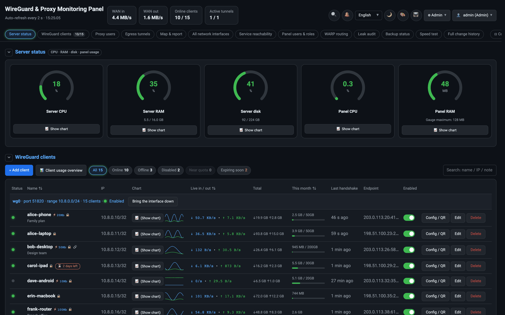
</p>
<p align="center"><sub>本 README 中的所有截图均为虚构的演示数据——参见<a href="#screenshots">截图</a>。</sub></p>

## 目录

- [截图](#screenshots)
- [功能](#features)
- [图表引擎](#chart-engine)
- [连接质量（WG-NQMO）](#wg-nqmo)
- [地图与报告（SvgStudio 和 Excel）](#map-and-report)
- [语言](#languages)
- [系统要求](#requirements)
- [使用 Docker 快速开始](#quick-start-with-docker)
- [使用 systemd 安装](#install-with-systemd)
- [升级](#upgrading)
- [配置](#configuration)
- [设置 Telegram 机器人](#telegram-bot-setup)
- [Squid 代理](#squid-proxy)
- [备份](#backups)
- [TLS 与反向代理](#tls-and-reverse-proxies)
- [Prometheus](#prometheus)
- [安全](#security)
- [出站连接](#outbound-connections)
- [局限](#limitations)
- [故障排查](#troubleshooting)
- [卸载](#uninstalling)
- [开发](#development)
- [仓库结构](#repository-layout)
- [参与贡献](#contributing)
- [支持项目](#support)
- [许可证](#license)

<a id="screenshots"></a>

## 截图

<table>
  <tr>
    <td width="50%" valign="top">
      <a href="docs/screenshots/client-chart.png">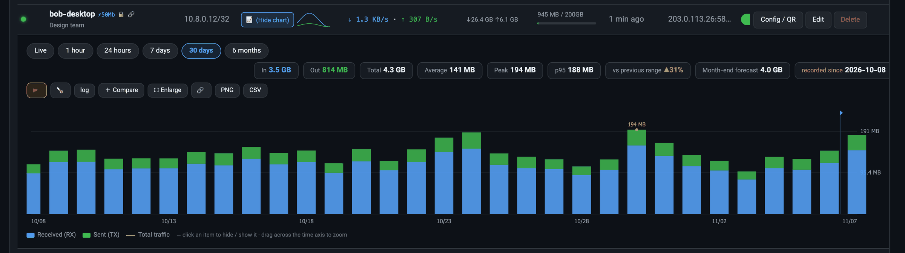</a>
      <p align="center"><b>客户端流量图</b><br><sub>30 天每日用量，含平均值、峰值、p95、与上一周期的对比以及月底预测</sub></p>
    </td>
    <td width="50%" valign="top">
      <a href="docs/screenshots/heatmap.png">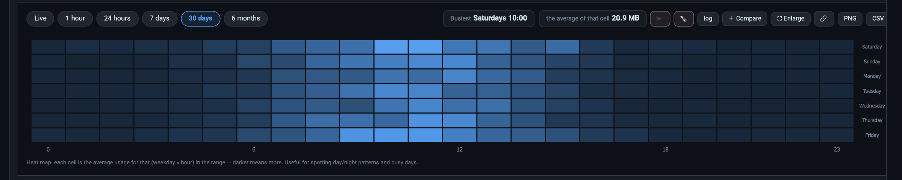</a>
      <p align="center"><b>星期 × 小时热力图</b><br><sub>客户端何时使用连接，以及最繁忙的时段</sub></p>
    </td>
  </tr>
  <tr>
    <td width="50%" valign="top">
      <a href="docs/screenshots/rtl-fa.png">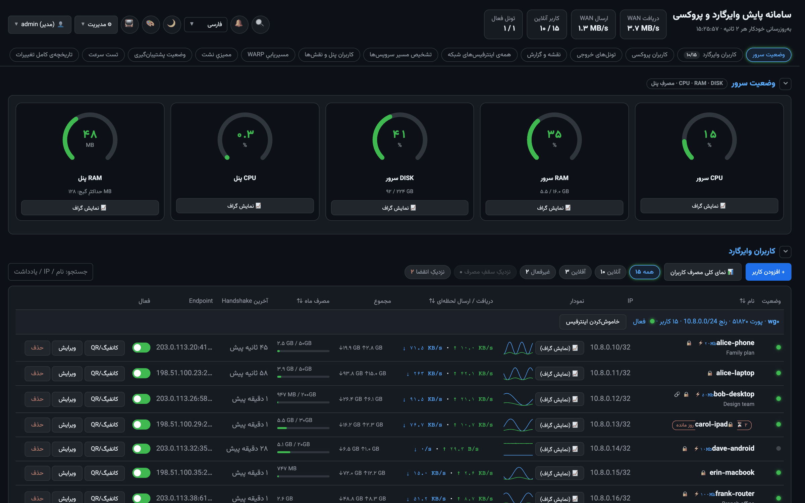</a>
      <p align="center"><b>波斯语，从右到左</b><br><sub>同一面板的波斯语界面——四种界面语言之一</sub></p>
    </td>
    <td width="50%" valign="top">
      <a href="docs/screenshots/light.png">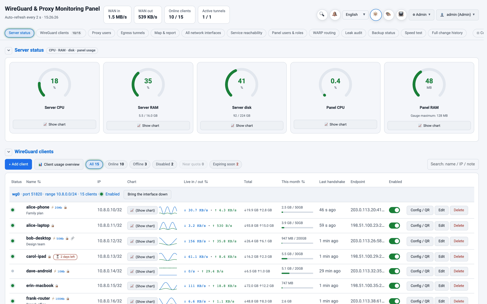</a>
      <p align="center"><b>浅色主题</b><br><sub>深色和浅色主题，可在工具栏中切换</sub></p>
    </td>
  </tr>
  <tr>
    <td width="50%" valign="top">
      <a href="docs/screenshots/config-qr.png">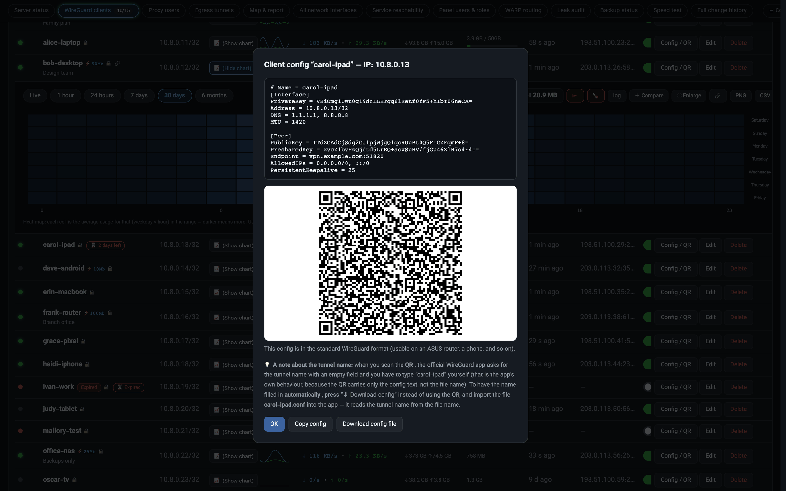</a>
      <p align="center"><b>客户端配置和二维码</b><br><sub>复制配置、下载 <code>.conf</code> 文件或扫描二维码</sub></p>
    </td>
    <td width="50%" valign="top">
      <a href="docs/screenshots/telegram-chart.png">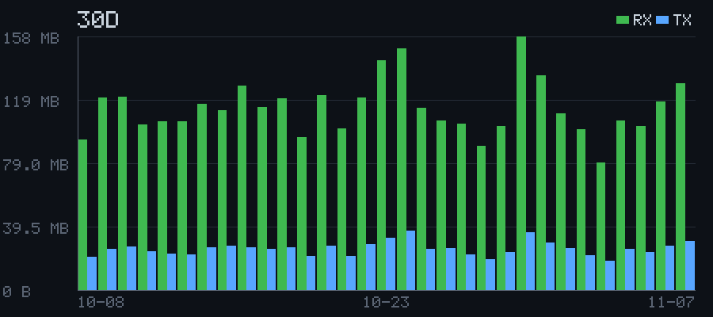</a>
      <p align="center"><b>Telegram 机器人生成的图表</b><br><sub>机器人用纯 Python 自行绘制 PNG</sub></p>
    </td>
  </tr>
  <tr>
    <td width="50%" valign="top">
      <a href="docs/screenshots/event-center.png">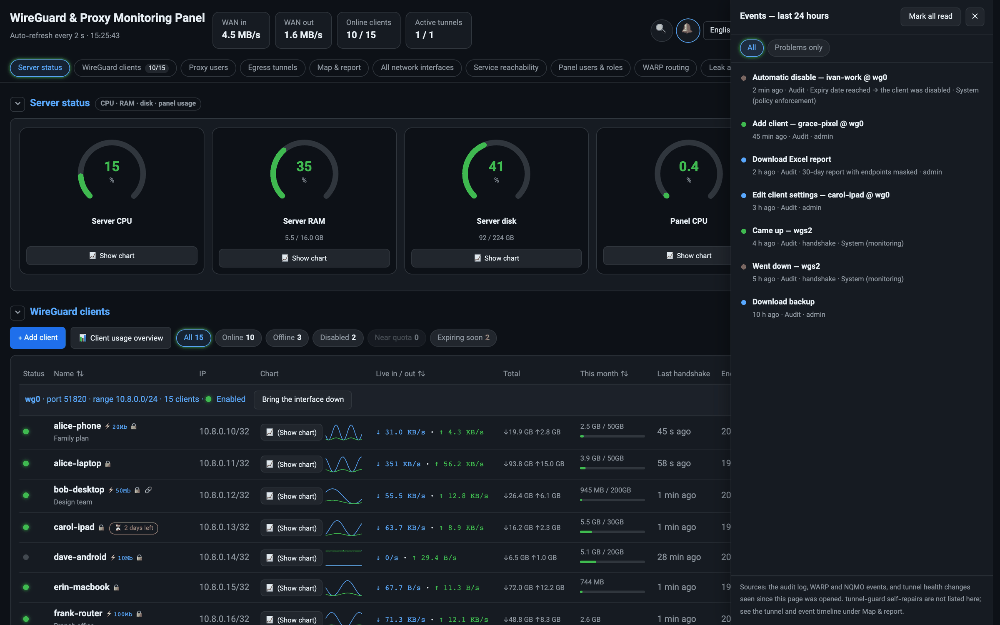</a>
      <p align="center"><b>事件中心</b><br><sub>过去 24 小时汇成一个列表：管理员操作、WARP、连接质量和隧道健康状况，重复项会合并</sub></p>
    </td>
    <td width="50%" valign="top">
      <a href="docs/screenshots/command-palette.png">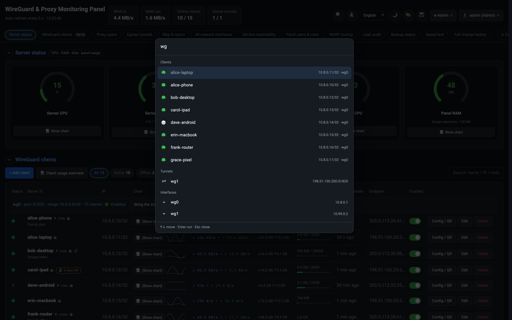</a>
      <p align="center"><b>搜索与命令</b><br><sub>按 <kbd>Ctrl</kbd>/<kbd>⌘</kbd> + <kbd>K</kbd> 查找客户端、隧道、接口、页面区块或命令</sub></p>
    </td>
  </tr>
  <tr>
    <td width="50%" valign="top" align="center">
      <a href="docs/screenshots/mobile-cards.png">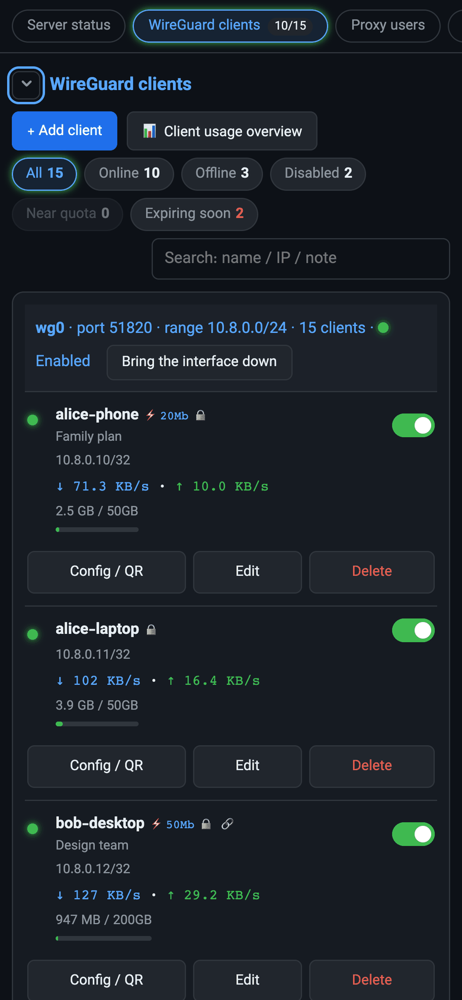</a>
      <p align="center"><b>手机上的面板</b><br><sub>屏幕较窄时，客户端表格会变成卡片，状态筛选位于上方</sub></p>
    </td>
    <td width="50%" valign="top" align="center">
      <a href="docs/screenshots/share-mobile.png">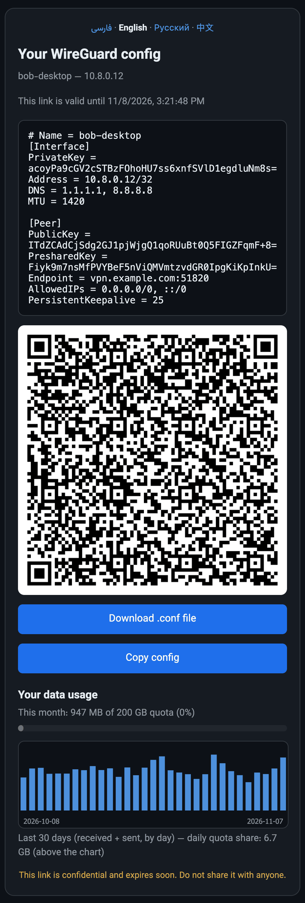</a>
      <p align="center"><b>手机上的分享页面</b><br><sub>分享链接的接收者看到的内容：配置、二维码、下载按钮以及自己的用量</sub></p>
    </td>
  </tr>
</table>

<p align="center"><sub>出口路径图、用户追踪、时间线和 Excel 报告的截图见<a href="#map-and-report">地图与报告</a>。</sub></p>

> [!NOTE]
> 这些截图取自一个真实运行、但填充了**虚构数据**的面板：虚构的客户端名称、
> 生成的密钥、示例域名 `vpn.example.com`，以及 RFC 5737 文档保留网段中的 IP
> 地址。其中不包含任何真实的服务器、用户或密钥。除两张 Excel 截图外，所有截图都
> 可以用 `python3 demo/screenshots.py` 重新生成；那两张是在 Microsoft Excel 中截取的。

<a id="features"></a>

## 功能

### 为每个 WireGuard 客户端设置限速和流量配额

- **按客户端限速**（单位 Mbit/s），通过 `tc htb` 在 Linux 内核中执行——下载在
  WireGuard 接口本身上限速，上传通过 `ifb` 设备限速。此功能完全可选：在你限制
  任何人之前，面板完全不会触碰 `tc`，未设限的客户端不受任何影响。
- 每个客户端都可设置**月度流量配额**、**总流量上限**和**到期日期**。
- 客户端达到上限时，面板会自动处理：**停用**该客户端（默认）或将其**删除**，
  把事件写入审计日志，并发送 Telegram 告警。即将到期的账户（默认提前 3 天）
  也会收到提醒。
- Squid 代理用户同样支持：配额、限速和到期日期。

### 专业图表

- 基于 canvas 自研的图表引擎，不依赖任何图表库：真实时间轴上的折线图和柱状图、
  **缩放**、**对数刻度**、无数据处显示断点、悬停显示数值、可单独开关每条曲线，
  以及全屏视图
- 时间范围：**实时、1 小时、24 小时、7 天、30 天和 6 个月**
- 每个客户端、每个接口和每条出口隧道的流量图表
- **「星期 × 小时」热力图**，显示每个客户端在什么时候使用连接
- CPU、内存和磁盘的实时仪表；WARP 的延迟和路由图表
- 每个分享页面都有用量图表，让客户端能看到自己的用量

它如何工作、能做什么：[图表引擎](#chart-engine)。

### 地图与报告：流量去了哪里，用户为何断开

- **实时出口路径图**：服务器的所有出口路径，从用户经 WireGuard 入口、路由决策
  （`ip rule`、ECMP）和隧道到物理上行，还包括 SNI 分流器、AI 出口池、WARP 链和断网
  保护。颜色表示实时健康状况，点击任意部分即可看到它的事实和依据
- **该用户为何断开？**：把一个客户端的路径逐步画出来，最后给出结论，例如运营商 NAT
  已过期、从未连接、离线或出口故障
- **隧道与事件时间线**：过去 6、24 或 72 小时的甘特图，包含每条隧道的流量和中断、
  tunnel-guard 的修复，以及 WARP、WG-NQMO 和管理员事件
- **Excel 报告**：一个覆盖 7、30 或 90 天的 `.xlsx` 文件，最多十张工作表，出口路径图
  用 Excel 原生形状绘制。客户端地址默认隐藏

详见[地图与报告](#map-and-report)。

### 高级 Telegram 机器人

机器人运行在面板进程内部，无需额外服务。它是管理服务器的第二条完整途径——
不需要 SSH，也不需要浏览器：

- **18 条命令**（其中 `/botwatch` 仅限所有者使用）和按钮菜单：创建、查看、
  重命名、启用/停用和删除 WireGuard 客户端及代理用户；设置**配额**和**限速**；发送**配置文件**和**二维码**
- **以图片形式发送图表**——机器人自己绘制 PNG（纯 Python，不依赖图像库）：
  客户端流量（24 小时 / 7 天 / 30 天 / 6 个月）、代理流量和测速结果，并在说明
  中附上总量、平均值和峰值
- 在线用户、搜索、按到期时间和按用量排序的报告、备份状态、测速，以及每日或
  每周摘要
- **11 类告警**：出口隧道断开/恢复、达到配额、账户即将到期、CPU/RAM/磁盘占用
  过高、swap 使用、多次登录失败、备份上传失败、网速下降、面板重启等
- 在 Telegram 中一键**批准面板登录**（可选）
- 机器人用户的角色（`owner`、`admin`、`viewer`），每位用户可使用不同语言
  （`/lang`）

### 其他功能

**客户端**

- 根据最近一次握手时间判断在线/离线状态，每个客户端的实时收发流量（每 2 秒
  采样一次）
- 添加客户端（生成密钥对，从地址池中选取空闲地址）和删除客户端
- 同时在运行中的接口**和**配置文件中启用或停用客户端，使更改在重启后依然有效
- 现成的客户端配置，附带复制、下载按钮和二维码
- **分享链接**——一个独立页面，包含二维码、下载按钮和用量图表，用于把配置发给
  他人。链接有效期为 1 分钟到 24 小时，可设为一次性，也可随时撤销。页面语言
  根据接收者的浏览器自动选择。

**服务器**

- 出口隧道状态：endpoint、实时速率、systemd 单元状态
- 支持 WireGuard 和 AmneziaWG 接口
- Squid 代理用户管理——参见 [Squid 代理](#squid-proxy)
- Cloudflare WARP 状态，以及一个可选的 SNI 分流服务，按目标主机名路由连接
  （这些功能需要本仓库中没有的辅助脚本——参见[局限](#limitations)）
- 每个客户端的连接质量（往返时间、丢包、MTU）以及诊断和告警，通过本仓库中的独立
  WG-NQMO 引擎实现；默认关闭——见[连接质量（WG-NQMO）](#wg-nqmo)
- 只读的泄漏审计（路由；DNS 和 IPv6 通过 Telegram 机器人）
- 备份与恢复；每个配置文件在写入前都会自动备份，且写入是原子操作
- 记录所有操作的审计日志：谁、做了什么、结果如何
- 电视/信息亭视图，轮播各状态页面，包括出口路径图和一个 3D 网络场景

**界面**

- 页面顶部的区块栏带有实时计数；任何区块都可以折叠，也可以一次全部折叠
- 按 <kbd>Ctrl</kbd>/<kbd>⌘</kbd> + <kbd>K</kbd> 打开**搜索与命令**：跳转到某个客户端、
  隧道、接口或区块，或者执行一条命令。<kbd>/</kbd> 跳到当前区块的筛选框，<kbd>?</kbd>
  列出所有快捷键
- 铃铛图标后面是**事件中心**：过去 24 小时的管理员操作、WARP 和 WG-NQMO 事件以及
  隧道健康变化，重复项会合并，还可以用*仅问题*筛选
- 客户端表格上方有状态筛选（在线、离线、已停用、接近配额、即将到期），每一行都有配额
  进度条和“剩余天数”标记
- 所有确认都使用同一种对话框。不可撤回的操作（删除客户端、关闭隧道、从云端恢复备份）
  要求先输入名称，有未保存修改的表单在关闭前会先询问
- 启用或停用客户端后，通知里有一个**撤销**按钮，十秒内有效
- 在手机上，客户端表格会变成卡片
- “加载中”、“空”和“出错”状态都有*重试*按钮；用键盘操作时有清晰的焦点框，为屏幕
  阅读器提供播报，系统要求减少动画时也会照做

**访问控制**

- 多用户；内置 `admin` 和 `viewer` 角色，并可基于细粒度权限目录创建自定义角色
- 可选的 TOTP 双因素认证，以及可选的通过 Telegram 批准每次面板登录
- 签名的会话 Cookie、登录频率限制、可选的 IP 白名单
- 位于 `/metrics` 的 Prometheus 指标，由 Bearer 令牌保护

<a id="chart-engine"></a>

## 图表引擎

面板里的所有图表都来自一个为本项目从零编写的小型绘图引擎：纯 Canvas 2D，
约两千行 JavaScript，写在 `wgpanel/web/page.html` 里。不用任何图表库，也不依赖 CDN，
所以在无法上网的服务器上同样可用。引擎理解自己绘制的数据：它知道什么是配额、
客户端何时被停用，以及某条隧道在过去十秒里传输了多少字节。

### 能画什么

| 图表 | 位置 | 显示内容 |
|---|---|---|
| 流量 | 每个客户端、接口和出口隧道 | 接收与发送，外加一条虚线表示总量；“实时”和“1 小时”为折线，24 小时及以上为柱状 |
| 热力图 | 任意流量图，7 天或 30 天 | 一周中每天每个小时的平均用量，以及最繁忙的时段 |
| 按客户端分解 | 每个 WireGuard 接口 | 接口流量在各客户端之间的分配：前 7 名，其余合并为“其他” |
| 对比 | 任意选中的一组图表 | 多个客户端、隧道或接口以折线画在同一坐标轴上 |
| 用量总览 | WireGuard 客户端区域 | 某接口所有客户端随时间的堆叠用量 |
| 服务器仪表 | CPU、内存、磁盘、面板 CPU 与面板内存 | 每个仪表背后的历史 |
| 测速 | 测速区域 | 下载和上传（Mbit/s），延迟画在第二坐标轴 |
| WARP | WARP 区域 | 直连与经 WARP 的响应时间，以及流向 AI 服务的流量占比 |
| 路由质量 | 服务可达性诊断 | 每条被测路由的通话质量（MOS）和往返时间 |
| 分享页面 | 分享链接打开的页面 | 接收者本人最近 30 天的用量；若有配额，还显示每日额度 |

### 数据从哪里来

| 区间 | 每个点代表 | 保留 |
|---|---|---|
| 实时 | 一次 2 秒采样 | 最近 3 分钟，内存中 |
| 1 小时 | 10 秒平均值 | 最近 1 小时，内存中（重启后重新开始） |
| 24 小时 | 1 小时 | 约 21 天，SQLite |
| 7 天 · 30 天 · 6 个月 | 1 天 | 约 400 天，SQLite；6 个月视图可按周汇总 |

代理用户的流量根据 Squid 访问日志统计，其图表从 24 小时视图开始。热力图由
按小时的记录构成，因此最多能回看约 21 天。

### 图表上方的数字

- **接收、发送、总计**：在“实时”和“1 小时”下是当前速率；在更长的区间里是
  整个区间的总量。
- **平均**、**峰值**，以及 **p95**：区间内 95% 的小时或天数都不超过的值，
  因此单次尖峰不会左右它。
- **较上一区间**：与紧挨着的前一个等长时段相比的变化。琥珀色 ▲ 表示更多，
  绿色 ▼ 表示更少。
- **月末预测**，适用于设有月度配额的客户端：把本月至今的用量按整月推算；
  如果速度过快，会提示“约 N 天后配额用尽”。
- **记录起始于**：第一天有数据的日期，避免把较短的历史误认为用量少。

在图表本身上，一个金色圆点标出峰值；设有配额的客户端还会有一条虚线，表示
每天应得的额度。

### 如何使用图表

- **悬停**可查看该时刻所有数据系列的值。打开多个图表时，它们会同步跟随同一
  时刻。
- **缩放**：在图表上拖动以框选时间段，或使用鼠标滚轮；在手机上用双指开合。
  放大后，拖动即可沿时间轴平移。双击或点击 **↺ 完整区间** 恢复原状。纵轴会
  根据可见部分自动调整。
- **点击图例项**可隐藏或显示对应系列。
- **log** 切换为对数刻度，让用量很小和很大的客户端都能在同一张图上看清。
- **🚩** 在时间轴上标出审计日志中的变更：客户端被停用或隧道断开时为红色，
  恢复时为绿色，其他变更为蓝色。在隧道的图表上，断开的时段还会以红色阴影
  标出。把鼠标移到旗标附近，可以看到发生了什么、由谁操作以及原因。WARP
  接口的图表还会显示 WARP 自身的事件，例如切换到备用密钥。
- **⛶ 放大** 以全屏打开图表，**＋ 对比** 把它加入对比。
- **🔗** 复制指向当前视图的链接：同一张图表、同一区间、同一缩放，以及对数、
  热力图或按客户端分解模式。
- **PNG** 以屏幕原生分辨率保存图表并附上标题。**CSV** 以 UTF-8 保存原始数据，
  可直接用表格软件打开。

每个已打开图表的区间、刻度和隐藏的系列都会记在浏览器中。

### 如实呈现

- 从 1 小时视图起，时间轴是真实时间：没有数据的小时保持空白，缺数据的地方
  折线会断开，而不是直接连过去。
- 在 1 小时视图中，静默的客户端显示为真实的零线而不是空白：面板连“没有流量”
  也会记录。
- 坐标轴使用整齐的步长（1、2、2.5 或 5 × 10ⁿ），字节按 1024 进位。速率单位是
  字节每秒；测速单位是 Mbit/s。
- 图表按屏幕的实际像素密度绘制，在高分辨率屏幕上依然清晰，窗口大小变化时会
  重新绘制。
- 数据每 2 秒更新一次，但鼠标停在图表上时会暂停，图表不会在光标下跳动。

### 颜色与语言

图表的颜色取自页面主题，因此会随深色和浅色主题变化。**🎨** 按钮可切换为
色盲友好的配色（Okabe–Ito）；在这种配色下，发送线还会变成虚线，让各系列不仅
颜色不同，形状也不同。在波斯语界面中，图表使用波斯数字；测速、路由质量和
WARP 图表的日期使用伊朗太阳历。

### Telegram 中的图表

Telegram 机器人无法运行浏览器，所以面板也会在服务器端用纯 Python 绘制图表：
先填充像素缓冲区，在其中画线和柱，用内置的点阵字体写上标签，再用 `zlib`
打包成 PNG。图片尺寸为 900 × 400，柱状或折线。机器人发送的客户端图表、代理
图表以及定期报告都使用这些图片。

<a id="wg-nqmo"></a>

## 连接质量（WG-NQMO）

客户端反映连接很慢或经常断开。原因是对方自己的网络、服务器、某条出口隧道、MTU，还是只是
你给它设置的限速？WG-NQMO 从服务器一侧逐个客户端回答这个问题，并给出证据和明确的置信度。
客户端设备上不需要安装任何东西。

它是一个独立的引擎，监视 WireGuard 握手的往返时间、上行丢包（客户端到服务器）和客户端
MTU，诊断问题，并可以推荐 MTU。诊断和建议都只是报告：引擎从不自行更改任何设置。

> [!NOTE]
> **该引擎是本仓库中一个独立的服务，并且是可选的。** 1.3.0 版加入了面板这一侧：一组钩子，用来
> 显示引擎报告的内容，并把面板自己的数据和管理员的命令交给引擎。1.4.0 版加入引擎本身，即由
> `nqmo/` 构建的 `wg_nqmo.pyz`。钩子默认关闭，因此没有引擎的面板就像没有这些钩子一样运行。

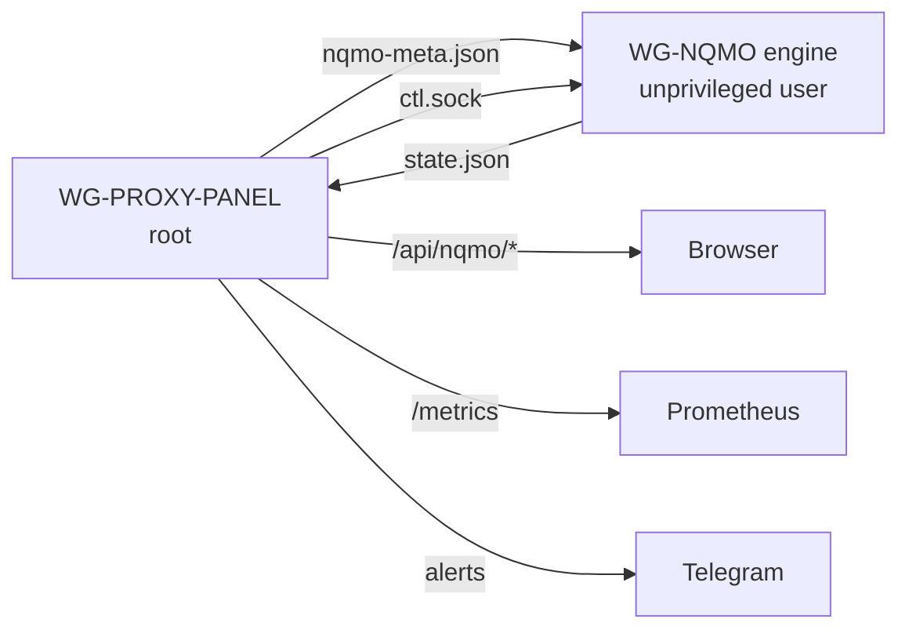

### 你会看到什么

- **在面板中。** **连接质量** 部分显示引擎模式及其数据的新旧程度、收集器（正常、故障或
  关闭）、覆盖范围、数据库大小、全局诊断和配置发现；一张客户端表格，含质量、往返时间
  中位数、上行丢包、MTU 状态和未关闭的诊断；以及最近 50 个事件。
- **每个客户端。** 点击客户端可打开最近 15 分钟的情况、诊断及其证据，以及建议及其理由和
  局限。客户端编辑对话框的 **质量与 MTU（WG-NQMO）** 区块显示相同内容。
- **在 Telegram 中。** 新出现、升级或已解决的诊断会变成告警。
- **在 Prometheus 中。** 同样的数字以 `wg_nqmo_*` 序列提供，示例查询见
  [参考](#wg-nqmo-reference)。

该部分每 30 秒刷新一次，仅在浏览器标签页可见时刷新。引擎没有报告的数字显示为“—”，绝不
显示为 0。

有三个按钮作用于引擎：诊断上的 **确认**、MTU 探测和模式切换。每个按钮都要求先确认，无论
被接受还是被拒绝，都会写入历史记录。

### 安装引擎

引擎是一个独立的服务：第二个单文件 `wg_nqmo.pyz`，由本仓库的 `nqmo/` 包构建，以无特权的
系统用户 `wg-nqmo` 运行。它只需要 Python 3.10 或更新版本，别无依赖；安装在运行面板的同一台
服务器上，Docker 镜像不包含它。构建、安装并运行自检：

```bash
python3 tools/build_nqmo_pyz.py --out dist/wg_nqmo.pyz
sudo useradd --system --user-group --no-create-home --home-dir /nonexistent --shell /usr/sbin/nologin wg-nqmo
sudo install -d -m750 -o root -g wg-nqmo /opt/wg-nqmo
sudo install -m640 -o root -g wg-nqmo dist/wg_nqmo.pyz /opt/wg-nqmo/wg_nqmo.pyz
sudo install -d -m755 -o root -g root /etc/wg-nqmo
sudo install -m640 -o root -g wg-nqmo deploy/wg-nqmo.config.json /etc/wg-nqmo/config.json
sudo install -m644 -o root -g root deploy/wg-nqmo.service /etc/systemd/system/wg-nqmo.service
sudo systemctl daemon-reload
sudo -u wg-nqmo python3 -I /opt/wg-nqmo/wg_nqmo.pyz --check
sudo systemctl enable --now wg-nqmo
```

自检会打印 `NQMO_CHECK_OK`；没有它就不要启动服务。然后按下一节所述开启面板的钩子，并确认
`/metrics` 报告 `wg_nqmo_up 1`。

**默认仅观察，且没有主动诊断。** 随附的 `deploy/wg-nqmo.config.json` 以 **仅观察** 模式启动引擎，
`active_probes` 关闭，报头捕获也关闭。此状态下引擎读取面板的文件和内核计数器并写出自己的状态文件。
它不发送任何数据包、不探测任何客户端、不更改任何设置、也不发出任何告警；诊断会被计算并保存，但不显示。
当你看清它测量了什么之后，再从面板把模式一次一级地往上调。

**报头捕获**（可选）。往返时间、丢包和 MTU 证据来自线路上的 WireGuard 报头，因此需要开启捕获。安装
drop-in `deploy/wg-nqmo-capture.conf`（只给服务 `CAP_NET_RAW`）和配置
`deploy/wg-nqmo.capture.config.json`（开启捕获）。引擎只读取 `listen_port` 所指端口上 WireGuard
数据包的报头；载荷是加密的，永远不会被保存。过滤器是为端口 `53953` 编译的：换用其他端口时，修改
`tools/gen_nqmo_bpf.py` 中的 `PORT` 并重新生成（需要 `tcpdump`），否则捕获会拒绝启动。永远不要给服务
`CAP_NET_ADMIN`：有了它，`wg show` 会暴露私钥。

```bash
sudo install -d -m755 -o root -g root /etc/systemd/system/wg-nqmo.service.d
sudo install -m644 -o root -g root deploy/wg-nqmo-capture.conf /etc/systemd/system/wg-nqmo.service.d/capture.conf
sudo install -m640 -o root -g wg-nqmo deploy/wg-nqmo.capture.config.json /etc/wg-nqmo/config.json
sudo systemctl daemon-reload
sudo systemctl restart wg-nqmo
```

**资源配额。** 单元把引擎限制在 `CPUQuota=20%`、`MemoryHigh=128M` 和 `MemoryMax=160M`，并设
`Nice=10`，使它永远不与数据路径争抢。在繁忙的服务器上开启捕获时这个上限太紧：引擎在关闭分析窗口时会被
watchdog 杀掉。`deploy/wg-nqmo-resources.conf` 把这三个值提高到 `200%`、`256M` 和 `320M`；把它作为
`resources.conf` 安装在 `capture.conf` 旁边。引擎只是观察者：它停下来时别的什么都不会停，而
`systemctl disable --now wg-nqmo` 会把它移出，没有任何需要回退的网络状态。

**指标。** 引擎没有自己的端点。它测量的一切都通过面板的 `/metrics` 以 `wg_nqmo_*` 序列进入
Prometheus，列表见[参考](#wg-nqmo-reference)。

**每小时复查归档**（可选）。`deploy/wg-nqmo-review.sh` 连同其服务和定时器每小时在
`/var/lib/wg-nqmo/review` 保存一份压缩的状态文件和一行摘要：只有计数，没有名称、密钥或地址，保留 14 天。

### 开启和关闭

只有当 `config.json` 的 `nqmo.enabled` 为 JSON 值 `true` 时钩子才开启；`"true"`、`1` 或
缺少该键都表示关闭。关闭时：

- 面板不为引擎读取或写入任何内容；
- `/api/stats` 和 `/metrics` 的响应与没有这些钩子时完全相同；
- 六个 `/api/nqmo/*` 路由只返回“引擎已禁用”的错误（`"disabled": true`）；
- 页面不发送任何 WG-NQMO 请求，也不显示任何 WG-NQMO 部分；WG-NQMO 的权限组和告警类型
  被隐藏。保存角色或告警设置时，已存储的 WG-NQMO 值保持不变。

安装引擎后，要开启钩子，请把下面的内容加入 `config.json`：

```json
"nqmo": {"enabled": true, "user_iface": "wg0"}
```

1. 把 `user_iface` 设为客户端连接的 WireGuard 接口；面板把它的 MTU 和防火墙标记报告给
   引擎。默认值为 `wg1udp`。如果不存在这个名称的接口，面板不会为引擎写入任何内容，因此
   请设置为你自己的接口。
2. 重启面板。
3. 给需要的人授予 `nqmo.view`。内置角色 `admin` 拥有所有 WG-NQMO 权限，内置角色 `viewer`
   一个也没有。
4. 检查 `/metrics` 是否报告 `wg_nqmo_up 1`。如果是 0，序列 `wg_nqmo_unavailable{why}` 会
   说明原因；见[故障排查](#wg-nqmo-troubleshooting)。

没有引擎时开启钩子也没有害处：该部分会提示引擎尚未写入任何输出。

要关闭钩子，把 `enabled` 设为 `false` 或删除该键，然后重启面板。面板不再更新它写给引擎的
文件。面板不会停止引擎，也不会删除引擎的文件，已存储的角色和告警值保持不变。

### 引擎模式

引擎从 **仅观察** 开始，手动逐步提升，这样你能在它下结论之前先看到它测量了什么。模式每次
只能移动一级；面板和引擎都会拒绝跳级。

| 模式 | 面板中 | Telegram | 建议和 MTU 探测 |
|---|---|---|---|
| **仅观察**（`OBSERVATION_ONLY`） | 往返时间和丢包。诊断会被计算并存储，但不显示 | 否 | 否 |
| **诊断已启用**（`DIAGNOSTICS_ENABLED`） | 另加诊断和质量列 | 中等或高置信度的新诊断 | 否 |
| **建议已启用**（`RECOMMENDATIONS_ENABLED`） | 另加建议 | 同上 | 是；探测还必须在引擎设置中被允许 |

### 解读结果

**质量** 是客户端未关闭诊断中最差的置信度。它不是连接本身的评分：“正常”表示没有规则发现
问题。

| `wg_nqmo_peer_quality_state` | 显示为 |
|---|---|
| −1 | 数据不足 |
| 0 | 正常，无诊断 |
| 1 | 诊断，低置信度 |
| 2 | 诊断，中等置信度 |
| 3 | 诊断，高置信度 |

**诊断。** 每条诊断都说明其范围、置信度、数据质量和证据；拥有 `nqmo.detail` 时还会说明
反面证据以及其他可能的解释。诊断是有依据的怀疑，而不是证明。

| 代码 | 显示为 | 范围 | 含义 |
|---|---|---|---|
| `SERVER_RESOURCE_BOTTLENECK` | 服务器资源瓶颈 | 全局 | 服务器自身在丢包：内核队列、网卡、UDP 缓冲区、连接跟踪或分片重组内存 |
| `HANDSHAKE_FLOOD` | 握手风暴 | 全局 | 到达的握手超过 WireGuard 同时能处理的数量 |
| `EGRESS_TUNNEL_DEGRADATION` | 出口隧道质量下降 | 出口 | 某条出口隧道不健康；其后的客户端受到影响，并非自身问题 |
| `TRAFFIC_SHAPING_EFFECT` | 限速影响 | 设备 | 客户端达到了面板中设置的限速；这是限速在起作用，不是故障 |
| `HANDSHAKE_FAILURE` | 握手失败 | 设备 | 客户端发送握手而服务器没有应答；请检查密钥或配置 |
| `NAT_OR_FIREWALL_ISSUE` | NAT 或防火墙问题 | 设备 | 服务器在发送却没有任何返回。常见于客户端一侧的 NAT 映射过期；无法从服务器一侧判断确切原因 |
| `ROUTING_ANOMALY` | 路由异常 | 设备 | 返回客户端的路由没有走预期的接口，或路由恰好在质量下降时发生了变化 |
| `UDP_INSTABILITY` | UDP 不稳定 | 设备 | 客户端地址频繁变化，或数据包乱序、重复到达 |
| `PACKET_LOSS` | 丢包 | 设备 | 统计上明确的上行丢包，而不是偶然读数 |
| `NETWORK_CONGESTION` | 网络拥塞 | 设备 | 握手往返时间明显高于该客户端自身的正常水平 |
| `SUSPECTED_MTU_PROBLEM` | 疑似 MTU 问题 | 设备 | 客户端 MTU 大于路径能承载的大小，数据包分片到达 |
| `SUSPECTED_PMTU_BLACKHOLE` | 疑似 PMTU 黑洞 | 设备 | 大数据包在途中丢失，而小数据包能够到达 |
| `UNKNOWN_DEGRADATION` | 原因不明的质量下降 | 设备 | 比该客户端的正常水平差，且没有规则能解释原因 |

**MTU 状态** 是引擎对客户端 MTU 能给出的判断。建议值由你决定是否应用；系统不会替你更改。

| `wg_nqmo_peer_mtu_status` | 显示为 | 含义 |
|---|---|---|
| 0 | 未确定 | 证据不足以得出结论 |
| 1 | 待测试 | 有建议值，但需要测试 |
| 2 | 估算 | 由稳定的测量或探测得出的值 |
| 3 | 已验证 | 完整大小的数据包在上行方向未分片到达；下行方向未确认 |

**配置发现** 是根据配置计算得出，而不是测量得出，因此只出现在面板中，绝不会成为告警。

### MTU 探测

探测向某一个客户端发送少量测试数据包，以找到能够通过的最大大小；在被动观察无法判断时很有
帮助。必须同时满足：

- 模式为 **建议已启用**，并且引擎设置中允许探测；
- 用户拥有 `nqmo.probe`；
- 客户端的最后一次握手不超过 2 分钟，即处于在线状态；
- 没有其他探测正在运行，且该客户端在过去一小时内没有被探测过；
- 客户端名称没有在另一个接口上重复。

不响应 ping 的客户端无法测试。

<a id="wg-nqmo-troubleshooting"></a>

### 故障排查

**该部分或 `wg_nqmo_unavailable{why}` 表示数据不可用：**

| `why` | 含义 | 处理方法 |
|---|---|---|
| `disabled` | 钩子已关闭 | 无需处理，除非你本来想开启。此状态下 `/metrics` 没有 WG-NQMO 序列 |
| `missing` | 引擎尚未写入任何输出 | 未安装或刚刚启动；请检查其服务 |
| `unreadable` | 文件无法读取 | 检查权限。符号链接以及任何非普通文件都会被有意拒绝 |
| `too_large` | 文件超过大小上限 | 检查引擎；文件应当小得多 |
| `corrupt` | 文件不是有效文档 | 查看引擎日志 |
| `schema` | 文档版本与面板不匹配 | 让面板和引擎使用相互匹配的版本 |
| `stale` | 文件已超过 3 分钟 | 引擎已停止或卡住 |
| `clock` | 文件的时间在未来 | 校正系统时钟 |
| `error` | 读取文件时发生内部错误 | 查看面板日志 |

**命令被拒绝**（代码见 `refused` 字段和历史记录）：

| 代码 | 含义 | 处理方法 |
|---|---|---|
| `UNREACHABLE` | 面板无法连接到引擎 | 启动引擎 |
| `NO_REPLY` | 引擎未应答就关闭了连接 | 面板可能不是以 root 运行 |
| `TIMEOUT` | 引擎没有及时应答 | 重试；如果反复出现，请检查引擎 |
| `MODE_GATE` | 探测需要 **建议已启用** | 逐级提升模式 |
| `FLAG_GATE` | 引擎设置中已禁用探测 | 如果需要，请在那里允许 |
| `META_STALE` | 引擎持有的面板数据已过期 | 检查 `user_iface` 以及组 `wg-nqmo` 是否存在 |
| `NO_SUCH_PEER` | 引擎不认识这个客户端 | 等待面板下一次更新 |
| `PEER_NOT_PROBEABLE` | 客户端已禁用或没有隧道地址 | 没有可测试的内容 |
| `STALE_HS` | 客户端不在线 | 在其连接时重试 |
| `RATE` | 该客户端在过去一小时内已被探测 | 稍后重试 |
| `BUSY` | 引擎繁忙或另一个探测正在运行 | 稍后重试 |
| `AMBIGUOUS_PEER` | 该名称存在于多个接口 | 重命名其中一个客户端 |
| `NOT_ADJACENT` | 模式每次只能移动一级 | 先经过中间模式 |
| `NO_SUCH_OPEN_DIAGNOSIS` | 该诊断已不再处于未关闭状态 | 无需处理 |

<a id="wg-nqmo-reference"></a>

### 参考

<details>
<summary><b>权限</b></summary>

<br>

| 权限 | 允许 | 包含 |
|---|---|---|
| `nqmo.view` | 查看质量和诊断 | — |
| `nqmo.detail` | 前缀、ASN、关联和完整证据 | `nqmo.view` |
| `nqmo.ack` | 确认诊断 | `nqmo.view` |
| `nqmo.probe` | 运行手动 MTU 探测 | `nqmo.view` |
| `nqmo.manage` | 更改引擎模式 | `nqmo.view` |

</details>

<details>
<summary><b>面板与引擎如何通信，以及信任什么</b></summary>

<br>

只通过下列文件；面板从不导入、启动或停止引擎，这些钩子也不建立任何出站连接。

| 路径 | 方向 | 内容 |
|---|---|---|
| `/run/wg-panel/nqmo-meta.json` | 面板 → 引擎，每 60 秒 | 所有客户端接口的客户端（名称、公钥、隧道地址、endpoint、最后握手、流量计数、每个客户端的 MTU 和限速）、已开启的出口隧道及其健康状况，以及 `client_mtu`。模式 `0640`，组 `wg-nqmo`，目录 `0750`。仅当组 `wg-nqmo` 存在（即引擎已安装）时才写入 |
| `/var/lib/wg-nqmo/state.json` | 引擎 → 面板，每 60 秒 | 引擎模式、收集器、未关闭的诊断、每个客户端的摘要和告警发件箱。面板将其缓存 10 秒；超过 180 秒的文件视为过期 |
| `/run/wg-nqmo/ctl.sock` | 面板 → 引擎，按需 | 三条命令：确认诊断、运行 MTU 探测、更改模式。每个连接一个请求，超时 7 秒。引擎在此套接字上只接受 root |
| `/opt/wg-panel/nqmo-notified.last` | 仅面板 | 面板发送的最后一条引擎告警的 ID |

meta 文件包含客户端的名称、公钥和 endpoint（其公网地址），因此加入组 `wg-nqmo` 就意味着可以
访问这些内容。

引擎的文件不受信任。引擎以自己的非特权用户运行，面板以 root 运行，因此面板只把 `state.json`
当作普通文件读取，绝不通过符号链接，且最多读取 8 MB。面板检查文档的 schema，从每个字符串中
删除控制字符和双向字符并将其截短，只保留有限数字，并且只为自己认识的客户端显示诊断和序列，
因此伪造的文件无法创建新的客户端或标签。

</details>

<details>
<summary><b>Telegram 告警</b></summary>

<br>

钩子开启后，`alerts.events` 下会出现名为 `nqmo` 的第十二种告警类型
（“网络质量引擎诊断（WG-NQMO）”）。面板转发引擎的告警发件箱：诊断的打开、升级或解决，使用
面板自己的四种语言文本。

- 去重、静默间隔和每小时上限由引擎负责；面板在每次 30 秒的检查中最多发送 6 条消息。
- 首次运行以及引擎数据库重建后，只发送不足 180 秒的事件，这样开启时不会把历史记录一次性
  倒进聊天。
- 因数据耗尽而关闭的诊断会收到单独的 ⚪ 消息，不会被报告为已解决。
- 低重要性和摘要条目绝不发送。

</details>

<details>
<summary><b>API</b></summary>

<br>

全部六个路由都是带 JSON 请求体的 `POST`，与面板其他部分相同。

| 路由 | 权限 | 输入 | 响应 |
|---|---|---|---|
| `/api/nqmo/status` | `nqmo.view` | — | 模式、收集器、覆盖范围、数据库、全局诊断、配置发现，以及面板认识的每个客户端的摘要 |
| `/api/nqmo/peer` | `nqmo.view` | `name`，以及 `iface`（可选） | 一个客户端：摘要、诊断和建议 |
| `/api/nqmo/events` | `nqmo.view` | `since`（0 或更大）、`limit`（1 到 200） | `since` 之后的发件箱事件，最早的在前 |
| `/api/nqmo/ack` | `nqmo.ack` | `id` | 确认诊断；诊断仍保持未关闭 |
| `/api/nqmo/probe` | `nqmo.probe` | `name`，以及 `iface`（可选） | 请求引擎运行 MTU 探测 |
| `/api/nqmo/mode` | `nqmo.manage` | `to`（可选） | 不带 `to` 返回当前模式；带 `to` 则移动一级 |

</details>

<details>
<summary><b>Prometheus</b></summary>

<br>

钩子开启后，`/metrics` 会增加下列序列。引擎未测量的值会被省略，绝不报告为 0。

| 序列 | 含义 |
|---|---|
| `wg_nqmo_up` | 引擎文件新鲜且有效时为 1 |
| `wg_nqmo_unavailable{why}` | 不可用的原因；当文件缺失、不可读或过期时，只出现此序列和 `wg_nqmo_up 0` |
| `wg_nqmo_state_age_seconds` | 引擎文件的存在时间 |
| `wg_nqmo_mode{mode}` | 当前模式为 1 |
| `wg_nqmo_collector_ok{collector}` | 1 正常，0 故障，关闭时不存在：`C1_meta`（面板的文件）、`C2_kernel`（内核计数）、`C3_capture`（数据包头） |
| `wg_nqmo_diagnoses_open{class}` | 每种未关闭的诊断 |
| `wg_nqmo_peers`、`wg_nqmo_active_peers` | 引擎认识的客户端，以及过去 180 秒内有握手的客户端 |
| `wg_nqmo_recent_errors` | 保存在引擎文件中的错误 |
| `wg_nqmo_store_bytes`、`wg_nqmo_store_read_only` | 引擎数据库的大小，以及它是否只读 |

每个客户端还有下列序列，其 `iface` 和 `name` 标签与 `wg_peer_*` 序列相同：

| 序列 | 含义 |
|---|---|
| `wg_nqmo_peer_quality_state` | 上述质量；在 **仅观察** 下不存在 |
| `wg_nqmo_peer_rtt_seconds`、`wg_nqmo_peer_rtt_min_seconds`、`wg_nqmo_peer_rtt_samples` | 握手往返时间的中位数和最小值，15 分钟窗口，至少 5 个样本 |
| `wg_nqmo_peer_upstream_loss_ratio`、`wg_nqmo_peer_upstream_loss_lower_ratio`、`wg_nqmo_peer_upstream_loss_upper_ratio`、`wg_nqmo_peer_upstream_loss_judged_packets` | 上行丢包及其 95% Wilson 区间，5 分钟窗口，至少 1000 个已判定的数据包 |
| `wg_nqmo_peer_mtu_status` | 上述 MTU 状态 |

示例查询：

```promql
wg_nqmo_up == 0
sum by (class) (wg_nqmo_diagnoses_open) > 0
wg_nqmo_peer_quality_state >= 2
wg_nqmo_peer_upstream_loss_lower_ratio > 0.01
```

</details>

**未包含：** 引擎本身，以及用于它的 Telegram 机器人命令。

<a id="map-and-report"></a>

## 地图与报告（SvgStudio 和 Excel）

**地图与报告**页面根据服务器的实时状态画出三张图：

1. **实时出口路径图**：此刻流量从服务器的哪里出去
2. **该用户为何断开？**：一个客户端的路径，一步一步画下来，最后给出结论
3. **隧道与事件时间线**：过去一天里隧道都经历了什么

同样的数据也可以下载为一个 Excel 工作簿。

<p align="center">
  <a href="docs/screenshots/egress-map.png">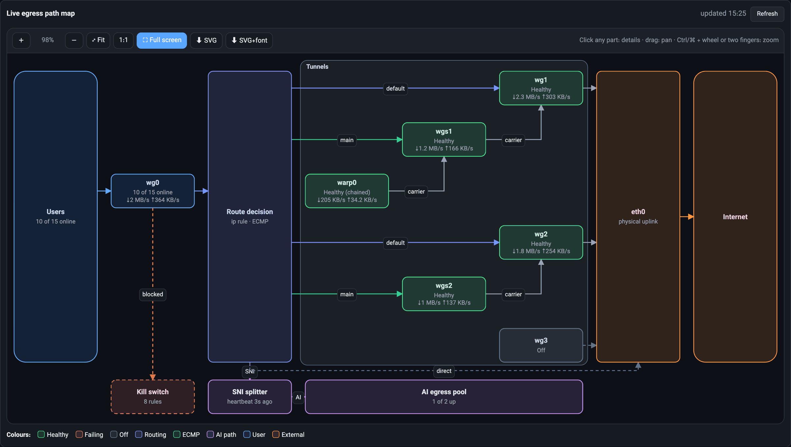</a>
</p>

判断都在服务器上完成。`wgpanel/viz.py` 收集实时事实（内核对 `ip route get` 给出的路由、
ECMP 成员、握手时长、每两秒采样一次的收发速率），把它们变成图的模型。浏览器只负责
用 `wgpanel/web/svgstudio.js` 把模型画出来，而这段代码对 WireGuard 一无所知：里面
没有接口名，也没有翻译。图上的每个名字都来自你自己的服务器，所以不用任何配置，
这张图就和你的拓扑对得上。

### 实时出口路径图

这张图展示客户端的数据包离开服务器的所有途径：用户、WireGuard 入口、路由决策
（`ip rule` 和 ECMP）、隧道、物理上行和互联网。如果服务器上有 SNI 分流器、AI 出口池、
WARP 链和断网保护，它们也会出现在图上。

- 隧道的角色由路由判断，而不是看名字。端点经由物理上行到达的是*母隧道*；端点要经过
  另一条隧道才能到达的是*子隧道*，画在它的承载隧道旁边。跑在正常承载隧道上的子隧道
  是一条链，不是路由环路。
- 颜色表示实时健康状况：健康、故障、关闭、路由、ECMP、AI 路径、用户和外部。被守护程序
  移出轮换的 ECMP 成员会单独标出。
- 点击任意方框或箭头，侧边抽屉会列出背后的事实：端点、端点路由所经过的设备、最近一次
  握手、速率和总量、ECMP 状态，以及流量特征和计算它所用的样本。
- 可以缩放、拖动、适应窗口、恢复 1:1 或全屏，也可以把图下载为 SVG（嵌入字体或不嵌入）。
  地图每分钟刷新一次，但在你操作之后的五分钟内，以及抽屉或全屏打开期间，它会保持不动。
- 这张图也是电视/信息亭视图中的一页，紧排在 3D 场景之前。

<p align="center">
  <a href="docs/screenshots/egress-map-fa.png">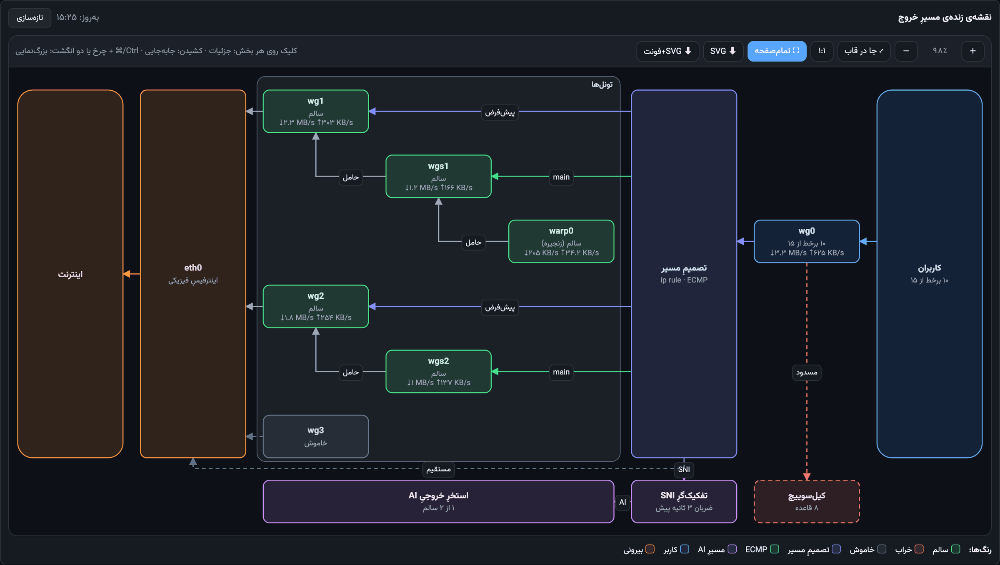</a><br>
  <sub>在波斯语中，整张图会镜像过来，从右向左阅读。</sub>
</p>

### 该用户为何断开？

输入客户端名称或从列表中选择，面板会画出一张从设备到互联网的时序图：握手、入口、
作用于该客户端自身地址的每一个路由决策（默认路由、ECMP 组、AI 路径）、途经的隧道
以及出口。每一步都附有依据。第一个出问题的步骤就是**结论**，检查顺序和人工排查时的
顺序一致：

| 结论 | 含义 |
|---|---|
| 已自动停用 · 已停用 | 客户端被关掉了：原因是配额、到期或管理员操作 |
| 从未连接 | 从来没有记录到握手：配置没送到设备上、密钥不对，或者端点不可达 |
| 运营商 NAT | 收不到任何数据，但服务器仍在发送很小的保活包：用户运营商的 NAT 映射已过期。服务器没有问题，用户重启应用或换个网络即可 |
| 离线 | 握手很久以前，也没有流量：设备关机了或应用已退出。这很正常 |
| 出口故障 | 设备能连到服务器，但路径上的某条隧道出了故障。没有隧道权限的角色只能看到结论，看不到隧道细节 |
| 无路由 | 没有任何路由决策作用于这个客户端的地址 |
| 正常 | 每一步都正常 |

<p align="center">
  <a href="docs/screenshots/user-trace.png">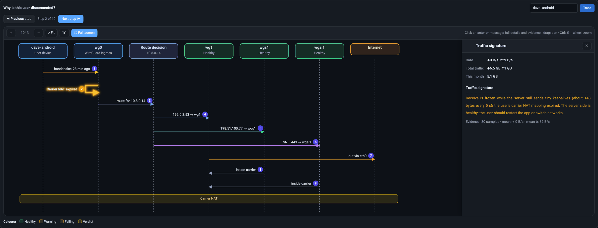</a>
</p>

**流量特征**由同样的两秒样本算出。每种特征只有一个固定含义，这样两种看起来相似的
故障就不会被混为一谈：

| 特征 | 数字说明了什么 |
|---|---|
| 运营商 NAT 已过期 | 接收停滞，发送是一股稳定的细流（大约每 5 秒 148 字节），握手很久以前 |
| 大量发送无接收 | 发出去很多，却什么也没回来：路由环路的典型表现 |
| 端点失效 | 握手很久以前，服务器仍在重试（针对隧道） |
| 仅握手 | 握手较新，但收到的只有握手应答 |
| 从未连接 · 离线 · 已连接，空闲 · 双向流量 · 已停用 · 隧道未启动 | 就是名字所说的意思 |

用*上一步*和*下一步*逐步查看这张图，或者直接点击任意一条消息。这张卡片故意没有下载
按钮，因为追踪展示的是某一个人未经隐藏的数据。

### 隧道与事件时间线

一张覆盖过去 6、24 或 72 小时的甘特图。每条隧道占一条泳道：有流量的时段显示为按小时
划分的色条，没有流量的地方是灰色，中断的地方是红色。事件落在它所涉及的隧道的泳道上，
其他事件各有自己的泳道：

- 面板自身监控发现的隧道和接口变化（断开、恢复、发现并修复的环路）
- **tunnel-guard** 的操作，从 systemd 日志读取（`journalctl -t tunnel-guard`）：状态
  变化、修复、已验证的修复、失败的修复以及路由固定。只保留真正的操作，不保留每轮检查
  的例行输出。没有这个守护脚本时，这条泳道就是空的
- WARP 事件（端点轮换、出口切换）
- WG-NQMO 事件，适用于拥有 `nqmo.view` 的角色
- 审计日志中其他管理员操作，适用于拥有 `audit.view` 的角色

面板的监控和守护程序各自独立地盯着同一批隧道，两者都会形成红色的中断区间。用
*上一事件*和*下一事件*在事件之间跳转，或者点击某个事件查看详情。

<p align="center">
  <a href="docs/screenshots/event-timeline.png">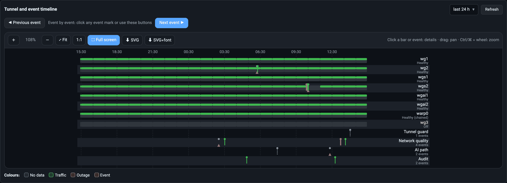</a>
</p>

### Excel 报告

**下载 Excel** 按钮会生成一个覆盖过去 7、30 或 90 天的 `.xlsx` 文件。文件只用标准库
写成（`wgpanel/xlsx.py`），并且只包含下载者有权查看的工作表：

| 工作表 | 内容 | 所需权限 |
|---|---|---|
| 概览 | 关键数字（客户端数、当前在线、本月用量、健康隧道、轮换中的 ECMP 成员、SNI 分流器）、发现的问题，以及指向每张工作表的链接 | — |
| 用户 | 每个客户端：状态、最近握手、端点、本月 / 所选范围 / 累计流量、配额及使用比例、到期日、限速、备注和流量特征 | `wg.view` |
| 每日 | 每天的流量和活跃客户端数，以及用量最多的用户和他们所占的份额 | `wg.view` |
| 隧道 | 每条隧道：角色、承载隧道、端点路由所经过的设备、ECMP 状态、健康状况、特征、速率和总量 | `tun.view` |
| 出口 | 用 **Excel 原生形状**画出的出口路径图，外加图中节点的表格 | `tun.view` |
| 事件 | 与时间线相同的事件 | `tun.view` |
| 审计 | 管理员操作：谁、做了什么、结果如何 | `audit.view` |
| 测速 | 所选范围内的每一次测速 | `sys.view` |
| 系统 | 服务器负载：CPU、内存和磁盘 | `sys.view` |
| 术语表 | 每种状态、特征和结论的含义 | — |

- 波斯语版本的工作表从右向左排列。数字以数字形式保存，可以直接排序、筛选和求和。
- **客户端的端点地址默认是隐藏的。** 取消勾选*隐藏用户 IP*即可得到完整地址。每次下载都会
  记入审计日志，连同时间范围以及是否隐藏了地址。
- 任何文本都按文本写入，绝不会变成公式，所以名为 `=HYPERLINK(…)` 的客户端仍然只是一个
  名字。日期是真正的 Excel 日期，缺失的值留空，而不是变成零。
- 已在 Mac 版 Microsoft Excel 中测试，打开时不会提示需要修复。

<table>
  <tr>
    <td width="50%" valign="top">
      <a href="docs/screenshots/excel-dashboard.png">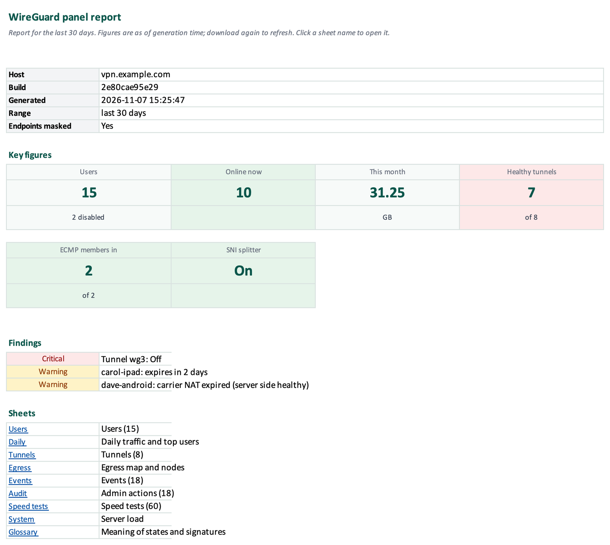</a>
      <p align="center"><b>概览工作表</b><br><sub>关键数字、发现的问题以及指向每张工作表的链接</sub></p>
    </td>
    <td width="50%" valign="top">
      <a href="docs/screenshots/excel-egress.png">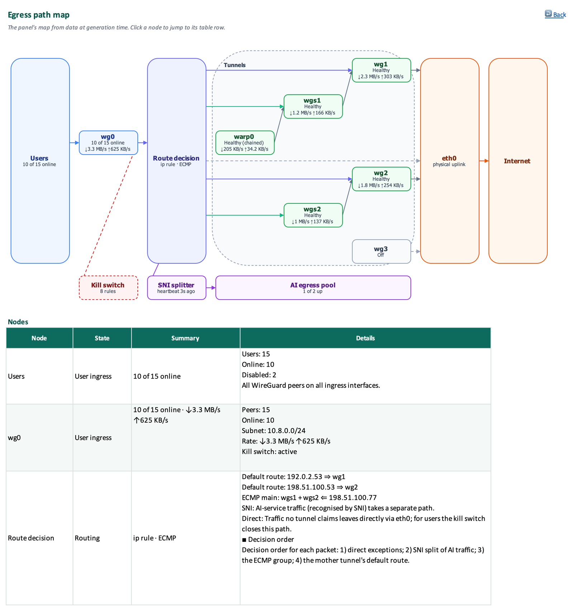</a>
      <p align="center"><b>出口工作表</b><br><sub>同一张图，由可以移动和编辑的 Excel 原生形状构成</sub></p>
    </td>
  </tr>
</table>

### 权限与 API

| 地址 | 权限 | 返回内容 |
|---|---|---|
| `GET /api/viz/egress` | `tun.view` | 出口路径图的模型 |
| `GET /api/viz/trace?iface=…&name=…` | `wg.view` | 某个客户端的追踪（不存在该客户端时返回 `404`） |
| `GET /api/viz/timeline?hours=1…168` | `tun.view` | 时间线的模型 |
| `GET /api/report.xlsx?days=1…183&mask=0\|1` | `wg.view` | 工作簿；`mask` 默认为 `1` |

拥有 `tun.view` 或 `wg.view` 的角色都能看到这个页面，而每张卡片只在具备相应权限时出现。
模型是普通的 JSON，因此同一个 `svgstudio.js` 可以在任何地方把它们画出来。

<a id="languages"></a>

## 语言

面板、审计日志、API 错误信息、Telegram 机器人和 Telegram 告警均提供**英语、
波斯语、俄语和中文**。翻译保存在 `wgpanel/i18n/catalog.json` 中（约三千个键），并被
打包进 `wg_panel.pyz`，因此面板仍然以单个文件部署。

| 位置 | 语言的选择方式 |
|---|---|
| 面板、登录页、分享页 | `?lang=` → `wgl` Cookie → 浏览器 `Accept-Language` → 波斯语 |
| Telegram 机器人 | 按用户单独设置——每位用户通过 `/lang` 选择 |
| Telegram 告警 | 机器人所有者的语言 |

波斯语页面从右到左显示，其他语言从左到右；样式表使用 CSS 逻辑属性，因此布局
会自动镜像。波斯语数字仅在波斯语中使用。标识符——客户端名称、密钥、endpoint、
IP 地址——在所有语言中都保持拉丁字符，以便搜索和复制。

内嵌的 Vazirmatn 字体覆盖波斯文和拉丁文；俄语和中文使用系统字体。不从任何
CDN 加载资源，因此面板在无法访问互联网的服务器上同样可用。

<a id="requirements"></a>

## 系统要求

- Ubuntu 22.04 或 24.04（x86_64 或 arm64），具有 root 权限
- 发行版自带的 Python 3.10 或更高版本——无需 pip 包，无需 virtualenv
- systemd、`wireguard-tools` 和 `iproute2`

其他一切都是可选的。缺少某个程序时，只会关闭依赖它的那项功能：

| 程序 | 用途 |
|---|---|
| `squid`、`openssl` | 代理用户——参见 [Squid 代理](#squid-proxy) |
| `tc`（来自 `iproute2`）和 `ifb` 内核模块 | 按客户端限速 |
| `qrencode` | Telegram 机器人发送的二维码（没有它时，机器人改为发送 `.conf` 文件） |
| `speedtest`（Ookla CLI，不在 Ubuntu 软件源中） | 测速 |
| `curl`、`dig`、`ping`、`traceroute` | 服务诊断和 WARP 检查 |
| `iptables`、`ipset` | WARP 路由 |
| `awg`、`awg-quick` | AmneziaWG 隧道 |
| `rclone` | 将备份上传到 MEGA S4（`deploy/`） |

Docker 镜像包含以上所有程序，`speedtest` 除外。

需要在防火墙中开放的端口：

| 端口 | 用途 |
|---|---|
| `8787/tcp`（`port`） | 面板和分享链接 |
| 每个客户端接口的 `ListenPort`（Docker 下为 `51820/udp`） | WireGuard 客户端 |
| `18080/tcp` | Squid 代理，仅在创建了代理用户时需要 |

> [!NOTE]
> 本面板管理 WireGuard 接口，但不负责设计你的网络拓扑。Docker 安装会为你创建
> 一个接口。使用 systemd 安装时，面板管理服务器上已存在的接口。

<a id="quick-start-with-docker"></a>

## 使用 Docker 快速开始

面板和 WireGuard 运行在同一个容器中。首次启动会生成 `config.json`、服务器密钥
和自签名 TLS 证书；之后的启动只更新面板代码，不会改动你的数据。

```bash
git clone https://github.com/alibakhtiari-ux/WG-PROXY-PANEL.git
cd WG-PROXY-PANEL/docker
sudo bash host-setup.sh
(umask 077 && cp .env.example .env)
```

打开 `.env`，至少设置 `WG_SERVER_HOST`——客户端将要连接的公网 IP 地址或域名。
如果留空，首次启动时会向 `https://ifconfig.me` 查询服务器的地址。同一个文件还
可以设置 Telegram 机器人（`WG_BOT_TOKEN`、`WG_BOT_OWNER_ID`、`WG_BOT_CHAT_ID`）
和 IP 白名单（`WG_PANEL_ALLOW_IPS`）。然后：

```bash
docker compose up -d --build
```

面板将在 `https://SERVER:8787` 上启动，使用自签名证书（在浏览器中接受一次警告
即可）。用户名为 `admin`。

> [!WARNING]
> **你输入的第一个密码会成为管理员密码。** 请在安装后立即登录，以免他人先访问
> 8787 端口。

对于无法访问互联网的服务器，可以在联网的机器上构建离线安装包，再拷贝过去。在
仓库根目录下执行：

```bash
cd docker/airgap && bash build-offline-bundle.sh --arch amd64
```

详情：[docker/README.md](docker/README.md) ·
[docker/airgap/README.md](docker/airgap/README.md)（波斯语）

<a id="install-with-systemd"></a>

## 使用 systemd 安装

从[最新发布版](https://github.com/alibakhtiari-ux/WG-PROXY-PANEL/releases/latest)下载面板及其单元文件，并用发布的校验和进行核对
（也可以直接克隆仓库）：

```bash
base=https://github.com/alibakhtiari-ux/WG-PROXY-PANEL/releases/latest/download
curl -fLO "$base/wg_panel.pyz" -O "$base/wg_panel.py" -O "$base/wg-panel.service" \
     -O "$base/qr.js" -O "$base/three.module.min.js.gz" -O "$base/three.core.min.js.gz" \
     -O "$base/three.LICENSE.txt" -O "$base/SHA256SUMS"
sha256sum -c SHA256SUMS
```

面板**不会**自行创建配置：它从 `wg_panel.py` 所在的目录读取 `config.json`，
没有该文件就无法启动。将面板的两个文件并排安装——`wg_panel.pyz`（整个面板）和
`wg_panel.py`（20 行的启动器，位于 systemd 单元一直使用的路径）——然后安装单元：

```bash
sudo install -d -m700 /opt/wg-panel
sudo install -m600 -o root -g root -t /opt/wg-panel wg_panel.pyz wg_panel.py
sudo python3 /opt/wg-panel/wg_panel.py --check
sudo install -m644 -t /opt/wg-panel qr.js three.module.min.js.gz three.core.min.js.gz \
     three.LICENSE.txt
sudo install -m644 wg-panel.service /etc/systemd/system/
```

然后创建 `/opt/wg-panel/config.json`（所有者为 root，权限 `600`）。最简示例——
`salt` 和 `hash` 为空时，首次登录会设置密码；没有 `tls_cert`/`tls_key` 时，
面板使用普通 HTTP：

```json
{
  "port": 8787,
  "users": [{"username": "admin", "salt": "", "hash": "", "role": "admin"}],
  "server_host": "vpn.example.com",
  "client_dns": "1.1.1.1, 8.8.8.8",
  "client_mtu": 1420
}
```

```bash
sudo systemctl enable --now wg-panel
```

首次启动时，面板会补上示例中省略的内容：会话密钥（`secret`）、随机的
`metrics_token`，以及空的 `allow_ips`、`roles` 和 `bot` 部分。请立即登录——
与 Docker 一样，你输入的第一个密码会成为管理员密码。

面板管理它在 `/etc/wireguard` 中找到的客户端接口：带有 `ListenPort` 且没有
peer `Endpoint` 的配置被视为客户端接口，其余所有 `wg*` 配置则视为出口隧道。
新客户端从接口 `Address` 所在的子网中获取地址。如需明确指定，请在
`config.json` 中设置 `server_ifaces` 和 `user_subnets`。

用于备份、日志轮转、OOM 保护的可选单元以及 fail2ban 规则位于
[deploy/](deploy/) 目录——参见[备份](#backups)。

<a id="upgrading"></a>

## 升级

面板是一个文件（`wg_panel.pyz`）加上它 20 行的启动器，升级就是替换这两个文件。`config.json` 中的设置和
`traffic.db` 中的数据都会保留；旧版配置会在面板启动时自动更新。

**使用 systemd：** 下载新版本的两个文件（包括 `sha256sum -c` 校验）：

```bash
base=https://github.com/alibakhtiari-ux/WG-PROXY-PANEL/releases/latest/download
curl -fLO "$base/wg_panel.pyz" -O "$base/wg_panel.py" -O "$base/wg-panel.service" \
     -O "$base/qr.js" -O "$base/three.module.min.js.gz" -O "$base/three.core.min.js.gz" \
     -O "$base/three.LICENSE.txt" -O "$base/SHA256SUMS"
sha256sum -c SHA256SUMS
```

然后先安装 `wg_panel.pyz`、再安装启动器（下面命令中的参数顺序保证了这一点），
运行 `--check`，再重启。从 1.2.x 或更早版本升级时，这就是唯一的变化：单元文件
保持不变，数据（`config.json`、`traffic.db`、`clients/`）也留在原处。

```bash
sudo install -m600 -o root -g root -t /opt/wg-panel wg_panel.pyz wg_panel.py
sudo install -m644 -t /opt/wg-panel qr.js three.module.min.js.gz three.core.min.js.gz
sudo install -m644 wg-panel.service /etc/systemd/system/
sudo python3 /opt/wg-panel/wg_panel.py --check
sudo systemctl daemon-reload
sudo systemctl restart wg-panel
```

要查看服务器上运行的是哪个构建，可将
`sha256sum /opt/wg-panel/wg_panel.pyz | cut -c1-12` 的输出与发布说明中的
build id 对比；它与在源码上运行 `python3 tools/build_pyz.py --id` 的结果以及
Docker 安装所显示的版本相同。各版本的变更见 [CHANGELOG.md](CHANGELOG.md)。

**使用 Docker：** 将新代码拉到服务器上（`git pull`），然后在 `docker/`
目录中执行：

```bash
docker compose up -d --build
```

> [!TIP]
> 升级前请先备份：复制 `/opt/wg-panel/`（Docker 为 `docker/data/`）。仅靠面板
> 中的 **备份 / 恢复** 按钮是不够的，因为它生成的归档不包含 `config.json`——
> 参见[备份](#backups)。

<a id="configuration"></a>

## 配置

所有设置都保存在 `/opt/wg-panel/config.json` 中，其中大部分也可以在面板里修改。
主要的键：

| 键 | 用途 |
|---|---|
| `port` | 监听端口（默认 `8787`） |
| `tls_cert` · `tls_key` | TLS 证书和密钥的路径；缺省时使用普通 HTTP |
| `users` | 面板账户（PBKDF2 密码哈希）及其角色 |
| `roles` | 自定义角色及其权限 |
| `server_host` · `server_endpoint` | 写入生成的客户端配置中的地址 |
| `server_label` | 机器人和告警中显示的简短服务器名称（默认：`server_host`，其次为主机名） |
| `server_ifaces` · `user_subnets` | 客户端接口及其地址池，例如 `{"wg0": "10.66.66.0/24"}`（默认：从 WireGuard 配置中检测） |
| `client_dns` · `client_mtu` · `client_allowed` | 生成客户端配置时的默认值（`1.1.1.1, 8.8.8.8` · `1420` · `0.0.0.0/0, ::/0`） |
| `allow_ips` | 可选的 IP 白名单（`127.0.0.1` 始终允许） |
| `metrics_token` | `/metrics` 与 `/api/health` 的 Bearer 令牌 |
| `trusted_proxies` | 面板前置反向代理的 IP/CIDR；仅此时才从 `X-Forwarded-For` / `X-Real-IP` 读取客户端 IP，并采纳 `X-Forwarded-Proto: https`（https 分享链接、`Secure` Cookie） |
| `session_idle_min` | 空闲多少分钟后自动登出（`0`/未设置 = 仅 12 小时绝对上限） |
| `secret` | 为会话 Cookie 签名的密钥；首次启动时创建。更改它会让所有人登出 |
| `bot` | Telegram 机器人是否启用、其授权用户及其角色 |
| `alerts` | 机器人令牌、告警会话、发送哪些告警及其阈值 |
| `login_2fa` | 通过 Telegram 批准每次面板登录 |
| `report` | Telegram 中的定期图片报告：`mode` `off`/`daily`/`weekly`、`time`、`dow` |
| `svc_enabled` · `svc_interval` | 服务诊断的开关（默认开启）及其间隔秒数（默认 `300`） |
| `speedtest_server` · `speedtest_ifaces` | Ookla 服务器 id 以及运行测速的接口 |
| `nqmo` | 独立 WG-NQMO 引擎的钩子；除非 `enabled` 为 `true`，否则关闭——见[连接质量（WG-NQMO）](#wg-nqmo) |

`alerts` 中的告警阈值及其默认值：`cpu_pct`、`ram_pct` 和 `disk_pct` 为 `90`，
需持续 `sustain_min` `5` 分钟；`quota_pct` 为 `90`；`expiry_days` 为 `3`；
`login_fails` 为 10 分钟内 `10` 次登录失败。11 类告警中的每一类都可以在
`alerts.events` 下单独关闭。

### 角色与权限

除内置的 `admin` 和 `viewer`（`wg.view`、`tun.view`、`net.view`、`sys.view`）
外，还可以在面板中用以下权限构建自定义角色：

| 范围 | 权限 |
|---|---|
| WireGuard 客户端 | `wg.view`、`wg.add`、`wg.edit`、`wg.del`、`wg.conf`（配置、二维码、分享链接） |
| 代理用户 | `proxy.view`、`proxy.add`、`proxy.edit`、`proxy.del`、`proxy.conf` |
| 隧道和服务器 | `tun.view`、`tun.toggle`、`net.view`、`sys.view` |
| 服务诊断 | `svc.view`、`svc.edit` |
| 审计日志 | `audit.view` |
| 管理 | `users.manage`、`alerts.manage`、`bot.manage`、`ecmp.manage`、`warp.manage`、`settings.ips`、`backup.get`、`backup.restore` |
| 连接质量（WG-NQMO） | `nqmo.view`、`nqmo.detail`、`nqmo.ack`、`nqmo.probe`、`nqmo.manage`（仅在 `nqmo.enabled` 开启时显示） |

`users.manage` 与完整管理员权限相当，因为它可以授予任何权限。角色还可以要求
启用双因素认证。

<a id="telegram-bot-setup"></a>

## 设置 Telegram 机器人

1. 通过 [@BotFather](https://t.me/BotFather) 创建一个机器人并复制其令牌。
2. 在面板中打开 Telegram 告警设置，粘贴令牌，并设置接收告警的会话。机器人和
   告警共用这个令牌（`alerts.bot_token`）。
3. 在私聊中给机器人发送任意消息。由于你尚未获得授权，它会回复你的 Telegram
   数字 id。
4. 把自己设为所有者。所有者无法在面板中添加或更改，因此请停止面板，编辑
   `config.json`，然后重新启动：

   ```json
   "bot": {"enabled": true, "users": [{"id": "123456789", "role": "owner", "name": ""}]}
   ```

   使用 Docker 时，`.env` 中的 `WG_BOT_TOKEN`、`WG_BOT_OWNER_ID` 和
   `WG_BOT_CHAT_ID` 会在首次启动时完成以上全部设置。
5. 发送 `/start`。之后即可在面板中添加其他机器人用户（`admin`、`viewer`）。

机器人只在私聊中发送配置、预共享密钥和代理密码。告警使用所有者的语言。如果
服务器无法直接访问 `api.telegram.org`，机器人会依次尝试每条出口隧道。

<a id="squid-proxy"></a>

## Squid 代理

代理用户由 Squid 在 **18080** 端口（固定）上提供服务，使用 HTTP 基本认证；
对于无密码用户，则按源 IP 认证。用户可以被限制为仅 HTTP 或仅 HTTPS，并且与
WireGuard 客户端一样拥有配额、限速和到期日期。

> [!CAUTION]
> 面板**独占** `/etc/squid/squid.conf` 和 `/etc/squid/passwd`，并会完整地重写
> 它们。不要在 Squid 已用于其他用途的服务器上使用本面板。

- 创建第一个代理用户时启动 Squid，删除最后一个代理用户时停止 Squid。
- 生成的配置把 DNS 查询发往 `127.0.0.1`，因此服务器需要在该地址上运行本地
  解析器（例如 `systemd-resolved` 或 `unbound`）。
- 代理流量根据 Squid 的访问日志统计。

<a id="backups"></a>

## 备份

备份有两种，它们包含的内容不同：

| | 面板按钮（**备份 / 恢复**） | `deploy/wg-panel-backup.sh`（每晚定时器） |
|---|---|---|
| WireGuard 配置 | ✅ | ✅ |
| 客户端配置（`clients/`） | ✅ | ✅ |
| 流量历史（`traffic.db`） | ✅ | ✅ |
| `config.json`（面板用户、角色、密钥、机器人令牌） | ❌ | ✅ |
| Squid 配置 | ❌ | ✅ |

从面板恢复时，会先显示预览（归档将添加、删除或更改哪些客户端），再次要求输入
密码，仅允许第一个管理员账户执行，并在写入任何内容之前把当前状态保存到
`/opt/wg-panel/restore-backups/`。面板每次写入 WireGuard 配置时，也会把上一个
版本保存在 `/etc/wireguard/backups/` 中（每个文件保留最近 50 个版本）。

[deploy/](deploy/) 中的文件应安装到以下位置：

| 文件 | 安装到 | 作用 |
|---|---|---|
| `wg-panel-backup.sh` · `.service` · `.timer` | `/usr/local/sbin/` · `/etc/systemd/system/` | 每晚 04:30 在 `/var/backups/wg-panel/` 中生成归档，保留 14 份 |
| `wg-panel-s4-upload.sh` · `.service` · `.timer` | 同上 | 04:55 用 `rclone` 把归档上传到 MEGA S4，**然后删除本地副本**。需要 `/etc/wg-panel-s4.env`（`REMOTE`、`BUCKET`，可选 `PREFIX`）和 `/etc/wg-panel-rclone.conf` |
| `wg-panel-verify-backup.sh` · `.service` · `.timer` | 同上 | 每周检查已上传的备份：新鲜度、校验和、归档内容以及数据库完整性。整机备份链（不在本仓库中）在至少上传过一次之后也会被检查 |
| `wg-panel-oom.conf` | `/etc/systemd/system/wg-panel.service.d/` | 让 OOM killer 不杀死面板 |
| `wg-quick-oom.conf` | `/etc/systemd/system/wg-quick@.service.d/` | 对 WireGuard 接口做同样的保护 |
| `wg-panel.logrotate` | `/etc/logrotate.d/wg-panel` | 每月轮转 `actions.log`，保留 12 份 |
| `fail2ban-wg-panel.filter.conf` · `.jail.conf` | `/etc/fail2ban/filter.d/wg-panel.conf` · `/etc/fail2ban/jail.d/wg-panel.conf` | 某个 IP 在 10 分钟内登录失败 5 次后将其封禁。规则中写的是 `port = 8787`；如果你修改了 `port`，请同步修改 |

单元文件调用的是 `/usr/local/sbin/` 中的脚本，因此请把脚本安装到那里。复制单元
后运行 `sudo systemctl daemon-reload`，然后启用所需的定时器，例如
`sudo systemctl enable --now wg-panel-backup.timer`。

<a id="tls-and-reverse-proxies"></a>

## TLS 与反向代理

**使用正式证书。** 将 `tls_cert` 和 `tls_key` 指向证书链和私钥（例如来自
Let's Encrypt），然后重启面板。面板接受 TLS 1.2 及更高版本。它只在启动时读取
这些文件，因此每次续期后都要重启面板（例如通过 certbot 的 deploy hook）。

**在 nginx 或 Caddy 之后。** 面板也可以以普通 HTTP 运行在终止 TLS 的反向代理
之后。此时：

- 把代理的地址写入 `trusted_proxies`，这样白名单、频率限制和审计日志才能从
  `X-Forwarded-For` 看到真实的客户端 IP；
- 原样转发 `Host` 头——如果 `POST` 请求的 `Origin` 与 `Host` 不一致，面板会
  拒绝该请求；
- 只允许代理直接访问面板端口（面板监听所有 IPv4 地址）。

没有 `tls_cert` 时，面板认为自己使用的是普通 HTTP：会话 Cookie 不带 `Secure`
标志，分享链接以 `http://` 开头。

<a id="prometheus"></a>

## Prometheus

```yaml
scrape_configs:
  - job_name: wg-panel
    scheme: https
    metrics_path: /metrics
    authorization:
      type: Bearer
      credentials: <metrics_token from config.json>
    static_configs:
      - targets: ['your-server:8787']
```

如果使用自签名证书，请添加 `tls_config: {insecure_skip_verify: true}`，或将
证书提供给 Prometheus。

`GET /api/health`（同一 Bearer 令牌，或具有 `sys.view` 的已登录用户）报告每个后台线程的心跳，若有线程停止则返回 `503`——适合外部监控或 Docker healthcheck。

这两个端点同样受 `allow_ips` 约束，因此如果使用白名单，请把 Prometheus 服务器
的地址加进去。

<a id="security"></a>

## 安全

- 服务以 root 身份运行，因为它需要修改网络接口和防火墙规则。其文件归 root
  所有，权限为 `600`。
- 由**面板本身**创建的客户端私钥保存在 `/opt/wg-panel/clients/`（仅 root
  可读），以便之后再次显示配置和二维码。
- **分享链接包含客户端的私钥。** 链接有效期很短，可设为一次性并可撤销，页面
  响应带有 `Referrer-Policy: no-referrer` 和 `X-Robots-Tag: noindex`——但仍请
  把每个链接当作机密对待。
- 登录失败次数限制为每个 IP 每分钟 5 次、每个账户每 5 分钟 10 次（锁定会自动
  解除），连续失败可触发 Telegram 告警。fail2ban 过滤器和规则位于 `deploy/`。
- Telegram 机器人是完整的管理途径：授权用户列表中的任何人都可以在不使用 SSH、
  不登录面板的情况下修改服务器。
- 请用 `allow_ips` 或防火墙保护面板。使用 Docker 时请注意，`ufw` 不会过滤
  Docker 发布的端口——参见 [docker/README.md](docker/README.md)。
- 分享链接在面板端口上提供，并且按设计绕过 `allow_ips`，以便接收者能够打开。
- 会话 Cookie 设置为 `SameSite=Strict`，`Origin` 头与 `Host` 不一致的 `POST`
  请求会被拒绝。

报告安全漏洞请参阅 [SECURITY.md](SECURITY.md)。

<a id="outbound-connections"></a>

## 出站连接

面板不会向任何地方回传数据，但某些功能会自行发出请求。如果这对你的服务器
很重要，下面列出会发出哪些请求以及如何关闭：

| 内容 | 时机 | 如何关闭 |
|---|---|---|
| 服务诊断：向 YouTube、YouTube Music、x.com、Telegram 和 Tidal 发出 HTTPS 请求，以及一次 `traceroute` | 每 5 分钟；traceroute 每小时一次 | `"svc_enabled": false`，或在页面上移除服务 |
| 在每个接口上运行 Ookla 测速 | 每 12 小时（03:00 至 06:00 之间除外），前提是已安装 `speedtest` | 不安装 `speedtest`，或用 `speedtest_ifaces` 加以限制 |
| Telegram Bot API（`api.telegram.org`） | 机器人或告警开启期间 | 关闭机器人和告警 |
| `https://ifconfig.me` | 测试 WARP 目标时；使用 Docker 且 `WG_SERVER_HOST` 为空时的首次启动 | 设置 `WG_SERVER_HOST` |

<a id="limitations"></a>

## 局限

- **客户端仅支持 IPv4。** 新客户端获得的是 IPv4 地址。默认的 `AllowedIPs`
  包含 `::/0`，因此客户端的 IPv6 流量会进入隧道并在那里被丢弃，客户端随后
  回退到 IPv4。面板本身也只监听 IPv4。
- **WARP、ECMP 守护和 SNI 分流器**是为维护者自己的网络拓扑构建的。它们需要本
  仓库中没有的辅助脚本和接口（`/usr/local/sbin/warp-gemini-sync.sh`、
  `/usr/local/sbin/awg-ecmp-from-file.sh`、`wgwarp` 接口），缺少这些时保持
  未启用状态。`deploy/cleanup-dead-iface-rules.sh` 中也写有该拓扑的接口名称；
  运行前请先阅读。
- **地图与报告的部分内容同样依赖这些脚本。** ECMP 组、SNI 分流器、AI 出口池和 WARP
  链只有在实际存在时才会出现在地图上；时间线中的 *tunnel-guard* 泳道读取的是一个
  本仓库中没有的守护脚本，没有它，这条泳道就是空的。
- **波斯语是后备语言。** 如果浏览器请求的语言不在四种语言之列，就会显示波斯语；
  添加一次 `?lang=en`，选择就会保存在 Cookie 中。在设置机器人所有者之前，告警
  使用波斯语。
- **地区性默认值。** Docker 的 `.env.example` 设置了 `TZ=Asia/Tehran`，
  `deploy/setup-deps.sh` 从伊朗的 Ubuntu 镜像安装（仅 24.04、amd64），服务诊断
  探测的是在伊朗被封锁的服务。请根据你的服务器修改这些设置。
- **一个面板管理一台服务器。** 面板管理它所运行的那台机器，没有多节点模式。

<a id="troubleshooting"></a>

## 故障排查

<details>
<summary><b>忘记了管理员密码，或丢失了双因素认证设备</b></summary>

<br>

停止面板并打开 `config.json`（`/opt/wg-panel/config.json`；Docker 为
`docker/data/panel/config.json`）。在 `users` 中找到该账户，将其 `salt` 和
`hash` 设为空字符串；如需同时关闭该账户的双因素认证，再将 `totp` 设为
`""`。重新启动面板：之后在登录页为该账户输入的第一个密码将成为新密码，
因此请在他人无法访问面板时进行此操作。

</details>

<details>
<summary><b>服务无法启动</b></summary>

<br>

使用 `journalctl -u wg-panel -n 50` 查看日志。最常见的原因是 `config.json`
缺失或无效：面板从不自行创建该文件（参见[使用 systemd 安装](#install-with-systemd)），
且它必须是合法的 JSON。

</details>

<details>
<summary><b>分享链接提示无效或已过期</b></summary>

<br>

分享链接在过期后、一次性链接在首次使用后，或被撤销后都会失效。页面有意
不说明具体是哪种情况。请在该客户端所在行重新创建链接。

</details>

<details>
<summary><b>在反向代理之后，面板中的每项修改都失败</b></summary>

<br>

面板会拒绝 `Origin` 头与 `Host` 不一致的 `POST` 请求。请让代理转发原始的
`Host`（nginx：`proxy_set_header Host $host;`），并把代理加入
`trusted_proxies`——参见 [TLS 与反向代理](#tls-and-reverse-proxies)。

</details>

<details>
<summary><b>限速对上传不起作用</b></summary>

<br>

上传通过 `ifb` 设备限速。systemd 单元会在面板启动前加载 `ifb` 模块；使用
Docker 时，`host-setup.sh` 会在宿主机上加载它。如果你用的是旧版
`wg-panel.service`，请安装当前版本，或自行在开机时加载该模块：

```bash
echo ifb | sudo tee /etc/modules-load.d/ifb.conf
sudo modprobe ifb
```

如果 `modprobe ifb` 失败，说明内核没有 `ifb` 模块，上传限速无法生效；面板会将此
写入 `actions.log`。

</details>

<details>
<summary><b>修改代码后页面一片空白</b></summary>

<br>

这几乎总是 Python 字符串中的 JavaScript 出错——参见[开发](#development)
一节中的说明，并检查浏览器控制台。

</details>

<a id="uninstalling"></a>

## 卸载

使用 systemd 时：

```bash
sudo systemctl disable --now wg-panel
sudo rm /etc/systemd/system/wg-panel.service
sudo systemctl daemon-reload
sudo rm -rf /opt/wg-panel      # config, traffic history and client keys — back up first
```

`/etc/wireguard/` 中的 WireGuard 配置会保留。如果使用过代理用户，请停止 Squid
并替换面板写入的 `/etc/squid/squid.conf`。如果使用过限速，
`sudo tc qdisc del dev <interface> root` 和
`sudo tc qdisc del dev <interface> ingress` 可以移除接口上的流量整形（重启也
可以）。已安装的 `deploy/` 单元，按与面板单元相同的方式移除即可。

使用 Docker 时，在 `docker/` 中运行 `docker compose down`；数据位于
`docker/data/`。

<a id="development"></a>

## 开发

面板就是 `wgpanel/` 这个包：服务器在 `wgpanel/app.py` 中（约 19,000 行），Web 界面是
`wgpanel/web/` 中的普通文件，翻译在 `wgpanel/i18n/catalog.json` 中。`tools/build_pyz.py`
把它们打包成你要部署的那一个文件。运行测试：

```bash
python3 -m unittest discover -s tests -v
python3 tools/build_pyz.py && python3 dist/wg_panel.pyz --check
python3 tests/check_js.py      # JavaScript syntax, needs Node.js
```

用户只需下载构建好的文件；贡献者从源码构建它（相同源码总是得到相同字节），或直接在检出的仓库中运行面板：

```bash
python3 tools/build_pyz.py      # dist/wg_panel.pyz — same source, same bytes
python3 -m wgpanel             # run the panel straight from a checkout
```

测试会检查的内容包括：每个翻译键在四种语言中都存在且占位符一致；翻译后的文本
绝不会成为数据（指标标签、已保存的审计记录、比较键）；没有任何私密内容进入
Docker 构建上下文；测试数据使用 RFC 5737 文档地址。本仓库中有部分测试会被跳过
（skip），因为它们检查的是未在此发布的部署工具。

> [!IMPORTANT]
> Python 看不到 `wgpanel/web/` 中 JavaScript 的错误——即使 JavaScript 有错，
> Python 测试依然通过，结果是浏览器中出现空白页。`tests/check_js.py`（CI 也会
> 运行）可以发现语法错误；但修改界面后，仍请打开面板并检查浏览器控制台。

**演示模式。** `python3 demo/run.py` 会在 `http://127.0.0.1:8787` 启动面板
（用户 `admin`，密码 `demo`），使用虚构的客户端、六个月的流量历史和模拟的
系统工具。它不需要 WireGuard，也不需要 root，并且不会在临时目录之外写入任何
内容。`python3 demo/screenshots.py` 会重新生成 `docs/screenshots/` 中的所有
图片；它需要 Node.js 和 Playwright（使用 Playwright 自带的 Chromium，没有时改用
Google Chrome），若已安装 Pillow 还会压缩图片。加上 `--reports DIR` 还会保存演示数据的
英文和波斯语 Excel 工作簿；`excel-dashboard.png` 和 `excel-egress.png` 就是用这两个文件
在 Microsoft Excel 中截取的（*Copy as Picture*）。

<a id="repository-layout"></a>

## 仓库结构

| 路径 | 内容 |
|---|---|
| `wgpanel/app.py` | 面板的服务器端：API、权限、后台线程 |
| `wgpanel/web/` | Web 界面：`page.html`、`share.html`、SvgStudio 引擎（`svgstudio.js`）、3D 场景、字体以及随附的 `svg-pan-zoom` |
| `wgpanel/viz.py` | 地图与报告背后的模型：出口路径图、用户追踪、时间线 |
| `wgpanel/report.py` · `wgpanel/xlsx.py` | Excel 报告，以及只用标准库写 `.xlsx` 的模块 |
| `wgpanel/i18n/catalog.json` | 全部翻译，四种语言 |
| `wgpanel/__main__.py` | 入口（`python3 -m wgpanel`） |
| `wgpanel/_check.py` | 归档自检（`wg_panel.pyz --check`） |
| `tools/build_pyz.py` | `dist/wg_panel.pyz` 的可复现构建 |
| `wg_panel.py` | systemd 单元启动的 20 行启动器 |
| `wg-panel.service` | systemd 单元 |
| `docker/` | Docker Compose 安装及离线安装包构建工具 |
| `deploy/` | 可选的 systemd 单元、fail2ban 规则、备份脚本、SNI 分流器 |
| `tests/` | 测试套件 |
| `docs/screenshots/` | README 中使用的截图 |
| `demo/` | 演示模式与截图生成器 |
| `CHANGELOG.md` | 各版本的变更 |
| `fonts/` | Vazirmatn 字体子集的源文件（子集本身位于 `wgpanel/web/fonts/`） |
| `qr.js` · `three.*.min.js.gz` | 随附的二维码库和 three.js |
| `.github/` | CI、发布工作流、issue 和 pull request 模板 |
| `SECURITY.md` · `CONTRIBUTING.md` | 漏洞报告与贡献指南 |
| `README.*.md` | 本 README 的波斯语、俄语和中文版本 |
| `three.LICENSE.txt` · `LICENSE` | three.js 的许可证和本项目的许可证 |

<a id="contributing"></a>

## 参与贡献

欢迎提交问题报告和 pull request——请参阅 [CONTRIBUTING.md](CONTRIBUTING.md)。
请遵守项目的两条规则：**仅使用标准库**和**单个文件**。

<a id="support"></a>

## 支持项目

如果这个面板对你有帮助，欢迎通过捐赠支持它的持续开发：

**USDT** — USDT · TRON (TRC20)

```text
TV4R2i7yQxzEVSzZEXwBJqfhDavifaGwMt
```

**USDT 或 USDC** — USDT / USDC · BNB Smart Chain (BEP20)

```text
0x5631398273a7283d543A62336eD090101FF3D449
```

**BTC** — Bitcoin (BTC)

```text
bc1qjnmmqs5c57shld3ka90vcle4scxhszevehj4y3
```

> [!WARNING]
> 每种币**只能通过其旁边标注的网络发送**。通过其他网络发送的资金无法找回。

<a id="license"></a>

## 许可证

[MIT](LICENSE) © 2026 Ali Bakhtiari

随附的第三方组件保留各自的许可证：

- [three.js](https://threejs.org) — MIT（[three.LICENSE.txt](three.LICENSE.txt)）
- [Vazirmatn](https://github.com/rastikerdar/vazirmatn) — SIL Open Font License 1.1
- [svg-pan-zoom](https://github.com/ariutta/svg-pan-zoom) 3.6.1 — BSD 2-Clause（[svg-pan-zoom.LICENSE.txt](wgpanel/web/vendor/svg-pan-zoom.LICENSE.txt)）
